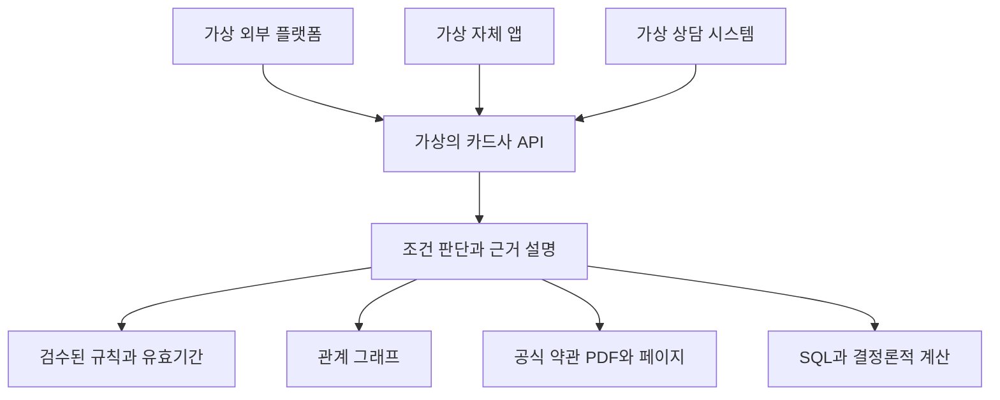

# 외부 플랫폼과 금융회사 자체 AI 엔진의 개발 명분

- 조사자: 김병주 / 도구: Codex / 조사 기준일: **2026-10-28**
- 결론: **조건부 추진(교육용 검증 관점)**. 카드사의 조건 판단 정확성 문제와 외부 채널 확대는 공식 발표상 서로 다른 목표로 확인된다. 둘을 결합한 교육용 엔진·API는 합리적인 실험 제안이다. 그러나 신한의 두 시스템이 연결되는지, GraphRAG가 다른 방식보다 나은지, 상용 차별성이 있는지는 미확인이다.
- 현행 [주제 선정 규칙](../../주제_선정_규칙.md)은 기존 카드 주제의 탈락을 확정한다. 본 보고서는 새로운 증거를 논의할 자료이며 그 결정을 변경하지 않는다. 교육 실험을 카드 주제로 채택하려면 팀과 강사님이 기준과 범위를 별도로 결정해야 한다.
- **확인 범위:** 이번 조사에서 웹의 공식 공고 본문·신한 그룹 발표·신한카드 배포 보도자료·카카오페이 공시를 직접 읽었다. 사용자 계정 로그인, 실제 카드 거래 수집, 서비스 호출·정확도 실험 및 프로그램 구현은 하지 않았다. 공식 소개의 계획은 실현 성과가 아니다. 접근·활용 가능성과 실제 데이터 전송은 별개다.

## 1. 질문에 대한 짧은 답

신한카드는 [2026-09-09 발표](https://www.shinhangroup.com/kr/archive/press/detail/966)에서 복잡한 금융상품 질문의 **조건 누락, 답변 불일치, 정보 왜곡, 정책 미반영**을 해결하고 정확성과 신뢰성을 높이기 위해 커넥셔너리와 조건을 구조화하는 AI 엔진 개발·실증에 착수한다고 밝혔다. 반면 [2026-09-13 카카오 연동 보도자료](https://press1.newswire.co.kr/newsRead.php?no=1042468)는 ChatGPT 대화에서 신한 상품과 콘텐츠를 쉽게 만나도록 **고객 접점을 확대**하겠다고 설명한다. 서로 다른 목적을 두고 별도 활동을 추진한다는 사실은 확인된다.

여기서 “외부 플랫폼에는 할 수 없어서”라는 이유, 9월 R&D 엔진을 카카오 도구가 호출한다는 사실, 동일 엔진을 다채널에 적용한다는 사실은 **공개 자료에서 확인되지 않았다**. 카카오도 자체 금융 AI를 보유·연계할 수 있고, 신한의 엔진 역시 외부 채널에 적용될 가능성은 열려 있다. 조건 엔진을 여러 채널이 API로 쓰는 것은 **이 보고서의 제안 설계**다.

## 2. 기존 자료와 새로 확인한 사실

| 선행 자료 | 이미 확인한 결과 | 이번 독립 확인과 차이 |
|---|---|---|
| [선정 규칙](../../주제_선정_규칙.md) | 기존 카드 주제 탈락 확정, 신규 영역·차별성·공식 데이터 필수 | 수정하지 않음. 교육적 검증과 상용 차별성의 평가 관점은 분리 |
| [Claude 재검토 제안](Claude_카드GraphRAG_재검토제안_20261028.md) | 9월 엔진의 복합 조건 문제와 2024 공고를 근거로 교육 목적 재검토 제안. GraphRAG 우위는 미확인 | 이번에 [9월 공식 원문](https://www.shinhangroup.com/kr/archive/press/detail/966), [창조경제혁신센터 공식 2024 공고 본문](https://ccei.creativekorea.or.kr/service/business_view.do?rownum=34&seq=9715)을 직접 확인. 공고의 Graph RAG는 소비 추천용이지 약관 그래프라고 명시하지 않음 |
| [산업적 명분](Codex_카드GraphRAG_산업적명분_자체서비스개발사례조사_20261028.md) | 2024 제3자 PDF 사본과 2025 AI-SOLa·PoC 계획을 확인, 교육 조건부·현 규칙 탈락 유지 | 이번에 공고의 발행기관 HTML 본문을 추가 확인하고, 9월 신한 엔진·카카오 연동 발표의 목적을 구분 |
| [토스 UI](Codex_토스대화형카드서비스_UI검증_20261028.md), [신한 도구 비교](Codex_신한카드ChatGPTforKakao_1to3Hop_실증검증_20261028.md) | 공개 토스 필터를 관찰했고 신한 카카오 툴의 실질 질의는 미실시 | 이번에도 신한 툴의 실제 실행·산정 정확도는 실측하지 않았다. [신한 배포 원문](https://press1.newswire.co.kr/newsRead.php?no=1042468)에서 PlayMCP 연동과 서비스 범위를 확인 |
| [데이터 차별성](Codex_카카오vs은행카드사_AI서비스_데이터차별성검증_20261028.md), [기술 검토](Codex_카드GraphRAG_기술적용타당성_20261028.md) | 외부 플랫폼도 동의·제휴 하에 일부 거래·실적을 볼 수 있고, SQL로도 그래프 질의의 답을 구현 가능. 내부 자료·우위 미검증 | 카카오페이 공시의 자체 AI와 외부 도구 협력 사례를 재확인. 데이터 독점·그래프 필수성을 주장하지 않음 |

참고: Claude 제안서는 AI-SOLa 공식 보도자료에 RAG 문구를 찾지 못했다고 적었다. 이번에 [신한카드 원문](https://www.shinhancard.com/pconts/company/html/promotion/press/1233240_3999.html) 본문을 직접 열어 **검색증강생성(RAG) 적용** 문장을 확인했다. 이는 일반 RAG이며 GraphRAG라는 뜻은 아니다. 과거 판독 차이를 서비스 성능의 증거로 확대하지 않는다.

## 3. 신한카드 사례 A: 2024 Startup TechBlaze

- [기업마당 공식 게시](https://www.bizinfo.go.kr/sii/siia/selectSIIA200Detail.do?menuId=80001001001&pblancId=PBLN_000000000102615&target=PR)를 이번에 직접 열어 2024-11-04 게시, 서울창조경제혁신센터 수행, 신한카드 데이터와 금융 특화 GenAI의 시너지 및 모집 PDF 첨부를 확인했다. PDF 다운로드 링크를 클릭했으나 웹 도구가 `(400) OK`로 처리하지 못했다. **공식 서버 첨부 파일 자체의 다운로드 성공은 미확인**이다.
- 기업마당에서 연결된 [창조경제혁신센터 공식 공고 원문](https://ccei.creativekorea.or.kr/service/business_view.do?rownum=34&seq=9715)을 직접 열었다. 카드업 특화 sLLM 개발 아래 소비 추천 항목으로 **고객·가맹점·결제내역 결합에 적합한 Graph RAG 구조 및 프롬프트 제안**을 명시한다. PoC 때 필요에 따라 상호 협의 후 신한카드 데이터를 제공할 수 있다고도 한다. 모든 지원자가 데이터 접근권을 갖는다는 의미가 아니다.
- [신한·서울센터 명의 모집 PDF의 제3자 사본](https://www.k-smbda.or.kr/shop_contents/multi_file_download.php?col_num=6&data_idx=2428511&dir_name=support&type=myboard)도 직접 열어 5쪽 중 1쪽의 동일 문구·2024-11-01 날짜를 확인했다. 사본과 공식 서버 첨부의 해시 동일성·로컬 다운로드는 미검증이다.
- 공고가 명시한 배경은 금융 특화 GenAI와 신한 데이터 역량의 시너지, PoC 검증·스타트업 발굴이다. 외부 AI만으로 해결할 수 없다고 명시하지 않았다. [신한 2025-03-19 후속 발표](https://shinhangroup.com/kr/archive/press/detail/183)는 세 기업 선정 및 최대 3개월 PoC와 실환경 적용 **계획**을 알렸으나 Graph RAG 과제 수행·완료·서비스 배포 여부는 명시하지 않는다.

## 4. 신한카드 사례 B: 2026-09-09 조건 판단 AI 엔진

[신한금융 공식 원문](https://www.shinhangroup.com/kr/archive/press/detail/966)에 따르면 신한카드는 민관공동기술사업화 R&D 3차 과제에 선정되어 **AI 엔진 개발에 착수**한다고 발표했다. 기술 개발·실증은 외부 AI 인프라 기업 **커넥셔너리와 공동**이다. ‘신한이 모든 기술을 독자 개발 완료’라고 표현하면 안 된다.

- **문제:** 확률 기반 AI 의사결정의 일관성 부족, 복합 조건 누락, 정보 왜곡과 정책·규정 미반영을 회사가 지적했다.
- **제안된 접근:** 서비스·정책·규정의 조건을 구조화해 탐색하고 카드의 전월 실적, 이용처, 한도, 업종·상황 예외, 카드 상태 등의 AND·OR·NOT 관계 및 내부 정책·규제를 고려한다는 개발 목표다. 규칙 수정으로 변경을 실시간 반영할 수 있다는 내용은 **회사 개발 목표**이지 검증된 실적이 아니다.
- **사업 목적:** 금융상품 추천에서 정확·안정적인 의사결정을 지원하고, 이후 리스크·마케팅·고객 상담으로 확장해 고객 경험과 경쟁력을 높이겠다고 회사가 명시했다. 초기 적용·향후 확장 **계획**과 운영 결과를 구분한다.
- **미공개:** Neo4j·GraphRAG 채택, 9월 카카오 도구와의 연결, 고객용/직원용 실제 배포 범위, 공통 API, 평가 수치, 출시·완료일. 엔진은 상품 추천을 우선하고 업무 확장 계획이 있으나 이미 모든 채널에서 재사용 중이라고 말할 수 없다.
- [커넥셔너리의 프로젝트 설명](https://connectionary.io/resources/in-the-media/aid-financial-decision-engine)은 자사 AID 프레임워크와 신한의 실제 상품·운영 환경을 이용한 정확성·일관성 검증 **계획**을 설명한다. [ZDNet Korea 2026-09-09](https://zdnet.co.kr/view/?no=20260909215442)는 신한 측이 신뢰할 판단 기반의 필요성을 말했다고 보도한다. 이들은 독립 성능 검증이나 GraphRAG 구현의 증거가 아니다.

## 5. 신한카드 사례 C: 2026-09 카카오 연동

[신한카드가 배포한 2026-09-13 보도자료](https://press1.newswire.co.kr/newsRead.php?no=1042468)는 ChatGPT for Kakao의 카카오 툴즈에 신한카드 툴을 추가해 **카드 추천, 인기카드 조회, 상세 혜택, 소비 인사이트·금융 콘텐츠**를 제공한다고 밝힌다. 발급 희망자는 발급 **페이지로 이동**한다. 소비 인사이트 예시는 소비 트렌드 콘텐츠이며, 개인별 승인·실적·혜택 잔액의 AI 전달을 의미하지 않는다.

이 자료는 PlayMCP 기반 도구에서 질문 의도에 맞게 신한카드 서비스를 호출한다고 명시한다. 따라서 ‘연동 도구를 통한 서비스 호출’은 확인되지만 내부 프로토콜 세부사항, 상세 API 명세, 모델·계산 주체, 상품 데이터 갱신·고객 데이터 항목·제공 동의·처리 및 보존, 9월 9일 R&D 엔진 연결은 **미확인**이다. [뉴스핌 2026-09-11](https://www.newspim.com/news/view/20260911000471)도 신한카드가 카카오툴즈 파트너로 추가됐다고 보도한다. 출시 발표와 실제 사용자의 기능 실행·정확도 검증은 구분한다.

두 발표는 각각 접점 확대와 복합 조건 처리라는 **명시된 목적**을 갖는다. 동일 회사가 양쪽 활동을 추진한다는 공존 사례다. 그러나 시스템 연계·인과관계나 ‘카카오는 판단하지 못한다’는 결론은 도출되지 않는다.

## 6. 근거가 강한 산업적 명분 3개와 반론

### ① 실제 카드사가 상품 조건 누락 문제를 연구한다

- **주장·사례:** 신한카드의 [2026-09-09 엔진 개발 발표](https://www.shinhangroup.com/kr/archive/press/detail/966)는 카드의 실적·이용처·한도·예외 조건을 구조화해 신뢰성과 일관성을 개선하려는 목적을 밝힌다.
- **입증 범위:** 카드 상품 조건 분석을 산업 문제로 제기하고 연구·개발에 착수했다는 사실. **미입증:** GraphRAG 사용, 성공률, 고객에게 출시된 엔진, 학생 프로젝트의 경쟁 우위.
- **반론:** “신한이 이미 개발하는데 왜 또 하나?” **답:** 이 제안의 목적은 시장 독점이 아니라 공개 문서와 가상 사례로 조건·근거 판단의 누락을 측정하는 교육 실험이다. 이미 있는 서비스 대비 실험 가치가 낮을 수 있으므로 기준선과 정답셋이 필요하다.

### ② 외부 접점 확대와 내부·전문 업무 기술은 공존할 수 있다

- **주장·사례:** 신한은 [카카오 툴 연동](https://press1.newswire.co.kr/newsRead.php?no=1042468)의 접점 확대와 [조건 엔진 R&D](https://www.shinhangroup.com/kr/archive/press/detail/966)의 정확성 문제를 각각 발표했다. 카카오페이는 [2026-05-14 분기보고서](https://kind.krx.co.kr/external/2026/05/14/001075/20260514002342/11013.htm)에서 ChatGPT for Kakao 기능 연결을 시작하고 자사 페이아이와 카나나의 연동·PlayMCP 데이터 활용을 **계획**했다.
- **입증 범위:** 채널과 전문 기능 개발을 병행하는 사업 활동·방향. **미입증:** 신한 엔진이 카카오에 연동되거나 공통 판단 결과를 여러 채널에서 이미 사용한다는 것.
- **반론:** “카카오도 엔진을 만들 수 있으니 차별점이 아닌가?” **답:** 맞다. 역할 분리는 가능한 설계와 교육 실험의 명분이지 경쟁 우위의 증명이 아니다. 실제 다채널 재사용 필요성과 성능을 따로 시험해야 한다.

### ③ 금융권에서 문서 검색·관계 기술을 별도로 검증한다

- **주장·사례:** [서울센터 2024 공식 공고](https://ccei.creativekorea.or.kr/service/business_view.do?rownum=34&seq=9715)는 카드업 특화 sLLM 내 소비 추천용 Graph RAG를 모집했고, [신한 AI-SOLa](https://www.shinhancard.com/pconts/company/html/promotion/press/1233240_3999.html)는 상담 정보 검색에 일반 RAG를 사용한다고 발표했다.
- **입증 범위:** 기술 검증 수요와 RAG 활용. **미입증:** 2024 Graph RAG PoC 완료 및 이번 약관 분석에 그래프가 필수라는 것.
- **반론:** “SQL이나 RAG로 똑같이 만들 수 있지 않나?” **답:** 가능하다. 정형 규칙과 원문·질의 조건을 맞춘 대조 실험에서 그래프의 추가 효과가 없으면 이를 그대로 보고해야 한다.

## 7. 여섯 가설의 확인·추론·반례

| 가설 | 실제 사례 및 확인 사실 | 기술적 이유와 미확인·반례 | 프로젝트 관계 |
|---|---|---|---|
| 1 접점과 판단 엔진은 다르다 | 신한 카카오 툴은 PlayMCP로 신한 서비스 호출, 별도 R&D는 상품 조건 구조화 목표. [툴 발표](https://press1.newswire.co.kr/newsRead.php?no=1042468), [R&D](https://www.shinhangroup.com/kr/archive/press/detail/966) | 질의 UI와 정책 평가를 분리할 수 있다는 것은 설계상 가능성. **두 신한 시스템의 연결·판단 주체 미확인**; 플랫폼이 판단 엔진을 자체 운영할 수도 있음 | 채널-엔진 분리 API를 실험 대상으로 제안 |
| 2 여러 채널에서 같은 결과를 재사용 | 카카오페이 [분기보고서](https://kind.krx.co.kr/external/2026/05/14/001075/20260514002342/11013.htm)는 기능 연결과 자체 에이전트 연동·데이터 활용 구조를 계획 | 공통 엔진의 여러 채널 이용은 **계획과 개념 수준**. 실동작·동일 규칙·중앙 관리 미확인. 채널별 규제와 입력 차이는 단일 결과를 불가능하게 할 수도 있음 | 같은 요청을 두 가상 채널에 넣고 규칙 버전·결과 일치를 시험. 산업에서 실제 그렇게 한다고 단정 금지 |
| 3 정확성과 책임 | [금융위 2026 AI 가이드라인](https://www.fsc.go.kr/po010102/87142)은 합법성·신뢰성·보안성·임직원 최종 책임 원칙 설명. [신한 2025 AI-SOLa](https://www.shinhancard.com/pconts/company/html/promotion/press/1233240_3999.html)는 오류에 상담사가 대응하도록 매뉴얼 제공 | 잘못된 금융설명은 소비자 혼란·손해 위험이라는 합리적 우려. 가이드라인은 자율규제이고 고영향 AI 등 별도 법적 의무 가능. 오류 사례·금액 손해는 이 프로젝트에서 실측하지 않음. 자체 통제와 외부 공급자 이용은 양립 가능 | 각 응답에 근거 위치·불명·검수 상태를 보존하고 잘못된 단정을 측정 |
| 4 약관·예외 변경 | 신한 R&D 발표는 정책 변경을 조건 수정으로 반영하는 것을 목표로 함. [금융위 2025-03-31](https://fsc.go.kr/no010101/84262?curPage=6&srchBeginDt=&srchCtgry=&srchEndDt=&srchKey=&srchText=)는 현행화된 금융 RAG 자료 필요성 설명 | 외부·자사 간 실제 불일치 사건, 반영 지연 빈도, 신한 중앙 규칙 저장소 운영·실시간 성과는 미확인. 별도 엔진 없이 통제된 문서·버전 관리로도 처리 가능 | 구버전·신버전의 검수된 예외 변경 시 영향 탐색 실험 |
| 5 데이터·업무 연계 | [카카오페이](https://contents.kakaopay.com/contents/2394)는 마이데이터 카드·은행 소비 연결, [카드 등록 안내](https://contents.kakaopay.com/contents/2320)는 일부 카드 실적·혜택 확인을 명시. [금결원](https://openapi.kftc.or.kr/service/openBanking)은 카드목록·청구 조회 API를 안내 | 동의·계약·표준항목에 따라 외부 접근 가능. 정산 사유 코드·잔여한도 등의 외부 제공/내부 전용 여부와 특정 AI 권한은 미확인. 특정 필드의 법적 절대 불가 목록을 만들 수 없음. 업무상 보유도 AI 처리를 자동 허용하지 않음 | 학생은 내부 거래 없이 가상 데이터를 사용; 원장 연계 정확도는 주장 불가 |
| 6 기술 통제·의존도 | [현대카드 2024 유니버스](https://newsroom.hyundaicard.com/front/board/%ED%98%84%EB%8C%80%EC%B9%B4%EB%93%9C-%EA%B8%88%EC%9C%B5%EC%97%85%EA%B3%84-%EC%B5%9C%EC%B4%88-AI-%EC%86%8C%ED%94%84%ED%8A%B8%EC%9B%A8%EC%96%B4-%EC%88%98%EC%B6%9C)는 자체 AI 개발과 외부 판매 계약·PoC를 밝힘. [금융위 2024](https://fsc.go.kr/po010102/83594?curPage=25&srchBeginDt=&srchCtgry=&srchEndDt=&srchKey=&srchText=)는 내부 오픈소스와 외부 상용 AI 병행 지원 설명 | 통제·보안·이식성·비용은 일반적 설계 가설이다. **신한이 외부 의존 축소 또는 비용 절감을 9월 엔진의 동기로 말했다는 근거는 없다.** 공동 개발 자체가 외부 솔루션 활용 반례 | 규칙 소유·버전·감사 설계와 별도로 비용·장애 성능은 측정 전 미확인 |

마이데이터와 오픈뱅킹은 구분한다. [금융결제원](https://openapi.kftc.or.kr/intro/useProcedure)은 API 신청·계약 및 일부 테스트 자격 제한을 명시한다. [금융위 마이데이터 포켓](https://www.fsc.go.kr/edu/news/84844?curPage=6&srchCtgry=&srchKey=&srchText=)은 전송요구·제3자 제공 내역의 관리·철회를 설명한다. 구체적인 재제공은 항목·목적·수신자·동의·위탁과 법령별 검토가 필요하며 일괄 금지 또는 일괄 허용이라 판단하지 않는다.

## 8. 신한 외 회사·해외 사례

| 회사 | 실제 사례 및 외부 관계 | 자체 AI/조건 엔진과 명분 | 상태·한계 |
|---|---|---|---|
| 카카오페이 | [2026 분기보고서](https://kind.krx.co.kr/external/2026/05/14/001075/20260514002342/11013.htm)는 ChatGPT for Kakao 기능 연계와 자체 Pay i·카나나 연동 및 PlayMCP 활용 계획 | 고객 경험과 결제 완결성 목표 명시; [2025 행사](https://story.kakaopay.com/342-kakaopay-fintech/)는 AI 혜택·실적 기능 시연 및 앱 이용 안내 | 외부 연계·자체 브랜드의 공존 사례. 2026 시점 실제 A2A 구조·중앙 카드 조건 엔진은 미확인 |
| KB국민카드 | [금융위 2024-12-09](https://www.fsc.go.kr/po010101/83554?curPage=26&srchBeginDt=&srchCtgry=&srchEndDt=&srchKey=&srchText=)가 카드생활 메이트 대화형 비교·발급 서비스를 지정 | 금융상품 상담·추천이라는 유사 산업 수요 | 지정이지 출시·외부 플랫폼 병행·규칙 엔진 구축 확인 아님 |
| 현대카드 | [2024-10-17 공식 발표](https://newsroom.hyundaicard.com/front/board/%ED%98%84%EB%8C%80%EC%B9%B4%EB%93%9C-%EA%B8%88%EC%9C%B5%EC%97%85%EA%B3%84-%EC%B5%9C%EC%B4%88-AI-%EC%86%8C%ED%94%84%ED%8A%B8%EC%9B%A8%EC%96%B4-%EC%88%98%EC%B6%9C)는 유니버스 자체 개발, SMCC 판매 계약 및 선행 PoC | 개인화 기술을 타 기관에 제공한 사업적 실례 | 제공은 자체 플랫폼의 외부 판매이지 외부 챗봇 접점과 조건 엔진의 동일 구조가 아님 |
| 삼성카드 | [공식 챗봇 샘](https://www.samsungcard.com/personal/customer-service/talk/UHPPCC0398M0.jsp), [이투데이 2026-02-08](https://www.etoday.co.kr/news/view/2554224)의 AI 큐레이션 운영 보도 | 상담과 혜택 추천의 유사 사례 | 외부 채널과 자체 상품판단 엔진을 같은 규칙으로 연동한 실례는 미확인 |
| 우리카드 | [AI 챗봇 답](https://m.wooricard.com/dcmw/yh1/cct/cct03/M1CCT203S11.do)이 카드 신청·조회·변경 관련 상담을 안내 | 자체 고객 상담 채널 | 생성형 AI·GraphRAG·별도 공통 엔진 및 외부 연계는 미확인 |
| 하나·롯데카드 | [하나Pay 상품 조건 변경](https://m.hanacard.co.kr/MKCDCM1010M.web?CD_PD_SEQ=18622), [롯데 LOCAi 보도](https://www.etoday.co.kr/news/view/2554224) | 하나는 자사 앱 기능, 롯데는 문서검색·큐레이션을 언론 보도 | 하나의 AI 판단 엔진·롯데의 외부 채널 공통 엔진은 미확인 |
| 토스 | [토스 카드 서비스](https://i18n.toss.im/service/card)는 소비 기반 추천과 복수 카드 비교를 설명 | 기존 경쟁 서비스의 반례 | AI 모델·그래프·외부 파트너 공통 판단 엔진 여부 및 동일 질의 실측 미확인 |
| Mastercard | [2024-02 공식 발표](https://newsroom.mastercard.com/news/press/2024/february/mastercard-supercharges-consumer-protection-with-gen-ai/)는 Decision Intelligence의 사기 판단에 생성형 AI 기법 도입을 설명. [서비스 설명](https://www.mastercard.com/global/en/business/cybersecurity-fraud-prevention/risk-decisioning/transaction-fraud-monitoring.html)은 API 통합·위험 점수 반환을 안내 | **외부 금융기관이 API로 전문 판단을 이용하는 참고 구조** | 부정거래 위험평가이며 카드 혜택 조건이나 신한의 아키텍처 증거가 아님. 서비스 설명의 기준일 당시 제공 상태·가격은 별도 확인 |

## 9. 발표용 우선 근거 8건

| 순위 / 날짜 / 기관 | 문서 제목·형식·URL | 사실 / 기업이 밝힌 이유 / 외부 관계 / 프로젝트 활용 / 수준 |
|---|---|---|
| 1 · 2026-09-09 · 신한카드 | [최적의 금융상품 추천하고 선택하는 AI 개발](https://www.shinhangroup.com/kr/archive/press/detail/966) · 그룹 공식 보도자료 | 조건 누락·왜곡을 줄이는 엔진 개발 착수, 정확·안정적 판단과 고객 경험 목표; 커넥셔너리 협력; 교육 문제 정의 근거. 카카오 연결·GraphRAG·완료 미확인. **공식 원문 직접 확인** |
| 2 · 2026-09-13 · 신한카드 | [카드사 최초 ChatGPT for Kakao 연계 AI 대화형 금융 서비스](https://press1.newswire.co.kr/newsRead.php?no=1042468) · 회사 배포 보도자료 | PlayMCP 툴·4종 기능, 고객이 원하는 채널에서 편리하게 이용하도록 접점 확대. 내부 엔진은 공개 안 됨. **배포 원문 직접 확인** |
| 3 · 2024-11-01 모집 · 신한카드·서울센터 | [2024 Startup TechBlaze 공고](https://ccei.creativekorea.or.kr/service/business_view.do?rownum=34&seq=9715) · 주관기관 공식 HTML | 고객·가맹점·결제내역 Graph RAG 구조 제안, 데이터 시너지·PoC 목적; 외부 AI의 불가능성 언급 없음. **공식 원문 직접 확인** |
| 4 · 2025-03-19 · 신한카드 | [유망 AI 스타트업과 상생 도모한다](https://shinhangroup.com/kr/archive/press/detail/183) · 그룹 공식 발표 | 3팀 선정·PoC와 실환경 적용 계획; GraphRAG 과제 완료는 미확인. **공식 원문 직접 확인** |
| 5 · 2025-01-23 · 신한카드 | [AI-SOLa 상담지원 시스템 구축](https://www.shinhancard.com/pconts/company/html/promotion/press/1233240_3999.html) · 공식 보도자료 | 사내 상담 정보 검색·RAG·상담 후속 자동화, 고객 편의 목적; 외부 모델과의 배타성·GraphRAG는 확인 안 됨. **공식 원문 직접 확인** |
| 6 · 2026-05-14 · 카카오페이 | [2026 1분기 분기보고서](https://kind.krx.co.kr/external/2026/05/14/001075/20260514002342/11013.htm) · 공식 공시 | ChatGPT for Kakao 기능 연계, 페이아이·카나나·PlayMCP 연동 계획 및 금융 경험·결제 완결성 목표; 실행 완료 여부 미확인. **공시 원문 직접 확인** |
| 7 · 2025-03-31 · 금융위원회 | [금융 특화 AI 개발의 밑거름](https://fsc.go.kr/no010101/84262?curPage=6&srchBeginDt=&srchCtgry=&srchEndDt=&srchKey=&srchText=) · 공식 정책 발표 | 현행화된 금융 RAG 자료와 평가 수요; 금융회사 대상 시범 말뭉치, 학생 접근 가능성·2026 조건 미확인. **공식 원문 직접 확인** |
| 8 · 2026-09-09 · 커넥셔너리·신한카드 | [커넥셔너리, 신한카드와 금융 의사결정 AI 엔진 개발](https://zdnet.co.kr/view/?no=20260909215442) · ZDNet Korea 기사 | AID 기술 실증 계획·신뢰할 의사결정 기반의 필요성 보도, 카카오 연결·검증 성과 없음. **언론 원문 직접 확인** |

## 10. 외부 플랫폼과 자체 엔진 비교

| 비교 | ChatGPT for Kakao·카카오페이 | 신한 자체 AI 엔진 R&D | 신한 카카오 연동 | 근거 수준 |
|---|---|---|---|---|
| 주요 목적 | 대화·플랫폼 접점; 카카오페이는 금융 경험·혜택 | 복합 조건의 정확·일관된 의사결정 목표 | 대화로 신한 상품·콘텐츠 접근 | 각 발표의 명시된 목적 |
| 고객 접점 | 카카오톡·카카오페이 | 초기 추천·상담 등 확장 계획, 구체 화면 미확인 | 카카오 대화와 발급 페이지 이동 | 공식 설명, 사용자 직접 테스트 아님 |
| 상품 조건 판단 | 카카오페이도 혜택·실적 기능 설명 | 조건 구조화·AND/OR/NOT은 개발 목표 | 추천·상세 조회 제공. 계산 주체 미확인 | [카카오페이](https://story.kakaopay.com/342-kakaopay-fintech/), 신한 두 발표 |
| 데이터 범위 | 카카오페이의 동의된 카드·은행 소비 및 일부 카드 실적; ChatGPT 데이터 공유 미확인 | 실제 신한 상품·업무 환경을 실증할 계획; 개인 거래 항목·AI 권한 미확인 | 상품과 소비 트렌드 콘텐츠 명시; 개인 승인/실적 전달 미확인 | [카카오페이](https://contents.kakaopay.com/contents/2394), [협력사](https://connectionary.io/resources/in-the-media/aid-financial-decision-engine) |
| 결과 재사용·규칙 변경 | 실제 공동 규칙·다채널 결과 일치 미확인 | 조건 변경을 반영하는 목표, 다른 채널의 재사용은 미확인 | R&D 연결 여부 미확인 | 신한 R&D 발표 |
| 정확성 검증 | 직접 측정 없음 | 개발·실증 계획, 정량 결과 미확인 | 직접 측정 없음 | 협력사 발표·본 조사 한계 |
| 업무 연계 | 카카오페이 결제 등 별도 서비스 | 리스크·상담 등 확장 계획 | 발급 페이지 링크. AI의 직접 발급 아님 | 신한 발표 |
| API·운영 책임 | Kakao Tools·PlayMCP는 명시, 내부 계약·책임 배분 미확인 | 공통 API·책임 설계 미확인 | 외부 서비스 호출 명시, 상세 인터페이스 미공개 | [신한 툴](https://press1.newswire.co.kr/newsRead.php?no=1042468) |
| 실제 구현 사례 | 플랫폼·연동 기능의 발표 존재 | **개발 착수**, 완성/운영 미확인 | 신한 툴 서비스 발표, 이번 조사 실제 UI 미검증 | 각 공식 발표 |

## 11. 채널–판단 엔진 관계도: 교육용 제안

다음은 **실제 신한 구조가 아니라** API 재사용을 평가할 수 있는 가상 아키텍처다. 외부 플랫폼 연동이나 고객 인증을 실제 구현하는 계획이 아니다.

입력에는 제품·시나리오·기준일, 출력에는 충족/미충족/불명, 규칙 버전, 조건별 원문 위치를 둔다. 여러 채널이 같은 버전·동일 입력을 사용할 때 같은 결과를 반환하는지, 변경 후 영향이 일치하는지 실험한다. 채널에 따라 권한·입력과 버전이 다르면 동일 결과를 강요하지 않는다. 실금융 API·내부 시스템·고객 데이터를 쓰지 않는다.

## 12. GraphRAG 검증: 다섯 방식과 공정 비교

| 방식 | 입력·목적 | 제한 |
|---|---|---|
| A 일반 ChatGPT | 같은 질문과 공개 문서 접근 조건을 기록해 범용 기준선 측정 | 모델·검색 시점 변동, 원문 접근 여부 기록 |
| B PDF RAG | 같은 PDF 청크·버전으로 검색·생성 | 숫자·예외의 규칙 계산을 신뢰할 수 있는지 측정 |
| C SQL + 규칙 | 동일하게 검수된 상품·혜택·조건의 정형 데이터, 계산·판정 | 규칙과 원문 위치를 SQL로도 보관할 수 있음 |
| D SQL + 규칙 + PDF RAG | C와 **동일 엔진** + 동일 PDF·출처 검색 | 그래프 없는 강한 기준선 |
| E SQL + 규칙 + GraphRAG | D와 **동일 엔진·상품·문서·정답** + 같은 사실의 관계 탐색 | 그래프 생성·검수에 든 추가 비용도 기록 |

**핵심 D–E 비교:** 시나리오와 룰을 동결하고 원문 접근·LLM·예산·컨텍스트·질의 횟수를 최대한 동일하게 설정한다. 그래프에만 정답이나 예외를 더 넣지 않는다. 조건 변경의 영향 범위를 SQL 재귀/조인도 구현하도록 해 표현 차이만 비교한다. 사전에 독립적으로 검수한 20~30개 예시 정답셋을 제안하되, 아직 구성하지 않았다. 기준은 조건 누락률 = 빠진 필요 조건 수 / 정답 필요 조건 수, 근거 정확도 = 정확한 상품·버전·쪽수를 제시한 판단 / 근거 제시 판단, 잘못된 단정률 = 정보 부족인데 단정한 사례 / 정보 부족 사례다. 함께 복합 조건 정답률·변경 영향의 재현율과 정밀도·잘못된 상품 연결·응답 시간·관계 변경 및 검수 인시를 기록한다.

그래프가 D와 같거나 더 나쁘면 그 결과를 그대로 보고한다. 그래프가 나은 경우에도 데이터 구성·정답 누출·평가 편향 및 통계적 불확실성을 확인한다. 현재 다섯 방식의 구현·시험·수치 **모두 미실시**다.

## 13. 학생 MVP와 실제 금융회사 차이

| 범위 | 검증할 수 있는 것과 한계 |
|---|---|
| 공개 데이터 | 공식 설명서의 적용·제외·시점과 문서 페이지를 수동 검수하는 실험. [KB NEED Pay](https://img2.kbcard.com/obj/card/download/09800__prdctOpmn_20260330.pdf)는 이전 조사에서 페이지 텍스트 일부를 확인했고 표 이미지·재사용 권리는 미완료. [PDF 원천 조사](Codex_카드GraphRAG_PDF원천검증_20261028.md)에서 노리2 Play 파일 다운로드는 성공했지만 혜택 페이지 추출이 불충분했다. 이번에 자료 확보 전부를 재검증한 것은 아니다. |
| 합성 데이터 | 실제 개인이 아닌 가상의 거래·실적·결제 방식과 정답으로 AND/OR/NOT, 예외·상태 변경, 불명·출처 일치 및 API 응답 일관성 시연 가능. 카드사의 실제 정산 결과 재현 주장은 금지. |
| 내부 자료가 필요 | 고객별 승인·매입·취소·실적 산정·실제 할인·미적용 사유·정산 상태의 정확한 연결 및 고객별 성능 검증. 이 팀에 대한 접근 허가 **없음**. |
| 상용화 전 추가 검증 | 원문 권리·개정 이력·표 해석, 금융사와 적법한 데이터/API 연계, 제3자 처리·보안·책임, 고객 보호, 운영 장애·갱신·경쟁 서비스 비교 및 실제 정답 대조. |

## 14. 강사님 예상 질문

1. **카카오가 있는데 왜 개발하나?** 신한은 외부 접점 확대와 조건 일관성 문제를 각각 공식 발표했다. 교육 실험은 조건·근거 판단이 별도 모듈로 재사용될 수 있는지 검증한다. 기존 카카오 제품이 같은 기능을 못 한다고 말할 수 없다.
2. **신한이 실제 엔진을 개발하나?** 2026-09-09 커넥셔너리와 개발·실증 **착수**를 발표했다. 출시·완성·GraphRAG 적용은 미확인이다.
3. **왜 카카오와 협력하나?** 신한 보도자료는 대화 채널에서 신한 서비스를 쉽게 이용하도록 접점을 확대한다고 명시한다. 그 툴과 R&D 엔진의 관계는 미확인이다.
4. **카카오와 무엇이 다른가?** 프로젝트 목표는 공개 문서 기반 가상 조건 판단과 출처·변경 영향을 평가하는 실험이다. 상용 기능 우위는 직접 비교 전 미입증이다.
5. **왜 GraphRAG인가?** 조건→예외→혜택→근거 역탐색이 후보이므로 SQL+규칙+RAG와 동등한 조건에서 비교한다. 필요하다는 결론은 미리 내리지 않는다.
6. **이미 신한이 만드는데 학생이 왜 만드나?** 실금융 시스템 복제가 아니라 문서 검수, 결정론적 판정, 근거 추적 및 대조 실험을 배우는 제한된 교육 목적이다.
7. **중복 개발 아닌가?** 실제 플랫폼이 동일 결과를 제공하면 중복일 수 있다. 채널·엔진 분리는 설계 가설이며 신한의 내부 구조는 확인되지 않았다.

## 15. 발표 문안

### 30초

“신한카드는 카카오 대화 채널을 통해 카드 정보를 제공하면서, 별도로 복잡한 상품 조건의 누락과 일관성 문제를 해결하는 AI 엔진 개발에 착수했습니다. 저희는 카카오보다 더 좋은 추천을 주장하지 않고, 공개 상품 문서와 가상 사례로 조건 판단과 근거를 다른 서비스에서도 재사용할 수 있는지 교육 목적으로 검증하려 합니다. 두 신한 시스템의 실제 연결은 확인되지 않았습니다.”

### 1분

“신한카드는 2026년 9월 카카오 툴즈에서 카드 추천과 상세 혜택을 제공하면서 고객이 원하는 채널에서 서비스를 이용하도록 접점을 확대한다고 밝혔습니다. 같은 달 별도 R&D에서는 상품의 실적, 이용처, 한도와 예외 조건이 AI 답변에서 누락되는 문제를 해결하기 위해 조건을 구조화하는 엔진을 개발한다고 발표했습니다. 이는 개발 착수 사실이며 카카오 툴과의 연결이나 완료를 뜻하지 않습니다.

저희는 이 문제를 참고해 공식 카드 문서의 조건을 검수하고 가상 거래에 적용하는 교육 실험을 제안합니다. API를 통해 여러 가상 화면에서 같은 판단 근거를 재사용할 수 있는지 살피되, 카카오의 기존 기능과 차별성이 이미 확보됐다고 주장하지 않겠습니다.”

### 2분

“금융상품은 전월 실적, 이용처, 할인 한도와 예외가 결합되기 때문에 설명에서 한 조건만 빠져도 결과가 달라질 수 있습니다. 신한카드는 2026년 9월 이런 조건 누락과 답변 일관성 문제를 지적하고 커넥셔너리와 조건을 구조화하는 AI 엔진 개발과 실증에 착수한다고 밝혔습니다. 같은 달 카카오 툴즈에는 카드 추천과 상세 혜택 서비스를 연결해 고객 접점을 넓혔습니다. 두 사례의 목적은 구분되지만 실제로 같은 엔진을 쓰는지는 공개되지 않았습니다.

2024년 신한카드와 서울창조경제혁신센터는 고객·가맹점·결제내역을 결합하는 Graph RAG 구조를 기술검증 주제로 모집했습니다. 다만 이것은 모집 사실이고 약관 조건 GraphRAG의 상용화 사례가 아닙니다. 저희는 이 산업 문제를 교육용으로 축소해 공식 상품설명서의 조건을 검수하고 가상 소비 시나리오에 대해 적용 여부와 원문 페이지를 보여주는 판단 엔진을 제안합니다. 한 엔진의 결과를 가상 앱과 상담 화면에서 재사용하는 구조도 검토할 수 있습니다.

실제 고객 데이터는 쓰지 않고 계산은 SQL과 규칙 엔진으로 처리합니다. 같은 자료와 질문에 대해 일반 ChatGPT, PDF RAG, SQL 규칙, SQL·RAG, SQL·GraphRAG를 비교해 조건 누락, 근거 정확도와 잘못된 단정을 측정하겠습니다. 그래프가 효과가 없으면 그 결과를 그대로 보고하겠습니다. 현행 팀 규칙에서는 카드 주제가 탈락 확정이므로 이 교육 목적의 별도 재검토가 필요합니다.”

## 16. 최종 추진 의견

| 항목 | 판단 |
|---|---|
| 산업적 개발 명분 | **확인:** 조건 누락과 정확성 문제를 기업이 실제 연구 과제로 제시 |
| 외부 접점과 자체 엔진의 역할 | **일부 확인:** 각 발표 목적은 다름. 두 시스템의 실제 연결·채널별 공통 엔진은 미확인 |
| 카드사 자체 개발 필요성 | **일부 확인:** 신한이 정확성·일관성 목표를 명시. 독자 개발만이 유일한 해결책이거나 외부 플랫폼이 기술적으로 못 한다는 근거는 없음 |
| 교육용 GraphRAG 가치 | **조건부:** 관계·규칙·근거·API 검증 및 대조 실험의 학습 가치. 다른 방식과 동등할 수 있음 |
| 공개 데이터 확보 | **부분 확인:** 이전 PDF 텍스트와 다운로드 사례는 있으나 표·시점·연결·이용권 전체 검증 미완료 |
| GraphRAG 실효성 | **미확인:** D 대 E 공정한 실험과 실제 정답셋 없음 |
| 카드 주제 재검토 | **조건부 추진:** 교육 목표를 기준으로 논의할 근거는 있으나, 현행 확정 탈락은 유지하고 별도 팀·강사 논의 필요 |

최우선 후속 과제는 ① 공식 상품 PDF 2건 이상의 정확한 버전·표·이용 조건 검수 ② 가상 시나리오와 독립 정답셋 구축 ③ 동일 규칙 엔진을 사용하는 D/E 및 ChatGPT·기존 서비스의 동일 질문 비교 ④ 결과·실패·수행 시간을 그대로 공개하는 것이다. **조건부 추진은 팀 규칙 통과나 상용 우위 판정이 아니다.**
