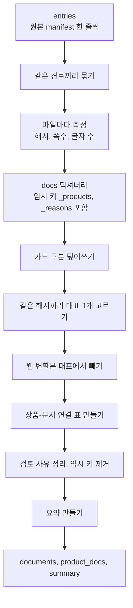
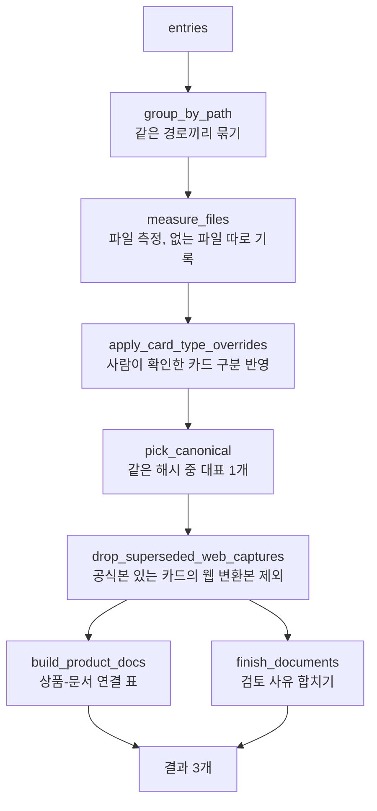

# core.py 단순화 계획 (승인용)

대상 코드: `src/card_benefit/payment_card/file_pipeline/doc_index/core.py`의 `build_index` (143줄)

**이 작업은 동작을 바꾸지 않습니다.** 코드를 나누고 이름만 쉽게 하는 작업이고, 끝나면 `documents.csv`, `product_docs.csv`가 한 글자도 바뀌지 않아야 합니다.

## 0. 머메이드가 보이는지 확인

아래 그림이 보이면 이 환경에서 머메이드가 동작하는 것입니다. 글자만 보이면 알려 주세요.

## 1. build_index가 하는 일 (지금)

한 함수가 아래 일을 처음부터 끝까지 합니다. 그래서 어디서 무엇이 바뀌는지 따라가기 어렵습니다.

문제는 두 가지입니다.
- 임시 키(`_products`, `_reasons`)를 만들었다가 마지막에 이름이 `_`로 시작하는지 보고 지웁니다. 실수하기 쉽습니다.
- 위 아홉 단계가 한 함수 안에 순서대로 들어 있어서, 한 단계를 고치려면 143줄을 다 읽어야 합니다.

## 2. 나눈 뒤 (제안)

단계마다 함수 하나로 나누고, 임시 값은 문서 딕셔너리 안이 아니라 **따로 들고 가는 작은 딕셔너리(`extra`)** 에 둡니다.

### 실제 한 건으로 따라가기

예: **카드의정석 WELFARE 계열** (우리카드)

| 단계 | 일어나는 일 |
|---|---|
| `group_by_path` | 상품 8개가 가리키는 파일 경로가 서로 다름 → 파일 8개로 시작 |
| `measure_files` | 8개 모두 해시가 같다고 확인 |
| `pick_canonical` | 8개 중 공식 수집본, 게시일 최신, 경로 순으로 1개를 `canonical=Y`로, 나머지는 `canonical=N` + `duplicate_of=대표 경로` |
| `build_product_docs` | 상품 8개 모두 같은 해시 → 연결 표 8행 모두 `relation=shared_guide` |

### 함수 일곱 개의 역할

| 함수 | 한 줄 역할 | 입력 → 출력 |
|---|---|---|
| `group_by_path` | 같은 파일을 가리키는 항목을 묶는다 | entries → {경로: [항목들]} |
| `measure_files` | 파일을 열어 해시·쪽수·글자 수를 재고 문서 한 줄씩 만든다 | 묶음 → docs, 없는 파일 목록 |
| `apply_card_type_overrides` | 사람이 정한 카드 구분을 반영하고 해당 사유를 지운다 | docs, overrides → docs |
| `pick_canonical` | 같은 해시끼리 대표 1개를 정한다 | docs → docs |
| `drop_superseded_web_captures` | 공식 설명서가 있는 카드의 웹 변환본은 대표에서 뺀다 | docs → docs |
| `build_product_docs` | 상품과 문서의 연결 행을 만든다 | entries, docs → 연결 행 |
| `finish_documents` | 검토 사유를 합쳐 최종 행을 만든다 | docs → documents 행 |

`build_index`는 이 일곱 함수를 순서대로 부르기만 하고 40줄 안팎이 됩니다. 요약(`summary`)은 별도 작은 함수 `make_summary`로 뺍니다.

## 3. 바뀌지 않는 것 / 검증

- 열 이름, 값, 파일 순서, 대표 선정 규칙, 테스트가 모두 그대로입니다.
- **완료 조건:** (1) 테스트 전부 통과, (2) 하나·우리 인덱스를 다시 만들어도 `git diff src/card_benefit/data/index`가 비어 있음.
- 조건 (2)가 안 되면 제가 틀린 것이므로 되돌립니다.

## 4. 이번에 하지 않는 것

- 표 1·2번 동작 변경(덮어쓰기의 일부 적용, 쪽별 글자 없음 열)은 별도 작업입니다.
- `cli.py`의 읽기 어려운 한 줄(`printable = ...`)은 같은 커밋에서 짧게 고칩니다. 동작은 같습니다.
- 다른 파일은 건드리지 않습니다.

## 5. 승인해 주실 것

- [ ] 위 일곱 함수로 나누는 것
- [ ] 임시 키 대신 `extra` 딕셔너리를 쓰는 것
- [ ] 완료 조건(테스트 + 빈 diff)

승인해 주시면 코드를 작성하고, 작성 후 함수별 실행 결과와 함께 다시 보여 드리겠습니다.
