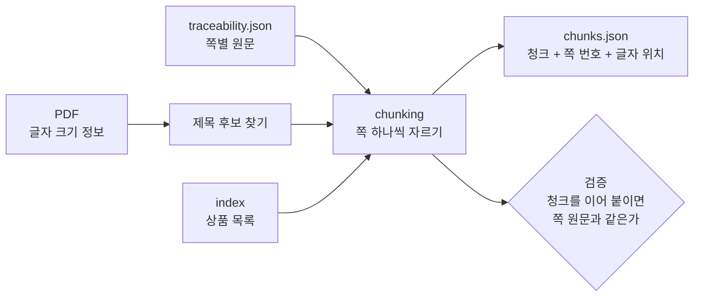
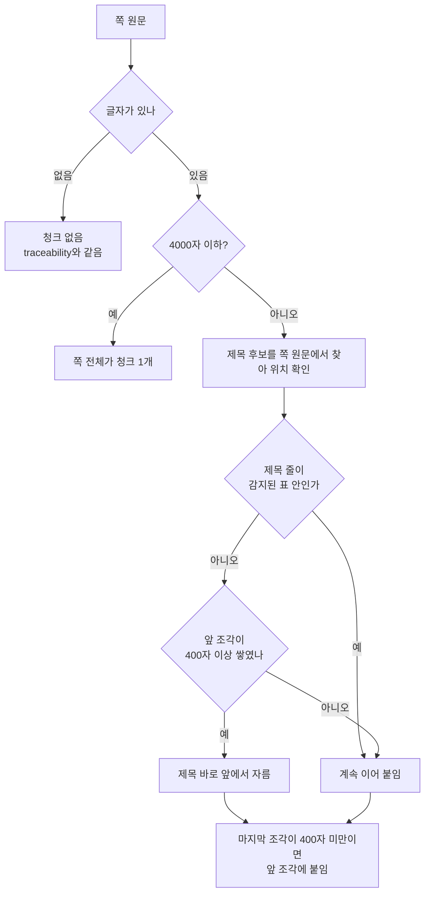

# 청킹 코드 계획 (승인용)

이 문서는 코드를 쓰기 **전** 설명서입니다. 승인해 주시면 코드를 씁니다.
기준값(4000자, 400자, 글자 크기 제목)은 `file_pipeline/notebooks/chunking_explore.ipynb`에서 이미 정했습니다.

## 1. 무엇을 만드나

3단계가 만든 **쪽별 원문**을 4단계 입력(청크)으로 자릅니다. 핵심은 청크마다 **원문의 어느 쪽 몇 번째 글자인지**를 남기는 것입니다.



## 2. 자르는 규칙



- **제목 후보**: 글자 크기가 쪽 본문 크기보다 1.5pt 이상 큰 줄.
- **위치 찾기**: 제목 글을 **traceability가 저장한 쪽 원문**에서 앞에서부터 차례로 찾습니다. 확인한 98쪽에서 제목 후보 1,587개 중 1,579개(99.5%)를 찾았고, 못 찾은 제목은 그냥 자르지 않습니다.
- **표 안에서는 자르지 않습니다.** 4000자 넘는 98쪽에서 자를 위치 270곳을 세어 보니 24곳(약 9%)이 표 추출기가 찾은 표 영역 안에 있었습니다. 제목 줄이 표 안에 있으면 그 앞에서 자르지 않고 이어 붙입니다. 표가 잘리지 않게 쪽 단위를 택한 `db_pipeline`의 이유와 같은 문제를 막기 위한 규칙입니다. 표 추출기가 놓친 표는 막지 못합니다.
- **제목이 없는 긴 쪽**은 쪼개지 않고 한 청크로 둡니다(기존 확인 결과 21개). 표 안 제목을 건너뛰면 이런 청크가 조금 늘 수 있어, 코드 후 다시 잽니다.
- 자르는 위치는 항상 제목 줄의 맨 앞이라서 **조각을 이어 붙이면 쪽 원문과 한 글자도 다르지 않습니다.** 이것이 아래 검증의 핵심입니다.

### 노트북과 다른 점 하나
노트북에서는 마지막 조각이 400자 미만이어도 그대로 두었습니다. 코드에서는 위처럼 **마지막 조각도 앞에 붙입니다.** 작은 조각이 줄어드는 쪽으로만 바뀝니다. 코드를 쓴 뒤 같은 193개 문서로 다시 재서 숫자를 보여 드립니다.

## 3. 청크 한 개의 모양

```json
{
  "chunk_id": "79faa76d9380f932-p0002-c01",
  "doc_id": "79faa76d9380f932",
  "doc_sha256": "79faa76d9380f932…(전체 64자)",
  "page_no": 2,
  "start_pos": 1,
  "end_pos": 1269,
  "heading": "주유할인 서비스",
  "text": "…쪽 원문의 1~1269번째 글자…",
  "products": [{"product_name": "카드의정석 WELFARE", "product_ids": {"product_code": "102867"}}]
}
```

- `start_pos`, `end_pos`는 `traceability.py`와 같은 규칙입니다(쪽마다 1부터, 끝 글자 포함).
- **비교 기준은 (`doc_sha256`, `page_no`, `start_pos`~`end_pos`)입니다.** `db_pipeline`도 같은 위치 규칙(쪽 원문 기준 1부터, 끝 글자 포함)을 쓰므로 청크를 어떻게 자르는지와 무관하게 결과 A·B를 같은 위치로 비교할 수 있습니다. `chunk_id`는 비교에 쓰지 않습니다.
- `doc_id`(해시 앞 16자)는 보기 편한 이름이고, 다른 쪽 결과와 맞출 때는 전체 `doc_sha256`을 씁니다.
- `doc_id`와 `products`는 인덱스에서 가져옵니다. 공유 문서는 청크 하나에 상품 목록이 모두 붙습니다.
- 표 보조본은 이번 1차에서는 청크에 붙이지 않습니다. 쪽 단위 목록(`page_tables`)으로 따로 둡니다. 표와 청크의 위치 연결은 LLM 추출 단계에서 필요해지면 합니다.

## 4. 검증 (승인 후 테스트로 고정)

1. 같은 쪽의 청크 글자를 이어 붙이면 쪽 원문과 **완전히 같다**.
2. 모든 청크에서 `쪽 원문[start_pos-1:end_pos] == text`.
3. 글자 없는 쪽은 청크가 없다.
4. 청크 id가 문서 안에서 겹치지 않는다.
5. 자른 위치가 감지된 표 영역 안에 있지 않다.

테스트는 PDF 없이 작은 가짜 쪽 데이터로 하고, 실제 데이터는 하나·우리 대표 문서 전체로 한 번 돌려 위 검증을 확인합니다.

## 5. 파일 구성 (제안)

| 파일 | 하는 일 | 크기 |
|---|---|---|
| `file_pipeline/chunking/split.py` | 쪽 원문과 제목 위치를 받아 자를 위치를 정한다. PDF를 열지 않는 순수 함수라 테스트하기 쉽다 | 약 50줄 |
| `file_pipeline/chunking/headings.py` | PDF에서 제목 후보 글을 찾아 쪽 원문 안의 위치로 바꾸고, 표 영역 안의 제목은 걸러낸다 | 약 60줄 |
| `file_pipeline/chunking/build.py` | traceability JSON + PDF + 인덱스를 읽어 청크 JSON을 쓴다 | 약 60줄 |
| `file_pipeline/chunking/cli.py` | 카드사 1곳 실행 진입점 | 약 40줄 |
| `payment_card/tests/test_file_pipeline_chunking.py` | 위 검증 5가지 | |

기존 코드(`traceability.py`, `doc_index/`)는 **수정하지 않습니다.**

## 6. 같이 알아 둘 것: OCR

- 공용 `common/document_reader`가 OCR(`ocr_engine` 인자)을 지원하고, `pyproject.toml`에는 선택 그룹 `ocr`(`rapidocr` 등)가 선언돼 있습니다. 이 환경에는 설치돼 있지 않습니다.
- OCR을 쓰려면 세 가지가 필요합니다: ① `uv sync --group ocr` (**그룹 없이 `uv sync`를 하면 OCR 패키지가 제거됩니다**), ② RapidOCR 모델 파일을 저장소 밖 폴더에 준비 (자동으로 내려받지 않음), ③ 환경 변수 `RAPIDOCR_MODEL_DIR` 설정. 설치는 승인이 필요하고, 결과는 `OCR_REVIEW` 상태로 사람이 검토하는 구조입니다.
- 이번 청킹 코드는 텍스트 PDF만 대상입니다. OCR은 청킹 시험이 끝난 뒤 별도로 정합니다.

## 7. 승인해 주실 것

- [ ] 위 규칙(4000자, 400자, 글자 크기 제목, 마지막 조각도 앞에 붙임)
- [ ] 청크의 모양과 검증 5가지(표 안에서 자르지 않음 포함)
- [ ] `file_pipeline/chunking/` 폴더에 다섯 파일을 새로 만들고 기존 코드는 수정하지 않는 것
- [ ] 표 보조본은 이번에 청크에 붙이지 않는 것
