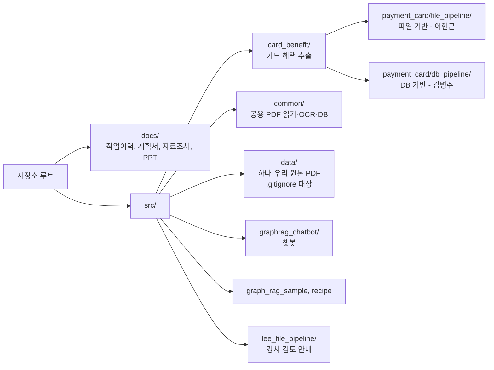
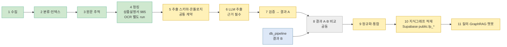
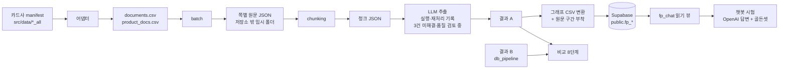

# 프로젝트 지도

프로젝트 전체를 한 장으로 보는 문서입니다. 자세한 내용은 각 링크로 갑니다. 폴더 안에서는 그 폴더의 `README.md`가 지도입니다.
작업이 끝날 때 같은 커밋에서 **2절 상태 색과 표**, **5절 열린 결정**을 확인합니다. 현황 스냅샷: 2026-11-09, laptop, `feat/file-pipeline-extraction-integrate` / `5ce52f1`. 이 확인 시 수정·미추적 경로 56개였고, 현재 브랜치는 `origin/feat/file-pipeline-extraction-integrate`보다 1커밋 앞섭니다. 저장된 로컬 `origin/main`과는 공통 조상이 없으며 원격은 새로 갱신하지 않았습니다. 마지막 관련 테스트 기록은 2026-11-08의 `509 passed, 4 subtests passed`이며, 현재 미커밋 변경 전체를 포함해 실행했는지는 확인되지 않았습니다. 단계별 데이터·적재 상태는 각 항목에 적힌 날짜와 범위를 따릅니다.

## 지금 진행할 일

아래 번호는 항목 ID이지 우선순위 순서가 아닙니다. **단기 P0는 11단계 챗봇 화면에서 CLUB1 실패 위치를 확인하는 일**이고, 기술 기반 P1은 **5단계 의미 기준 → 6단계 추출 품질 → 7단계 사람 검증** 순서입니다. 시연 질문 하나가 성공해도 5~7단계가 완료된 것은 아닙니다. 골든셋 사람 검토는 사용자 지시로 보류 중이며, 재개 신호 전까지 진행하지 않습니다. PR #8 확인과 작업 트리 반영은 별도 조건을 따릅니다.

### 코드 기준 경로와 강사 검토 시작점 (2026-11-08)

- **기준 코드:** `src/card_benefit/payment_card/file_pipeline/`. 기존 Python 패키지명과 테스트 경로를 유지한다.
- **강사 검토 시작점:** [`src/lee_file_pipeline/README.md`](../src/lee_file_pipeline/README.md). 사용자 작성 점검 코드와 검토 자료를 두며 기존 실행 코드를 복제하지 않는다.
- **폴더 구조:** 사용자 폴더의 대응 계층에 영어·한글 이름을 붙였다. `notebooks_점검노트북/`에 합성 확인 노트북이 있으며, 빈 폴더는 구현 완료가 아니다. 실제 사용자 코드는 README와 현황판에서 구분한다.
- **상태:** 중첩 폴더명을 `file_pipeline/`로 복원했고, 사용자 폴더에 강사 검토 README와 관계 근거 점검 코드를 뒀다. 기존 미커밋 코드 수정은 보존했다.
- **경계:** 골든셋 사람 검토 기록은 `docs/`에 둔다. 개인 학습 노트북은 팀 제출 대상이 아니다. 날짜가 붙은 과거 설계·발표·작업 기록의 당시 경로는 고치지 않는다.
- **검증:** 경로 복원 당시 관련 테스트 `478 passed, 4 subtests passed`; 이후 챗봇 자료·관계도 합성 검증까지 포함한 관련 테스트 `509 passed, 4 subtests passed`. 팀 main·PR은 건드리지 않았다.

기준 상태 기록: 2026-11-08, laptop 로컬 작업 트리. 브랜치 `feat/file-pipeline-extraction-integrate`, HEAD `5ce52f1`. 2026-11-09 재확인에서 작업 트리 경로는 56개였다. 기존 파이프라인 경로는 복원했으며 미커밋 변경은 유지 중이다. 저장된 로컬 참조 기준 현재 feature 브랜치는 upstream보다 1커밋 앞서고 `origin/main`과 공통 조상이 없다. 원격을 갱신하지 않아 PR #8 병합 여부와 최신 원격 상태는 미확인이다. 2절의 과거 단계별 기록은 해당 시점의 기록이다.

### P1 · 1. 로컬 변경 검토·반영 준비

- **상태:** 진행 중. 코드·테스트·노트북·관리 문서가 함께 미커밋이다.
- **브랜치:** 사용자의 2026-11-09 요청에 따라 이번 현황 문서 변경을 `feat/file-pipeline-extraction-integrate`에 커밋하고 추적 원격 브랜치로 push한다. 이 브랜치는 팀 main과 공통 조상이 확인되지 않아 팀 main 대상 PR로 직접 사용하지 않는다.
- **팀 공유 계획:** PR #8 병합 알림과 사용자 승인 후 최신 `origin/main`을 확인하고, 문서만 선별 이식하는 별도 브랜치(제안 이름: `docs/project-map-status-2026-11-09`)를 만든다. 저장된 `origin/main`에는 현재 프로젝트 지도가 없으므로 새 문서 추가 여부와 내부 링크 대상도 그때 확인한다.
- **완료된 부분:** 챗봇 충돌 방어, 추출 이어하기·저장, 그래프 입력·CSV 저장을 로컬에서 수정했다. 그래프 CSV 실패와 파일 보존은 합성 사례로 확인했다.
- **남은 일:** 주제별 diff와 호환성·팀 반영 범위를 검토한다. PR #8 병합 확인 전 팀 main에 옮기지 않는다.
- **주의:** 구형 추출 결과는 새 이어하기 검증을 통과하지 못하며, 그래프 CSV 변환은 비어 있는 출력 폴더가 필요하다. 팀 호스트에서의 실제 동작은 미확인이다.
- **최근 수정:** 파일럿 실행 시 기존 그래프 폴더가 비어 있지 않으면 모델 클라이언트를 만들기 전에 중단한다. 사전 확인 뒤 다른 프로세스가 폴더를 변경하는 경쟁 상황까지 막지는 못한다.

### 보류 · 2. 골든 기대값 사람 확인

- **상태:** 사용자의 지시로 보류. 재개 요청 전에는 사람 검토를 시작하지 않는다.
- **우선 확인 대상:** G-H-A-04, G-H-A-09, G-H-A-02, G-H-A-10, G-W-A-12, G-W-A-02, G-W-B-03, G-H-B-15.
- **재개 후 다음 행동:** 기존에 허용된 자료를 확인해 문항별 근거·판정 자료를 준비한다. final 문항은 개선에 사용하지 않는다.
- **완료 기준:** 확인 대상별 근거와 사람 판정 기록. final 점수 하락 원인은 아직 미확인이다.

### P2 · 3. 검색 관계·근거 연결

- **상태:** 합성 입력에서 중복 관계 근거를 대표 ID에 재연결하고, 제거된 자기 연결 근거를 별도 보존하도록 로컬 수정했다. 진단은 끊긴 참조와 별도 보존 건수를 보고한다. 실제 데이터와 챗봇 영향은 미확인이다.
- **결함 분석:** 대표 노드가 검색 결과에 없을 때 참조 불일치, 쉼표 구분 쪽 번호 누락, 병합 근거의 문장·쪽 대응 문제를 합성 입력으로 확인했다. [분석과 재현](../src/lee_file_pipeline/docs_작업기록/챗봇_결함_분석.md)
- **다음 행동:** 실제 입력 계약과 별도 보존 근거의 소비 방식을 확인하고, 진단 CSV에 추가된 두 열의 소비자 호환성을 검토한다. [연결 점검 코드와 현황](../src/lee_file_pipeline/STATUS.md), [합성 재현과 한계](../src/lee_file_pipeline/docs_작업기록/관계-근거-연결-검토.md)

### P2 · 4. 현황 점검 도구

- **상태:** 안전한 사용 방식 검토 필요. 기존 `hg-bottleneck` 스크립트는 미추적 파일 검사 과정에서 `.env`를 열 가능성이 있어 실행하지 않았다.
- **다음 행동:** 민감 파일·활성 결과 폴더를 읽지 않는 점검 범위를 설계한다. 자동 백그라운드 감시는 설정되지 않았다.

### 대기 · 5. PR #8과 임시 worktree

- **상태:** PR #8 병합 소식을 사용자에게서 듣기 전까지 대기. 현재 병합 여부는 미확인이다.
- **다음 행동:** 병합 알림 뒤 fetch하고 `origin/main` 기반 임시 worktree에서 임포트·단위 테스트를 확인한다. 현재 브랜치를 main에 통째로 병합하지 않는다.
- **임시 worktree:** 로컬 목록에서 본 작업 폴더 외 3개가 확인됐다. 용도와 사용 여부를 확인하고 사용자 확인을 받은 뒤 정리한다.

### P0 · 시연 질문 실제 화면 확인 (11단계)

- **현재 판정:** 사용자는 LLM 추출 이후 일부 질문에서 정확한 답을 받았다고 보고했다. 국민행복카드S2 커피 한도 답변은 한도 값이 다른 근거에 있었지만 카드 연결은 확인되지 않았다. `CLUB1카드 200 혜택 뭐야?`는 예시 질문 목록에 있지만 UI 합성 테스트는 문구 표시와 첫 번째 질문 전달만 확인한다. 사용자는 실제 화면에서 동작하지 않는다고 보고했으며, 실패 화면·실제 답변 근거·원인은 아직 확인되지 않았다.
- **다음 행동:** CLUB1 질문의 화면 입력, 분석 결과, 선택 엔티티, 검색 그래프, 답변 근거를 순서대로 확인한다. 실제 답변이 근거와 맞는지 확인되기 전에는 정상 시연 질문으로 표시하지 않는다. Travel & Family·원더 질문도 원문 위치 확인과 실제 앱 답변 확인을 구분한다.
- **완료 기준:** 질문 버튼이 표시되는 것과 별개로, 실제 답변의 핵심 주장이 해당 카드의 원문 근거에 연결되는지 확인하고 결과를 기록한다. 실패가 남으면 확인된 대체 질문을 선택하거나 시연 후보에서 제외한다.
- **코드상 확인 경로:** v2 화면은 [`app_v2.py`](../src/card_benefit/payment_card/file_pipeline/chat/ui/app_v2.py)에서 분석·탐색·답변 생성을 직접 호출한다. [`fp_chat_patch.py`](../src/card_benefit/payment_card/file_pipeline/chat/fp_chat_patch.py)의 `answer()` 경로와 화면 실행 경로를 같은 것으로 간주하지 않는다. 현재 테스트는 CLUB1 문구 표시와 첫 예시 질문 전달을 확인할 뿐 CLUB1의 실제 검색·답변 정확성을 검증하지 않는다([UI 테스트](../src/card_benefit/payment_card/tests/test_file_pipeline_chat_ui_v2.py)).
- **진단상 한계:** 현재 화면은 예외 종류만 표시하고 실패 단계·실패 시점의 그래프를 보존하지 않는다. 후보 목록·캐시 적중·시드 ID, 답변 보정 전후, 근거 조회 상태도 한 turn의 진단 자료로 함께 남지 않는다. 이 정보가 필요한 경우 최소 정보만 담는 선택형 진단 기록을 설계한다. 이 관찰 공백은 실패 원인 자체가 아니다.
- **재현 버전:** CLUB1 문구와 현재 UI 수정은 미커밋 작업 트리에 있다. `5ce52f1`만 실행해도 동일 화면이 재현된다고 가정하지 않는다. 실패 자료에는 실행한 화면 진입점과 작업 트리 기준을 함께 기록한다.
- **범위:** [5절 13번](#13-추출-표본-시연-질문-검수).

마지막 관련 테스트 기록은 2026-11-08 사용자 점검 코드와 기존 file_pipeline 관련 테스트 **509 passed, 4 subtests passed**다. 이 결과는 그때 기록된 실행 범위만 가리키며, 현재 미커밋 변경 전체를 포함했는지는 확인되지 않았다. 실제 PDF 정확성이나 팀 main 상태를 뜻하지 않는다. final 점수 하락 원인은 미확인이다. 캐시 키·스트리밍 재요청·run 분리 등은 [기존 검토 이력](작업이력/06-챗봇연결-골든셋/2026-11-07-코덱스비판검토-분석로그-DB검사-laptop.md)의 미처리 항목을 따른다.

2026-11-08 로컬 합성 재현에서 발견한 그래프 결과·청크 불일치와 저장 결과 내용 변경은 검사하도록 수정했다. 결과 내용 지문이 없는 이전 결과는 이어하기를 거부하고 보존한다. 내용 지문은 우발적 변경 감지용으로, 고의적인 수정까지 인증하지 않는다. 실제 데이터의 발생 여부는 미확인. 상세와 호환성은 [관리 기준 이력](작업이력/99-기타/2026-11-08-프로젝트현황-폴더관리-laptop.md)을 본다.

상태는 `할 일`, `진행 중`, `확인 대기`, `보류`, `완료`로 쓰고, 작업 시작·종료 시 근거와 다음 행동을 확인한다. 현황판에는 현재 판단을 간결히 두고 실행 명령과 상세 결과는 [관리 기준 이력](작업이력/99-기타/2026-11-08-프로젝트현황-폴더관리-laptop.md) 등 작업이력에 연결한다. 자동 상시 감시가 아니며, 원격·실행 결과를 확인하지 않았다면 미확인으로 남긴다.

## 기준 문서 (처음 읽는다면 여기서 시작)

| 하려는 일 | 읽을 문서 |
|---|---|
| 지금 어디까지 왔는지 | 이 지도 2절, 5절 |
| 왜 이렇게 결정했는지, 무엇이 확정이고 합의 대기인지 | [결정 기록](결정/README.md) |
| 그래프가 어떤 모양인지(노드·키·근거·한계, 팀 V7 대응) | [지식그래프 설계](설계/지식그래프.md) |
| 챗봇 품질을 어떻게 재고 현재 수치가 얼마인지 | [챗봇 품질](품질/챗봇-품질.md) |
| 적재·교체·복구·시험 실행 명령과 흔한 실수 | [그래프 런북](운영/그래프-런북.md) |
| 단계별로 어떤 명령을 실행하는지(수집부터 챗봇·평가까지, `--help` 로 확인한 인자 표) | [사용법: 작업별 명령](사용법-작업별-명령.md) |
| 날짜별 작업 기록 | [작업이력](작업이력/README.md) |

## 1. 저장소 구성

- `file_pipeline`과 `db_pipeline`은 **같은 원천 문서를 다른 방식으로 처리하는 독립 구현**이고 서로를 입력으로 쓰지 않습니다. 두 방식의 결과는 공통 계약으로 비교합니다.
- 두 폴더의 대상 문서는 같습니다(하나카드 manifest의 열과 해시 185개가 일치, 2026-11-02 직접 비교).
- 폴더 규칙: [src/card_benefit/docs/directory_structure.md](../src/card_benefit/docs/directory_structure.md)

## 2. 전체 흐름

색: 초록 = 완료, 노랑 = 진행·확인 중, 회색 = 예정, 파랑 = 상대 담당.

| 단계 | 하는 일 | 담당 | 상태 | 자세한 문서 |
|---|---|---|---|---|
| 1 수집 | 하나·우리 PDF와 manifest | 이현근 | 완료 (신용 중심, 체크는 하나만) | [우리 수집 보고서](../src/data/woori_all/collection_report.md) (로컬 파일) |
| 2 분류·인덱스 | 대표 문서 선정, 상품 연결 | 이현근 | 완료 | [작업 이력](작업이력/01-문서인덱스-청킹/2026-11-02-카드사-문서-인덱스.md) |
| 3 원문 추적 | 쪽별 원문과 위치 JSON | 이현근 | 완료 (배치 포함) | [file_pipeline README](../src/card_benefit/payment_card/file_pipeline/README.md) |
| 4 청킹 | 쪽 원문을 청크로 | 이현근 | - 2026-11-08 지도 스냅샷의 상품설명서 청크 수는 985개(하나 500·우리 485)이며 OCR run과 별도다. - 1,032개는 2026-11-03~05 후속 대표 문서 집계, 우리 OCR 117개는 2026-11-06 별도 run이다. 집계 범위가 달라 서로 더하거나 같은 집합으로 보지 않는다. - 인덱스의 OCR 필요 표시는 우리 45개(미분류 1 포함)·하나 2개다. 우리 45개 입력 중 1개를 제외한 44문서·117청크의 처리·적재 기록이 있다. 하나 2개 처리 여부는 미확인이다. - 213→206 차이와 OCR 재분류 건수(하나 2·우리 5)는 건수상 일치하지만, 개별 문서 7개를 모두 대조한 것은 아니다. | [청킹 집계와 범위](단계별-결과-요약.md#3-청킹), [인덱스 판정 근거](작업이력/01-문서인덱스-청킹/2026-11-02-카드사-문서-인덱스.md), [OCR 적재·검수 상태](#6-ocr-결과-확인) |
| 5 추출 스키마·온톨로지 | 추출 항목·관계와 근거 규칙 | 이현근 (file_pipeline v1) | - `ONTOLOGY_V1` 구조화 결과 6개 표본은 스키마 검사를 통과했다. - `Condition`·`Limit` 경계와 의미 완전성은 표본에서 미흡해 검증 미완료다. - 8단계 비교 형식·팀 공통 계약과 일부 표현 규칙도 미확정이다. - **다음:** 조건·한도·근거 해석 규칙과 비교 출력 필드를 명시한다. 필드·관계 의미 변경이 확인될 때만 v2를 검토한다. | [온톨로지 v1](작업이력/02-스키마-온톨로지/온톨로지-v1.md), [날짜별 결과 요약](단계별-결과-요약.md#4-온톨로지), [표본 검토](#2026-11-08-표본-검토) |
| 6 추출 | LLM 추출, 근거 위치 부여 | 이현근 | - 11/04 1차 실행 998/1,032 API 호출 성공, 11/06 재처리 31/34 복구 기록은 이전 실행의 수치다. - 11/08 선택 표본은 실행·스키마 6/6 성공, 의미 검토 5개 부분 통과·1개 실패, 인용 위치 모호 33건(3개 청크)이다. - 전체 품질·비용은 미확인이고, 단계 완료가 아니다. - **다음:** 고정한 5단계 기준으로 기존 표본의 누락·축약·관계·인용 오류를 분류하고, 재처리 뒤 전체 상태와 비용을 재집계한다. API 호출 성공과 의미상 추출 성공은 분리한다. | [추출 상세](#6단계--llm-추출), [표본 검토](#2026-11-08-표본-검토), [날짜별 결과 요약](단계별-결과-요약.md) |
| 7 검증 | 추출 결과 A 검증 | 이현근 | - 서브에이전트 표본 대조 6건: 부분 통과 5, 실패 1. - 사람 판정과 사전 합의된 통과 기준은 미완료다. 현재 정확성 표본 도구는 혜택이 있는 청크를 모집단으로 삼으므로 빈 결과의 누락률을 판정하지 못한다. - **다음:** 표본 모집단·판정 기준·허용 기준을 결과 확인 전에 정하고, 혜택이 있는 청크와 빈 결과를 모두 포함해 사람 원문 대조를 기록한다. 임의의 정확도 목표를 추가하지 않는다. | [검증 상세](#7단계--추출-결과-검증), [표본 검토](#2026-11-08-표본-검토), [정확성 판정 도구 한계](작업이력/04-점검/2026-11-04-7단계-정확성-표본-판정-도구-laptop.md), [시연 질문 검수](#13-추출-표본-시연-질문-검수) |
| 8 비교 | 결과 A·B를 같은 위치 기준으로 비교 | 공동 | 예정 | |
| 9~10 | 정규화·지식그래프 | 공동 | 정규화 통합은 연결되지 않았고, 그래프 적재는 2026-11-06 기록 기준이다. 현재 DB 상태는 재확인하지 않았다. | [9~11단계 상세](#911단계--정규화-그래프-챗봇) |
| 11 챗봇 | 질문 분석·탐색·답변·근거 표시 | 공동 | **P0:** CLUB1 화면 실패 보고 후 원인 미확인. 실제 답변과 카드 원문 근거 연결을 확인하기 전까지 시연 성공으로 판정하지 않는다. | [시연 질문 진단](#13-추출-표본-시연-질문-검수), [상세](#911단계--정규화-그래프-챗봇) |
| (결과 B) | `db_pipeline` (DB 기반 처리) | 김병주 | 상대 담당. 작업 중이라 이 지도에는 상태를 적지 않음 | [db_pipeline README](../src/card_benefit/payment_card/db_pipeline/README.md) |

### 6단계 — LLM 추출

**시험과 확인**

- 실행기·병렬 실행(1~16)·재시도·비용 한도·자동 검증(verify)·원커맨드(pilot-run) 구현.
- 하나카드 같은 20개 청크를 프롬프트 버전별로 5회 시범(out3~out6): 인용문 위치 실패 38→0, 모호 인용 18→13(같은 프롬프트 반복에서도 20↔67로 변동), 항목 집합 일치도 약 0.5(실행 간 변동이 큼), 스키마 위반은 모두 `Condition.kind=CHANNEL`(out7에서 CHANNEL 스키마 위반 0건(20청크 표본, 정확성 미검증)).
- 근거 인용 총수 489→294로 감소(원인 미확인, 재현율 점검 필요).
- 사람 정확성 점검은 일부(AI 보조 1~2번 청크: 일치 64/68행, 값 오류 0)만 진행.
- 데스크탑 별도 15개 표본은 추출 성공 10, 근거 483건 PDF 대조 통과, 관계 의미 10건 중 8건 맞음.
- 청킹 파일 양쪽 생성 확인(2026-11-03), 비용 실측 전

**전체 실행과 남은 일**

- 하나카드 50청크 실측(out8) 집계 완료, 비용 수치 대기
- 프롬프트에 Limit.amount 정수·Target.kind 규칙 추가
- 프롬프트 규칙 효과: out9에서 amount 위반 0, 빈 결과 19 유지
- 빈 결과 상위 8개 사람 판정: 정상 7·놓침 1(표 밀도 high 청크), 전체 실행 진행 가능
- 2026-11-04 1차 실행: 1,032청크 중 998개는 API 호출 성공 후 결과가 기록됐고 34개는 재시도 대상. 이 수치는 내용 추출 성공률이 아님.
- 1차 내용 상태: 깨끗한 성공 338, 빈 결과 325, 인용 위치 문제 335, 재시도 대상 실패 34(당시 집계).
- 2026-11-06 재처리: 34개 중 31개 복구, 3개는 `json_parse_failure`로 미해결. 재처리 뒤 전체 내용 상태는 재집계되지 않음.
- 비용은 미확인. 파일 수정 시각으로 추정한 실행 시간은 기존 결과가 섞일 수 있어 확정 수치가 아님.
- 별도 OCR run (2026-11-06 기록): 우리 117청크 추출. 비용 수치 미확인. 주 실행 1,032청크와 별도 집계다.

### 2026-11-08 표본 검토

- **실행·스키마:** 선택한 6개 청크의 LLM 호출과 구조화 결과 검사가 모두 성공했다(6/6). 이는 의미 정확도 통과를 뜻하지 않는다.
- **근거 위치:** 160개는 위치를 유일하게 확인했고, 33개는 반복 인용으로 위치가 모호해 검수 대상으로 남았다. 모호 인용은 3개 청크에서 나왔다.
- **의미 검토:** 서브에이전트의 독립 표본 대조에서 5개는 부분 통과, 1개는 실패였다. 표·구간 값 누락과 조건 축약이 발견됐다. 사용자·강사의 확정 판정이 아니며, 선택 표본이므로 전체 성능 평가로 해석하지 않는다.
- **시연 후보:** 원문 대조와 앱 검증 상태를 분리한다. CLUB1은 화면 실패 보고 후 원인 확인 대기이며, 다른 질문의 앱 검증 상태는 5절 13번을 따른다.

### 2026-11-09 코드·산출물 대조

- **확인된 계약 불일치:** [`prompt.py`](../src/card_benefit/payment_card/file_pipeline/extraction/prompt.py)는 `Condition.amount`를 허용한다고 지시하지만 [`schema.py`](../src/card_benefit/payment_card/file_pipeline/extraction/schema.py)의 Condition 고유 필드는 `text`, `kind`, `min_amount`이며 공통 필수 필드 `id`, `evidence`를 상속하고 정의되지 않은 필드를 거부한다. `Condition.amount`가 출력되면 스키마에서 거부된다. 기존 run에서 이 지시로 실패했는지는 미확인이다.
- **의미 보존 위험:** Result A 변환은 Condition·Limit·Target의 `text`를 내보내지 않는다. 단위·조건·표 연결을 비교 결과에서 보존할지 결정하기 전에 이 변환만으로 정확성을 판정하지 않는다.
- **표본 실행 블로커:** `src/card_benefit/data`에서 청크 파일 206개(하나 95·우리 111)를 확인했으나 같은 경로에서 `*.result.json`은 발견하지 못했다. 추가로 `src/card_benefit/payment_card/file_pipeline/extraction/`과 `src/lee_file_pipeline/`에서 `*.result.json`·`*.jsonl`을 찾지 못했다. 저장소 전체 또는 외부 실행 폴더에 결과가 없다는 뜻은 아니다. 기존 결과 재검수에는 대응 결과 파일이 필요하고, 새 추출에는 선정 입력·실행 계약이 필요하다. 36개는 아직 제안 규모이며 분모·층·문서 단위 개발/검증 분할은 미정이다.
- **다음 조치:** `Condition.min_amount`와 원문 보존용 `Condition.text`의 역할을 계약에 명시하고, 잘못된 `Condition.amount` 프롬프트 지시를 고친다. Result A에서 Condition·Limit·Target의 `text`를 비교에 포함할지도 결정한다. 그 뒤 대응 결과 파일을 확보해 기존 상태를 재집계하고, 사용량 기록이 있을 때만 비용을 산정한다. 기록이 없으면 비용은 미확인으로 둔다. LLM 재실행은 재집계로 부족한 사례가 특정되고 호출·비용 상한을 정한 뒤 진행한다.

**관련 이력:** [재시범 out6](작업이력/03-추출/2026-11-03-6단계-재시범out6-고유단어지침-laptop.md), [재시범 out7](작업이력/03-추출/2026-11-03-6단계-재시범out7-CHANNEL규칙효과-laptop.md), [편차 측정](작업이력/03-추출/2026-11-03-6단계-편차측정-동일프롬프트2회-laptop.md), [데스크탑 후속 기록](작업이력/03-추출/2026-11-03-6단계-요약정의-id보강-desktop.md)

### 7단계 — 추출 결과 검증

- 자동 검증 플래그(`verify`)와 결과 A 비교 형식 JSONL 초안(`result-a`)을 마련했다.
- 정확성 무작위 표본 판정 도구와 30개 판정표는 준비됐으며 사람 판정은 대기 중이다.
- 판정 도구의 현재 모집단은 혜택이 있는 청크다. 이 표본만으로 추출 결과가 비어 있는 청크의 누락률을 추정할 수 없다. 빈 결과 모집단을 별도로 표집·판정해야 한다.
- 표본 도구는 혜택이 있는 청크를 길이 구간별로 뽑는다. 카드사·OCR·표·공유 한도 균형이나 문서 단위 개발/검증 분할을 보장하지 않으므로 새 표본은 별도 선정 명세가 필요하다.
- 하나카드 30청크의 AI 판정은 값 정확도 70%, 완전성 67%, 근거 일치 90%였다. **사람 확인 결과는 아니다.**
- 과거 하나 파일럿의 [`08_표본대조_결과.md`](../src/card_benefit/payment_card/file_pipeline/extraction/pilot_hana_15299/08_표본대조_결과.md)는 사람 확인 상태가 문서 안에서 상충하고 표 셀 대응은 검수하지 않았다고 적혀 있다. 이 기록만으로 표 추출의 사람 검증 완료를 주장하지 않는다.
- 관련 이력: [오프라인 점검·결과 A 초안](작업이력/03-추출/2026-11-03-6단계-오프라인점검-결과A초안-laptop.md)

### 9~11단계 — 정규화·그래프·챗봇

**지식그래프**

- **2026-11-06 기준.** 지식그래프: 하나·우리 기존 run 2개에 OCR 추출 run(우리 이미지 문서)과 실패 청크 재처리 run 2개를 더해 Supabase `public.fp_*` 에 **노드 12,144·엣지 15,697** 적재(노드 5,748+4,561+새 run 997·321·517, 엣지 7,956+5,173+1,432·519·617로 산식 일치).
- 같은 그래프를 로컬 Neo4j(`graphrag-neo4j`, `Fp` 라벨 전용)에도 올려 도메인 노드 12,144·관계 15,697을 확인했다(사용자 Browser 확인, 근거 노드 23,970).
- 실패 청크 재처리는 34개 중 31개 복구, 3개 미해결.

**챗봇**

- 우리 읽기 뷰 `fp_chat` 와 래퍼(`chat/`)로 동작하고, 브랜드 공통 안내장 출처 표기는 옵트인(`FP_SOURCE_LABEL`, 시험 확인, 기본 꺼짐).

**평가**

- 골든셋 v2는 80문항(하나 40·우리 40)이며 dev 41문항과 final 39문항으로 나뉜다. final은 개선에 쓰지 않는다.
- dev 3회 AI 판정(`chat/eval/fact_judge.py`)은 **원본 골든 68.3~70.7%, 기대값 6문항 보정 후 32/41(78.0%)**이었다(95% 구간 63.3~88.0%).
- final은 보정 없이 한 번(3회 반복) 채점해 **53.8·61.5·61.5%(하나 37~47%, 우리 70~80%)**였다.
- 모두 **AI 판정이며 사람 확정 정답률은 SHOPPER 4개 혜택뿐**이다. 보정 후 78.0%를 일반화 성능으로 해석하지 않는다.
- dev 오답 13개 문항의 재분류(Codex 조사 후 Claude 확인): 답변 생성 3, 카드 그래프에 기대 문자열 없음 8(추출 공백 또는 골든 불일치), 평가 신뢰성 문제 2.
- 골든 기대값이 문장 조각인 문항이 dev 에 약 17개 있어 점수에 평가 오류가 섞여 있다.

**정규화**

- 엔티티 연결(`fp_entity_links`)의 안전 부분집합은 56그룹·73매핑이다. 삭제 없이 연결하며 챗봇 적용은 기본 꺼짐이다. 영향 질문은 약 2.5%로 근사 시뮬레이션했다.

**폴더**

- `file_pipeline`의 2026-11-06 정리(T·E·R·A·U, extraction 도구 15개 이동 포함)와 정본 설계는 [구조 전후와 설계](설계/폴더구조-정리-전후와-설계.md)를 참조한다(관련 테스트 391개 통과).

**화면 분기**

- `chat/panel.py`의 공개 접점 `prepare_backend()`·`render(key_prefix)`는 병합·푸시 완료, 관련 테스트 397개와 실제 질의 1건(2026-11-07) 통과, 호스트 연결은 팀원이 자기 앱으로 이식할 예정이다([탭 분기 렌더링 설계](설계/탭-분기-렌더링-설계.md)).

**팀 장부**

- 팀원 `file_pipeline` 장부 스키마(표 17~18개)는 비어 있고 사실 데이터 적재 드라이런 도구를 준비 중

**관련 이력:** [chat 폴더 정리·재채점](작업이력/06-챗봇연결-골든셋/2026-11-06-chat폴더정리-재채점-출처표기확인-laptop.md), [Neo4j 적재·README](작업이력/06-챗봇연결-골든셋/2026-11-06-PPT요구사항대조-Neo4j적재-README3개-laptop.md)

## 3. 데이터가 흐르는 길

- 인덱스 CSV는 저장소에 있습니다: `src/card_benefit/data/index/{hana,woori}/`
- 그래프 CSV(`/tmp/fp-check-*`), 시험 결과(`/tmp/fp-answer-*`), OCR 결과(`/tmp/ocr-woori2`)는 **임시 파일이며 재생성 가능**합니다. 생성·적재 절차는 [그래프 런북](운영/그래프-런북.md)에 있습니다.
- 쪽별 원문 JSON은 PDF 전체 글이 들어가서 저장소에 올리지 않고 임시 폴더에 둡니다.
- **비교 기준은 (`doc_sha256`, `page_no`, `start_pos`~`end_pos`)입니다.** 위치는 쪽 원문 기준 1부터, 끝 글자 포함이며 두 방식이 이미 같은 규칙입니다. 청크를 어떻게 자르는지는 각자 정하고 `chunk_id`는 비교에 쓰지 않습니다.

## 4. DB 사용

- **2~7단계(추출·검증)는 파일로 처리합니다. 10~11단계(그래프·챗봇)는 사용자가 관리하는 Supabase `public.fp_*` 4개 표와 읽기 뷰 `fp_chat`만 씁니다.** 팀 `db_pipeline`·`file_pipeline` 스키마에는 쓰지 않습니다.
- DB 접속 정보(`.env`)는 AI가 열지 않습니다. DB 실행은 사용자가 합니다.
- `db_pipeline`은 담당자가 작업 중이라 요청이 있을 때까지 읽거나 바꾸지 않습니다. DB 사용 규칙(스키마 분리, 쓰기 범위)은 그 작업을 재개할 때 정합니다.

## 5. 열린 결정과 승인 대기

### 1. 긴 청크 처리

- **현황:** 4000자 넘는 청크 29개는 제목이 없는 긴 쪽이다.
- **확인 결과:** 시범 6개 중 4개가 정상 추출됐고 실패 원인은 길이가 아니었다. 표본이 작아 확정할 수 없다.
- **다음 행동:** 전체 실행 결과를 보고 문단 규칙 추가 여부를 결정한다.
- **상태:** 전체 실행 후 확인 필요.

### 2. DB 쪽 공동 합의

- **대상:** `db_pipeline` 합의 질문, 8단계 비교의 추출 스키마 매핑, 공통 상품 마스터 위치, 개발용 DB와 계정, 팀 장부와 그래프의 장기 소유·연결 계약.
- **상태:** 보류. 요청 시 재개한다.

### 3. 그래프 저장소와 소유권

- **시험 저장소:** Supabase `public.fp_*` 4개 표와 읽기 뷰 `fp_chat`. OCR·실패 청크 재처리 run을 포함한 노드 12,144개·엣지 15,697개 적재를 작업이력에 기록했다.
- **Neo4j:** 같은 도메인 그래프를 로컬 Neo4j에서 확인했으며, Neo4j는 시각화용이다.
- **현재 진행 방향:** GraphRAG용 별도 읽기 그래프로 유지하고 승인 사실은 팀 장부가 소유하도록 한다. 사용자 지시에 따른 방향이며 팀 전체 합의는 아니다.
- **남은 결정:** 팀 장부 통합과 필드 매핑 합의.
- **확인 범위:** 기존 문서 갱신에서 DB에 직접 접속하지 않았다.
- **근거:** [결정 기록](결정/README.md) D1, [그래프 런북](운영/그래프-런북.md).
- **상태:** 별도 읽기 그래프 유지, 팀 통합 합의 대기.

### 4. 팀 스키마와 적재 계약

- **결정할 내용:** 팀원 `file_pipeline` 스키마(`card_extr_stg` 등) 사용 계획, DDL 기준(V6/V7), `card_common*` 컬럼 계약, 우리 추출 결과의 적재 주체와 문서 ID 발급.
- **상태:** 팀원 답변 대기.

### 5. 화면 탭 분기

- **결정할 내용:** 호스트와 함수 이름(`prepare_backend`, `render`), 최상위 모듈 이름 충돌(`rag`·`llm`·`ui`), `llm` 교체.
- **근거:** [탭 분기 설계](설계/탭-분기-렌더링-설계.md) 10절에 이유와 재현을 기록했다.
- **상태:** 팀원 답변 대기.

### 6. OCR 결과 확인

- **인덱스 범위:** OCR 필요 표시 우리 45개(상품 안내서 25, 공통 브랜드 서비스 19, 미분류 1), 하나 2개. 이 표시는 모두 이미지라고 직접 확인한 결과가 아니다.
- **적재 기록:** 우리 문서 44개·117청크 추출분을 그래프에 적재했다.
- **추출 결과:** 깨끗한 성공 47/117(40.2%), 인용 위치 문제 42, 빈 결과 27, 재시도 실패 1로 기록됐다. 사람의 숫자·혜택 정확성 검수는 제한적이다.
- **위치 기준:** PDF 텍스트가 아닌 OCR 추적 텍스트 기준이다.
- **남은 일:** 교차검증과 미해결 추출 청크 검토.
- **상태:** 추출 결과에 대한 사람의 숫자·혜택 정확성 검수는 제한적이며, 사용자가 남은 교차검증을 확인할 때까지 대기.

### 7. 반복 인용문 위치

- **현재 정책:** 같은 문구가 청크에 여러 번 나오면 위치를 null로 둔다. 데스크탑 기준을 채택했고 노트북에도 병합했다.
- **남은 결정:** 8단계에서 위치 없는 근거를 대조하는 방법.
- **상태:** 8단계에서 결정.

### 8. 체크카드·약관 범위

- **확인된 범위:** 하나 약관 3개와 우리 체크카드 상품설명서 7개는 텍스트 PDF지만 추출·청킹에서 빠져 있다. 장부 드라이런으로 확인했으며 제외 결정 기록은 없다.
- **추가 범위:** 하나 체크카드 70개는 인덱싱 가능하며, 우리는 수집부터 필요하다.
- **상태:** 범위 미정.

### 9. 검토 대상 문서와 현행본

- **검토 대상:** 25건. 우리 23건(이미지 PDF 21건, `카드의정석2` g1New, `AK 우리카드`), 하나 2건(웹 변환본만 있는 카드).
- **현행본 선택:** `스타트래블우리카드`와 `카드의정석2`의 g1/g1New 선택이 필요하다.
- **상태:** OCR·현행본 선택 후 정리 대기.

### 10. 골든 기대값 사람 확인

- **상태 구분:** 아래 문항·판정 기준은 보류를 해제할 때 참고할 준비 정보다. 현재 검토를 진행하라는 뜻이 아니다.
- **확인 대상:** dev 오답 13개와 정답 표본 약 12개를 PDF와 대조한다. 기대값이 문장 조각인 문항을 포함하며, 특히 G-W-A-02·G-H-A-10·G-W-B-03·G-H-B-15를 확인한다.
- **준비 상태:** 지정 8문항을 분류했지만 이는 이전 이력의 미확정 가설이다. 저장소에서 실제 질문·기대값 8행과 원문 근거 위치를 확인하지 못해 페이지 단위 대조 전이다. [검토 준비 기록](작업이력/06-챗봇연결-골든셋/2026-11-08-골든기대값-사람확인준비-laptop.md)
- **점수 표현:** 확인 전에는 78.0%와 53.8~61.5% 모두 AI 판정으로만 말한다.
- **미확인 원인:** final이 dev보다 낮은 이유, 특히 하나 37~47%의 원인이 골든 결함·추출 공백·dev에 맞춘 조정 중 무엇인지 모른다.
- **상태:** 사용자 지시로 보류. 재개 요청 전까지 골든셋 원문 대조를 진행하지 않는다.

### 11. 이후 성능 개선 방향

- **제안 순서:** 사용자가 골든 검토를 재개한 뒤 기대값을 원문 대조한다. 그 결과를 확인한 다음 카드 시드·hops 고정, 조건·한도 묶음 렌더링의 우선순위를 다시 결정한다.
- **기준:** 특정 문항에 맞춘 하드코딩은 하지 않는다.
- **제안서:** `~/pilot_work/eval-assets/golden-improve-proposal.md`.
- **상태:** 골든셋 보류에 종속. 재개 요청 후 계획을 다시 확인한다.

### 12. 기타 후속 기능

- **내용:** 쪽별 글자 없음 열 추가, 덮어쓰기 부분 적용 경고.
- **상태:** 기능 변경이므로 별도로 다룬다.

### 13. 추출 표본 시연 질문 검수

- **원문 근거 확인 후보:** “Travel & Family 바우처에서 선택할 수 있는 항목은 무엇인가요?” 추출 결과의 네 선택 항목을 3페이지 원문과 대조했고, 각 근거 위치는 유일하게 확인됐다. 이 질문은 선택 항목 목록만 답한다. 첫해 제공 시기, 미사용분 소멸·이월, 기존 선택 유지·변경 조건은 답변에 포함하지 않는다. 실제 앱 답변의 독립 확인 상태는 별도 기록이 필요하다.
- **원문 근거 확인 후보:** “원더 서비스는 어떤 결제에서 제공되나요?” 3페이지에서 신용 결제 한정 근거를 유일하게 확인했다. 할인율·금액·신청 조건 전반이나 별도 서비스 내용을 답변에 섞지 않는다. 실제 앱 답변의 독립 확인 상태는 별도 기록이 필요하다.
- **현재 UI 질문 카드:** v2 코드에는 위 두 질문, SHOPPER 해외 호텔 질문, “CLUB1카드 200 혜택 뭐야?”가 있다. UI 테스트는 버튼 표시와 질문 전달을 확인하며, 실제 답변 정확성을 확인하지 않는다. 사용자는 CLUB1 질문을 화면에서 시험한 뒤 동작하지 않는다고 보고했다. 실패 화면과 검색 근거가 없어 원인은 미확인이다.
- **다음 확인 순서:** 실제 화면에서 질문 입력 → 분석된 엔티티 → 탐색 그래프의 `Card --OFFERS--> Benefit` 및 한도 연결 → 답변에 사용한 근거를 확인한다. 화면은 `analyze`·`explore`·`generate_stream`을 직접 호출하므로 래퍼의 `answer()` 로그만으로 화면 경로를 판정하지 않는다. 답변이 원문에 연결되는지 확인되기 전에는 시연 성공으로 판정하지 않는다.
- **국민행복카드S2 커피 한도 테스트(사용자 제공):** 분석에서 카드명과 한도 설명이 선택됐고 그래프 탐색은 1-hop, 노드 17개·엣지 16개였다. 답변은 한도 숫자가 다른 근거에는 있으나 카드와 연결된 정보는 없다고 했다. 그래프는 비어 있지 않지만 이 수치만으로 `Card→Benefit→Limit` 경로 유무를 알 수 없다. “커피 혜택” 엔티티가 선택 엔티티에 포함되지 않은 점도 관찰됐다.
- **사용자 테스트 보고:** 이전에 일부 질문이 정확히 답했다고 보고됐지만 CLUB1 실패 보고와는 별개다. 질문별 답변과 근거를 각각 확인한다.
- **주의:** 이 저장소에서 실행한 표본 LLM 결과는 `/tmp`에 저장했으며 그래프에 적재하지 않았다. 따라서 사용자가 관찰한 개선이 해당 표본 실행 때문이라고 단정하지 않는다. 추출 뒤 그래프 적재·갱신 여부를 확인해야 한다.
- **다음 진단 자료:** 개발자 모드의 근거 그래프에서 카드·혜택·한도 노드의 유형·이름과 연결 엣지 종류를 확인한다. `Card --OFFERS--> Benefit --HAS_LIMIT--> Limit`가 없으면 추출/적재 문제를, 그래프에는 있으나 검색 subgraph에 없으면 검색 문제를 우선 조사한다.
- **완료 기준:** 실제 화면 답변의 핵심 주장이 원문과 맞고 근거가 해당 주장에 연결되는지 확인한다. 누락·모호한 근거가 답변에 섞이면 후보에서 제외하거나 미확인으로 표시한다.

## 6. 이 지도를 읽는 법 (AI와 사람)

1. 2절 흐름도로 지금 위치를 본다.
2. 5절에서 막힌 것과 승인 대기를 본다.
3. 하려는 일에 맞는 기준 문서(위 "기준 문서" 표)를 읽는다. 폴더 안에서는 그 폴더 `README.md`가 지도다.
4. AI 도구는 작업 시작 전에 `src/AGENTS.md`(작업 범위), `CLAUDE.local.md`(작업이력 규칙; 개인용), 이 지도 순서로 읽는다.
5. 작업이 끝나면 날짜별 이력을 남기고, 결과가 재현 가능하고 설계에 영향을 주면 같은 커밋에서 기준 문서(결정·설계·품질·런북)로 승격한다.
