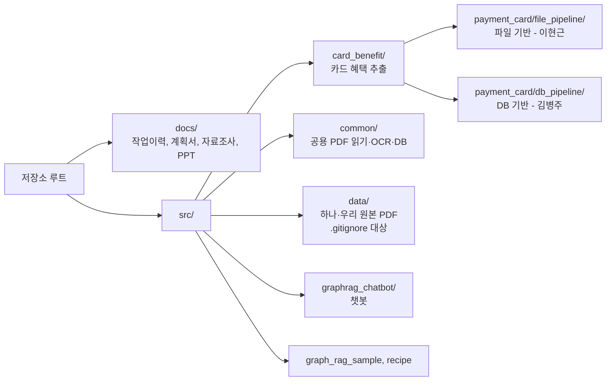
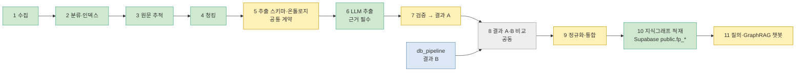
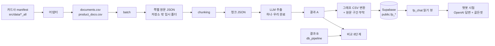

# 프로젝트 지도

프로젝트 전체를 한 장으로 보는 문서입니다. 자세한 내용은 각 링크로 갑니다. 폴더 안에서는 그 폴더의 `README.md`가 지도입니다.
작업이 끝날 때 같은 커밋에서 **2절 상태 색과 표**, **5절 열린 결정**을 갱신합니다. 마지막 갱신: 2026-11-06 (file_pipeline 폴더 정리 T·E·R·A 반영, Supabase 그래프 12,144노드·15,697엣지 적재 기록, 로컬 Neo4j 시각화 확인, 별도 GraphRAG 읽기 그래프 유지 방향 반영)

## 기준 문서 (처음 읽는다면 여기서 시작)

| 하려는 일 | 읽을 문서 |
|---|---|
| 지금 어디까지 왔는지 | 이 지도 2절, 5절 |
| 왜 이렇게 결정했는지, 무엇이 확정이고 합의 대기인지 | [결정 기록](결정/README.md) |
| 그래프가 어떤 모양인지(노드·키·근거·한계, 팀 V7 대응) | [지식그래프 설계](설계/지식그래프.md) |
| 챗봇 품질을 어떻게 재고 현재 수치가 얼마인지 | [챗봇 품질](품질/챗봇-품질.md) |
| 적재·교체·복구·시험 실행 명령과 흔한 실수 | [그래프 런북](운영/그래프-런북.md) |
| 단계별로 어떤 명령을 실행하는지(수집부터 챗봇·평가까지, `--help` 로 확인한 인자 표) | [사용법: 작업별 명령](사용법-작업별-명령.md) |
| 날짜별 작업 기록 | [작업이력](작업이력/README.md) |

## 1. 저장소 구성

- `file_pipeline`과 `db_pipeline`은 **같은 원천 문서를 다른 방식으로 처리하는 독립 구현**이고 서로를 입력으로 쓰지 않습니다. 두 방식의 결과는 공통 계약으로 비교합니다.
- 두 폴더의 대상 문서는 같습니다(하나카드 manifest의 열과 해시 185개가 일치, 2026-11-02 직접 비교).
- 폴더 규칙: [src/card_benefit/docs/directory_structure.md](../src/card_benefit/docs/directory_structure.md)

## 2. 전체 흐름

색: 초록 = 완료, 회색 = 예정, 파랑 = 상대 담당.

| 단계 | 하는 일 | 담당 | 상태 | 자세한 문서 |
|---|---|---|---|---|
| 1 수집 | 하나·우리 PDF와 manifest | 이현근 | 완료 (신용 중심, 체크는 하나만) | [우리 수집 보고서](../src/data/woori_all/collection_report.md) (로컬 파일) |
| 2 분류·인덱스 | 대표 문서 선정, 상품 연결 | 이현근 | 완료 | [작업 이력](작업이력/01-문서인덱스-청킹/2026-11-02-카드사-문서-인덱스.md) |
| 3 원문 추적 | 쪽별 원문과 위치 JSON | 이현근 | 완료 (배치 포함) | [file_pipeline README](../src/card_benefit/payment_card/file_pipeline/README.md) |
| 4 청킹 | 쪽 원문을 청크로 | 이현근 | 완료 (213개 문서, 검증 불일치 0건) | [청킹 계획](작업이력/01-문서인덱스-청킹/chunking-계획.md) |
| 5 추출 스키마·온톨로지 | 뽑을 항목과 관계 (file_pipeline v1 초안: 온톨로지, 인용문 위치 변환) | 이현근 (v1). 8단계에서 DB 쪽과 맞춤 | 초안 (2026-11-03). 테스트 17개 통과 | [온톨로지 v1](작업이력/02-스키마-온톨로지/온톨로지-v1.md) |
| 6 추출 | LLM 추출, 근거 위치 부여 | 이현근 | 실행기·병렬 실행(1~16)·재시도·비용 한도·자동 검증(verify)·원커맨드(pilot-run) 구현. 하나카드 같은 20개 청크를 프롬프트 버전별로 5회 시범(out3~out6): 인용문 위치 실패 38→0, 모호 인용 18→13(같은 프롬프트 반복에서도 20↔67로 변동), 항목 집합 일치도 약 0.5(실행 간 변동이 큼), 스키마 위반은 모두 `Condition.kind=CHANNEL`(out7에서 CHANNEL 스키마 위반 0건(20청크 표본, 정확성 미검증)). 근거 인용 총수 489→294로 감소(원인 미확인, 재현율 점검 필요). 사람 정확성 점검은 일부(AI 보조 1~2번 청크: 일치 64/68행, 값 오류 0)만 진행. 데스크탑 별도 15개 표본은 추출 성공 10, 근거 483건 PDF 대조 통과, 관계 의미 10건 중 8건 맞음. 청킹 파일 양쪽 생성 확인(2026-11-03), 비용 실측 전 | [재시범 out6](작업이력/03-추출/2026-11-03-6단계-재시범out6-고유단어지침-laptop.md), [재시범 out7](작업이력/03-추출/2026-11-03-6단계-재시범out7-CHANNEL규칙효과-laptop.md), [편차 측정](작업이력/03-추출/2026-11-03-6단계-편차측정-동일프롬프트2회-laptop.md), [데스크탑 후속 기록](작업이력/03-추출/2026-11-03-6단계-요약정의-id보강-desktop.md) | 하나카드 50청크 실측(out8) 집계 완료, 비용 수치 대기; 프롬프트에 Limit.amount 정수·Target.kind 규칙 추가; 프롬프트 규칙 효과: out9에서 amount 위반 0, 빈 결과 19 유지; 빈 결과 상위 8개 사람 판정: 정상 7·놓침 1(표 밀도 high 청크), 전체 실행 진행 가능; 하나카드 543청크·우리카드 489청크 전체 실행 완료(성공 998/1,032), 후속 재처리 34개 중 31개 복구·3개 미해결; OCR 117청크 추출 완료, 비용 수치 대기)
| 7 검증 | 추출 결과 A 검증 | 이현근 | 일부 시작: 자동 검증 플래그(verify)와 결과 A 비교 형식 JSONL 초안(result-a). 사람 정확성 점검은 대기. 정확성 무작위 표본 판정 도구와 30개 판정표 준비(판정 대기) 하나카드 30청크 AI 판정(사람 확인 아님): 값 정확도 70%, 완전성 67%, 근거 일치 90%. | [오프라인 점검·결과 A 초안](작업이력/03-추출/2026-11-03-6단계-오프라인점검-결과A초안-laptop.md) |
| 8 비교 | 결과 A·B를 같은 위치 기준으로 비교 | 공동 | 예정 | |
| 9~11 | 정규화, 지식그래프, 챗봇 | 공동 | **2026-11-06 기준.** 지식그래프: 하나·우리 기존 run 2개에 OCR 추출 run(우리 이미지 문서)과 실패 청크 재처리 run 2개를 더해 Supabase `public.fp_*` 에 **노드 12,144·엣지 15,697** 적재(노드 5,748+4,561+새 run 997·321·517, 엣지 7,956+5,173+1,432·519·617로 산식 일치). 같은 그래프를 로컬 Neo4j(`graphrag-neo4j`, `Fp` 라벨 전용)에도 올려 도메인 노드 12,144·관계 15,697을 확인했다(사용자 Browser 확인, 근거 노드 23,970). 실패 청크 재처리는 34개 중 31개 복구, 3개 미해결. 챗봇: 우리 읽기 뷰 `fp_chat` 와 래퍼(`chat/`)로 동작하고, 브랜드 공통 안내장 출처 표기는 옵트인(`FP_SOURCE_LABEL`, 시험 확인, 기본 꺼짐). 평가: 골든셋 v2 80문항(하나 40·우리 40; dev 41·final 39, final 은 개선에 쓰지 않음). dev 3회 AI 판정(`chat/eval/fact_judge.py`) **원본 골든 68.3~70.7%, 기대값 6문항 보정 후 32/41(78.0%)**(95% 구간 63.3~88.0%). final 은 보정 없이 한 번(3회 반복) 채점해 **53.8·61.5·61.5%(하나 37~47%, 우리 70~80%)**. 모두 **AI 판정이며 사람 확정 정답률은 SHOPPER 4개 혜택뿐**이다. dev 오답 13개 문항의 재분류(Codex 조사 후 Claude 확인): 답변 생성 3, 카드 그래프에 기대 문자열 없음 8(추출 공백 또는 골든 불일치), 평가 신뢰성 문제 2. 골든 기대값이 문장 조각인 문항이 dev 에 약 17개 있어 점수에 평가 오류가 섞여 있다. 정규화: 엔티티 연결(`fp_entity_links`, 안전 부분집합 56그룹·73매핑, 삭제 없이 연결, 챗봇 적용은 기본 꺼짐; 영향 질문 약 2.5% 근사 시뮬레이션). 폴더: `file_pipeline`의 2026-11-06 정리(T·E·R·A·U; extraction 도구 15개 이동 포함)와 정본 설계는 [구조 전후와 설계](설계/폴더구조-정리-전후와-설계.md)를 참조한다(관련 테스트 391개 통과). 화면 분기: `chat/panel.py`의 공개 접점 `prepare_backend()`·`render(key_prefix)`는 병합·푸시 완료, 관련 테스트 397개와 실제 질의 1건(2026-11-07) 통과, 호스트 연결은 팀원이 자기 앱으로 이식할 예정이다([탭 분기 렌더링 설계](설계/탭-분기-렌더링-설계.md)). 팀원 `file_pipeline` 장부 스키마(표 17~18개)는 비어 있고 사실 데이터 적재 드라이런 도구를 준비 중 | [chat 폴더 정리·재채점](작업이력/06-챗봇연결-골든셋/2026-11-06-chat폴더정리-재채점-출처표기확인-laptop.md), [Neo4j 적재·README](작업이력/06-챗봇연결-골든셋/2026-11-06-PPT요구사항대조-Neo4j적재-README3개-laptop.md) |
| (결과 B) | `db_pipeline` (DB 기반 처리) | 김병주 | 상대 담당. 작업 중이라 이 지도에는 상태를 적지 않음 | [db_pipeline README](../src/card_benefit/payment_card/db_pipeline/README.md) |

## 3. 데이터가 흐르는 길

- 인덱스 CSV는 저장소에 있습니다: `src/card_benefit/data/index/{hana,woori}/`
- 그래프 CSV(`/tmp/fp-check-*`), 시험 결과(`/tmp/fp-answer-*`), OCR 결과(`/tmp/ocr-woori2`)는 **임시 파일이며 재생성 가능**합니다. 생성·적재 절차는 [그래프 런북](운영/그래프-런북.md)에 있습니다.
- 쪽별 원문 JSON은 PDF 전체 글이 들어가서 저장소에 올리지 않고 임시 폴더에 둡니다.
- **비교 기준은 (`doc_sha256`, `page_no`, `start_pos`~`end_pos`)입니다.** 위치는 쪽 원문 기준 1부터, 끝 글자 포함이며 두 방식이 이미 같은 규칙입니다. 청크를 어떻게 자르는지는 각자 정하고 `chunk_id`는 비교에 쓰지 않습니다.

## 4. DB 사용

- **2~7단계(추출·검증)는 파일로 처리합니다. 10~11단계(그래프·챗봇)는 사용자가 관리하는 Supabase `public.fp_*` 4개 표와 읽기 뷰 `fp_chat`만 씁니다.** 팀 `db_pipeline`·`file_pipeline` 스키마에는 쓰지 않습니다.
- DB 접속 정보(`.env`)는 AI가 열지 않습니다. DB 실행은 사용자가 합니다.
- `db_pipeline`은 담당자가 작업 중이라 요청이 있을 때까지 읽거나 바꾸지 않습니다. DB 사용 규칙(스키마 분리, 쓰기 범위)은 그 작업을 재개할 때 정합니다.

## 5. 열린 결정과 승인 대기

| 구분 | 내용 | 상태 |
|---|---|---|
| 확인 필요 | 4000자 넘는 청크 29개(제목이 없는 긴 쪽). 시범 6개 중 4개가 정상 추출되었고 실패 원인은 길이가 아니었음(표본이 작아 확정 아님). 전체 실행 결과를 보고 문단 규칙 추가 여부 결정 | 전체 실행 후 |
| 보류 (DB 쪽) | `db_pipeline` 합의 질문, 8단계 비교 때 추출 스키마 매핑, 공통 상품 마스터 위치, 개발용 DB와 계정, 팀 장부와 그래프의 장기 소유·연결 계약 | 요청 시 재개 |
| 그래프 저장소 | **현재 시험 저장소 확정:** Supabase `public.fp_*`(4표)와 읽기 뷰 `fp_chat`. OCR·실패 청크 재처리 run을 포함해 노드 12,144·엣지 15,697 적재를 작업이력에 기록. 같은 도메인 그래프를 로컬 Neo4j에서 확인했으며 Neo4j는 시각화용이다. **현재 진행 방향:** GraphRAG용 별도 읽기 그래프로 유지하고 승인 사실은 팀 장부가 소유하도록 한다. 팀 장부 통합과 필드 매핑은 합의 대기이며, 이는 사용자 지시에 따른 현재 방향이지 팀 전체 합의는 아니다. 이번 문서 갱신에서 DB에 직접 접속하지 않음. 이유와 대안은 [결정 기록](결정/README.md) D1, 적재·교체 절차는 [그래프 런북](운영/그래프-런북.md) | 별도 GraphRAG 읽기 그래프 유지; 팀 통합 합의 대기 |
| 결정 필요 | 팀원 `file_pipeline` 스키마(`card_extr_stg` 등) 사용 계획과 DDL 기준(V6/V7), `card_common*` 컬럼 계약, 우리 추출 결과 적재 주체·문서 ID 발급 | 팀원 답 대기 |
| 결정 필요 | 화면 탭 분기: 호스트와 함수 이름(`prepare_backend`, `render`), 최상위 모듈 이름 충돌(`rag`·`llm`·`ui`), `llm` 교체 합의. 이유와 재현은 [탭 분기 설계](설계/탭-분기-렌더링-설계.md) 10절 | 팀원 답 대기 |
| 결정 필요 | OCR: 이미지 문서는 인덱스 기준 우리 45개(126쪽; 상품 안내서 25, 공통 브랜드 서비스 19, 미분류 1), 하나 2개. 우리 문서는 44개·117청크 추출분이 그래프에 적재됐다. 추출은 깨끗한 성공 47/117(40.2%), 인용 위치 문제 42, 빈 결과 27, 재시도 실패 1로 기록돼 있고, 사람의 숫자·혜택 정확성 검수는 제한적이다. OCR 위치는 PDF 텍스트가 아닌 OCR 추적 텍스트 기준이다. 교차검증과 미해결 추출 청크 검토가 남았다. | 사용자 확인 대기 |
| 결정 필요 | 반복 인용문(같은 문구가 청크에 여러 번)은 위치를 null로 두는 정책 채택(데스크탑 기준, 노트북도 병합). 8단계에서 위치 없는 근거의 대조 방법 결정 필요 | 8단계 |
| 결정 필요 | 체크카드·약관 범위. 하나 약관 3개와 우리 체크카드 상품설명서 7개는 텍스트 PDF인데 추출·청킹에서 빠져 있고(장부 드라이런으로 확인), 제외 결정 기록은 없음. 하나 체크카드 70개 인덱싱 가능, 우리는 수집부터 | 미정 |
| 정리 대기 | 검토 대상 25건: 우리 23건(이미지 PDF 21, `카드의정석2` g1New, `AK 우리카드`), 하나 2건(웹 변환본만 있는 카드). g1/g1New 현행본 선택이 필요한 상품은 `스타트래블우리카드`와 `카드의정석2` | OCR·현행본 선택 후 |
| 결정 필요 | 골든셋 dev 오답 13개와 정답 표본 약 12개를 사람이 PDF 로 확인(기대값이 문장 조각인 문항 포함, 특히 G-W-A-02·G-H-A-10·G-W-B-03·G-H-B-15). 확인 전에는 78.0%·53.8~61.5% 모두 AI 판정으로만 말한다. final 이 dev 보다 낮은 이유(특히 하나 37~47%)는 아직 모름: 골든 결함, 추출 공백, dev 에 맞춘 조정 중 무엇인지 미확인 | 사용자 확인 대기 |
| 결정 필요 | 이후 성능 개선 방향: 골든 수정·사람 확인을 먼저 하고, 그다음 카드 시드·hops 고정, 조건·한도 묶음 렌더링 순(제안서 `~/pilot_work/eval-assets/golden-improve-proposal.md`). 특정 문항에 맞춘 하드코딩은 하지 않는다 | 승인 대기 |
| 후속 | 쪽별 글자 없음 열 추가, 덮어쓰기 부분 적용 경고 | 기능 변경이라 별도 |

## 6. 이 지도를 읽는 법 (AI와 사람)

1. 2절 흐름도로 지금 위치를 본다.
2. 5절에서 막힌 것과 승인 대기를 본다.
3. 하려는 일에 맞는 기준 문서(위 "기준 문서" 표)를 읽는다. 폴더 안에서는 그 폴더 `README.md`가 지도다.
4. AI 도구는 작업 시작 전에 `src/AGENTS.md`(작업 범위), `CLAUDE.local.md`(작업이력 규칙; 개인용), 이 지도 순서로 읽는다.
5. 작업이 끝나면 날짜별 이력을 남기고, 결과가 재현 가능하고 설계에 영향을 주면 같은 커밋에서 기준 문서(결정·설계·품질·런북)로 승격한다.
