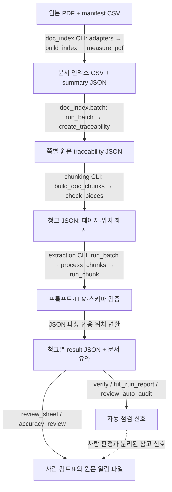

# 작업 기록 01~04와 코드 연결 조사

> 범위: 문서 인덱스·청킹, 스키마·온톨로지, LLM 추출, 점검  
> 조사 방식: 저장소와 작업 기록을 정적으로 읽어 대조. 코드·노트북·테스트 실행, API·LLM 호출, DB 접속, 패키지 설치는 하지 않음.

## 접근 경로와 사실 구분

두 지정 경로 모두 읽을 수 있었다.

- 작업 기록: `C:\Users\Lee\Downloads\공유파일\작업이력` (현재 세션 경로: `/mnt/c/Users/Lee/Downloads/공유파일/작업이력`)
- 코드 저장소: `\\wsl.localhost\Ubuntu-24.04\home\lee\workspace\mle-02-p2-team3`

본문에서는 근거를 다음처럼 나눈다.

- **코드 확인:** 저장소의 현재 코드와 문서에서 확인한 사실
- **작업 기록:** 지정된 01~04 작업 기록에 적힌 당시 실행·판정·수치. 현재 결과 파일을 재검증했다는 뜻은 아님
- **추정·미확인:** 기록과 코드만으로 확정할 수 없는 내용

## 1. 프로젝트 구조

저장소에는 카드 혜택 프로젝트 외에도 공통 DB 접근 코드, GraphRAG 예제, 레시피 샘플이 함께 있다. 최상위 주요 경로는 `src/`, `docs/`, `pyproject.toml`, `uv.lock`, `run_offline_tests.py`다. `src/`에는 `card_benefit`, `common`, `graph_rag_sample`, `graphrag_chatbot`, `recipe`, `data`가 있다.

이번 조사 대상 코드는 `src/card_benefit/payment_card/file_pipeline/`에 있다.

| 경로 | 역할 |
|---|---|
| `src/card_benefit/payment_card/file_pipeline/doc_index/` | 카드사별 manifest 변환, 문서 인덱스와 상품-문서 연결 |
| `src/card_benefit/payment_card/file_pipeline/traceability.py` | PDF에서 쪽별 원문과 추적 메타데이터 생성 |
| `src/card_benefit/payment_card/file_pipeline/chunking/` | 페이지 원문을 위치 정보가 있는 청크로 분할 |
| `src/card_benefit/payment_card/file_pipeline/extraction/` | 추출 스키마·프롬프트·LLM 실행·저장·점검 |
| `src/card_benefit/payment_card/file_pipeline/notebooks/` | 보조 점검·탐색 노트북 |
| `src/card_benefit/payment_card/tests/` | file_pipeline 단위 테스트 |
| `src/card_benefit/data/index/{hana,woori}/` | 인덱스 산출물 |
| `src/card_benefit/data/chunks/{hana,woori}/` | 청크 JSON 산출물 |
| `src/data/{hana,woori}_all/` | 코드가 기대하는 카드사 PDF 및 manifest 경로 |

Python 환경은 `pyproject.toml`에서 Python 3.12 이상과 `uv`를 사용하도록 지정한다. 이 파이프라인은 저장소 루트에서 `PYTHONPATH=src:src/card_benefit`와 `python -m payment_card.file_pipeline...` 형식으로 실행하도록 [file_pipeline README 실행 절](src/card_benefit/payment_card/file_pipeline/README.md#5-실행-방법)에 적혀 있다.

### 문서 간 상태 차이

상위 [card_benefit README](src/card_benefit/README.md)는 PDF 파싱·LLM 추출·검증이 아직 미구현이라고 적지만, 하위 [file_pipeline README](src/card_benefit/payment_card/file_pipeline/README.md)와 실제 모듈에는 인덱스·청킹·추출·점검 코드가 있다. 이 문서는 작업 범위에 가까운 하위 README와 코드 구조를 기준으로 설명한다. 하위 README도 7단계 검증 및 Result A를 예정 또는 초안으로 표시한다.

## 2. 01번 기록: 문서 인덱스와 청킹

### manifest와 PDF에서 인덱스까지

**코드 확인:** 원본 입력은 `src/data/{hana,woori}_all/manifest.csv`와 해당 경로의 PDF다. 카드사별 열 차이는 어댑터에서 공통 항목으로 바꾼다.

- [hana.py `load_entries`](src/card_benefit/payment_card/file_pipeline/doc_index/adapters/hana.py#L32): 하나 manifest의 한글 열을 공통 항목으로 변환하고 문서 종류·출처를 분류한다. `debit/` 경로는 제외한다.
- [woori.py `load_entries`](src/card_benefit/payment_card/file_pipeline/doc_index/adapters/woori.py#L41): 우리 manifest의 영문 열을 변환한다. `g1`, `g1New` 등 슬롯을 문서 역할로 바꾸고, 세미콜론으로 묶인 상품명·코드를 분리한다.
- [measure.py `measure_pdf`](src/card_benefit/payment_card/file_pipeline/doc_index/measure.py#L9): PDF 바이트의 SHA-256, 쪽수, 추출 글자 수를 측정한다.
- [core.py `build_index`](src/card_benefit/payment_card/file_pipeline/doc_index/core.py#L231): 공통 인덱스 규칙을 묶는다. 대표 문서는 해시별로 정하고 상품-문서 관계도 만든다.
- [cli.py `run`, `main`](src/card_benefit/payment_card/file_pipeline/doc_index/cli.py#L47): 처리 흐름을 호출하고 결과를 쓴다.

인덱스 CLI의 기본 산출 위치는 `src/card_benefit/data/index/{issuer}/`다. `doc_index/cli.py`가 `documents.csv`, `product_docs.csv`, `summary.json`을 만든다.

| 산출물 | 핵심 필드·내용 | 다음 단계 사용 |
|---|---|---|
| `documents.csv` | `doc_id`, 전체 `sha256`, `file_path`, `canonical`, `ocr_needed`, `needs_review`, `review_reason` 등 | 대표 문서 선택, PDF 경로·해시 확인 |
| `product_docs.csv` | 상품명·상품 ID, `doc_id`, 파일 경로, 관계 유형 | 청크 문서에 연결 상품 정보 구성 |
| `summary.json` | 파일·OCR·검토·미분류·대표 선정 오류 통계 | 인덱스 결과 요약 |

열 정의는 [doc_index/schema.py](src/card_benefit/payment_card/file_pipeline/doc_index/schema.py#L3)에 있다. CSV는 UTF-8 BOM으로 저장된다.

### 검토 표시

- **OCR 필요:** `measure_pdf`가 페이지당 추출 글자 수를 계산하고, [core.py `measure_files`](src/card_benefit/payment_card/file_pipeline/doc_index/core.py#L51)가 페이지당 평균이 50자보다 적으면 `ocr_needed=Y`로 표시한다. 이는 문서 단위 휴리스틱이다.
- **상품명 확인:** 어댑터가 manifest의 자동 확인 실패를 검토 사유에 넣는다. [core.py `apply_review_decisions`](src/card_benefit/payment_card/file_pipeline/doc_index/core.py#L100)는 `review_decisions.csv`의 `name_ok=Y`일 때 해당 사유를 제거한다.
- **문서 종류:** 카드사별 adapter 규칙으로 `product_guide`, `web_capture`, `brand_service`, `terms` 등을 분류한다. 분류 불가 문서는 `unclassified` 검토 사유가 붙는다.
- **사람 확인 결과:** `card_type_overrides.csv`는 카드 종류를 보정하고, `review_decisions.csv`의 `content_image=Y`는 `ocr_needed=Y`로 표시한다. 두 파일은 인덱스 CLI가 읽는다.

작업 기록에는 OCR 도구를 설치하지 않고 먼저 검토 표시만 하기로 한 내용과 사람 확인 결과를 결정 파일에 반영한 사례가 있다. 기록에 있는 건수는 당시 실행 결과이며 이 조사에서 재실행해 확인한 값은 아니다.

### PDF → 쪽별 원문 → 청크

1. [doc_index/batch.py `select_documents`, `run_batch`](src/card_benefit/payment_card/file_pipeline/doc_index/batch.py#L24)는 `documents.csv`에서 대표 문서와 허용 역할·카드 종류를 고른다. OCR 필요 문서는 건너뛴다.
2. [traceability.py `create_traceability`](src/card_benefit/payment_card/file_pipeline/traceability.py#L14)는 PDF를 읽고 쪽별 텍스트와 품질 정보를 만든다. 인덱스의 SHA-256 및 쪽수와 대조한다. PDF 텍스트는 [common/document_reader.py `DocumentReader`](src/common/document_reader.py#L90)에서 읽는다.
3. traceability JSON에는 문서 전체 SHA-256, 쪽별 `text`와 `text_sha256`, 페이지 번호, 빈 페이지 상태가 들어간다. 텍스트가 있는 페이지의 임시 페이지 청크는 `start_pos=1`, `end_pos=len(text)`다.
4. [chunking/cli.py `run`](src/card_benefit/payment_card/file_pipeline/chunking/cli.py#L39)는 인덱스와 traceability JSON을 읽고 제목 감지를 위해 원본 PDF도 연다.
5. [chunking/build.py `build_doc_chunks`, `build_page_chunks`, `check_pieces`](src/card_benefit/payment_card/file_pipeline/chunking/build.py#L8)는 페이지를 청크로 만든다. [chunking/split.py `split_page`](src/card_benefit/payment_card/file_pipeline/chunking/split.py#L10)는 4,000자 이하는 페이지당 한 청크, 긴 페이지는 제목 경계 분할, 400자 최소 조각 규칙을 적용한다. 제목 감지는 [chunking/headings.py `find_heading_offsets`](src/card_benefit/payment_card/file_pipeline/chunking/headings.py#L36)가 담당한다.

청크 JSON은 `{doc_id}.chunks.json`이며 문서 해시와 상품 목록, 청크마다 `chunk_id`, `page_no`, `start_pos`, `end_pos`, `heading`, `text`를 담는다. 위치는 페이지 텍스트 기준 1부터 시작하고 끝 위치를 포함한다.

청크를 이어 붙여 페이지 원문과 대조하는 검사는 `check_pieces`다. [test_file_pipeline_chunking.py](src/card_benefit/payment_card/tests/test_file_pipeline_chunking.py#L27)의 긴 페이지 재구성, 79~94행의 위치·불일치 테스트가 관련 범위를 검증하도록 작성돼 있다. 테스트는 이 조사에서 실행하지 않았다.

### 실행 순서

`doc_index.cli.main` → adapter `load_entries` → `core.build_index` → `measure_pdf` → CSV·요약 저장 → `doc_index.batch.run_batch` → `traceability.create_traceability` → `chunking.cli.run` → `build_doc_chunks` → `check_pieces` → 청크 JSON 저장.

## 3. 02번 기록: 스키마와 온톨로지

실제 추출 계약은 [extraction/schema.py](src/card_benefit/payment_card/file_pipeline/extraction/schema.py#L13)의 Pydantic 모델이다.

| 종류 | 표현되는 주요 필드 |
|---|---|
| `Benefit` | 이름, 방식(`DISCOUNT`·`CASHBACK`·`POINT`), 원문 표기율·금액 |
| `Condition` | 텍스트, 유형(`SPEND_REQ`, `EXCLUDE`, `USAGE`, `PAYMENT`, `MERCHANT`, `OTHER`), 원 단위 `min_amount` |
| `Limit` | 텍스트, 기간(`TXN`, `DAY`, `MONTH`, `YEAR`, `UNKNOWN`), `amount`, `unlimited`, `shared` |
| `Target` | 텍스트, 유형(`MERCHANT`, `INDUSTRY`, `CHANNEL`, `SERVICE`, `OTHER`) |

각 엔티티와 관계는 한 개 이상의 `evidence` 인용문을 가져야 한다. 관계는 `HAS_CONDITION`, `HAS_LIMIT`, `APPLIES_TO`, `EXCLUDES`, `MUTUALLY_EXCLUSIVE`이며, `ALLOWED_RELATIONS`가 허용되는 출발·도착 엔티티 유형을 제한한다. 스키마 검증은 중복 ID, 없는 ID, 자기 자신 연결, 엔티티 유형이 맞지 않는 관계를 거부한다.

[prompt.py `build_prompt`](src/card_benefit/payment_card/file_pipeline/extraction/prompt.py#L133)는 스키마에서 필드와 enum을 읽어 프롬프트를 만든다. 작업 기록에 언급된 다음 규칙은 실제 프롬프트에도 확인된다.

- 엔티티별 ID 형식과 유일성, 관계 endpoint ID 재사용
- 혜택에 직접 붙은 한도 연결, 여러 혜택이 공유하는 한도와 `shared=true`
- 품목 택1은 여러 Target, 할인·적립 택1은 `method=None`과 Condition으로 표현
- 전월 실적 제외 목록은 `Condition(kind=EXCLUDE)` 하나로 보존
- 명확한 제외 가맹점·업종만 `EXCLUDES`로 표현
- 표에서 라벨과 값이 분리된 불확실한 연결은 추정하지 않음
- 위치 숫자는 LLM 출력에서 받지 않고 실행기에서 계산

### ID·인용문·위치의 연결

`Relation.source`·`target`은 같은 추출 객체에 있는 엔티티 ID를 참조한다. 각 evidence의 `text`는 인용문이다. [runner.py `run_chunk`](src/card_benefit/payment_card/file_pipeline/extraction/runner.py#L19)는 LLM 응답을 JSON으로 파싱하고 `Extraction.model_validate`로 검사한 뒤, [evidence.py `locate_quote`](src/card_benefit/payment_card/file_pipeline/extraction/evidence.py#L35)로 인용문을 청크 원문에서 찾는다. 유일하게 찾은 경우에만 `doc_sha256`, `page_no`, `start_pos`, `end_pos`를 연결한다. 누락·중복 인용은 위치를 `null`로 두고 각각 실패·모호 상태를 기록한다.

### 세 가지 스키마의 관계

| 스키마 | 위치 | 목적 | 추출기와 연결 |
|---|---|---|---|
| 추출 스키마 | `extraction/schema.py` | LLM 응답 검증 | **직접 연결**: `runner.py`가 Pydantic 검증 |
| 그래프 스키마 | `graph/schema.sql` | `public.fp_*` 노드·엣지·근거 DB 설계 | 추출 결과 CSV 내보내기와 별도 후속 단계. SQL 자동 실행은 아님 |
| 참고 명세 | `sql/card_benefit_schema.sql` | 문서·페이지·청크·AI 실행/호출·상품·검토 등을 담는 PostgreSQL 참고안 | 현재 file_pipeline 실행 코드는 JSON을 사용하며 SQL을 자동 적용하지 않음 |

02번 기록에는 `public.pf_*` 그래프안과 `file_pipeline.card_*` 참고 명세의 통합 방향, 테이블 접두사, RLS, 상품 마스터 소유권 등이 **팀 결정 대기**로 남아 있다. 2026-11-03 별도 기록은 `pf_*` SQL을 Supabase에서 실행해 테이블과 RLS를 확인했다고 적지만, 이번 조사에서는 DB에 접속하지 않아 현 상태를 확인하지 않았다.

작업 기록에 있던 값·라벨 분리 한도 규칙 보류는 현재 프롬프트에서 “확정되지 않은 연결은 추정하지 말라”는 방식으로 반영되어 있다. 규칙이 팀 차원에서 최종 승인됐는지는 **미확인**이다.

## 4. 03번 기록: LLM 추출

실행 진입점은 [extraction/cli.py `main`](src/card_benefit/payment_card/file_pipeline/extraction/cli.py#L104)이며 `select`, `estimate`, `summarize`, `run`, `verify` 등을 제공한다. 하위 README의 실행 예시는 [여기](src/card_benefit/payment_card/file_pipeline/README.md#5-실행-방법)에 있다. 기본 `run`은 드라이런이고 `--execute`가 있어야 실제 호출 코드로 진입한다.

### 호출 순서

1. CLI가 청크 JSON(`*.chunks.json`)과 선택 청크 ID를 읽는다.
2. 예상 프롬프트 토큰이 기본 한도 200,000을 넘으면 `--allow-large`가 없을 때 멈춘다.
3. `--execute`일 때 `create_llm_call`을 만들고 `run_batch`에 넘긴다.
4. `batch.run_batch`가 이어하기 결과를 검사하고 새 호출이 필요한 청크를 모은다.
5. `parallel.process_chunks`가 제한된 동시 실행과 재시도·오류 중단을 관리한다.
6. `runner.run_chunk` → `prompt.build_prompt` → LLM 응답 → JSON 파싱 → Pydantic 스키마 검증 → evidence 위치 확인 순으로 실행한다.
7. 결과를 청크별 `{chunk_id}.result.json`, 문서별 `{doc_id}.summary.json`에 쓴다. 결과 폴더는 저장소 밖이어야 한다.

LLM 호출 어댑터는 [llm_adapter.py `create_llm_call`](src/card_benefit/payment_card/file_pipeline/extraction/llm_adapter.py#L51)이다. `langchain_openai.ChatOpenAI`를 지연 import하고 `client.invoke(prompt)`를 호출한다.

### 설정과 실패 구분

| 항목 | 현재 코드 | 작업 기록의 예 |
|---|---|---|
| 모델 | 기본 모델 없음. 실제 실행에 `--model` 필요 | 전체 실행에 `gpt-6-luna` 사용 기록 |
| 동시 실행 | 기본 1, 최대 16 | 전체 실행 workers 8 기록, 20청크 시범은 1 |
| 재시도 | 기본 2회. 재시도 가능한 오류만 지수 대기 후 재시도 | 20청크 작업은 retries 0 기록 |
| 이어하기 | `run_batch` 기본 `resume=True`; 유효 결과 재사용, 호출 실패는 다시 시도 | 중단 후 같은 결과 폴더를 사용했다는 기록 |
| fail-fast | 기본 활성화. 같은 재시도 불가 오류 코드가 연속 3개면 새 청크 제출 중단 | 실제 과거 결과 폴더는 이번에 열지 않음 |
| temperature | 선택 인자. 미지정이면 SDK 기본값 | 모델별 설정 관련 작업 기록 있음 |

오류는 `json_parse_failure`, `schema_validation_failure`, `llm_call_failure`, `empty_result`, `quote_location_failure`, `quote_location_ambiguous` 등으로 구분된다. `empty_result`는 JSON과 스키마 검증은 됐지만 엔티티가 없는 경우다. 인용 위치 실패·모호는 추출값을 유지하면서 위치 상태를 표시한다.

작업 기록은 하나카드 543청크, 우리카드 489청크 등 전체 실행 수치와 그룹별 항목·위치·스키마 위반 통계를 보고한다. **이 수치는 작업 기록에만 확인된다.** 이번 조사에서 과거 `/tmp`·`~/pilot_work/` 결과를 열지 않았으므로 재집계하지 않았다. 작업 기록에 하나카드 보고서는 결과 파일을 열지 않은 사용자 제공 값이라고 명시돼 있고, 우리카드 기록은 당시 `/tmp` 보고서를 읽었다고 적혀 있다. 둘 다 이 문서에서 코드 실행으로 재검증한 수치는 아니다.

현재 [full_run_report.py `build_report`](src/card_benefit/payment_card/file_pipeline/extraction/report/full_run_report.py#L65)는 청크 수·성공·실패·빈/부분 결과·오류 코드·위치 근거·스키마 경로·그룹별 항목과 근거 수·길이 구간을 집계한다. `partial`의 정의는 이 보고서와 [batch.py `_summarize`](src/card_benefit/payment_card/file_pipeline/extraction/batch.py#L176)에서 다르므로 두 도구의 부분 결과 수치를 그대로 비교하면 안 된다.

## 5. 04번 기록: 자동 점검과 사람 판정

| 도구 | 입력·처리 | 출력 |
|---|---|---|
| [review_sheet.py `generate_review_sheet`](src/card_benefit/payment_card/file_pipeline/extraction/review_sheet.py#L102) | 결과 JSON + 청크 JSON에서 대조 대상 추출 | 원문과 추출 근거가 포함된 Markdown 표. 저장소 밖 출력 |
| [review_auto_audit.py `audit_review_sheet`](src/card_benefit/payment_card/file_pipeline/extraction/review_auto_audit.py#L189) | 판정표 + 청크 + traceability, 선택적으로 PDF·결과 JSON. 위치·인용·숫자·관계 구조 점검 | 원문 없는 기계 점검 JSON |
| [verify.py `verify_results`](src/card_benefit/payment_card/file_pipeline/extraction/verify.py#L50) | 저장 결과 + 청크 JSON의 숫자·단위·연결·위치 상태 신호 | 청크별 verify JSON과 집계 |
| [accuracy_review.py `prepare`, `tally`](src/card_benefit/payment_card/file_pipeline/extraction/accuracy_review.py#L195) | 결과 + 청크에서 길이 구간별 표본 생성, 사람이 표를 채운 뒤 판정 집계 | Markdown 판정표, 원문 열람 텍스트, 정밀도 집계 |
| [review_tally.py `tally`](src/card_benefit/payment_card/file_pipeline/extraction/review_tally.py#L39) | 사람이 표시한 Markdown 판정표 | 청크·섹션별 집계 JSON |

자동 점검은 의미상 정답을 확정하지 않는다. 숫자나 인용 위치가 맞는지, 관계 ID와 허용 endpoint 유형이 맞는지 같은 기계적 신호를 검사한다. 혜택 누락, 문맥상 숫자 귀속, 표의 열 대응, 관계의 의미는 사람 검토가 필요하다. `review_auto_audit`도 결과에 `semantic_correctness_verified: False`를 기록한다.

사람 verdict와 자동 플래그는 별도 정보다. 자동 플래그가 없다고 사람의 확인 없이 정확한 것으로 처리하지 않는다. 작업 기록의 과거 대조 결과와 표본 판정은 기록에만 확인되며, 현재 외부 판정표 상태는 이 조사에서 확인하지 않았다.

관련 테스트 파일은 [test_file_pipeline_extraction_review_auto_audit.py](src/card_benefit/payment_card/tests/test_file_pipeline_extraction_review_auto_audit.py), [test_file_pipeline_extraction_accuracy_review.py](src/card_benefit/payment_card/tests/test_file_pipeline_extraction_accuracy_review.py), [test_file_pipeline_extraction_parallel_verify.py](src/card_benefit/payment_card/tests/test_file_pipeline_extraction_parallel_verify.py)다. 테스트 범위를 읽었으며 실행하지 않았다.

## 6. 데이터 흐름

| 화살표 | 전달 데이터·출력 | 연결 상태 |
|---|---|---|
| PDF·manifest → 인덱스 | PDF·CSV → 문서 CSV, 상품-문서 CSV, 요약 JSON | **코드로 연결 확인** |
| 인덱스 → 쪽별 원문 | CSV 경로·해시 → PDF → traceability JSON | **코드로 연결 확인** |
| 쪽별 원문 → 청크 | 페이지 텍스트 → 위치가 있는 청크 JSON | **코드로 연결 확인** |
| 청크 → LLM 추출 | 청크 JSON → 프롬프트·검증된 추출 객체 | **코드로 연결 확인**. 실제 호출은 이번 조사에서 실행 안 함 |
| 추출 → 결과 | JSON 객체·오류·evidence 위치 → result JSON 및 summary JSON | **코드로 연결 확인** |
| 결과 → 자동 점검 | 결과 JSON과 청크, 일부 도구는 trace·PDF·판정표 | **코드로 연결 확인** |
| 자동 신호 → 사람 판정 | 자동 후보와 사람 verdict는 별도 관리 | **자동 승인 연결은 없음** |
| Result A → 상대 파이프라인 공통 형식 | JSONL 초안 출력 가능 | **상대 형식 정렬 여부 미확인** |

## 7. 확인 상태 요약

| 항목 | 상태 |
|---|---|
| 인덱스와 상품-문서 연결 생성 | **현재 코드로 연결 확인** |
| PDF → 페이지 원문 → 위치 청크 | **현재 코드로 연결 확인** |
| 청크 → 프롬프트 → 스키마 검증 → 추출 JSON | **현재 코드로 연결 확인** |
| 결과 JSON → 자동 점검 도구 | **현재 코드로 연결 확인** |
| 대조표 생성 → 사람 verdict 집계 | **현재 코드로 연결 확인** |
| 과거 전체 실행 수치와 모델 결과 | **작업 기록에만 있음**. 이번에 결과 폴더를 열지 않음 |
| 과거 사람 판정표의 현재 상태 | **작업 기록에만 있음 / 현재 상태 미확인** |
| 참고 DDL과 실행 추출 스키마의 동기화 | **자동 연결 없음** |
| 노트북의 최근 실행 여부와 사용 빈도 | **사용 여부 미확인** |
| `doc_index/tables.py`의 파이프라인 사용 | README는 호출되지 않는다고 설명. 현재 사용 여부 미확인 |
| Result A와 비교 대상 파이프라인의 공통 계약 | **아직 연결 여부 미확인** |

## 8. 발표용 2분 설명문

“이 프로젝트의 01~04번 작업은 카드 상품 PDF를 나중에 검증할 수 있는 데이터로 바꾸는 과정입니다. 먼저 카드사마다 다른 manifest를 어댑터로 공통 형식으로 바꾸고, PDF의 해시와 페이지 수를 재서 문서 인덱스와 상품-문서 연결표를 만듭니다. 상품명이나 이미지 여부를 사람이 확인한 결과도 인덱스에 반영합니다.

그다음 대표 PDF에서 페이지별 원문을 추출하고, 긴 페이지는 제목 기준으로 청크를 만듭니다. 각 청크에는 문서 해시, 페이지 번호, 원문 안의 시작·끝 위치를 저장합니다. 코드에는 청크를 다시 붙였을 때 페이지 원문과 일치하는지 확인하는 검사도 있습니다.

LLM 단계에서는 혜택·조건·한도·대상과 관계를 정해진 스키마에 맞춰 추출합니다. LLM은 원문 인용문을 내고 실행기가 실제 원문에서 그 인용을 찾아 위치를 붙입니다. 인용이 없거나 여러 번 나오면 실패나 모호 상태로 남깁니다.

마지막으로 자동 점검 도구가 숫자·인용 위치·관계 구조 같은 기계적 신호를 확인하고, 사람은 원문을 읽어 값이 맞는지와 혜택이 누락되지 않았는지 판정합니다. 자동 점검은 의미상 정답을 확정하지 않습니다. 그래서 이 파이프라인은 추출값뿐 아니라 근거 위치와 검토 상태도 함께 관리합니다.”

## 9. 이해 점검 질문과 답

1. **`doc_id`와 전체 SHA-256은 무엇이 다른가요?**  
   `doc_id`는 전체 SHA-256 앞 16자를 쓰는 짧은 표시 ID이고, 전체 SHA-256은 문서 내용 확인에 사용합니다.

2. **`start_pos`와 `end_pos`는 어떤 좌표인가요?**  
   페이지별 추출 텍스트의 문자 위치입니다. 1부터 시작하고 끝 위치를 포함합니다.

3. **LLM이 evidence 위치 숫자도 생성하나요?**  
   아닙니다. LLM은 인용문을 반환하고 실행기가 청크에서 인용문을 찾아 위치를 계산합니다.

4. **Pydantic 추출 스키마와 SQL 스키마는 같은 계약인가요?**  
   아닙니다. Pydantic은 LLM 응답을 검증합니다. 그래프 SQL과 참고 DDL은 별도 저장 설계이며, 추출 코드가 자동 적용하지 않습니다.

5. **자동 점검 플래그가 없으면 추출을 정확하다고 볼 수 있나요?**  
   아닙니다. 자동 도구는 기계적으로 확인 가능한 신호를 찾습니다. 의미, 누락, 문맥상 숫자 귀속은 사람이 원문을 대조해야 합니다.
