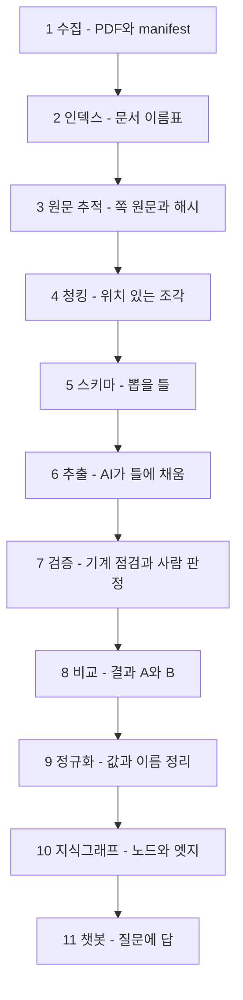
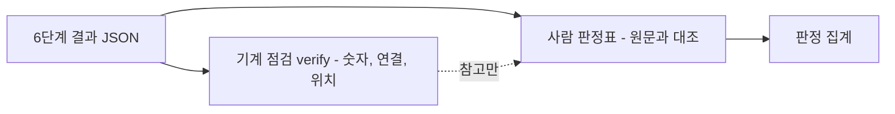
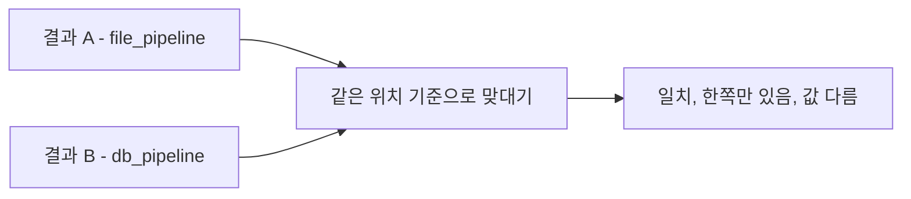
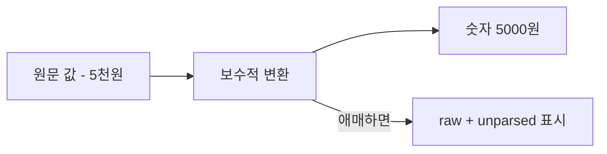
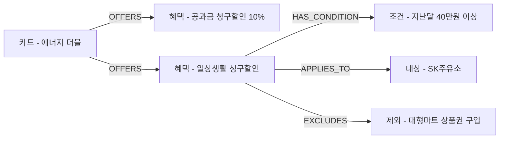

# 1~11단계 한 건 따라가기: 에너지 더블 카드 PDF 한 장이 챗봇 답변이 되기까지

- 대상: 하나카드 **에너지 더블 카드** 상품설명서(1쪽 PDF, `doc_id 1b938dd04b54116a`)
- 범위: [프로젝트 지도](프로젝트-지도.md) 2절의 1~11단계. 1~6단계는 요약이고, 자세한 값은 [1~6단계 문서](프로젝트-코드흐름-1-6단계-한건따라가기.md)와 [c07 청크 문서](프로젝트-코드흐름-한건따라가기.md)에 있다.
- 읽는 법: 단계마다 **쉬운 말 → 입력·출력 한 건 → 그림 → 핵심 코드 → 왜 → 못 확인한 것 → 점검 질문**.
- 확인 방식: 로컬 파일을 직접 읽었고, 7·8·10단계는 이 한 문서만 따로 돌려 값을 얻었다(아래 "이번에 돌린 것"). **DB 접속·OpenAI 호출은 하지 않았다.**
- 한계: 중간 결과 파일은 저장소 밖(`~/pilot_work/`, `/tmp`)에 있다. 다른 PC에서는 같은 값을 못 볼 수 있다. 11단계는 이 카드로 질문을 실행하지 않았다.

## 이번에 돌린 것 (읽기·변환만, 비용·DB 없음)
이 카드 결과 파일 7개(`…-p0001-c01~c07.result.json`)만 임시 폴더로 복사해 아래 세 가지를 실행했다. 저장소 파일은 바꾸지 않았다.
1. 자동 점검(`extraction cli verify`) — 7단계 값
2. 결과 A 출력(`result_a`) — 8단계 값
3. 그래프 CSV 변환(`graph/export`, run_id `demo-1b938dd`) — 10단계 값. **DB에는 넣지 않았다.**

## 전체 한 장 그림



| 단계 | 상태 (지도 2026-11-05 기준) |
|---|---|
| 1~4 | 완료 |
| 5 | 초안(v1) |
| 6 | 하나·우리 전체 실행 완료, 성공 998/1,032, 실패 재시도 대기 |
| 7 | 일부 시작 (사람 정확성 점검은 대기) |
| 8 | 예정 |
| 9 | 값 변환 함수는 있음, 이름 정규화는 실험 중(결정 D5). 지도는 9~11단계를 묶어 적음 |
| 10 | 하나·우리 추출분 Supabase `fp_*` 적재 |
| 11 | 시험 진행 중 (자동·AI 판정만, 사람 확정 정답률 없음) |

---

## 1~6단계 한 줄 요약 (자세한 값은 짝 문서)

| 단계 | 한 건의 값 |
|---|---|
| 1 수집 | 디자인코드 14422, PDF 1,398,539바이트, 수집일 2026-10-30, 해시 1b938dd0… |
| 2 인덱스 | `doc_id 1b938dd04b54116a`(해시 앞 16자), 4,893자, OCR 불필요, 대표 문서 |
| 3 원문 추적 | 쪽 원문 4,894자(공백 제외 3,658), PyMuPDF, 쪽 해시 저장 |
| 4 청킹 | 청크 7개(c01~c07), 길이 합 4,894, 위치는 1부터·끝 포함 |
| 5 스키마 | 혜택·조건·한도·대상 + 관계 5종, 인용문 필수, **위치 숫자는 AI가 못 냄** |
| 6 추출 | c07: 혜택 1·조건 3·한도 0·대상 12·관계 15, 위치 있는 근거 11/16, 할인율·한도 빠짐 |

이 카드 전체(7청크)의 6단계 결과: 혜택 4, 조건 10, **한도 0**, 대상 17, 근거 59개 중 위치 있음 50 · 모호 9.

---

## 7단계. 검증: 기계가 거친 신호를 주고, 사람이 판정한다

**쉬운 말**
- AI가 뽑은 결과가 믿을 만한지 점검한다. 기계는 "숫자가 원문에 있나, 연결이 빠진 항목은 없나, 인용 위치가 비었나" 같은 **거친 신호**만 준다.
- 값이 의미상 맞는지, 빠진 혜택이 없는지는 기계가 확정하지 못한다. **사람이 원문과 대조해야 한다.**

**한 건: 입력 → 출력** (이번에 `verify`를 돌린 값)

| 청크 | 기계 신호 | 뜻 |
|---|---|---|
| c01~c05 | 없음 | 걸린 것 없음 |
| c06 | `unlinked_item` 2건 (조건 c1, c2) | 혜택과 연결 안 된 조건이 2개 |
| c07 | `ambiguous_or_missing_quotes` 비율 0.29 | 인용 중 약 29%의 위치가 모호(9개 / 31개로 보임, 분모는 추정) |

7청크 중 신호가 있는 청크는 2개다.

**여기서 중요한 점:** c07에서 **할인율(`rate`)이 null이고 한도가 0개인 것은 신호에 잡히지 않았다.** 기계는 "모호한 인용"만 알렸고, 표에서 대응이 끊겨 값이 빠진 것은 알리지 못했다. "신호가 없다 = 정확하다"가 아니라는 실제 예다.



**핵심 코드:** `extraction/verify.py` `verify_results`(거친 신호, 숫자 단위 비교는 대략적), `extraction/accuracy_review.py`(길이 구간별 표본 + 사람 판정 집계), `extraction/review_auto_audit.py`(위치·인용·숫자·관계 구조 기계 점검, 결과에 `semantic_correctness_verified: False` 기록).

**왜 이렇게?** 전부를 사람이 보기엔 너무 많아서(하나 543청크) 기계로 의심 구간을 좁히고, 정확도는 표본을 사람이 판정한다. 기계 신호와 사람 판정은 **섞지 않고 따로** 보관한다.

**현재 수치(지도 기록):** 하나카드 30청크 AI 판정(사람 확인 아님) 값 정확도 70% · 완전성 67% · 근거 일치 90%. 이 세션에서 재집계하지 않았다.

**못 확인한 것:** 사람 판정표의 현재 진행 상태. 위 AI 판정이 사람 판정과 얼마나 일치하는지.

**점검 질문:** (1) c07에서 기계가 할인율 누락을 못 잡은 이유는? (2) 기계 신호와 사람 판정을 따로 보관하는 이유는?

---

## 8단계. 비교: 두 방식의 결과를 같은 자로 잰다

**쉬운 말**
- 같은 PDF를 우리(`file_pipeline`, 결과 A)와 팀원(`db_pipeline`, 결과 B)이 **서로 모르게** 따로 처리했다. 두 결과를 합쳐 비교해 서로 틀린 곳을 찾는 단계다.
- 비교의 자는 **(문서 해시, 쪽 번호, 시작 위치~끝 위치)**다. 청크를 어떻게 자르든, 쪽 원문 글자 위치가 같으면 같은 근거로 본다.

**한 건: 우리 쪽 결과 A 행** (이번에 `result_a`를 돌린 값, 59행: 위치 있음 50 · 없음 9)

```json
{"doc_sha256": "1b938dd04b54116a9c56…", "page_no": 1,
 "start_pos": 2122, "end_pos": 2137, "quote_status": "located",
 "entity_type": "Benefit", "entity_key": "1b938dd04b54116a-p0001-c02:b1",
 "values": {"name": "에너지 공과금 청구할인 서비스", "method": "DISCOUNT", "rate": "10%", "amount": null}}
```
위치 없는 9행은 별도 파일(`result_a_unlocated.jsonl`)로 나뉜다. 근거 인용문 글은 이 파일에 넣지 않는다.



**핵심 코드:** `extraction/result_a.py`(**초안**). 이 모듈은 `db_pipeline`을 읽지 않고, 상대 형식으로 변환하지도 않는다.

**상태:** 비교 자체는 **예정**이다. 이 문서는 우리 쪽 행 한 건만 보였고, 상대 쪽 결과는 읽지 않았다(`db_pipeline`은 요청 전 읽지 않는 원칙).

**못 확인한 것:** 상대 형식과 맞는지, 위치 기준이 두 방식에서 실제로 같은지(문서상 "이미 같은 규칙"이라고 적혀 있음). 공통 계약은 [결과 A·B 공통 계약 초안](작업이력/99-기타/결과AB-공통계약초안-laptop.md)을 참고.

**점검 질문:** (1) 비교 기준에 `chunk_id`를 쓰지 않는 이유는? (2) 위치가 `null`인 행은 비교에서 어떻게 되나?

---

## 9단계. 정규화: 값과 이름을 정리한다

**쉬운 말**
- AI가 원문 그대로 적은 값("5천원", "10%")은 컴퓨터가 계산하기 어렵다. 숫자로 바꿔 두면 비교·검색이 쉬워진다.
- 또 같은 이름이 여러 번 나오면(예: 여러 카드의 "대형마트") 하나로 볼지 말지 정해야 한다.

**한 건: 값 변환 실제 결과** (`graph/normalize_values.py` 호출)

| 원문 | 변환 함수 | 결과 |
|---|---|---|
| `10%` | `parse_rate` | `{rate: 0.1}` |
| `5천원` | `parse_amount` | `{amount: 5000, unit: 원}` |
| `3만원 이상` | `parse_condition` | `{min: 30000}` |
| `리터당 50원` | `parse_per_unit` | `{amount: 50, per: 리터}` |
| `10%`를 금액으로 | `parse_amount` | `{unparsed: unsupported_or_ambiguous}` |

**보수적이다:** 확실히 아는 모양만 바꾸고, 애매하면 "못 바꿨다(`unparsed`)"고 적는다. 값을 추측해서 채우지 않는다.

**이름 정리(중복·동명 노드):** 결정 D5 = **삭제·병합하지 않고 연결로 처리**, 정규화는 분석 후 구현(실험 중). 이 카드 안에서는 Target·Condition 이름이 겹치는 것이 **없었다**(17개 모두 다름). 카드 사이·카드사 사이에서는 겹침이 많다(하나 같은 발급사 내 이름 같은 그룹 917, 발급사 간 178 그룹 — `지식그래프.md` 7절, 이력 기재 수치).



**핵심 코드:** `graph/normalize_values.py`의 `parse_rate`, `parse_amount`, `parse_condition`, `parse_per_unit`, `parse_range`.

**왜 이렇게?** 잘못 바꾸면 "월 5천원"이 "5만원"이 되는 식의 큰 오류가 나서, 틀릴 바엔 비워 둔다.

**못 확인한 것:** 이 변환 함수가 지금 그래프 적재 파이프라인에서 실제로 호출되는지(함수 자체만 호출해 봤다). 이름 정규화 기준은 팀 합의 대기.

**점검 질문:** (1) `10%`를 `parse_amount`에 넣으면 왜 "못 바꿨다"가 나오나? (2) 동명 노드를 삭제하지 않고 연결하는 이유는?

---

## 10단계. 지식그래프: 점과 선으로 저장한다

**쉬운 말**
- 6단계 결과(항목·관계)를 **점(노드)과 선(엣지)**으로 바꿔 DB에 넣는다. 그래야 "이 혜택에 걸린 조건은?" 같은 질문을 선을 따라가며 찾을 수 있다.
- 각 점·선에는 근거(문서 해시·쪽·글자 위치)가 붙는다. 우리 그래프는 Supabase의 `public.fp_*` 테이블에 둔다.

**한 건: 이 카드 한 장이 그래프로 변환된 값** (이번에 `export`로 만든 CSV, DB에는 넣지 않음)

| 항목 | 값 |
|---|---|
| 노드 합계 | **32** — 카드 1, 혜택 4, 조건 10, 대상 17, **한도 0** |
| 엣지 합계 | **29** — `OFFERS` 4, `HAS_CONDITION` 8, `APPLIES_TO` 9, `EXCLUDES` 8 |
| 근거 | 59 — 위치 있음(`located`) 50, 모호(`ambiguous`) 9 |

점 예시:
- 카드 노드 `card:hana:102305100955756` = 에너지 더블 카드(발급사는 `issuer` 속성이고 **발급사 노드는 없음**)
- 혜택 4개(`OFFERS`로 카드에 연결): "에너지 공과금 청구할인 서비스"(할인, **10%**), "에너지 공과금 더블 할인", "2~3개월 무이자 할부서비스", "일상생활 청구할인 서비스"(**할인율 null**)



**근거 규칙(스키마 SQL):** 위치는 `located`일 때만 채우고, `ambiguous`·`missing`이면 위치를 **비운다**("임의로 첫 위치를 근거로 삼지 않는다"). 근거는 점이나 선 중 정확히 한 곳에 붙는다.

**핵심 코드:** `graph/export.py`(결과 → CSV, 허용 끝점 검사), `graph/load.py`(CSV → DB, **기본은 드라이런**, `--execute` 때만 쓰기, run_id 단위 삭제), `graph/schema.sql`(테이블 4개: `fp_load_runs`, `fp_nodes`, `fp_edges`, `fp_evidence`).

**왜 이렇게?** 한 번 적재가 한 run_id로 묶여서, 잘못 올리면 run 단위로 지울 수 있다. DB 쓰기는 사용자만 실행한다(D4).

**이 한 건이 알려 주는 것:** 이 카드는 그래프에 **한도 노드가 하나도 없다.** "월 할인한도"를 묻는 질문은 그래프에서 답을 찾기 어렵다. 이 카드 하나의 결과이며, 다른 카드의 한도 노드는 이 문서에서 확인하지 않았다.

**못 확인한 것:** **실제 DB의 이 카드 행.** 이번엔 CSV 변환만 했고 DB에 접속하지 않았다. 팀 합의 대기: `fp_*` 위치(D1), 우리 장부 계약(D13). 이 값은 `demo-1b938dd` 임시 run이지 DB의 실제 run이 아니다.

**점검 질문:** (1) 근거 위치가 `ambiguous`이면 DB에 어떻게 저장되나? (2) 카드 노드에 발급사 노드가 없는 영향은?

---

## 11단계. 챗봇: 질문에 그래프로 답한다

**쉬운 말**
- 사용자가 질문하면 챗봇은 그래프에서 관련 점을 찾고, 그 점과 이웃을 읽어 AI에게 건네 답을 만든다. 근거 문서 위치도 함께 낼 수 있다.
- 흐름: **질문 → 후보 이름 목록 → AI가 이름 고르기 → 고른 점에서 1~3칸 이웃 읽기(최대 40개 점) → 답변 생성.**

**한 건: 이 카드로 따라가 본 질문 (가정한 예시, 실행하지 않음)**

| 단계 | 일어날 일 | 상태 |
|---|---|---|
| 질문 | "에너지 더블 카드 일상생활 청구할인 월 한도는?" | 예시 질문 |
| 이름 찾기 | 후보 이름에서 "일상생활 청구할인 서비스" 혜택 노드를 고름 | 추정 |
| 이웃 읽기 | `HAS_CONDITION`(40만원 이상), `APPLIES_TO`·`EXCLUDES` 대상들은 보임 | 10단계 값으로 확인 |
| 한도 | **연결된 한도 노드가 없음** | 10단계 값으로 확인 |
| 답변 | 한도 정보를 못 찾았다고 답하거나, 원문 구간(source_text)이 붙은 경우 그것을 근거로 답할 수 있음 | **추정, 미실행** |

즉 이 카드의 한도 질문 결과는 6단계에서 이미 정해진다: **앞 단계에서 빠진 정보는 챗봇이 만들어 낼 수 없다.**


**핵심 코드:** `chat/fp_chat_patch.py`(팀 챗봇 `graphrag_chatbot`을 건드리지 않고 `fp_chat` 읽기 뷰로 연결하는 래퍼, D3), `chat/openai_llm_patch.py`(OpenAI `gpt-6-luna` 어댑터, 가져오기만으로는 API를 부르지 않음), `chat/eval/run_eval.py`(시험 실행기, 기본 드라이런), `graph/chat_views.sql`(읽기 뷰).

**현재 시험 결과** (`품질/챗봇-품질.md`, **자동·AI 판정, 사람 확정 정답률 아님**)

| 항목 | 값 |
|---|---|
| 골든셋 v1 | 80문항 작성(하나 40·우리 40, 정답 없음 9), dev 39·final 41. **사람 검수는 아직 없음** |
| dev 39문항 3회 평균 | **82.9%** (97/117), 95% 구간 70~94% |
| 정답 없음 4문항 | 3회 모두 거절 4/4 |
| 약한 곳 | **한도 질문**(하나 62%, 우리 71%) |

한도 질문이 약한 것은 위 한 건과 같은 방향이다. 다만 원인을 한 가지로 확정하진 못한다(판정기 오판, 추출 실패 청크 등도 있음, 품질 문서 기록).

**못 확인한 것:** 이 카드에 대한 실제 질문·답변(OpenAI 호출 비용이 들어 실행하지 않았다). 위 "예시 질문" 표의 이름 찾기·답변은 추정이다. 사람 검수 결과.

**점검 질문:** (1) 한도 노드가 없는 카드에서 월 한도를 물으면 어떻게 될 수 있나? (2) 82.9%를 "정확도 82.9%"라고 말하면 안 되는 이유는?

---

## 한눈 요약표

| 단계 | 들어가는 것 | 나오는 것 | 이 카드의 한 건 |
|---|---|---|---|
| 1 수집 | 카드사 홈페이지 | PDF + manifest | 14422, 1,398,539바이트 |
| 2 인덱스 | manifest, PDF | `documents.csv` | `doc_id 1b938dd0…`, OCR 불필요 |
| 3 원문 추적 | 대표 PDF | 쪽 원문 + 해시 | 4,894자 |
| 4 청킹 | 쪽 원문 | 위치 있는 청크 | 7개 |
| 5 스키마 | 설계 | 4종 항목 + 관계 5종 | 위치 필드 금지 |
| 6 추출 | 청크 + 스키마 | 결과 JSON | 혜택 4·조건 10·한도 0·대상 17 |
| 7 검증 | 결과 JSON | 기계 신호 + 사람 판정 | 신호 2청크, 할인율 누락은 못 잡음 |
| 8 비교 | 결과 A·B | 일치·차이 | A 행 59개(위치 50·없음 9), 비교는 예정 |
| 9 정규화 | 원문 값 | 숫자 값 | `5천원` → 5000원 |
| 10 그래프 | 결과 JSON | 노드·엣지·근거 | 노드 32·엣지 29·근거 59 |
| 11 챗봇 | 질문 + 그래프 | 답변 | 한도 질문 약함(자동·AI 판정 기준) |

## 이 문서 전체에서 읽은 것과 못 읽은 것
- **직접 확인:** manifest·인덱스·원문 추적·청크 위치(1~4), 스키마 파일(5), 7개 결과 JSON(6), `verify` 실행 결과(7), `result_a` 실행 결과(8), 값 변환 함수 호출(9), CSV 변환 실행 결과(10), 설계·품질 문서(10·11).
- **읽지 않음·못 함:** `db_pipeline`(요청 전 읽지 않음), `.env`·DB, OpenAI 호출, PDF 원본을 눈으로 대조, 7단계 사람 판정표, 11단계의 이 카드 실제 질문.
- **추정:** 2단계 글자 수 4,893 vs 쪽 원문 4,894 차이의 원인, 4단계 c01이 긴 이유, 6단계 할인율 누락의 원인(표가 글자 나열로 바뀐 영향), 11단계 이 카드의 질문 결과.
- **정정 알림:** [발표 자료 비교분석](PPT/발표자료-비교분석-2026-11-05.md)에 "골든셋 실제 질문 0개로 들었다"고 적었는데, 품질 문서 최신판은 **골든셋 v1 80문항 작성**으로 바뀌었다(사람 검수는 없음). 그 문서의 해당 문구는 갱신이 필요하다.
