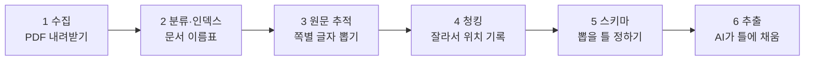
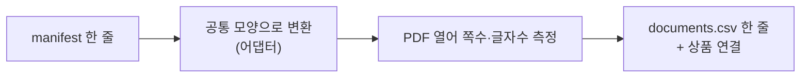
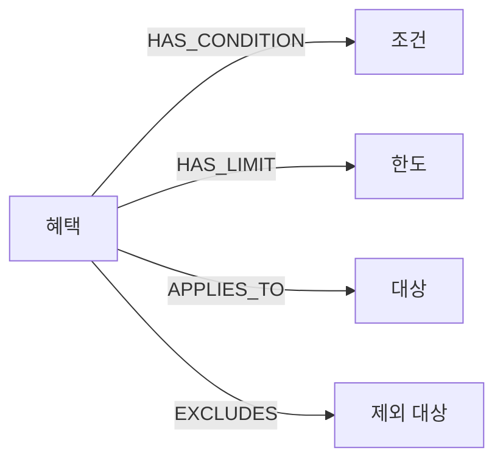
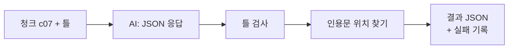

# 1~6단계 한 건 따라가기: 에너지 더블 카드 PDF 한 장

- 대상: 하나카드 **에너지 더블 카드** 상품설명서(1쪽 PDF, `doc_id 1b938dd04b54116a`)
- 범위: [프로젝트 지도](프로젝트-지도.md) 2절의 1~6단계(수집 → 분류·인덱스 → 원문 추적 → 청킹 → 추출 스키마 → 추출)
- 짝 문서: [코드 흐름 조사 01~04](프로젝트-코드흐름-01-04.md)(전체 구조), [한 건 따라가기: c07 청크](프로젝트-코드흐름-한건따라가기.md)(6단계의 자세한 장면)
- 확인 방식: 로컬 파일을 직접 읽었다. 코드·LLM·DB는 실행하지 않았다.
- 한계: 2~6단계 실제 값은 `~/pilot_work/` 등 저장소 밖 임시 폴더와 로컬 데이터에 있다. 다른 PC에서는 같은 값을 못 볼 수 있다.
- 읽는 법: 단계마다 같은 틀이다. **쉬운 말 → 입력·출력 한 건 → 그림 → 핵심 함수 → 왜 → 못 확인한 것 → 점검 질문**.

## 전체 한 장 그림

---

## 1단계. 수집: PDF를 내려받고 목록을 만든다

**쉬운 말**
- 카드사 홈페이지에서 상품설명서 PDF를 내려받고, "어느 카드의 어떤 문서를 언제 어디서 받았나"를 표(manifest)로 남긴다.
- 코드가 아니라 수집 작업의 결과물이다. 이 표가 이후 모든 단계의 출발점이다.

**한 건: 입력과 출력**

| 칸 | 실제 값 |
|---|---|
| 카드 | 신용 · 에너지 더블 카드 |
| 디자인코드 | 14422 |
| 원본 URL | `https://m.hanacard.co.kr/leaflet/14/14422_20251224.pdf` |
| 저장 파일 | `credit/신용_에너지더블카드_상품설명서(공식PDF)_14422_20251224.pdf` |
| 크기·쪽수 | 1,398,539바이트 · 1쪽 |
| 내용 해시(SHA256) | `1b938dd04b54116a9c56…` (앞 16자가 다음 단계의 `doc_id`) |
| 수집일시 | 2026-10-30 15:49 |

하나카드 manifest는 217행이다(`src/data/hana_all/manifest.csv`, 체크카드 `debit/` 포함).

**핵심 코드:** 없음(수집 결과 파일). 수집 방식은 `src/data/hana_all/collection_report.md`에 적혀 있다.

**왜 이렇게?** 같은 문서가 중복으로 받아져도 "어디서 받은 무엇인지"를 나중에 되짚을 수 있어야 한다.

**못 확인한 것:** 수집을 이 세션에서 다시 하지 않았다. 홈페이지의 현재 PDF가 같은지도 확인하지 않았다.

**점검 질문:** (1) 해시를 문서 이름표로 쓰는 이유는? (2) manifest에 수집일시가 있는 이유는?

---

## 2단계. 분류·인덱스: 문서마다 이름표 한 줄을 만든다

**쉬운 말**
- manifest의 칸이 카드사마다 달라서(하나는 한글 열, 우리는 영문 열) 공통 모양으로 바꾼다.
- PDF를 열어 쪽수와 글자 수를 재고, "대표 문서인가, OCR이 필요한가"를 표시한다.
- 같은 내용이 중복이면 하나만 대표(`canonical=Y`)로 둔다.

**한 건: 입력 → 출력**

| 입력(manifest) | 출력(`documents.csv` 한 줄) |
|---|---|
| 신용 · 에너지 더블 카드 · 해시 1b938dd0… | `doc_id 1b938dd04b54116a` |
| 상품설명서(공식PDF) | 문서 역할 `product_guide` |
| 1쪽 | `pages 1`, `text_chars 4893` |
| | `canonical Y`, `ocr_needed N`, `needs_review N` |

`product_docs.csv`에는 "에너지 더블 카드 ↔ 이 문서(`primary_guide`)" 연결이 한 줄 더 생긴다.

**OCR 판정:** 쪽당 평균 글자가 50자 미만이면 OCR 필요로 본다. 이 문서는 4,893자라 `N`이다.

**핵심 함수**
- `doc_index/adapters/hana.py` `load_entries`: 하나 manifest 열을 공통 항목으로 바꾸고 `debit/`는 제외한다.
- `doc_index/core.py` `build_index`: `doc_id = sha256[:16]`(65행)과 대표 문서 선정을 묶는다.

**왜 이렇게?** 카드사별 차이를 이 단계에서 흡수해야 3단계부터는 카드사 구분 없이 같은 코드를 쓴다.

**못 확인한 것:** 글자 수 4,893은 인덱스 기록과 같고, 쪽 원문 길이(4,894)와 1 차이가 난다. 맨 끝 공백·줄바꿈 때문으로 보이며(앞뒤를 자르면 4,893), 인덱스가 자른 값을 쓰는지는 코드로 확인하지 못했다(추정).

**점검 질문:** (1) 같은 PDF가 두 번 수집되면 `doc_id`는 어떻게 되나? (2) `ocr_needed`는 무엇을 보고 정하나?

---

## 3단계. 원문 추적: 쪽마다 글자를 뽑고 "출처 증명서"를 붙인다

**쉬운 말**
- 대표 PDF를 열어 쪽별 글자를 뽑는다(PyMuPDF 사용).
- 글자만 저장하지 않고, 어느 문서·몇 쪽인지, 글자의 해시, 추출 품질까지 같이 적는다. 나중에 "이 문장이 진짜 PDF 몇 쪽에서 왔나"를 증명하기 위해서다.

**한 건: 입력 → 출력** (`traceability-v1` JSON)

| 칸 | 실제 값 |
|---|---|
| 문서 | `1b938dd04b54116a…`, 1,398,539바이트, 1쪽 |
| 쪽 1 글자 수 | 공백 포함 4,894 / 공백 제외 3,658 |
| 한글·숫자 | 한글 3,044 · 숫자 136 |
| 추출기 | PyMuPDF 1.28.2, 상태 `OK`, 의심 글자 0 |
| 그림 포함 | `has_visual: true` (표나 이미지가 있다는 표시) |
| 글자 해시 | `text_sha256` 기록 |
| 임시 청크 | `p0001`: 위치 1~4894 (쪽 전체) |

**핵심 함수:** `traceability.py` `create_traceability`: 인덱스의 해시·쪽수와 대조하며 JSON을 만든다. PDF 읽기는 `common/document_reader.py`의 `DocumentReader`.

**왜 이렇게?** 위치 숫자(몇 번째 글자)의 기준이 "이 쪽 원문"이다. 기준 글자가 바뀌면 위치가 모두 어긋나서, 원문과 해시를 같이 보관한다.

**못 확인한 것:** `has_visual: true`가 가리키는 표·이미지가 글자로 제대로 옮겨졌는지는 PDF를 눈으로 열어 보지 않았다. 실제로 표가 글자 나열로 바뀐 흔적은 6단계 c07에서 보였다.

**점검 질문:** (1) 글자 수가 4,894와 3,658, 두 개 있는 이유는? (2) 쪽 원문과 함께 해시를 저장하는 이유는?

---

## 4단계. 청킹: 쪽을 잘게 자르고 위치를 적는다

**쉬운 말**
- AI에게 한 쪽(4,893자)을 통째로 주면 놓치기 쉬워서 자른다.
- 자를 때마다 "이 조각은 쪽 원문의 몇 번째 글자부터 몇 번째까지"를 적는다. 위치는 1부터 시작하고 끝 글자를 포함한다.
- 4,000자 이하는 쪽당 하나, 긴 쪽은 제목 경계에서 자르고, 400자 미만 조각은 만들지 않는다.

**한 건: 입력 1쪽 → 출력 청크 7개**

| 청크 | 위치 | 길이 | 제목 |
|---|---|---|---|
| c01 | 1~2121 | 2121 | (없음) |
| c02 | 2122~2525 | 404 | 에너지 공과금 청구할인 서비스 |
| c03 | 2526~2957 | 432 | 연체이자율… |
| c04 | 2958~3380 | 423 | 신용카드 발급이 부적정한 경우… |
| c05 | 3381~3804 | 424 | 2~3개월 무이자 할부서비스 |
| c06 | 3805~4204 | 400 | 서비스 제공 방법 |
| c07 | 4205~4894 | 690 | 실적 제외 대상 |

검산: 마지막 청크 끝(4,894) = 쪽 원문 길이(4,894). 청크 길이 합 4,894와 맞고, 이어 붙이면 쪽 원문이 된다는 검사(`check_pieces`)가 코드에 있다(실행하지 않음).

**핵심 함수:** `chunking/split.py` `split_page`(자르는 규칙), `chunking/build.py` `check_pieces`(이어 붙여 원문과 대조).

**왜 이렇게?** 청크 안 위치만 알면, 청크 시작 위치를 더해 **쪽 원문의 정확한 위치**로 바꿀 수 있다(6단계의 위치 계산).

**못 확인한 것:** c01이 2,121자로 길어 보이는 이유(제목이 감지되지 않은 것으로 보임)는 PDF를 열어 확인하지 않았다. 제목 경계가 의미 단위와 맞는지도 미확인.

**점검 질문:** (1) 청크 길이를 모두 더하면 왜 4,894인가? (2) 제목이 없는 긴 구간은 어떻게 되나?

---

## 5단계. 추출 스키마: AI가 채울 "틀"을 정한다

**쉬운 말**
- AI에게 자유롭게 요약시키지 않고, **정해진 종류만** 뽑게 한다. 틀에 안 맞으면 코드가 거부한다.
- 뽑을 것 4가지: 혜택(Benefit), 조건(Condition), 한도(Limit), 대상(Target). 이들을 5가지 관계로 잇는다.
- 모든 항목은 **원문 인용문(evidence) 1개 이상**이 있어야 한다. 근거 없는 말은 받지 않는다.

**한 건: 틀(`extraction/schema.py`)이 정한 것**

| 종류 | 채우는 칸 | 이 카드에서 나올 수 있는 값 |
|---|---|---|
| 혜택 | 이름, 방식(`DISCOUNT`·`CASHBACK`·`POINT`), 할인율·금액(원문 그대로) | 일상생활 청구할인, `DISCOUNT` |
| 조건 | 설명, 종류(`SPEND_REQ`·`EXCLUDE`·`USAGE`·`PAYMENT`·`MERCHANT`·`OTHER`), 최소 금액(원) | 지난달 실적 40만원 → 종류 `SPEND_REQ`, 400000 |
| 한도 | 기간(`TXN`·`DAY`·`MONTH`·`YEAR`·`UNKNOWN`), 금액, 무제한, 공유 | 월 5천원 |
| 대상 | 종류(`MERCHANT`·`INDUSTRY`·`CHANNEL`·`SERVICE`·`OTHER`) | SK주유소 → `MERCHANT` |

**관계와 허용 쌍** (`ALLOWED_RELATIONS`)

| 관계 | 출발 → 도착 | 뜻 |
|---|---|---|
| `HAS_CONDITION` | 혜택 → 조건 | 이 혜택의 조건 |
| `HAS_LIMIT` | 혜택 → 한도 | 이 혜택의 한도 |
| `APPLIES_TO` | 혜택 → 대상 | 적용되는 곳 |
| `EXCLUDES` | 혜택 → 대상 | 제외되는 곳 |
| `MUTUALLY_EXCLUSIVE` | 혜택 → 혜택 | 중복 불가 |

코드는 같은 ID 중복, 없는 ID 참조, 자기 자신 연결, **허용 쌍이 아닌 연결**(예: 혜택→조건에 `EXCLUDES`)을 거부한다고 주석에 적혀 있다.

**핵심 코드:** `extraction/schema.py`의 Pydantic 모델(`Benefit`, `Condition`, `Limit`, `Target`, `Relation`), 허용 쌍 표 `ALLOWED_RELATIONS`.

**왜 이렇게?** 틀이 없으면 AI마다 다른 말로 답해서 그래프(노드·엣지)에 넣을 수 없다. 위치 값(`start_pos` 등)은 **틀에 아예 없다.** AI가 숫자를 지어내지 못하게 막으려고 "모르는 필드는 거부"(`extra="forbid"`)로 걸어 두었다.

**못 확인한 것:** 이 틀이 팀(`db_pipeline`)의 스키마와 맞는지는 8단계 비교 전이라 미확인이다. 팀 결정 대기 항목(그래프 위치·접두사 등)은 [결정 기록](결정/README.md) 참고. 틀을 코드 실행으로 검증하지 않았다(파일 읽기만).

**점검 질문:** (1) AI가 위치 숫자를 못 내는 이유는? (2) "혜택→조건"에 `EXCLUDES`를 쓰면 어떻게 되나?

---

## 6단계. 추출: AI가 청크를 읽고 틀에 채운다

**쉬운 말**
- 청크 하나와 틀을 AI에게 주면, AI는 JSON으로 항목과 **원문 인용문**을 돌려준다.
- 실행기가 JSON을 검사하고(틀에 맞나), 인용문을 청크에서 찾아 **글자 위치를 붙인다.**
- 못 찾거나 여러 번 나오면 위치는 비우고 실패로 기록한다.

**한 건: 청크 c07 → 결과 JSON** (자세한 장면은 [c07 문서](프로젝트-코드흐름-한건따라가기.md))

| 칸 | 실제 값 |
|---|---|
| 입력 | 청크 c07(690자), 제목 "실적 제외 대상" |
| 혜택 | 1개 (일상생활 청구할인 서비스) |
| 조건 · 한도 · 대상 · 관계 | 3 · **0** · 12 · 15 |
| 위치 있는 근거 | 16개 중 11개 (예: "40만원 이상" → 4315~4321) |
| 위치 비어 있음 | 5개, 이유는 "인용문이 청크에 여러 번 나옴" |
| 빠진 것 | 할인율(`rate`)은 null, 한도는 0개 → **표에서 대응이 끊김** |

**핵심 함수:** `extraction/runner.py` `run_chunk`(응답 검사와 위치 연결), `extraction/evidence.py` `locate_quote`(인용문 찾기). 실행 진입은 `extraction/cli.py`, 기본 `run`은 드라이런이고 `--execute`가 있어야 실제 호출한다.

**왜 이렇게?** 위치를 AI가 아니라 실행기가 계산하므로 "근거가 원문에 실제로 있는지"를 검증할 수 있다. 대신 표처럼 글자 나열이 깨진 곳은 AI가 연결을 못 하고 비워 둘 수 있다.

**전체 규모(작업 기록·지도 기준):** 하나카드 543청크, 우리카드 489청크 전체 실행. 성공 998/1,032, 실패 재시도 대기. 이 세션에서 재집계하지 않았다.

**못 확인한 것:** AI가 왜 할인율과 한도를 연결하지 않았는지는 결과만으로 확정할 수 없다. 이런 청크가 전체의 얼마인지 집계하지 않았다. 사람이 확정한 정확도는 아직 없다(자동 판정만 있음).

**점검 질문:** (1) "40만원 이상"의 위치가 4315인 이유는? (2) 위치가 null인 근거는 버려지나? (3) 값이 빠진 것은 자동 점검이 막아 주나?

---

## 한눈 요약

| 단계 | 들어가는 것 | 나오는 것 | 이 카드의 한 건 |
|---|---|---|---|
| 1 수집 | 카드사 홈페이지 | PDF + manifest | 에너지 더블 PDF 1,398,539바이트 |
| 2 분류·인덱스 | manifest, PDF | `documents.csv` | `doc_id 1b938dd04b54116a`, 4,893자, OCR 불필요 |
| 3 원문 추적 | 대표 PDF | 쪽 원문 + 해시 + 품질 | 4,894자(공백 제외 3,658), PyMuPDF |
| 4 청킹 | 쪽 원문 | 위치 있는 청크 | 청크 7개, 마지막 끝 4,894 |
| 5 스키마 | (설계) | 혜택·조건·한도·대상 + 관계 5종 | 인용문 필수, 위치 필드 금지 |
| 6 추출 | 청크 + 스키마 | 결과 JSON + 실패 기록 | c07: 항목 16, 위치 11/16, 할인율 빠짐 |

## 이 문서에서 직접 확인한 것과 못 한 것
- **확인:** manifest 행 값, 인덱스 행, traceability JSON(문서·쪽·품질·임시 청크), 청크 7개 위치와 합계, 스키마 파일(종류·허용 쌍), c07 결과(개수·위치·실패)와 4315 계산.
- **못 함:** PDF를 눈으로 열어 표·이미지 대조, 코드·테스트 실행, 프롬프트 본문 확인, 이 카드 외 문서의 일반화. 2단계 글자 수 차이의 원인과 4단계 c01 길이의 원인은 추정이다.
