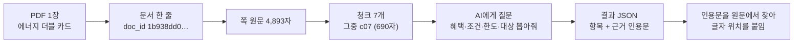

# 한 건 따라가기: 에너지 더블 카드 청크 하나가 결과가 되기까지

- 대상: 하나카드 에너지 더블 카드 상품설명서, 7번째 청크(`1b938dd04b54116a-p0001-c07`)
- 목적: [프로젝트-코드흐름-01-04.md](프로젝트-코드흐름-01-04.md)의 추상 설명을 **실제 값 한 건**으로 확인한다.
- 범위: 인덱스 → 청크 → LLM 추출 결과. 점검 도구(04번)는 마지막에 한 줄만.
- 확인 방식: 로컬 파일을 직접 읽었다. 코드·LLM·DB는 실행하지 않았다.
- 한계: 추출 결과 파일은 `~/pilot_work/full_hana/`(저장소 밖 로컬 폴더)에 있어 다른 PC·팀원이 같은 값을 볼 수 있다는 보장이 없다.

## 0. 한 장 그림



## 1. 문서 한 줄 (인덱스)

**쉬운 말:** PDF 한 장마다 "이름표 한 줄"을 만든다. 같은 PDF가 중복 수집돼도 같은 이름표가 나오도록, 파일 내용으로 이름표(`doc_id`)를 만든다.

| 칸 | 실제 값 |
|---|---|
| `doc_id` | `1b938dd04b54116a` (파일 내용 해시 SHA-256의 앞 16자, `doc_index/core.py:65`) |
| 종류 | 신용카드, 상품 안내서(`product_guide`), 대표 문서(`canonical=Y`) |
| 쪽수·글자수 | 1쪽, 4,893자 |
| OCR 필요 | N (글자가 충분히 읽힘) |
| 연결 상품 | 에너지 더블 카드 (`primary_guide`) |

**왜 해시로?** 파일 이름은 같은 문서가 다르게 저장되면 달라지지만, 내용 해시는 같다. 그래서 중복 문서를 하나로 묶을 수 있다.

## 2. 청크 (쪽을 잘게 자르기)

**쉬운 말:** AI에게 4,893자를 통으로 주면 놓치기 쉬워서, 4,000자가 넘는 쪽은 제목 경계에서 자르고, 너무 짧은 조각(400자 미만)은 만들지 않는다. 이 문서는 첫 조각이 2,121자로 길고 나머지는 400~700자 안팎이다. 자를 때마다 **원문에서 몇 번째 글자부터 몇 번째까지인지**를 같이 적어 둔다. 나중에 근거를 되짚기 위해서다.

이 문서 1쪽은 청크 7개가 된다.

| 청크 | 글자 위치(쪽 기준) | 길이 | 제목 |
|---|---|---|---|
| c01 | 1~2121 | 2121 | (없음) |
| c02 | 2122~2525 | 404 | 에너지 공과금 청구할인 서비스 |
| c03 | 2526~2957 | 432 | 연체이자율… |
| c04 | 2958~3380 | 423 | 신용카드 발급이 부적정한 경우… |
| c05 | 3381~3804 | 424 | 2~3개월 무이자 할부서비스 |
| c06 | 3805~4204 | 400 | 서비스 제공 방법 |
| **c07** | **4205~4894** | **690** | **실적 제외 대상** |

위치는 **1부터 시작하고 끝 글자를 포함**한다(c07 시작 4205).

### c07 입력 (AI에게 가는 원문, 앞부분만)
```
· 실적 제외 대상
일상생활 청구할인 서비스
대형마트(이마트/롯데마트/홈플러스) ※온라인 결제 제외
SK주유소 ※LPG 제외
파리바게뜨/뚜레쥬르 ※온라인 결제 제외
버스/지하철
EV(전기차)충전
40만원 이상
5%  10%  5천원  5천원  5천원  5천원  1만원
대상 가맹점 / 월 할인한도 / 지난달 실적 / 할인율
- SK주유소: SK주유소 현장 결제에 한하여 서비스 제공
...
```

**짚어 볼 점:** 이건 원래 *표*다. 가맹점 · 지난달 실적 · 할인율 · 월 한도가 열로 맞춰진 표인데, PDF에서 글자만 뽑으니 **숫자들이 한 줄로 쭉 나열**됐다. 어느 숫자가 어느 가맹점의 것인지는 글만 봐서는 알 수 없다. (3절에서 이 영향이 나온다.)

## 3. AI 추출 결과

**쉬운 말:** AI에게 "혜택·조건·한도·대상을 정해진 틀로 뽑고, 뽑은 근거 문장도 원문 그대로 따와라"라고 시킨다. 결과는 JSON 한 파일(`…-p0001-c07.result.json`)이다.

### 뽑힌 것
| 종류 | 개수 | 예 |
|---|---|---|
| 혜택(Benefit) | 1 | 일상생활 청구할인 서비스 (할인) |
| 조건(Condition) | 3 | "지난달 실적 40만원 이상"(`SPEND_REQ`, 최소 400,000원), "SK주유소 현장 결제에 한하여", "EV 충전 가맹점 멤버십 가입 후…" |
| 한도(Limit) | **0** | |
| 대상(Target) | 12 | 대형마트, SK주유소, 파리바게뜨/뚜레쥬르, 버스/지하철, EV충전, 그리고 제외 대상들 |
| 관계 | 15 | 혜택 → 조건 3개, 혜택 → 대상 5개(`APPLIES_TO`), 혜택 → 제외 대상 7개(`EXCLUDES`) |

### 장면 A. 위치 계산이 맞은 경우
조건 `c1`의 근거 인용문은 `"40만원\n이상"`이다. 실행기가 청크 안에서 이 문장을 찾으면 청크 안 110번째(0부터)에 있고, 청크 시작 4205를 더하면 4315가 된다.

| | 값 |
|---|---|
| 직접 계산 | 청크 시작 4205 + 110 = **4315** ~ 4321 |
| 결과 파일 기록 | `start_pos 4315`, `end_pos 4321` |
| 판정 | 일치 (이 문장은 청크에 1번만 나옴) |

AI는 위치 숫자를 만들지 않는다. 문장만 내고, **실행기가 원문에서 찾아 숫자를 붙인다.** 그래서 AI가 숫자를 지어낼 수 없다.

### 장면 B. 위치가 비어 있는 경우
같은 결과에서 근거 16개 중 **5개는 위치가 `null`**이다. 실패 기록(`failures`)에는 `quote_location_ambiguous`(모호)가 9건 있고 이유는 같다: *인용문이 청크 안에 여러 번 나온다.*

| 인용문 | 청크 안 등장 횟수 |
|---|---|
| 일상생활 청구할인 서비스 | 2 |
| 대형마트(이마트/롯데마트/홈플러스) | 2 |
| EV(전기차)충전 | 5 |

어느 쪽을 가리키는지 정할 수 없으니, **추측하지 않고 위치를 비우고 "모호"라고 기록**한다. 값 자체는 버리지 않는다.

### 장면 C. 표에서 관계가 끊긴 경우 (가장 중요)
원문 표에는 가맹점마다 할인율(5%, 10%)과 월 한도(5천원, 1만원)가 있었다. 그런데 결과는:
- 혜택의 `rate`(할인율)가 **null**
- 한도(Limit)가 **0개**

즉 "40만원 이상이면 대형마트 5%, 월 5천원"이라는 핵심 정보 중 **실적 조건만 남고 할인율·한도는 빠졌다.** 원인은 2절에서 본 것처럼 표가 글자 나열로 바뀌어 대응 관계가 깨졌기 때문으로 보이나, AI가 왜 연결하지 않았는지는 이 결과만으로는 확정할 수 없다(추정).

이 장면은 발표 자료의 "숫자는 읽혀도 조건 사이의 관계는 끊어진다"가 **우리 실제 추출 결과에서도 나타난 사례**다.

## 4. 이 한 건이 알려 주는 것

| 질문 | 답 |
|---|---|
| 위치 근거는 믿을 수 있나? | 맞춘 것은 직접 계산과 일치했다(1건 검산). 다만 16개 중 5개는 위치가 없다. |
| 값이 다 맞나? | 이 청크에서는 **아니다.** 할인율·한도가 빠졌다. 자동 점검은 이런 의미 누락을 확정하지 못하고 사람이 원문과 대조해야 한다. |
| 그럼 이 결과를 그래프에 넣어도 되나? | 넣을 수는 있지만, 답변에서 "할인율을 모른다"가 나올 수 있다. 챗봇 시험에서 한도 질문이 약했던 이유와 이어진다(검증 필요). |

## 5. 직접 확인한 것과 못 한 것
- 확인: 인덱스 행, 청크 7개 위치, c07 원문, 결과 JSON의 개수·위치·실패 기록, 4315 위치 계산.
- 못 함: 원본 PDF를 눈으로 열어 표를 대조하지 않았다(표의 열 구조는 청크 텍스트의 항목 이름으로 추정). 이 카드 외 다른 청크가 같은 문제를 갖는지 미집계. 프롬프트 버전·모델은 결과 파일에 적혀 있지 않아 확인 못 함.

## 6. 이해 점검 (답은 아래에)
1. 청크 c07의 시작이 4205인데 근거 위치가 4315인 이유는?
2. 위치가 `null`이면 그 근거는 버려지나?
3. 할인율이 빠진 것은 자동 점검에서 걸러지나?

<details><summary>답 보기</summary>

1. 청크 안에서 문장이 110번째에 있어서 4205 + 110 = 4315.
2. 아니다. 값은 유지하고 위치만 비우며 "모호" 실패로 기록한다.
3. 보장하지 않는다. 자동 점검은 숫자·위치·관계 구조 같은 기계적 신호만 보고 의미 누락은 사람이 확인한다.

</details>
