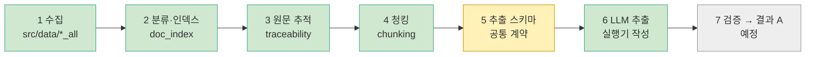
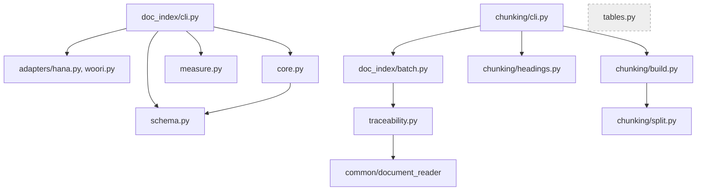

# file_pipeline — 파일 기반 처리 방식 (담당: 이현근)

이 문서는 이 폴더의 **지도**다. 파일을 추가하거나 옮기면 같은 커밋에서 아래 3절 표와 4절 그림을 고친다.
(지도와 코드가 다르면 지도를 고친다.) 마지막 갱신: 2026-11-03

## 1. 한 줄 목적

카드 상품설명서 PDF를 Python으로 직접 처리해 분류 → 원문 추적 → 청킹 → LLM 추출 → 검증까지 수행한다.
`db_pipeline/`(김병주)과 같은 원천 문서를 다른 방식으로 처리하는 **독립 구현**이며, 서로의 결과를 입력으로 쓰지 않는다.

## 2. 전체 흐름

프로젝트 전체 11단계 중 이 폴더가 맡는 1~7단계다. 8~11단계(비교, 정규화, 지식그래프, 챗봇)와 상대 담당은 [프로젝트 지도](../../../../docs/프로젝트-지도.md)에 있다.
색: 초록 = 완료, 회색 = 예정.



| 단계 | 입력 → 출력 | 상태 |
|---|---|---|
| 1 수집 | 카드사 사이트 → `src/data/{hana,woori}_all/` PDF와 manifest | 완료 (신용 중심, 체크는 하나만) |
| 2 분류·인덱스 | manifest → `src/card_benefit/data/index/{issuer}/documents.csv`, `product_docs.csv` | 완료 |
| 3 원문 추적 | 대표 PDF → 쪽별 원문과 청크 위치 JSON | 완료 (배치 포함) |
| 4 청킹 | 쪽 원문 → 청크(쪽 번호와 글자 위치 포함) | 완료 (`chunking/`) |
| 5 추출 스키마 | 온톨로지 v1(초안)과 인용문 위치 변환. `extraction/` | 초안 (file_pipeline 단독, 2026-11-03). 공통 계약은 8단계 비교 때 맞춤. 문서: `docs/작업이력/온톨로지-v1.md` |
| 6 LLM 추출 | 청크 → 혜택·조건·한도·관계와 원문 근거 | 실행기·이어하기 배치·표본 선정·크기 추정·지연 OpenAI 어댑터·드라이런/재집계 CLI 구현. 노트북 20개 시범 hard 실패 없는 결과 13개. 데스크탑 별도 15개 표본은 추출 성공 10, 빈 추출 2, 호출 실패 3. 7단계 검증 준비 부분 완료 |
| 7 검증 | 추출 결과 → 공통 형식 결과 A | 예정 |

## 3. 폴더 구성

```
file_pipeline/
├── README.md                이 문서
├── __init__.py
├── sql/                     파일 기반 파이프라인용 PostgreSQL 스키마 명세
│   └── card_benefit_schema.sql
├── traceability.py          3단계: PDF 1개 → 쪽별 원문 + 청크 위치 JSON
├── chunking/                4단계: 쪽 원문을 청크로 자름
│   ├── split.py             쪽 원문 + 제목 위치 → 자를 조각 (PDF를 열지 않는 순수 함수)
│   ├── headings.py          글자 크기로 제목 줄을 찾아 쪽 원문 안의 위치로 변환, 표 안 제목은 제외
│   ├── build.py             쪽 → 청크 변환과 "이어 붙이면 원문과 같은가" 검증
│   └── cli.py               카드사 1곳의 청크 JSON 생성 (실행 진입점)
├── graph/                   지식그래프 CSV 변환·적재 및 논리 설계
│   ├── README.md            엔티티·근거 규칙·CSV 적재 계약
│   ├── queries.sql          pf_ 테이블만 대상으로 하는 읽기 전용 질의 예시
│   ├── schema.sql           public pf_ 테이블 및 관계 검사 초안
│   ├── export.py            추출 결과와 인덱스 → 검증된 pf_ CSV
│   └── load.py              기본 드라이런, 명시적 실행 옵션의 CSV 적재기
├── extraction/              5~6단계: 추출 스키마, 청크 실행기와 시범 준비 도구
│   ├── schema.py            온톨로지 v1 데이터 구조 (위치 숫자는 받지 않음)
│   ├── evidence.py          인용문 → 쪽 원문 위치 변환
│   ├── prompt.py            청크 1개용 프롬프트 (필드·허용값은 schema.py에서 읽음)
│   ├── ambiguity_report.py  모호 인용문 길이·반복 횟수·섹션 분석 (인용문 원문 미기록)
│   ├── runner.py            프롬프트 → 응답 파싱 → 스키마 검증 → 인용문 위치 부여, 실패는 구조화해 기록
│   ├── batch.py             청크 JSON 순회, 청크별 결과·문서 요약 저장 (예외 격리, 이어하기). 출력은 저장소 밖
│   ├── parallel.py          청크 동시 실행(최대 16), 지수 재시도와 진행 숫자 출력
│   ├── verify.py            저장 결과의 숫자·관계 연결·인용 위치 신호와 한도 shared 키워드 불일치 점검 (판정 아님)
│   ├── result_a.py          7단계 Result A JSONL 초안 (8단계 counterpart 정렬 대기)
│   ├── locate_diagnose.py   인용 위치 실패를 원문 없이 유형 분류
│   ├── relocate.py          공백·문장부호 차이만 유일 일치 시 위치 재탐색
│   ├── variance.py          반복 결과의 항목 수·집합·성공 편차 비교
│   ├── consensus.py         반복 결과에서 k회 이상 합의한 항목·관계만 새 결과로 저장
│   ├── eval_runs.py         라벨별 반복·프롬프트 결과의 숫자 지표와 변동 범위 비교
│   ├── table_density_report.py 청크 텍스트의 거친 표 밀도와 추출 지표 비교
│   ├── enum_violation_report.py  스키마 실패의 enum 경로·값 집계 (원문형 값은 숨김)
│   ├── prompt_version_compare.py 프롬프트별 항목·근거 개수와 청크 방향 비교
│   ├── pilot_run.py         선택·추정·실행·요약·검증·그래프 내보내기 흐름 묶음
│   ├── diagnose.py          빈 추출 결과를 제목·길이·키워드 수로 분류 (원문은 출력하지 않음)
│   ├── review_sheet.py      추출 성공 청크 N개를 사람이 원문과 대조하는 마크다운 대조표로 만듦 (원문 포함, 저장소 밖에만 저장)
│   ├── review_tally.py      사람이 채운 대조표의 표시 수와 검토 정확도 비율 집계 (원문은 출력하지 않음)
│   ├── pilot.py             OCR 제외 텍스트 PDF에서 길이·문서·표·규칙 신호를 고려해 결정적 표본 선정, 프롬프트 크기 추정
│   ├── llm_adapter.py       LangChain OpenAI 호출 어댑터. SDK 지연 import, 키 환경변수 이름 인자
│   └── cli.py               select / estimate / summarize / run / verify / pilot-run / diagnose-locate / relocate / variance / result-a 진입점
├── doc_index/               2단계(+3단계 일괄 실행): 분류·인덱스
│   ├── core.py              인덱스 만드는 핵심 규칙 (대표 선정, 공유 문서, 연결 표)
│   ├── measure.py           PDF 1개의 해시·쪽수·글자 수 측정
│   ├── schema.py            열 이름과 허용 값
│   ├── cli.py               카드사 1곳의 인덱스 생성 (실행 진입점)
│   ├── batch.py             인덱스의 대표 문서를 traceability로 일괄 변환
│   ├── tables.py            표 보조본 추출 (아직 어디에서도 부르지 않음)
│   └── adapters/            카드사별 원본 manifest → 공통 항목 변환 (hana.py, woori.py)
├── notebooks/               눈으로 확인하는 보조용. 로직은 두지 않는다. 커밋 전 출력 삭제
│   ├── doc_index_check.ipynb    인덱스 결과 점검
│   ├── chunking_explore.ipynb   청킹 기준 탐색
│   └── data_modify.ipynb        PDF 1개의 페이지 이미지와 추출 텍스트를 보는 기존 노트북
├── pilot_hana_15299/        하나 1건으로 원문 추적을 시험한 기록 (참고용)
│   ├── 08_파일럿_결과.md  08_표본대조_결과.md  09_마감.md  check_sheet.md
│   └── traceability.json
```

`sql/card_benefit_schema.sql` 은 전달받은 카드 문서·AI 추출·혜택 스키마 명세를 PostgreSQL DDL로 옮긴 참고 파일이다. 현재 `file_pipeline` 실행 코드는 JSON 파일을 사용하며 이 SQL을 자동 적용하지 않는다.

### 3-1. 이 파일이 하는 일 (처음 보는 사람용)

파일 이름이 영어 약어라 역할이 한눈에 안 보이므로, `extraction/`과 `graph/` 안의 파일을 하는 일 기준으로 모았다. **LLM을 실제로 부르는 것은 맨 위 "추출 실행" 묶음뿐**이고, 나머지는 이미 저장된 결과 파일을 읽어 분석한다. 사람이 읽는 결과(대조표 등)에는 PDF 원문이 들어가므로 저장소 밖에 둔다.

**① 추출 실행 (핵심 흐름)**

| 파일 | 하는 일 | 입력 → 출력 |
|---|---|---|
| `schema.py` | 뽑을 항목의 모양(혜택, 조건, 한도, 대상, 관계)과 허용값을 정한다 | 규칙 정의 |
| `prompt.py` | LLM에게 보낼 지시문을 만든다 | 청크 → 지시문 |
| `llm_adapter.py` | OpenAI 호출을 감싼다. 키는 환경변수 이름으로만 받고, 실패 원인은 비밀 없이 남긴다 | 지시문 → 응답 |
| `evidence.py` | LLM이 낸 인용문을 청크 원문에서 찾아 쪽 번호와 글자 위치로 바꾼다 | 인용문 → 위치 |
| `runner.py` | 청크 1개를 처리한다: 호출 → 응답 해석 → 스키마 검사 → 인용문 위치 부여, 실패는 종류별로 기록 | 청크 → 결과 1개 |
| `parallel.py` | 여러 청크를 동시에 호출하고 일시적 오류는 재시도, 고칠 수 없는 오류가 반복되면 중단 | 청크 목록 → 결과들 |
| `batch.py` | 문서 단위로 결과 파일을 저장하고 요약을 만들며 이어하기를 지원 | 청크 파일 → 결과 폴더 |
| `cli.py` | 위를 명령어로 실행하는 입구(`select`, `estimate`, `run`, `summarize`, `verify` 등). `--execute`가 있어야 실제 호출 | 명령 |

**② 시범 실행 보조**

| 파일 | 하는 일 |
|---|---|
| `pilot.py` | 시범으로 돌릴 청크를 골고루 고르고, 프롬프트 크기와 토큰을 어림한다(호출 없음) |
| `pilot_run.py` | 선정부터 실행, 요약, 검증, 그래프 변환까지 한 번에. `--execute`가 없으면 계획만 보여 준다 |

**③ 결과 점검·진단 (모두 읽기 전용, 원문 미출력)**

| 파일 | 답하는 질문 |
|---|---|
| `verify.py` | 숫자가 인용문에 있나? 연결 안 된 항목은? 공유 한도 표시가 맞나? (거친 신호) |
| `diagnose.py` | 결과가 빈 청크는 왜 비었나? (제목, 길이, 혜택 키워드 수) |
| `locate_diagnose.py` | 인용문 위치를 못 찾은 이유는? (공백만 다름, 일부만 일치, 환각 의심 등) |
| `ambiguity_report.py` | 같은 문구가 청크에 여러 번 나와 위치가 모호한 인용문은 어떤 것이 많나? |
| `enum_violation_report.py` | 허용값 밖의 분류값(`kind` 등)을 어떤 값이 얼마나 냈나? |
| `variance.py` | 같은 청크를 여러 번 돌렸을 때 결과가 얼마나 흔들리나? |
| `prompt_version_compare.py` | 프롬프트를 바꾸자 항목 수가 늘었나 줄었나? (개수만, 정확성 아님) |
| `eval_runs.py` | 같은 프롬프트 반복 또는 프롬프트별 성공·실패·빈 결과와 항목·근거 수를 요약하고, 반복 범위와 비교한다 |
| `table_density_report.py` | 청크 텍스트만으로 표 밀도를 거칠게 나눠 결과 지표를 비교한다 (PDF를 열지 않음) |
| `consensus.py` | 여러 실행에서 k회 이상 일치한 항목과 연결 관계만 새 결과 폴더에 저장한다. 정밀도가 높아지고 재현율은 낮아질 수 있다 |

**④ 복구·내보내기**

| 파일 | 하는 일 |
|---|---|
| `relocate.py` | 공백·문장부호만 달라 위치를 못 찾은 인용문의 위치를 안전한 경우에만 복구한다(원본 폴더는 수정하지 않음) |
| `result_a.py` | 근거 위치 기준으로 비교하기 쉬운 형식(JSONL)으로 내보낸다. 초안이며 8단계에서 상대 형식과 맞춘다 |

**⑤ 사람 점검**

| 파일 | 하는 일 |
|---|---|
| `review_sheet.py` | 사람이 원문과 대조할 표(마크다운)를 만든다 |
| `review_tally.py` | 사람이 체크한 표를 집계해 일치·오류·누락 비율을 낸다 |

**⑥ 지식그래프 (`graph/`)**

| 파일 | 하는 일 |
|---|---|
| `normalize_values.py` | "5만원", "3천원", "리터당 50원", "3만원 이상", "연 4회" 같은 원문 표기를 수치로 바꾼다. 해석 못 하면 추측하지 않고 원문과 `unparsed` 사유를 남긴다(아직 export에는 연결하지 않음) |
| `export.py` | 추출 결과를 노드·간선·근거 CSV로 바꾼다. 위반 행은 사유별로 세어 제외한다 |
| `load.py` | CSV를 검증하고 `pf_` 테이블에만 넣는다. 기본은 드라이런, `--execute`가 있어야 DB에 쓴다 |
| `schema.sql`, `queries.sql` | 테이블 정의(실행 전 합의 필요)와 읽기 전용 질의 예시 |

**이름 읽는 법**: `report`는 숫자 보고서, `diagnose`는 원인 분류, `relocate`는 위치 복구, `verify`는 자동 점검, `variance`는 흔들림 측정, `review`는 사람 점검이다.

## 4. 모듈 호출 관계

화살표는 "가져다 쓴다"이다. `tables.py`는 아직 연결되지 않았다.



`core.py` 안에서 일어나는 일의 순서는 `docs/작업이력/core-단순화-계획.md`의 흐름도에 있다.

## 5. 실행 방법

저장소 루트에서 실행한다. PDF 라이브러리가 준비된 uv 환경이 필요하다.

```bash
# 2단계: 카드사 1곳의 인덱스 만들기
PYTHONPATH=src:src/card_benefit uv run --locked --no-sync python -m payment_card.file_pipeline.doc_index.cli --issuer woori --overwrite

# 3단계: 대표 문서를 쪽별 원문 JSON으로 변환 (출력 폴더는 직접 지정)
PYTHONPATH=src:src/card_benefit uv run --locked --no-sync python -m payment_card.file_pipeline.doc_index.batch --issuer woori --output-dir <저장 폴더>

# 4단계: 3단계 JSON을 청크 JSON으로 (입력은 3단계 출력 폴더, 출력 폴더는 직접 지정)
PYTHONPATH=src:src/card_benefit uv run --locked --no-sync python -m payment_card.file_pipeline.chunking.cli --issuer woori --trace-dir <3단계 출력 폴더> --output-dir <저장 폴더>

# 6단계: 하나카드 청크 표본을 고르고 프롬프트 크기를 추정 (경로는 저장소 밖)
PYTHONPATH=src:src/card_benefit uv run --locked --no-sync python -m payment_card.file_pipeline.extraction.cli select --index-csv src/card_benefit/data/index/hana/documents.csv --chunk-dir <하나 청크 폴더> --output <저장소 밖>/pilot.json --count 5
PYTHONPATH=src:src/card_benefit uv run --locked --no-sync python -m payment_card.file_pipeline.extraction.cli estimate --chunk-dir <하나 청크 폴더> --chunk-ids <저장소 밖>/pilot.json

# 기존 결과 재집계 (LLM 호출 없이 기존 result.json만 읽음)
PYTHONPATH=src:src/card_benefit uv run --locked --no-sync python -m payment_card.file_pipeline.extraction.cli summarize --chunk-dir <하나 청크 폴더> --output-dir <저장소 밖>/results --chunk-ids <저장소 밖>/pilot.json

# 기본 run은 드라이런. 실제 호출에는 --execute와 모델 이름이 필요하며 키는 OPENAI_API_KEY에서 읽음
PYTHONPATH=src:src/card_benefit uv run --locked --no-sync python -m payment_card.file_pipeline.extraction.cli run --chunk-dir <하나 청크 폴더> --chunk-ids <저장소 밖>/pilot.json --output-dir <저장소 밖>/results --max-chunks 5

# 실제 호출 예시: 먼저 OPENAI_API_KEY를 셸 환경에 설정하고, 모델명을 정한 뒤 명시적으로 실행
PYTHONPATH=src:src/card_benefit uv run --locked --no-sync python -m payment_card.file_pipeline.extraction.cli run --chunk-dir <하나 청크 폴더> --chunk-ids <저장소 밖>/pilot.json --output-dir <저장소 밖>/results --max-chunks 5 --workers 1 --retries 2 --max-estimated-tokens 200000 --model <모델명> --execute

# 저장 결과 자동 신호 점검 (원문이나 인용문은 출력하지 않음)
PYTHONPATH=src:src/card_benefit uv run --locked --no-sync python -m payment_card.file_pipeline.extraction.cli verify --result-dir <저장소 밖>/results --chunk-dir <하나 청크 폴더> --output-dir <저장소 밖>/verification

# 인용 위치 실패 분류 (출력 JSON에는 청크 id·경로·분류·길이·일치 비율만 저장)
PYTHONPATH=src:src/card_benefit uv run --locked --no-sync python -m payment_card.file_pipeline.extraction.cli diagnose-locate --result-dir <저장소 밖>/results --chunk-dir <하나 청크 폴더> --output-dir <저장소 밖>/locate-diagnosis

# 공백·문장부호 유형만 유일 일치할 때 별도 결과 폴더에서 위치 복구
PYTHONPATH=src:src/card_benefit uv run --locked --no-sync python -m payment_card.file_pipeline.extraction.cli relocate --result-dir <저장소 밖>/results --chunk-dir <하나 청크 폴더> --output-dir <저장소 밖>/relocated-results

# 반복 실행 결과 폴더 2개 이상 비교
PYTHONPATH=src:src/card_benefit uv run --locked --no-sync python -m payment_card.file_pipeline.extraction.cli variance --result-dirs <저장소 밖>/run1/results <저장소 밖>/run2/results <저장소 밖>/run3/results --output-dir <저장소 밖>/variance

# 한 명령으로 계획 출력. 실행 시에만 --execute 추가 (최대 추정 200000 토큰)
PYTHONPATH=src:src/card_benefit uv run --locked --no-sync python -m payment_card.file_pipeline.extraction.cli pilot-run --index-csv src/card_benefit/data/index/hana/documents.csv --chunk-dir <하나 청크 폴더> --work-dir <저장소 밖>/pilot_run --count 5 --model <모델명> --workers 1

# 하나카드 543개 전체 실행 절차 (실제 실행은 승인된 환경에서만)
# 1. 계획만 확인 (실행하지 않고 선택과 추정만 함)
PYTHONPATH=src:src/card_benefit uv run --locked --no-sync python -m payment_card.file_pipeline.extraction.cli pilot-run --index-csv src/card_benefit/data/index/hana/documents.csv --chunk-dir ~/pilot_work/chunks/hana --work-dir ~/pilot_work/full_hana --count 543 --model <모델명> --workers 4
# 2. 실제 실행; 중단 후 같은 출력 폴더로 이 명령을 다시 실행하면 저장된 결과를 재사용
PYTHONPATH=src:src/card_benefit uv run --locked --no-sync python -m payment_card.file_pipeline.extraction.cli run --chunk-dir ~/pilot_work/chunks/hana --output-dir ~/pilot_work/full_hana/results --max-chunks 543 --workers 4 --allow-large --model <모델명> --execute
# 3. 요약
PYTHONPATH=src:src/card_benefit uv run --locked --no-sync python -m payment_card.file_pipeline.extraction.cli summarize --chunk-dir ~/pilot_work/chunks/hana --output-dir ~/pilot_work/full_hana/results
# 4. 검증 신호
PYTHONPATH=src:src/card_benefit uv run --locked --no-sync python -m payment_card.file_pipeline.extraction.cli verify --result-dir ~/pilot_work/full_hana/results --chunk-dir ~/pilot_work/chunks/hana --output-dir ~/pilot_work/full_hana/verification
# 5. 그래프 CSV 내보내기
PYTHONPATH=src:src/card_benefit uv run --locked --no-sync python -m payment_card.file_pipeline.graph.export --result-dir ~/pilot_work/full_hana/results --chunk-dir ~/pilot_work/chunks/hana --index-dir src/card_benefit/data/index/hana --model-name <모델명> --output-dir ~/pilot_work/full_hana/graph
# 6. 그래프 적재 드라이런 (DB 쓰기 없음)
PYTHONPATH=src:src/card_benefit uv run --locked --no-sync python -m payment_card.file_pipeline.graph.load --csv-dir ~/pilot_work/full_hana/graph

# Result A JSONL DRAFT (stage 8 counterpart와 정렬 예정)
PYTHONPATH=src:src/card_benefit uv run --locked --no-sync python -m payment_card.file_pipeline.extraction.cli result-a --result-dir <저장소 밖>/results --chunk-dir <하나 청크 폴더> --output-dir <저장소 밖>/result_a

# 저장된 청크 결과만으로 요약 다시 만들기 (LLM 호출 없음)
PYTHONPATH=src:src/card_benefit uv run --locked --no-sync python -m payment_card.file_pipeline.extraction.cli summarize --chunk-dir <하나 청크 폴더> --output-dir <저장소 밖>/results

# 빈 추출 결과 분류 (LLM 호출 없음, 결과에는 청크 원문을 저장하지 않음)
PYTHONPATH=src:src/card_benefit uv run --locked --no-sync python -m payment_card.file_pipeline.extraction.cli diagnose-empty --chunk-dir <하나 청크 폴더> --results-dir <저장소 밖>/results --output-dir <저장소 밖>/diagnosis

# 사람이 채운 검토표의 표시 수와 비율 집계 (원문이나 인용문은 출력하지 않음)
PYTHONPATH=src:src/card_benefit uv run --locked --no-sync python -m payment_card.file_pipeline.extraction.review_tally --sheet <저장소 밖>/review_sheet.md --output-dir <저장소 밖>/review_tally

# 테스트
PYTHONPATH=src:src/card_benefit uv run --locked --no-sync python -m pytest -q src/card_benefit/payment_card/tests/
```

JSON에는 쪽 전체 원문이 들어간다. 로컬 임시 폴더에 저장하고 공유하거나 Git에 올리기 전에 내용을 확인한다.
시범 표본의 표/규칙 키워드 탐지는 거친 선정 신호다. `run`은 `--execute`가 없으면 네트워크를 호출하지 않으며 기본 최대 새 호출 수는 5다. 기본 예상 토큰 한도는 200000이며 초과 시 실행을 거부하고 `--allow-large`로 해제한다. `--workers`는 1~16 범위로 제한한다. 재시도 가능한 호출 오류는 기본 2회 재시도하고, 재시도 불가 오류는 즉시 실패로 기록한다. 기본 fail-fast는 같은 비재시도 오류 코드가 연속 3개 청크에서 반복되면 이후 청크 제출을 멈추며 아직 시작하지 않은 청크에는 결과 파일을 만들지 않는다. `--no-fail-fast`로 중단 동작을 끌 수 있다. `summarize`는 기존 결과 폴더의 청크별 JSON만 다시 집계하고, 아직 결과가 없는 청크는 `missing_results`로 표시한다. 청크 폴더에 없는 요청 ID는 오류로 중단한다. 프롬프트 버전을 비교할 때는 결과 폴더를 구분해 각각 집계한다. `verify`는 원문 근거를 판정하지 않는 신호이며 숫자·단위 비교도 거친 검사다. `pilot-run` 계획 모드는 DB/LLM 호출 없이 선택과 추정만 수행한다.

`result_a.py`와 `result-a`는 stage 7의 **DRAFT**다. 저장된 결과에서 위치·유형·정규화 값을 내보내며 인용문 텍스트를 포함하지 않는다. 위치 없는 행은 별도 JSONL로 분리하고, stage 8에서 counterpart와 정렬한다.

같은 청크를 세 번 비교하려면 각 `run`에서 같은 `--chunk-ids`와 청크 폴더를 사용하고 출력 경로만 나눈다. 아래 예시는 실제 호출이므로 실행할 때 `--execute`가 필요하며, API 키는 환경변수로만 전달한다. `--temperature 0`은 지원 모델에서 변동성을 줄이는 설정이고, 미지정 시 SDK 기본 동작을 유지한다. gpt-6-luna는 temperature 0 요청을 400으로 거부했다(2026-11-03 관찰).

```bash
for n in 1 2 3; do
  PYTHONPATH=src:src/card_benefit uv run --locked --no-sync python -m payment_card.file_pipeline.extraction.cli run --chunk-dir ~/pilot_work/chunks/hana --chunk-ids ~/pilot_work/pilot_ids20.json --output-dir ~/pilot_work/repeat$n/results --max-chunks 20 --model <모델명> --temperature 0 --execute
done
PYTHONPATH=src:src/card_benefit uv run --locked --no-sync python -m payment_card.file_pipeline.extraction.cli variance --result-dirs ~/pilot_work/repeat1/results ~/pilot_work/repeat2/results ~/pilot_work/repeat3/results --output-dir ~/pilot_work/repeat-variance
```

`variance`의 항목 집합 키는 유형과 정규화된 이름·텍스트·종류를 사용하며 인용문을 비교하지 않는다. 항목 수 변동이 큰 청크는 변동계수 0.5 이상으로 집계한다. 결과 JSON은 청크 id와 수치 지표만 저장한다.


```bash
# 반복 결과 숫자 요약: 그룹 표준편차와 반복 범위 비교 (정확성 판정 아님)
PYTHONPATH=src:src/card_benefit uv run --locked --no-sync python -m payment_card.file_pipeline.extraction.eval_runs --group fixed_prompt=~/pilot_work/out5a,~/pilot_work/out5b --group new=~/pilot_work/out6 --output /tmp/eval-runs.json

# 여러 번 합의한 새 결과 폴더 (원래 결과는 수정하지 않음)
PYTHONPATH=src:src/card_benefit uv run --locked --no-sync python -m payment_card.file_pipeline.extraction.consensus --run ~/pilot_work/out5a --run ~/pilot_work/out5b --run ~/pilot_work/out6 --k 2 --output-dir /tmp/consensus --summary-json /tmp/consensus-summary.json

# 청크 텍스트의 짧은 줄·숫자/단위·구분자·줄 길이 신호로 표 밀도 추정
PYTHONPATH=src:src/card_benefit uv run --locked --no-sync python -m payment_card.file_pipeline.extraction.table_density_report --chunk-dir ~/pilot_work/chunks/hana --run out3=~/pilot_work/out3 --run out4=~/pilot_work/out4 --run out5a=~/pilot_work/out5a --run out5b=~/pilot_work/out5b --run out6=~/pilot_work/out6 --output /tmp/table-density.json
```

`consensus`는 인용문을 쓰지 않는 `variance.py`의 정규화 키를 재사용한다. 항목은 k회 이상, 관계는 양 끝 항목과 함께 관계 키가 k회 이상 일치해야 유지한다. 유지율의 입력 항목 수는 실행별 평균이다. `table_density_report`의 세 등급은 텍스트 특징 기반의 거친 상대 구간이다. 세 도구의 보고서에는 결과·청크 원문 없이 수치와 청크 id만 기록한다.

## 6. 읽는 순서 (처음 보는 사람)

1. 이 README의 2절 흐름도
2. `docs/작업이력/2026-11-02-카드사-문서-인덱스.md` — 무엇을 왜 했는지
3. `doc_index/core.py` 맨 위 설명과 맨 아래 `build_index` — 인덱스가 만들어지는 순서
4. `notebooks/doc_index_check.ipynb` — 결과를 표로 보기
5. `traceability.py` — 원문 추적 JSON 구조
6. `chunking/split.py` — 쪽을 어디서 자르는지(35줄)

## 7. 결정 기록

| 날짜 | 결정 | 이유 |
|---|---|---|
| 2026-11-02 | 범위는 신용카드와 common. 체크카드는 2단계 | 우리 `debit/`이 비어 있고 하나 체크는 변환본만 있는 카드가 있음 |
| 2026-11-02 | 같은 해시는 한 문서, 대표 1개만 `canonical=Y` | 같은 내용이 경로만 달라 여러 벌 있음(우리 107그룹) |
| 2026-11-02 | 웹 변환본은 공식 PDF가 있으면 대표에서 제외 | 같은 카드가 두 번 추출되는 것을 막음 |
| 2026-11-02 | 표는 평문을 원문으로 두고 검사 통과한 것만 보조본 | 표 추출기가 병합 셀을 비우거나 글자를 쪼갬 |
| 2026-11-02 | 청킹은 쪽 4000자 이하는 쪽 단위, 초과는 글자 크기 제목 기준, 400자 미만은 앞에 붙임 | 193개 문서 814쪽으로 24가지 기준값 비교 |
| 2026-11-02 | 제목 줄이 감지된 표 안에 있으면 그 앞에서 자르지 않음 | 자를 위치 270곳 중 24곳(9%)이 표 안. 대가로 4000자 초과 청크가 21 → 29개 |
| 2026-11-02 | 제목 없는 긴 쪽(카드의정석2 7쪽 7,935자 등)은 쪼개지 않음 | 길이가 실제 문제인지 5단계에서 확인한 뒤 문단 규칙 추가 여부 결정 |
| 2026-11-02 | OCR 도구는 아직 설치하지 않음 | 대표 문서 기준 우리 44개, 하나 2개가 대상. 텍스트 PDF로 먼저 끝까지 시험 |
| 2026-11-02 | 사람이 PDF를 열어 확인한 결과는 `review_decisions.csv`에 기록(이름 일치, 혜택 내용이 그림인지) | 확인 결과를 코드가 아니라 파일에 남기고, 자동 판정과 사람 판정을 `decided_by`로 구분 |
| 2026-11-02 | 공유 문서는 RAG에서 청크 1개 + 상품 목록 | 같은 내용이 검색 결과에 여러 번 나오는 것을 막음 |

## 규칙

- `db_pipeline/`을 import하지 않는다. 공통 모델·SQL은 `payment_card/` 최상위 것을 쓰고 복사하지 않는다.
- 새 Python 폴더를 만들면 `__init__.py`도 함께 만든다. 테스트는 `payment_card/tests/test_*.py`에 둔다.
- 원천·샘플 문서는 `src/card_benefit/data/`에 둔다. `src/data/*_all/`은 `.gitignore` 대상이다.
- 코드를 쓰기 전에 쉬운 말로 설명하고 흐름도를 보여 준 뒤 승인받는다. 승인 전에는 커밋하지 않는다.
- 상세: `src/card_benefit/docs/development_roles.md`
