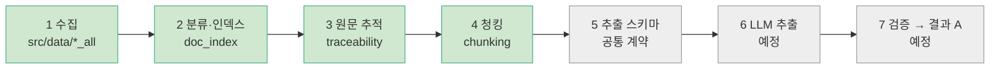
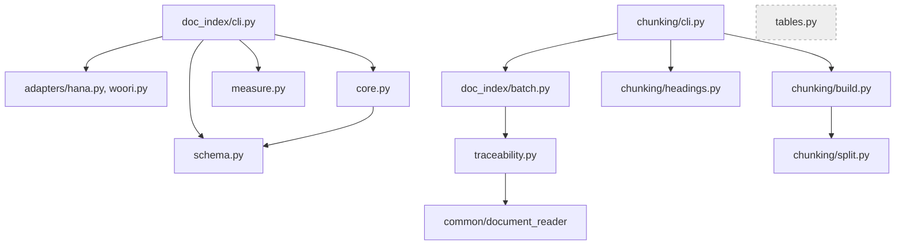

# file_pipeline — 파일 기반 처리 방식 (담당: 이현근)

이 문서는 이 폴더의 **지도**다. 파일을 추가하거나 옮기면 같은 커밋에서 아래 3절 표와 4절 그림을 고친다.
(지도와 코드가 다르면 지도를 고친다.) 마지막 갱신: 2026-11-02

## 1. 한 줄 목적

카드 상품설명서 PDF를 Python으로 직접 처리해 분류 → 원문 추적 → 청킹 → LLM 추출 → 검증까지 수행한다.
`db_pipeline/`(김병주)과 같은 원천 문서를 다른 방식으로 처리하는 **독립 구현**이며, 서로의 결과를 입력으로 쓰지 않는다.

## 2. 전체 흐름

프로젝트 전체 11단계 중 이 폴더가 맡는 1~7단계다. 8~11단계(비교, 정규화, 지식그래프, 챗봇)와 상대 담당은 [프로젝트 지도](../../../../docs/프로젝트-지도.md)에 있다.
색: 초록 = 완료, 회색 = 예정.



| 단계 | 입력 → 출력 | 상태 |
|---|---|---|
| 1 수집 | 카드사 사이트 → `src/data/{hana,woori}_all/` PDF와 manifest | 완료 (신용 중심, 체크는 하나만) |
| 2 분류·인덱스 | manifest → `src/card_benefit/data/index/{issuer}/documents.csv`, `product_docs.csv` | 완료 |
| 3 원문 추적 | 대표 PDF → 쪽별 원문과 청크 위치 JSON | 완료 (배치 포함) |
| 4 청킹 | 쪽 원문 → 청크(쪽 번호와 글자 위치 포함) | 완료 (`chunking/`) |
| 5 추출 스키마 | 뽑을 항목과 관계의 공통 계약 | 예정. 공통 계약 여부는 DB 쪽 작업 후 재개 |
| 6 LLM 추출 | 청크 → 혜택·조건·한도·관계와 원문 근거 | 예정 |
| 7 검증 | 추출 결과 → 공통 형식 결과 A | 예정 |

## 3. 폴더 구성

```
file_pipeline/
├── README.md                이 문서
├── __init__.py
├── traceability.py          3단계: PDF 1개 → 쪽별 원문 + 청크 위치 JSON
├── chunking/                4단계: 쪽 원문을 청크로 자름
│   ├── split.py             쪽 원문 + 제목 위치 → 자를 조각 (PDF를 열지 않는 순수 함수)
│   ├── headings.py          글자 크기로 제목 줄을 찾아 쪽 원문 안의 위치로 변환, 표 안 제목은 제외
│   ├── build.py             쪽 → 청크 변환과 "이어 붙이면 원문과 같은가" 검증
│   └── cli.py               카드사 1곳의 청크 JSON 생성 (실행 진입점)
├── doc_index/               2단계(+3단계 일괄 실행): 분류·인덱스
│   ├── core.py              인덱스 만드는 핵심 규칙 (대표 선정, 공유 문서, 연결 표)
│   ├── measure.py           PDF 1개의 해시·쪽수·글자 수 측정
│   ├── schema.py            열 이름과 허용 값
│   ├── cli.py               카드사 1곳의 인덱스 생성 (실행 진입점)
│   ├── batch.py             인덱스의 대표 문서를 traceability로 일괄 변환
│   ├── tables.py            표 보조본 추출 (아직 어디에서도 부르지 않음)
│   └── adapters/            카드사별 원본 manifest → 공통 항목 변환 (hana.py, woori.py)
├── notebooks/               눈으로 확인하는 보조용. 로직은 두지 않는다. 커밋 전 출력 삭제
│   ├── doc_index_check.ipynb    인덱스 결과 점검
│   ├── chunking_explore.ipynb   청킹 기준 탐색
│   └── data_modify.ipynb        PDF 1개의 페이지 이미지와 추출 텍스트를 보는 기존 노트북
├── pilot_hana_15299/        하나 1건으로 원문 추적을 시험한 기록 (참고용)
│   ├── 08_파일럿_결과.md  08_표본대조_결과.md  09_마감.md  check_sheet.md
│   └── traceability.json
```

## 4. 모듈 호출 관계

화살표는 "가져다 쓴다"이다. `tables.py`는 아직 연결되지 않았다.



`core.py` 안에서 일어나는 일의 순서는 `docs/작업이력/core-단순화-계획.md`의 흐름도에 있다.

## 5. 실행 방법

저장소 루트에서 실행한다. PDF 라이브러리가 준비된 uv 환경이 필요하다.

```bash
# 2단계: 카드사 1곳의 인덱스 만들기
PYTHONPATH=src:src/card_benefit uv run --locked --no-sync python -m payment_card.file_pipeline.doc_index.cli --issuer woori --overwrite

# 3단계: 대표 문서를 쪽별 원문 JSON으로 변환 (출력 폴더는 직접 지정)
PYTHONPATH=src:src/card_benefit uv run --locked --no-sync python -m payment_card.file_pipeline.doc_index.batch --issuer woori --output-dir <저장 폴더>

# 4단계: 3단계 JSON을 청크 JSON으로 (입력은 3단계 출력 폴더, 출력 폴더는 직접 지정)
PYTHONPATH=src:src/card_benefit uv run --locked --no-sync python -m payment_card.file_pipeline.chunking.cli --issuer woori --trace-dir <3단계 출력 폴더> --output-dir <저장 폴더>

# 테스트
PYTHONPATH=src:src/card_benefit uv run --locked --no-sync python -m pytest -q src/card_benefit/payment_card/tests/
```

JSON에는 쪽 전체 원문이 들어간다. 로컬 임시 폴더에 저장하고 공유하거나 Git에 올리기 전에 내용을 확인한다.

## 6. 읽는 순서 (처음 보는 사람)

1. 이 README의 2절 흐름도
2. `docs/작업이력/2026-11-02-카드사-문서-인덱스.md` — 무엇을 왜 했는지
3. `doc_index/core.py` 맨 위 설명과 맨 아래 `build_index` — 인덱스가 만들어지는 순서
4. `notebooks/doc_index_check.ipynb` — 결과를 표로 보기
5. `traceability.py` — 원문 추적 JSON 구조
6. `chunking/split.py` — 쪽을 어디서 자르는지(35줄)

## 7. 결정 기록

| 날짜 | 결정 | 이유 |
|---|---|---|
| 2026-11-02 | 범위는 신용카드와 common. 체크카드는 2단계 | 우리 `debit/`이 비어 있고 하나 체크는 변환본만 있는 카드가 있음 |
| 2026-11-02 | 같은 해시는 한 문서, 대표 1개만 `canonical=Y` | 같은 내용이 경로만 달라 여러 벌 있음(우리 107그룹) |
| 2026-11-02 | 웹 변환본은 공식 PDF가 있으면 대표에서 제외 | 같은 카드가 두 번 추출되는 것을 막음 |
| 2026-11-02 | 표는 평문을 원문으로 두고 검사 통과한 것만 보조본 | 표 추출기가 병합 셀을 비우거나 글자를 쪼갬 |
| 2026-11-02 | 청킹은 쪽 4000자 이하는 쪽 단위, 초과는 글자 크기 제목 기준, 400자 미만은 앞에 붙임 | 193개 문서 814쪽으로 24가지 기준값 비교 |
| 2026-11-02 | 제목 줄이 감지된 표 안에 있으면 그 앞에서 자르지 않음 | 자를 위치 270곳 중 24곳(9%)이 표 안. 대가로 4000자 초과 청크가 21 → 29개 |
| 2026-11-02 | 제목 없는 긴 쪽(카드의정석2 7쪽 7,935자 등)은 쪼개지 않음 | 길이가 실제 문제인지 5단계에서 확인한 뒤 문단 규칙 추가 여부 결정 |
| 2026-11-02 | OCR 도구는 아직 설치하지 않음 | 대표 문서 기준 우리 44개, 하나 2개가 대상. 텍스트 PDF로 먼저 끝까지 시험 |
| 2026-11-02 | 사람이 PDF를 열어 확인한 결과는 `review_decisions.csv`에 기록(이름 일치, 혜택 내용이 그림인지) | 확인 결과를 코드가 아니라 파일에 남기고, 자동 판정과 사람 판정을 `decided_by`로 구분 |
| 2026-11-02 | 공유 문서는 RAG에서 청크 1개 + 상품 목록 | 같은 내용이 검색 결과에 여러 번 나오는 것을 막음 |

## 규칙

- `db_pipeline/`을 import하지 않는다. 공통 모델·SQL은 `payment_card/` 최상위 것을 쓰고 복사하지 않는다.
- 새 Python 폴더를 만들면 `__init__.py`도 함께 만든다. 테스트는 `payment_card/tests/test_*.py`에 둔다.
- 원천·샘플 문서는 `src/card_benefit/data/`에 둔다. `src/data/*_all/`은 `.gitignore` 대상이다.
- 코드를 쓰기 전에 쉬운 말로 설명하고 흐름도를 보여 준 뒤 승인받는다. 승인 전에는 커밋하지 않는다.
- 상세: `src/card_benefit/docs/development_roles.md`
