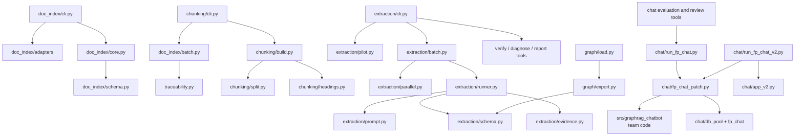

# file_pipeline — 파일 기반 처리 방식 (담당: 이현근)

이 문서는 이 폴더의 **지도**다. 파일을 추가하거나 옮기면 같은 커밋에서 아래 3절 표와 4절 그림을 고친다.
(지도와 코드가 다르면 지도를 고친다.) 마지막 갱신: 2026-11-06

## 1. 한 줄 목적

카드 상품설명서 PDF를 Python으로 직접 처리해 분류 → 원문 추적 → 청킹 → LLM 추출 → 검증까지 수행한다.
`db_pipeline/`(김병주)과 같은 원천 문서를 다른 방식으로 처리하는 **독립 구현**이며, 서로의 결과를 입력으로 쓰지 않는다.

## 2. 전체 흐름

프로젝트 11단계 중 `file_pipeline`은 1~7단계의 파일 처리와 10~11단계의 그래프·챗봇 코드를 제공한다. 8단계 결과 비교는 공동 작업이다. 9단계 정규화·통합은 아직 연결되지 않았으며, `graph/normalize_values.py`는 독립 보조 모듈이다. 전체 담당과 현황은 [프로젝트 지도](../../../../docs/프로젝트-지도.md)를 본다.

```mermaid
flowchart LR
    A[1 수집<br/>src/data/*_all] --> B[2 분류·인덱스<br/>doc_index]
    B --> C[3 원문 추적<br/>doc_index.batch + traceability]
    C --> D[4 청킹<br/>chunking]
    D --> O[5 추출 스키마<br/>extraction.schema]
    O --> E[6 LLM 추출<br/>extraction]
    E --> F[7 검증 → 결과 A<br/>extraction]
    F --> CMP[8 결과 A·B 비교<br/>공동]
    CMP --> N[9 정규화·통합<br/>공동 연결 단계]
    N --> G[10 지식그래프<br/>graph]
    G --> H[11 질의·챗봇<br/>chat]
    classDef done fill:#cfe8cf,stroke:#4a8
    classDef shared fill:#dde8f7,stroke:#58a
    class A,B,C,D,E,F,G,H done
    class O,N,CMP shared
```



| 단계 | 이 폴더와의 관계 |
|---|---|
| 1~7 | `file_pipeline`이 수집 자료의 인덱싱, 원문 추적, 청킹, 추출, 결과 A 검증을 맡는다. |
| 8 | 결과 A와 `db_pipeline` 결과 B를 공동 기준으로 비교한다. |
| 9 | 정규화·통합은 아직 연결되지 않았다. `graph/normalize_values.py`는 보조 모듈이다. |
| 10~11 | 이 폴더의 `graph/`와 `chat/`가 지식그래프 및 챗봇 경로를 제공한다. |

**코드 소유 경계:** `file_pipeline/` 안의 코드는 사용자 소유다. `src/graphrag_chatbot/`은 팀 코드이며, 이 폴더에서는 어댑터를 통해 연결해서만 사용한다. 팀 폴더의 코드를 이 폴더로 복사하거나 직접 수정하는 범위가 아니다.

## 3. 폴더 구성

| 경로 | 역할 |
|---|---|
| `doc_index/` | 카드사 manifest를 공통 인덱스로 바꾸고 대표 문서를 선정하며, 배치 원문 추적을 시작한다. 자세한 분류는 [doc_index README](doc_index/README.md). |
| `chunking/` | 쪽 원문과 제목 위치를 청크로 나누고 위치 보존을 확인한다. 자세한 분류는 [chunking README](chunking/README.md). |
| `extraction/` | 추출 스키마·근거 위치·LLM 실행기와 시범, 평가·검토·진단 도구를 둔다. 자세한 분류는 [extraction README](extraction/README.md). |
| `graph/` | 추출 결과를 그래프 형식으로 변환·검증·적재하고 그래프 보조 질의를 제공한다. |
| `chat/` | 그래프 챗봇의 두 실행 화면, 팀 코드 어댑터, 평가·검수 도구를 둔다. 자세한 분류는 [chat README](chat/README.md). |
| `ledger/` | 인덱스·추적·청크 JSON을 문서·쪽·청크 테이블 열에 매핑해 검토용 SQL을 만든다(DB 연결 코드 없음). 자세한 분류는 [ledger README](ledger/README.md). |
| `notebooks/` | 모듈을 눈으로 점검하는 보조 노트북과 점검 목록을 둔다. 출력은 비운 상태로 유지한다. |
| `sql/` | 파일 기반 파이프라인용 PostgreSQL 스키마 참고 명세를 둔다. 실행 코드가 자동 적용하지 않는다. |
| 최상위 `traceability.py` | PDF 한 건에서 쪽별 원문과 청크 위치 데이터를 만든다. |
| 최상위 `__init__.py`, `README.md` | 패키지 표시와 이 폴더의 안내 문서다. |

`extraction/pilot_hana_15299/`에는 하나카드 문서 한 건의 추적성 파일럿 결과와 대조 기록을 둔다. 최상위 `fp_schema.md`는 현재 비어 있어 위치를 유지한다.

`sql/card_benefit_schema.sql` 은 전달받은 카드 문서·AI 추출·혜택 스키마 명세를 PostgreSQL DDL로 옮긴 참고 파일이다. 현재 `file_pipeline` 실행 코드는 JSON 파일을 사용하며 이 SQL을 자동 적용하지 않는다.

### 3-1. 이 파일이 하는 일 (처음 보는 사람용)

파일 이름이 영어 약어라 역할이 한눈에 안 보이므로, `extraction/`과 `graph/` 안의 파일을 하는 일 기준으로 모았다. **LLM을 실제로 부르는 것은 맨 위 "추출 실행" 묶음뿐**이고, 나머지는 이미 저장된 결과 파일을 읽어 분석한다. 사람이 읽는 결과(대조표 등)에는 PDF 원문이 들어가므로 저장소 밖에 둔다.

**① 추출 실행 (핵심 흐름)**

| 파일 | 하는 일 | 입력 → 출력 |
|---|---|---|
| `schema.py` | 뽑을 항목의 모양(혜택, 조건, 한도, 대상, 관계)과 허용값을 정한다 | 규칙 정의 |
| `prompt.py` | LLM에게 보낼 지시문을 만든다 | 청크 → 지시문 |
| `llm_adapter.py` | OpenAI 호출을 감싼다. 키는 환경변수 이름으로만 받고, 실패 원인은 비밀 없이 남긴다 | 지시문 → 응답 |
| `evidence.py` | LLM이 낸 인용문을 청크 원문에서 찾아 쪽 번호와 글자 위치로 바꾼다 | 인용문 → 위치 |
| `runner.py` | 청크 1개를 처리한다: 호출 → 응답 해석 → 스키마 검사 → 인용문 위치 부여, 실패는 종류별로 기록 | 청크 → 결과 1개 |
| `parallel.py` | 여러 청크를 동시에 호출하고 일시적 오류는 재시도, 고칠 수 없는 오류가 반복되면 중단 | 청크 목록 → 결과들 |
| `batch.py` | 문서 단위로 결과 파일을 저장하고 요약을 만들며 이어하기를 지원 | 청크 파일 → 결과 폴더 |
| `cli.py` | 위를 명령어로 실행하는 입구(`select`, `estimate`, `run`, `summarize`, `verify` 등). `--execute`가 있어야 실제 호출 | 명령 |

**② 시범 실행 보조**

| 파일 | 하는 일 |
|---|---|
| `pilot.py` | 시범으로 돌릴 청크를 골고루 고르고, 프롬프트 크기와 토큰을 어림한다(호출 없음) |
| `pilot_run.py` | 선정부터 실행, 요약, 검증, 그래프 변환까지 한 번에. `--execute`가 없으면 계획만 보여 준다 |

**③ 결과 점검·진단 (모두 읽기 전용, 원문 미출력)**

| 파일 | 답하는 질문 |
|---|---|
| `verify.py` | 숫자가 인용문에 있나? 연결 안 된 항목은? 공유 한도 표시가 맞나? (거친 신호) |
| `diagnose.py` | 결과가 빈 청크는 왜 비었나? (제목, 길이, 혜택 키워드 수) |
| `locate_diagnose.py` | 인용문 위치를 못 찾은 이유는? (공백만 다름, 일부만 일치, 환각 의심 등) |
| `report/ambiguity_report.py` | 같은 문구가 청크에 여러 번 나와 위치가 모호한 인용문은 어떤 것이 많나? |
| `enum_violation_report.py` | 허용값 밖의 분류값(`kind` 등)을 어떤 값이 얼마나 냈나? |
| `eval/variance.py` | 같은 청크를 여러 번 돌렸을 때 결과가 얼마나 흔들리나? |
| `prompt_version_compare.py` | 프롬프트를 바꾸자 항목 수가 늘었나 줄었나? (개수만, 정확성 아님) |
| `eval/eval_runs.py` | 같은 프롬프트 반복 또는 프롬프트별 성공·실패·빈 결과와 항목·근거 수를 요약하고, 반복 범위와 비교한다 |
| `report/full_run_report.py` | 저장된 전체 실행 결과를 청크·위치·스키마·항목·길이 구간·표 밀도별 숫자로 집계한다. 원문/인용문 본문은 출력하지 않는다 |
| `report/table_density_report.py` | 청크 텍스트만으로 표 밀도를 거칠게 나눠 결과 지표를 비교한다 (PDF를 열지 않음) |
| `eval/consensus.py` | 여러 실행에서 k회 이상 일치한 항목과 연결 관계만 새 결과 폴더에 저장한다. 정밀도가 높아지고 재현율은 낮아질 수 있다 |
| `report/item_loss_report.py` | 반복 기준 그룹과 비교 그룹 사이의 사라진 후보·불안정 항목·새 항목 수를 종류·길이·표 밀도로 집계한다. 안정 항목 분모와 비율을 출력하며, `--fuzzy --fuzzy-threshold 0.8`로 거친 표기 유사 매칭을 켤 수 있다. 항목 텍스트는 출력하지 않으며 정확성을 판단하지 않는다 |

**④ 복구·내보내기**

| 파일 | 하는 일 |
|---|---|
| `relocate.py` | 공백·문장부호만 달라 위치를 못 찾은 인용문의 위치를 안전한 경우에만 복구한다(원본 폴더는 수정하지 않음) |
| `result_a.py` | 근거 위치 기준으로 비교하기 쉬운 형식(JSONL)으로 내보낸다. 초안이며 8단계에서 상대 형식과 맞춘다 |

**⑤ 사람 점검**

| 파일 | 하는 일 |
|---|---|
| `review_sheet.py` | 사람이 원문과 대조할 표(마크다운)를 만든다 |
| `review_auto_audit.py` | 기존 대조표의 인용문·청크·쪽 원문 위치·숫자 근거를 오프라인 점검한다. `--result-dir`을 주면 관계 끝점 ID와 허용된 엔티티 유형 연결도 확인한다. 추출 의미를 확정하지 않고 실패 코드만 저장소 밖 JSON으로 남긴다. PDF 텍스트 추출기가 쪽 인용문을 찾지 못한 경우는 페이지 단위 시각 확인으로 묶는다 |
| `review_tally.py` | 사람이 체크한 표를 집계해 일치·오류·누락 비율을 낸다 |
| `accuracy_review.py` | 청크 길이 구간별로 혜택 추출 표본과 원문 열람 파일을 준비하고 사람 판정을 집계해 정밀도를 계산한다 |
| `review/empty_review.py` | 두 실행에서 비어 있던 청크 중 신호가 많은 항목의 원문 열람 파일과 판정표를 만들고 결과를 집계한다 |

**⑥ 지식그래프 (`graph/`)**

| 파일 | 하는 일 |
|---|---|
| `normalize_values.py` | "5만원", "3천원", "리터당 50원", "3만원 이상", "연 4회" 같은 원문 표기를 수치로 바꾼다. 해석 못 하면 추측하지 않고 원문과 `unparsed` 사유를 남긴다(아직 export에는 연결하지 않음) |
| `export.py` | 추출 결과를 노드·간선·근거 CSV로 바꾼다. 위반 행은 사유별로 세어 제외한다 |
| `load.py` | CSV를 검증하고 `fp_` 테이블에만 넣는다. 기본은 드라이런, `--execute`가 있어야 DB에 쓴다 |
| `cypher_export.py` | 그래프 CSV를 Fp 라벨과 FP_ 관계를 사용하는 Neo4j Browser Cypher 스크립트로 변환한다 |
| `schema.sql`, `queries.sql` | 테이블 정의(실행 전 합의 필요)와 읽기 전용 질의 예시 |

**⑦ 챗봇 평가 도구 (`chat/`)**

| 파일 | 하는 일 |
|---|---|
| `chat/fp_chat_patch.py` | 명시적으로 적용할 때만 팀 GraphRAG를 `fp_chat` 뷰에 연결하고 질문 키워드 우선 검색을 수행한다 |
| `chat/run_fp_chat.py` | Streamlit 챗봇 진입점. `streamlit run`으로 실행하고 화면에 fp_chat 모드를 표시한다 |
| `chat/eval/eval_questions.py` | 그래프 CSV에서 PDF 원문 없이 결정적인 메타데이터 질문 세트를 만든다. 출력은 `/tmp`만 허용한다 |
| `chat/eval/run_eval.py` | 기본 드라이런, `--execute`일 때 소량 질문 평가와 검색·답변·출처·시간 지표를 계산한다 |

**이름 읽는 법**: `report`는 숫자 보고서, `diagnose`는 원인 분류, `relocate`는 위치 복구, `verify`는 자동 점검, `variance`는 흔들림 측정, `review`는 사람 점검이다.

## 4. 모듈 호출 관계

화살표는 모듈 간 주요 호출 관계다.



## 5. 실행 방법

저장소 루트에서 실행한다. PDF 라이브러리가 준비된 uv 환경이 필요하다.

### 챗봇 화면

```bash
PYTHONPATH=src:src/card_benefit uv run --locked streamlit run src/card_benefit/payment_card/file_pipeline/chat/run_fp_chat.py
PYTHONPATH=src:src/card_benefit uv run --locked streamlit run src/card_benefit/payment_card/file_pipeline/chat/run_fp_chat_v2.py
```

`run_fp_chat.py`는 팀 화면에 사용자 연결부를 적용하고, `run_fp_chat_v2.py`는 사용자 소유 v2 화면을 실행한다. `chat/app_v2.py`는 직접 실행하지 않는다. 직접 실행하면 팀 `rag` 모듈의 Anthropic 임포트 오류가 발생한다.

```bash
# 2단계: 카드사 1곳의 인덱스 만들기
PYTHONPATH=src:src/card_benefit uv run --locked --no-sync python -m payment_card.file_pipeline.doc_index.cli --issuer woori --overwrite

# 3단계: 대표 문서를 쪽별 원문 JSON으로 변환 (출력 폴더는 직접 지정)
PYTHONPATH=src:src/card_benefit uv run --locked --no-sync python -m payment_card.file_pipeline.doc_index.batch --issuer woori --output-dir <저장 폴더>

# 4단계: 3단계 JSON을 청크 JSON으로 (입력은 3단계 출력 폴더, 출력 폴더는 직접 지정)
PYTHONPATH=src:src/card_benefit uv run --locked --no-sync python -m payment_card.file_pipeline.chunking.cli --issuer woori --trace-dir <3단계 출력 폴더> --output-dir <저장 폴더>

# 6단계: 하나카드 청크 표본을 고르고 프롬프트 크기를 추정 (경로는 저장소 밖)
PYTHONPATH=src:src/card_benefit uv run --locked --no-sync python -m payment_card.file_pipeline.extraction.cli select --index-csv src/card_benefit/data/index/hana/documents.csv --chunk-dir <하나 청크 폴더> --output <저장소 밖>/pilot.json --count 5
PYTHONPATH=src:src/card_benefit uv run --locked --no-sync python -m payment_card.file_pipeline.extraction.cli estimate --chunk-dir <하나 청크 폴더> --chunk-ids <저장소 밖>/pilot.json

# 기존 결과 재집계 (LLM 호출 없이 기존 result.json만 읽음)
PYTHONPATH=src:src/card_benefit uv run --locked --no-sync python -m payment_card.file_pipeline.extraction.cli summarize --chunk-dir <하나 청크 폴더> --output-dir <저장소 밖>/results --chunk-ids <저장소 밖>/pilot.json

# 기본 run은 드라이런. 실제 호출에는 --execute와 모델 이름이 필요하며 키는 OPENAI_API_KEY에서 읽음
PYTHONPATH=src:src/card_benefit uv run --locked --no-sync python -m payment_card.file_pipeline.extraction.cli run --chunk-dir <하나 청크 폴더> --chunk-ids <저장소 밖>/pilot.json --output-dir <저장소 밖>/results --max-chunks 5

# 실제 호출 예시: 먼저 OPENAI_API_KEY를 셸 환경에 설정하고, 모델명을 정한 뒤 명시적으로 실행
PYTHONPATH=src:src/card_benefit uv run --locked --no-sync python -m payment_card.file_pipeline.extraction.cli run --chunk-dir <하나 청크 폴더> --chunk-ids <저장소 밖>/pilot.json --output-dir <저장소 밖>/results --max-chunks 5 --workers 1 --retries 2 --max-estimated-tokens 200000 --model <모델명> --execute

# 저장 결과 자동 신호 점검 (원문이나 인용문은 출력하지 않음)
PYTHONPATH=src:src/card_benefit uv run --locked --no-sync python -m payment_card.file_pipeline.extraction.cli verify --result-dir <저장소 밖>/results --chunk-dir <하나 청크 폴더> --output-dir <저장소 밖>/verification

# 인용 위치 실패 분류 (출력 JSON에는 청크 id·경로·분류·길이·일치 비율만 저장)
PYTHONPATH=src:src/card_benefit uv run --locked --no-sync python -m payment_card.file_pipeline.extraction.cli diagnose-locate --result-dir <저장소 밖>/results --chunk-dir <하나 청크 폴더> --output-dir <저장소 밖>/locate-diagnosis

# 공백·문장부호 유형만 유일 일치할 때 별도 결과 폴더에서 위치 복구
PYTHONPATH=src:src/card_benefit uv run --locked --no-sync python -m payment_card.file_pipeline.extraction.cli relocate --result-dir <저장소 밖>/results --chunk-dir <하나 청크 폴더> --output-dir <저장소 밖>/relocated-results

# 반복 실행 결과 폴더 2개 이상 비교
PYTHONPATH=src:src/card_benefit uv run --locked --no-sync python -m payment_card.file_pipeline.extraction.cli variance --result-dirs <저장소 밖>/run1/results <저장소 밖>/run2/results <저장소 밖>/run3/results --output-dir <저장소 밖>/variance

# 한 명령으로 계획 출력. 실행 시에만 --execute 추가 (최대 추정 200000 토큰)
PYTHONPATH=src:src/card_benefit uv run --locked --no-sync python -m payment_card.file_pipeline.extraction.cli pilot-run --index-csv src/card_benefit/data/index/hana/documents.csv --chunk-dir <하나 청크 폴더> --work-dir <저장소 밖>/pilot_run --count 5 --model <모델명> --workers 1

# 하나카드 543개 전체 실행 절차 (실제 실행은 승인된 환경에서만)
# 1. 계획만 확인 (실행하지 않고 선택과 추정만 함)
PYTHONPATH=src:src/card_benefit uv run --locked --no-sync python -m payment_card.file_pipeline.extraction.cli pilot-run --index-csv src/card_benefit/data/index/hana/documents.csv --chunk-dir ~/pilot_work/chunks/hana --work-dir ~/pilot_work/full_hana --count 543 --model <모델명> --workers 4
# 2. 실제 실행; 중단 후 같은 출력 폴더로 이 명령을 다시 실행하면 저장된 결과를 재사용
PYTHONPATH=src:src/card_benefit uv run --locked --no-sync python -m payment_card.file_pipeline.extraction.cli run --chunk-dir ~/pilot_work/chunks/hana --output-dir ~/pilot_work/full_hana/results --max-chunks 543 --workers 4 --allow-large --model <모델명> --execute
# 3. 요약
PYTHONPATH=src:src/card_benefit uv run --locked --no-sync python -m payment_card.file_pipeline.extraction.cli summarize --chunk-dir ~/pilot_work/chunks/hana --output-dir ~/pilot_work/full_hana/results
# 4. 검증 신호
PYTHONPATH=src:src/card_benefit uv run --locked --no-sync python -m payment_card.file_pipeline.extraction.cli verify --result-dir ~/pilot_work/full_hana/results --chunk-dir ~/pilot_work/chunks/hana --output-dir ~/pilot_work/full_hana/verification
# 5. 그래프 CSV 내보내기
PYTHONPATH=src:src/card_benefit uv run --locked --no-sync python -m payment_card.file_pipeline.graph.export --result-dir ~/pilot_work/full_hana/results --chunk-dir ~/pilot_work/chunks/hana --index-dir src/card_benefit/data/index/hana --model-name <모델명> --output-dir ~/pilot_work/full_hana/graph
# 6. 그래프 적재 드라이런 (DB 쓰기 없음)
PYTHONPATH=src:src/card_benefit uv run --locked --no-sync python -m payment_card.file_pipeline.graph.load --csv-dir ~/pilot_work/full_hana/graph

# Result A JSONL DRAFT (stage 8 counterpart와 정렬 예정)
PYTHONPATH=src:src/card_benefit uv run --locked --no-sync python -m payment_card.file_pipeline.extraction.cli result-a --result-dir <저장소 밖>/results --chunk-dir <하나 청크 폴더> --output-dir <저장소 밖>/result_a

# 저장된 청크 결과만으로 요약 다시 만들기 (LLM 호출 없음)
PYTHONPATH=src:src/card_benefit uv run --locked --no-sync python -m payment_card.file_pipeline.extraction.cli summarize --chunk-dir <하나 청크 폴더> --output-dir <저장소 밖>/results

# 빈 추출 결과 분류 (LLM 호출 없음, 결과에는 청크 원문을 저장하지 않음)
PYTHONPATH=src:src/card_benefit uv run --locked --no-sync python -m payment_card.file_pipeline.extraction.cli diagnose-empty --chunk-dir <하나 청크 폴더> --results-dir <저장소 밖>/results --output-dir <저장소 밖>/diagnosis

# 사람이 채운 검토표의 표시 수와 비율 집계 (원문이나 인용문은 출력하지 않음)
PYTHONPATH=src:src/card_benefit uv run --locked --no-sync python -m payment_card.file_pipeline.extraction.review_tally --sheet <저장소 밖>/review_sheet.md --output-dir <저장소 밖>/review_tally

# 테스트
PYTHONPATH=src:src/card_benefit uv run --locked --no-sync python -m pytest -q src/card_benefit/payment_card/tests/
```

JSON에는 쪽 전체 원문이 들어간다. 로컬 임시 폴더에 저장하고 공유하거나 Git에 올리기 전에 내용을 확인한다.
시범 표본의 표/규칙 키워드 탐지는 거친 선정 신호다. `run`은 `--execute`가 없으면 네트워크를 호출하지 않으며 기본 최대 새 호출 수는 5다. 기본 예상 토큰 한도는 200000이며 초과 시 실행을 거부하고 `--allow-large`로 해제한다. `--workers`는 1~16 범위로 제한한다. 재시도 가능한 호출 오류는 기본 2회 재시도하고, 재시도 불가 오류는 즉시 실패로 기록한다. 기본 fail-fast는 같은 비재시도 오류 코드가 연속 3개 청크에서 반복되면 이후 청크 제출을 멈추며 아직 시작하지 않은 청크에는 결과 파일을 만들지 않는다. `--no-fail-fast`로 중단 동작을 끌 수 있다. `summarize`는 기존 결과 폴더의 청크별 JSON만 다시 집계하고, 아직 결과가 없는 청크는 `missing_results`로 표시한다. 청크 폴더에 없는 요청 ID는 오류로 중단한다. 프롬프트 버전을 비교할 때는 결과 폴더를 구분해 각각 집계한다. `verify`는 원문 근거를 판정하지 않는 신호이며 숫자·단위 비교도 거친 검사다. `pilot-run` 계획 모드는 DB/LLM 호출 없이 선택과 추정만 수행한다.

`result_a.py`와 `result-a`는 stage 7의 **DRAFT**다. 저장된 결과에서 위치·유형·정규화 값을 내보내며 인용문 텍스트를 포함하지 않는다. 위치 없는 행은 별도 JSONL로 분리하고, stage 8에서 counterpart와 정렬한다.

같은 청크를 세 번 비교하려면 각 `run`에서 같은 `--chunk-ids`와 청크 폴더를 사용하고 출력 경로만 나눈다. 아래 예시는 실제 호출이므로 실행할 때 `--execute`가 필요하며, API 키는 환경변수로만 전달한다. `--temperature 0`은 지원 모델에서 변동성을 줄이는 설정이고, 미지정 시 SDK 기본 동작을 유지한다. gpt-6-luna는 temperature 0 요청을 400으로 거부했다(2026-11-03 관찰).

```bash
for n in 1 2 3; do
  PYTHONPATH=src:src/card_benefit uv run --locked --no-sync python -m payment_card.file_pipeline.extraction.cli run --chunk-dir ~/pilot_work/chunks/hana --chunk-ids ~/pilot_work/pilot_ids20.json --output-dir ~/pilot_work/repeat$n/results --max-chunks 20 --model <모델명> --temperature 0 --execute
done
PYTHONPATH=src:src/card_benefit uv run --locked --no-sync python -m payment_card.file_pipeline.extraction.cli variance --result-dirs ~/pilot_work/repeat1/results ~/pilot_work/repeat2/results ~/pilot_work/repeat3/results --output-dir ~/pilot_work/repeat-variance
```

`variance`의 항목 집합 키는 유형과 정규화된 이름·텍스트·종류를 사용하며 인용문을 비교하지 않는다. 항목 수 변동이 큰 청크는 변동계수 0.5 이상으로 집계한다. 결과 JSON은 청크 id와 수치 지표만 저장한다.


```bash
# 반복 결과 숫자 요약: 그룹 표준편차와 반복 범위 비교 (정확성 판정 아님)
PYTHONPATH=src:src/card_benefit uv run --locked --no-sync python -m payment_card.file_pipeline.extraction.eval.eval_runs --group fixed_prompt=~/pilot_work/out5a,~/pilot_work/out5b --group new=~/pilot_work/out6 --output /tmp/eval-runs.json

# 여러 번 합의한 새 결과 폴더 (원래 결과는 수정하지 않음)
PYTHONPATH=src:src/card_benefit uv run --locked --no-sync python -m payment_card.file_pipeline.extraction.eval.consensus --run ~/pilot_work/out5a --run ~/pilot_work/out5b --run ~/pilot_work/out6 --k 2 --output-dir /tmp/consensus --summary-json /tmp/consensus-summary.json

# 청크 텍스트의 짧은 줄·숫자/단위·구분자·줄 길이 신호로 표 밀도 추정
PYTHONPATH=src:src/card_benefit uv run --locked --no-sync python -m payment_card.file_pipeline.extraction.report.table_density_report --chunk-dir ~/pilot_work/chunks/hana --run out3=~/pilot_work/out3 --run out4=~/pilot_work/out4 --run out5a=~/pilot_work/out5a --run out5b=~/pilot_work/out5b --run out6=~/pilot_work/out6 --output /tmp/table-density.json
```

`consensus`는 인용문을 쓰지 않는 `variance.py`의 정규화 키를 재사용한다. 항목은 k회 이상, 관계는 양 끝 항목과 함께 관계 키가 k회 이상 일치해야 유지한다. 유지율의 입력 항목 수는 실행별 평균이다. `table_density_report`의 세 등급은 텍스트 특징 기반의 거친 상대 구간이다. 세 도구의 보고서에는 결과·청크 원문 없이 수치와 청크 id만 기록한다.

## 6. 읽는 순서 (처음 보는 사람)

1. 이 README의 2절 흐름도
2. `docs/작업이력/01-문서인덱스-청킹/2026-11-02-카드사-문서-인덱스.md` — 무엇을 왜 했는지
3. `doc_index/core.py` 맨 위 설명과 맨 아래 `build_index` — 인덱스가 만들어지는 순서
4. `notebooks/doc_index_check.ipynb` — 결과를 표로 보기
5. `traceability.py` — 원문 추적 JSON 구조
6. `chunking/split.py` — 쪽을 어디서 자르는지(35줄)

## 7. 결정 기록

| 날짜 | 결정 | 이유 |
|---|---|---|
| 2026-11-02 | 범위는 신용카드와 common. 체크카드는 2단계 | 우리 `debit/`이 비어 있고 하나 체크는 변환본만 있는 카드가 있음 |
| 2026-11-02 | 같은 해시는 한 문서, 대표 1개만 `canonical=Y` | 같은 내용이 경로만 달라 여러 벌 있음(우리 107그룹) |
| 2026-11-02 | 웹 변환본은 공식 PDF가 있으면 대표에서 제외 | 같은 카드가 두 번 추출되는 것을 막음 |
| 2026-11-02 | 표는 평문을 원문으로 두고 검사 통과한 것만 보조본 | 표 추출기가 병합 셀을 비우거나 글자를 쪼갬 |
| 2026-11-02 | 청킹은 쪽 4000자 이하는 쪽 단위, 초과는 글자 크기 제목 기준, 400자 미만은 앞에 붙임 | 193개 문서 814쪽으로 24가지 기준값 비교 |
| 2026-11-02 | 제목 줄이 감지된 표 안에 있으면 그 앞에서 자르지 않음 | 자를 위치 270곳 중 24곳(9%)이 표 안. 대가로 4000자 초과 청크가 21 → 29개 |
| 2026-11-02 | 제목 없는 긴 쪽(카드의정석2 7쪽 7,935자 등)은 쪼개지 않음 | 길이가 실제 문제인지 5단계에서 확인한 뒤 문단 규칙 추가 여부 결정 |
| 2026-11-02 | OCR 도구는 아직 설치하지 않음 | 대표 문서 기준 우리 44개, 하나 2개가 대상. 텍스트 PDF로 먼저 끝까지 시험 |
| 2026-11-02 | 사람이 PDF를 열어 확인한 결과는 `review_decisions.csv`에 기록(이름 일치, 혜택 내용이 그림인지) | 확인 결과를 코드가 아니라 파일에 남기고, 자동 판정과 사람 판정을 `decided_by`로 구분 |
| 2026-11-02 | 공유 문서는 RAG에서 청크 1개 + 상품 목록 | 같은 내용이 검색 결과에 여러 번 나오는 것을 막음 |

## 규칙

- `db_pipeline/`을 import하지 않는다. 공통 모델·SQL은 `payment_card/` 최상위 것을 쓰고 복사하지 않는다.
- 새 Python 폴더를 만들면 `__init__.py`도 함께 만든다. 테스트는 `payment_card/tests/test_*.py`에 둔다.
- 원천·샘플 문서는 `src/card_benefit/data/`에 둔다. `src/data/*_all/`은 `.gitignore` 대상이다.
- 코드를 쓰기 전에 쉬운 말로 설명하고 흐름도를 보여 준 뒤 승인받는다. 승인 전에는 커밋하지 않는다.
- 상세: `src/card_benefit/docs/development_roles.md`
