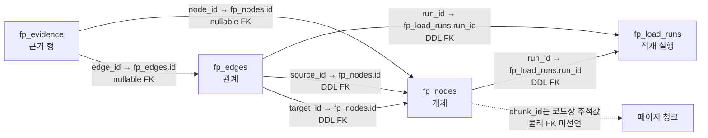
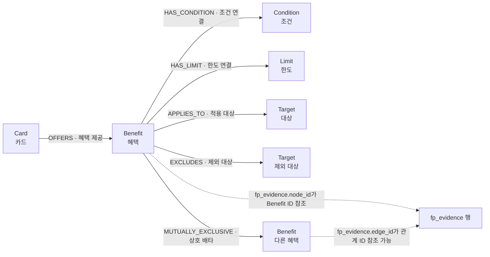
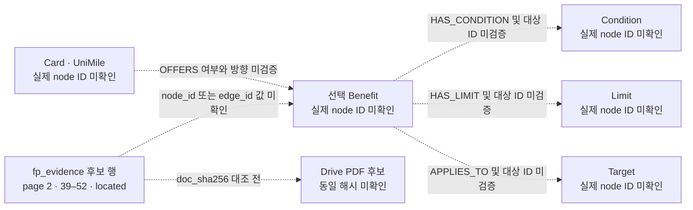

# 카드 혜택 프로젝트 Supabase 데이터 구조 설명

작성 기준: 2026-11-05. Supabase 대시보드의 프로젝트 스키마를 직접 열람하거나 SQL을 실행하지 않았다. 현재 작업 트리의 `file_pipeline/graph/schema.sql` 및 코드, GitHub `main` 문서, Google Drive 자료를 서로 다른 근거로 구분한다.

> **기존 문서 위치:** 참고 자료로 적힌 `card_benefit_supabase_점검_및_진행안_2026-11-05.md`는 저장소와 Drive에서 찾지 못했다. 같은 주제의 작업 트리 Markdown 초안을 바탕으로 보완했다. 이 파일의 이전 화면 확인 기록은 이번에 Supabase에서 재확인한 값으로 간주하지 않는다.

## 1. 핵심 결과와 추천

- 사용자가 맡은 `fp_pipeline`은 문서·청크에서 추출한 개체와 관계를 그래프 형태로 `public.fp_*`에 저장하도록 설계됐다. 팀원 `db_pipeline`은 문서 등록·페이지·청크·추출 검토를 PostgreSQL에서 관리하는 별도 흐름이다. 두 구조는 같은 입력 문서를 처리해도 서로의 테이블이나 결과를 공유하는 단일 스키마가 아니다.
- 현재 `fp_*` 컬럼·제약의 상세 표는 저장소 작업 트리의 DDL과 코드에서 확인했다. **Supabase 화면의 실제 설치 상태는 확인하지 못했다.** 이 문서에서 “코드 확인”은 현재 저장소 파일에 정의가 있다는 뜻이지, 운영 DB에 동일하게 설치됐다는 뜻이 아니다.
- 가장 추천하는 개선은 **영문 컬럼명을 유지하고 한글 데이터 사전과 한글 병기 관계도를 제공하는 것**이다. 이해에 필요한 설명을 빠르게 얻으면서 DB와 기존 코드 변경을 피한다.
- 이 보고서에서 Supabase 쓰기, SQL 실행, 뷰 생성, 컬럼 설명·컬럼명 변경, 데이터 적재·삭제는 하지 않았다.

### 근거의 구분

| 근거 종류 | 이번에 확인한 범위 | 확인 상태 |
|---|---|---|
| Supabase 화면 | 대시보드 전용 읽기 도구 또는 대상 화면 링크를 사용할 수 없었음 | **미확인**. 직접 화면 확인으로 인용하지 않음 |
| 현재 작업 트리 | `file_pipeline/graph/schema.sql`, `graph/export.py`, 추출 스키마·근거 위치 변환 코드 | 파일 내용 확인. GitHub `main` 반영 여부와 DB 설치 상태는 별도 |
| GitHub `main` | [file_pipeline README](https://github.com/encore-ai-campus/mle-02-p2-team3/blob/main/src/card_benefit/payment_card/file_pipeline/README.md), [db_pipeline README](https://github.com/encore-ai-campus/mle-02-p2-team3/blob/main/src/card_benefit/payment_card/db_pipeline/README.md), [db_pipeline 개발 현황](https://github.com/encore-ai-campus/mle-02-p2-team3/blob/main/src/card_benefit/payment_card/db_pipeline/PROJECT_STATUS.md) | 읽기 확인. GitHub `main`에서 `fp_load_runs`와 최신 그래프 DDL 파일은 찾지 못함. `main` 문서와 현재 작업 트리를 같은 시점의 내용으로 취급하지 않음 |
| Google Drive | [우리카드 공통 브랜드 서비스 PDF 중복 확인표](https://docs.google.com/spreadsheets/d/1IA5CM0YDTaLKWHe7miHNNqNrqlML9YbQ-Fynr_zC8H4/edit), [우리카드 원문 폴더](https://drive.google.com/drive/folders/11eBGNHfAoElKd9YTBm-MvqgJhY6-hRGo) | 파일·폴더 메타데이터 및 확인표의 범위만 확인. 선택된 근거 행과 동일한 PDF인지는 미확인 |
| 검토자의 제안 | 표시명, 도식, 문서화 방법 순위 | 제안이며 현재 DB 설정이 아님 |

저장소 근거: [현재 작업 트리의 `schema.sql`](../graph/schema.sql), [`export.py`](../graph/export.py), [추출 스키마](../extraction/schema.py), [인용 위치 변환](../extraction/evidence.py), [청킹 위치 규칙](../chunking/build.py). 이 그래프 경로는 이번 GitHub `main` 검색에서 확인되지 않았다.

## 2. 시각자료

선 스타일은 그림마다 다음 뜻으로 쓴다.

- **실선:** 현재 작업 트리 코드에 구현 또는 스키마 선언이 있음. 실제 DB 설치·실행을 보증하지 않는다.
- **점선:** 기존 문서에 기록됐거나 다음 단계로 표현된 내용. 현재 화면·데이터에서 다시 검증하지 못했다.
- **미확인:** 필요한 실제 ID, 원문 해시 또는 실행 결과가 없어 연결을 확정할 수 없다.

### A. PDF에서 검색·답변까지의 흐름

```mermaid
flowchart LR
    PDF[카드 PDF] -->|코드: 페이지 텍스트 읽기| PAGE[페이지]
    PAGE -->|코드: 위치 포함 청킹| CHUNK[페이지·청크]
    CHUNK -->|코드: 추출·검증| EXT[혜택·조건·한도·대상·관계]
    EXT -->|코드: 그래프 CSV 생성| CSV[fp_load_runs.csv<br/>fp_nodes.csv<br/>fp_edges.csv<br/>fp_evidence.csv]
    CSV -. 기존 프로젝트 문서에 적재 완료로 기록<br/>이번 화면 재확인 없음 .-> DB[(Supabase public.fp_*)]
    DB -. 변환 코드 존재<br/>현재 Neo4j 적재 여부 미확인 .-> NEO[(Neo4j)]
    NEO -. 연결·검색·답변의 현재 동작 미확인 .-> CHAT[검색·챗봇 답변]

    classDef code fill:#d8ebff,stroke:#337ab7
    classDef reported fill:#fff1bd,stroke:#c98a00
    classDef unknown fill:#eeeeee,stroke:#888
    class PDF,PAGE,CHUNK,EXT,CSV code
    class DB reported
    class NEO,CHAT unknown
```



`PDF → 페이지 → 청크 → 추출 결과 → 그래프 CSV`는 작업 트리의 코드에서 확인했다. `Neo4j` 변환 코드도 있지만, 이번 조사에서 실제 Neo4j 적재나 챗봇 응답을 실행하지 않았다. 프로젝트 지도에는 하나·우리카드의 `public.fp_*` 적재와 검색 시험이 완료됐다고 기록되어 있으나, 이는 기존 프로젝트 기록이며 이번 Supabase 화면 재확인이 아니다. [프로젝트 지도](../../../../../docs/프로젝트-지도.md), [그래프 런북](../../../../../docs/운영/그래프-런북.md)

### B. Supabase 테이블 관계도

실선은 `schema.sql`이 선언하는 FK 방향이다. 그림만으로 현재 Supabase에 해당 FK가 설치됐다고 판단하면 안 된다. `chunk_id`는 추적용 값이며 DDL에는 참조할 청크 테이블이나 FK가 선언되어 있지 않다.



`fp_evidence`의 `node_id`와 `edge_id`는 둘 중 정확히 하나만 채우도록 CHECK가 선언되어 있다. FK의 실제 설치 상태와 현재 RLS 상태는 Supabase 화면에서 확인하지 못했다. 근거: [그래프 스키마 DDL](../graph/schema.sql).

### C. 지식그래프 관계도

아래 화살표는 DDL의 허용 연결 유형과 코드의 연결 방향이다. 실제 적재 데이터에 모든 유형이 존재한다는 뜻은 아니다.



`fp_evidence`는 Neo4j 관계가 아니라 별도 PostgreSQL 테이블의 근거 행이다. 마지막 두 점선은 가능한 FK 참조 구조를 나타내며, 특정 UniMile 행의 실제 연결은 아직 확인하지 못했다. 관계 유형과 끝점 규칙은 [DDL](../graph/schema.sql)과 [그래프 CSV 변환 코드](../graph/export.py)에 정의돼 있다.

### D. 우리카드 UniMile 1건 추적도

요청서가 전한 이전 조사값은 근거 행의 `page_no=2`, `start_pos=39`, `end_pos=52`, `quote_status=located`다. 기존 조사 원본 파일과 Supabase 화면을 이번 세션에서 찾지 못했고, 행의 `node_id`·`edge_id`, `doc_sha256`, 카드·혜택·조건·한도 ID는 확인되지 않았다. 따라서 **이 사례에는 검증된 ID 연결이 없으며 선을 실선으로 표시하지 않는다.**



선택한 혜택의 `source_id`, `target_id`를 다시 확인하기 전에는 다른 혜택의 조건·한도를 이 사례에 연결하지 않는다. PDF와의 일치, Neo4j 적재, 챗봇 답변은 모두 미검증이다. 대조 범위와 이유는 5절에 기록한다.

## 3. `fp_pipeline` 한글 데이터 사전

다음 컬럼·제약은 **현재 작업 트리 DDL**을 근거로 정리했다. `NULL`은 DDL의 `NOT NULL` 유무를 뜻한다. 기본값이나 CHECK는 키·NULL 칸에 함께 적었다. 예시 값은 개인정보 없는 **가상 예시**이며 실제 Supabase 행이 아니다.

### `public.fp_load_runs` — 그래프 적재 실행 기록

| 테이블 | 실제 컬럼명 | 자료형 | 한글 표시명 제안 | 쉬운 설명 | 예시 | 키·NULL | 근거·확인 상태 |
|---|---|---|---|---|---|---|---|
| fp_load_runs | run_id | text | 실행 ID | 그래프 CSV 적재 한 묶음을 식별한다. | `run-demo-20261105` | PK, NOT NULL, 빈 문자열 금지 CHECK | 작업 트리 DDL 확인; Supabase 화면 미확인 |
| fp_load_runs | input_folder_name | text | 입력 결과 폴더 | 적재에 사용한 입력 결과 폴더 이름이다. | `hana-demo` | NOT NULL | 작업 트리 DDL 확인; 실제 행 미확인 |
| fp_load_runs | model_name | text | 추출 모델명 | 해당 실행의 모델명을 기록한다. | `demo-model` | NOT NULL | 작업 트리 DDL 확인; 실제 행 미확인 |
| fp_load_runs | started_at | timestamptz | 시작 시각 | 실행 시작 시각을 시간대 포함 값으로 기록한다. | `2026-11-05T00:00:00Z` | NOT NULL | 작업 트리 DDL 확인; 실제 행 미확인 |
| fp_load_runs | node_count | integer | 노드 수 | 실행 결과의 노드 수를 기록한다. | `1` | NOT NULL, 기본값 0, 0 이상 CHECK | 작업 트리 DDL 확인; 실제 행 미확인 |
| fp_load_runs | edge_count | integer | 관계 수 | 실행 결과의 관계 수를 기록한다. | `0` | NOT NULL, 기본값 0, 0 이상 CHECK | 작업 트리 DDL 확인; 실제 행 미확인 |

### `public.fp_nodes` — 카드·혜택·조건 등의 개체

| 테이블 | 실제 컬럼명 | 자료형 | 한글 표시명 제안 | 쉬운 설명 | 예시 | 키·NULL | 근거·확인 상태 |
|---|---|---|---|---|---|---|---|
| fp_nodes | id | text | 노드 ID | 개체 한 건의 식별자다. 다른 테이블은 이 값을 참조할 수 있다. | `chunk-demo:benefit-1` | PK, NOT NULL, 빈 문자열 금지 CHECK | 작업 트리 DDL 확인; 실제 행 미확인 |
| fp_nodes | node_type | text | 노드 종류 | 어떤 개체인지 구분한다. 허용값은 `Issuer`, `Card`, `Benefit`, `Condition`, `Limit`, `Target`이다. | `Benefit` | NOT NULL, 허용값 CHECK | 작업 트리 DDL 확인; 실제 값 분포 미확인 |
| fp_nodes | props | jsonb | 노드 속성 | 종류별 부가 정보를 JSON 객체로 담는다. 키 계약은 4절에 둔다. | `{"name":"가상 국내 이용 혜택","method":"DISCOUNT"}` | NOT NULL, 기본값 `{}`; DB DDL은 개별 키를 강제하지 않음 | 작업 트리 DDL·export 코드 확인; 실제 행 미확인 |
| fp_nodes | chunk_id | text | 출처 청크 ID | 노드가 나온 입력 청크를 추적하는 보조 식별값이다. | `chunk-demo-p0002-c01` | NULL 허용, DDL상 FK 없음 | 작업 트리 DDL·export 코드 확인; 청크 행 연결 미확인 |
| fp_nodes | run_id | text | 적재 실행 ID | 이 노드를 만든 적재 실행을 가리킨다. | `run-demo-20261105` | NOT NULL, `fp_load_runs.run_id` FK, `(run_id,id)` UNIQUE | 작업 트리 DDL 확인; Supabase 설치 미확인 |

### `public.fp_edges` — 노드 사이의 방향 관계

| 테이블 | 실제 컬럼명 | 자료형 | 한글 표시명 제안 | 쉬운 설명 | 예시 | 키·NULL | 근거·확인 상태 |
|---|---|---|---|---|---|---|---|
| fp_edges | id | text | 관계 ID | 관계 한 건의 식별자다. | `chunk-demo:offers-card-1-benefit-1` | PK, NOT NULL, `(run_id,id)` UNIQUE | 작업 트리 DDL 확인; 실제 행 미확인 |
| fp_edges | source_id | text | 시작 노드 ID | 화살표가 출발하는 개체 ID다. | `card:woori:demo` | NOT NULL, `fp_nodes.id` FK | 작업 트리 DDL 확인; 실제 방향 미확인 |
| fp_edges | target_id | text | 도착 노드 ID | 화살표가 향하는 개체 ID다. | `chunk-demo:benefit-1` | NOT NULL, `fp_nodes.id` FK | 작업 트리 DDL 확인; 실제 방향 미확인 |
| fp_edges | edge_type | text | 관계 종류 | 두 노드 사이의 의미와 방향 유형을 나타낸다. | `OFFERS` | NOT NULL, 6개 허용값 CHECK; 끝점 종류는 트리거로 검사 | 작업 트리 DDL 확인; 실제 값 분포 미확인 |
| fp_edges | run_id | text | 적재 실행 ID | 이 관계를 만든 적재 실행을 가리킨다. | `run-demo-20261105` | NOT NULL, `fp_load_runs.run_id` FK, `(run_id,source_id,target_id,edge_type)` UNIQUE | 작업 트리 DDL 확인; Supabase 설치 미확인 |

### `public.fp_evidence` — 노드 또는 관계의 원문 근거 위치

| 테이블 | 실제 컬럼명 | 자료형 | 한글 표시명 제안 | 쉬운 설명 | 예시 | 키·NULL | 근거·확인 상태 |
|---|---|---|---|---|---|---|---|
| fp_evidence | id | bigint | 근거 행 ID | 근거 행을 식별하는 DB 생성 번호다. | 예: 자동 생성 번호 | PK, identity, NOT NULL | 작업 트리 DDL 확인; 실제 행 미확인 |
| fp_evidence | node_id | text | 근거 대상 노드 ID | 근거가 노드 하나를 뒷받침할 때 그 노드를 가리킨다. | `chunk-demo:benefit-1` | NULL 허용 FK; `edge_id`와 정확히 하나만 채움 | 작업 트리 DDL 확인; UniMile 행의 값 미확인 |
| fp_evidence | edge_id | text | 근거 대상 관계 ID | 근거가 관계 하나를 뒷받침할 때 그 관계를 가리킨다. | `chunk-demo:edge-1` | NULL 허용 FK; `node_id`와 정확히 하나만 채움 | 작업 트리 DDL 확인; UniMile 행의 값 미확인 |
| fp_evidence | doc_sha256 | text | 원문 파일 SHA-256 | 근거가 속한 문서를 파일 내용 해시로 식별한다. 파일명만으로 동일 문서라 판단하지 않는다. | 설명용 64자리 `0` | NOT NULL, 16진수 64자리 CHECK | 작업 트리 DDL 확인; UniMile 행 해시 미확인 |
| fp_evidence | page_no | integer | 페이지 번호 | PDF의 페이지 번호를 기록한다. | `2` | NULL 허용, 값이 있으면 1 이상 CHECK; `located`일 때 필수 | 작업 트리 DDL 확인; 기존 조사 값은 요청서에 기록됨 |
| fp_evidence | start_pos | integer | 시작 위치 | 페이지 텍스트 안에서 근거가 시작하는 1 기반 위치다. | `39` | NULL 허용, 값이 있으면 1 이상 CHECK; `located`일 때 필수 | 작업 트리 코드 확인; 기존 조사 값은 요청서에 기록됨 |
| fp_evidence | end_pos | integer | 끝 위치 | 페이지 텍스트 안에서 근거가 끝나는 위치이며 끝 글자를 포함한다. | `52` | NULL 허용, `end_pos >= start_pos` CHECK; `located`일 때 필수 | 작업 트리 코드 확인; 기존 조사 값은 요청서에 기록됨 |
| fp_evidence | quote_status | text | 인용 위치 상태 | 위치 탐색 결과를 저장한다. 허용값은 `located`, `ambiguous`, `missing`이다. 원문 정답 여부 자체를 판정하는 값은 아니다. | `located` | NOT NULL, 허용값 CHECK; 위치 필수 여부는 상태별 CHECK | 작업 트리 DDL·코드 확인; 기존 상태값은 요청서에 기록됨 |

근거 행에는 현재 DDL 기준 `run_id`, `chunk_id`, 인용문 원문 컬럼이 없다. 문서 위치는 해시·쪽·시작·끝을 조합해 찾는다. 상태가 `ambiguous` 또는 `missing`이면 위치 값 세 개를 비우도록 제약이 선언되어 있다. 실제 Supabase 제약 설치 여부는 미확인이다.

## 4. 노드·관계·`props` 용어 사전

### 식별자와 위치 용어

| 용어 | 쉬운 뜻 | 주의점 |
|---|---|---|
| `run_id` | 한 번의 그래프 적재를 묶는 ID | `fp_load_runs`의 PK이며 노드·관계가 이를 FK로 참조한다. `card_ai_run_id`와 같은 ID라고 가정할 수 없다. |
| `id` | 각 테이블의 행 또는 노드 ID | `fp_nodes.id`와 `fp_edges.id`는 서로 다른 개념이다. `fp_evidence.id`는 DB가 생성하는 근거 행 번호다. |
| `node_id` | 근거가 가리키는 개체 ID | `fp_nodes.id` 참조. `edge_id`와 둘 다 채우거나 둘 다 비울 수 없다. |
| `edge_id` | 근거가 가리키는 관계 ID | `fp_edges.id` 참조. 근거가 개체가 아니라 관계를 뒷받침하는 경우에 쓴다. |
| `chunk_id` | 입력 청크 추적 ID | `fp_nodes.chunk_id`의 text 값이다. 현재 DDL은 `chunk_id`를 FK로 선언하지 않는다. 위치 비교 키는 아니다. |
| `source_id` | 방향 관계의 출발 노드 ID | `fp_edges.source_id → fp_nodes.id`. 관계 방향을 정한다. |
| `target_id` | 방향 관계의 도착 노드 ID | `fp_edges.target_id → fp_nodes.id`. `source_id`와 뒤바꾸면 뜻이 달라질 수 있다. |
| `edge_type` | 방향 관계의 종류 | 허용값: `OFFERS`, `HAS_CONDITION`, `HAS_LIMIT`, `APPLIES_TO`, `EXCLUDES`, `MUTUALLY_EXCLUSIVE`. 끝점 노드 종류도 정해져 있다. |
| `props` | 노드별 JSON 속성 묶음 | DDL 자료형은 `jsonb`; exporter는 객체를 만들고 Neo4j 변환기는 JSON 객체가 아닌 값을 거부한다. DB 자체는 노드 종류별 키 필수를 보장하지 않는다. |
| `doc_sha256` | PDF 파일 내용의 해시 | 동일성 대조 키다. 파일명이나 카드명이 같다는 이유로 같은 문서라 판정하지 않는다. |
| `page_no` | PDF 쪽 번호 | 1부터 시작하는 쪽 번호. 페이지 이미지 좌표나 PDF 내부 오브젝트 위치가 아니다. |
| `start_pos`, `end_pos` | 페이지 텍스트의 문자 범위 | 작업 트리 코드는 쪽 원문 기준 1부터 시작하고 끝 위치를 포함한다. `39..52`는 해당 규칙이면 14개 위치를 가리킨다. |
| `quote_status` | 인용 위치 찾기의 상태값 | `located`는 코드가 위치를 찾아 저장했다는 상태다. PDF 원문·사람 검토와 값이 일치함을 자동 보증하지 않는다. |

### `props` 키 사전

아래 키는 exporter와 Pydantic 추출 스키마에서 확인한 계약이다. “필수”는 추출 모델의 입력 검증에서 확인한 뜻이며, 실제 DB 행의 완전성이나 기존 적재값을 뜻하지 않는다. `Card`는 그래프 exporter가 만든 키, 나머지는 `PROPS` 선택 목록과 추출 스키마의 근거를 사용한다.

| 노드 종류 | 속성 키 | 한글 의미 | 예시 | 필수 여부 | 근거 |
|---|---|---|---|---|---|
| Issuer | 확인된 키 없음 | 발급사 개체의 속성 | 확인된 예 없음 | 미확인 | DDL은 `Issuer` 종류를 허용하나 exporter의 추출 그룹은 Issuer를 만들지 않음. 키 계약 미확인 |
| Card | `issuer` | 발급사 표시값 | `Woori` (가상) | exporter가 키를 항상 생성; 값의 필수·NULL 여부는 미확인 | [`graph/export.py`](../graph/export.py) |
| Card | `product_name` | 상품 표시명 | `가상 카드` | exporter가 키를 항상 생성; 값의 필수·NULL 여부는 미확인 | [`graph/export.py`](../graph/export.py) |
| Card | `card_type` | 카드 유형 | `CREDIT` (가상) | exporter가 키를 항상 생성; 값의 필수·NULL 여부는 미확인 | [`graph/export.py`](../graph/export.py); 허용 enum 미확인 |
| Benefit | `name` | 혜택 이름 | `가상 국내 이용 혜택` | 추출 스키마 필수 | [`extraction/schema.py`](../extraction/schema.py), [`graph/export.py`](../graph/export.py) |
| Benefit | `method` | 혜택 방식 | `DISCOUNT` | 선택·nullable. enum: `DISCOUNT`, `CASHBACK`, `POINT` | 같은 코드 |
| Benefit | `rate` | 원문 표기 비율·단가 등 | `가상 비율` | 선택·nullable | 같은 코드 |
| Benefit | `amount` | 추출 스키마가 정의한 금액·범위 문구 | `가상 금액 기준` | 선택·nullable | 같은 코드 |
| Condition | `text` | 조건 설명 | `가상 이용 조건` | 필수 | 같은 코드 |
| Condition | `kind` | 조건 종류 | `SPEND_REQ` | 필수. enum: `SPEND_REQ`, `EXCLUDE`, `USAGE`, `PAYMENT`, `MERCHANT`, `OTHER` | 같은 코드 |
| Condition | `min_amount` | 조건 최소 기준 금액(원) | `300000` (가상) | 선택·nullable, 0 이상 | 같은 코드 |
| Limit | `text` | 한도 설명 | `가상 월 한도` | 필수 | 같은 코드 |
| Limit | `period` | 한도 기간 | `MONTH` | 필수. enum: `TXN`, `DAY`, `MONTH`, `YEAR`, `UNKNOWN` | 같은 코드 |
| Limit | `amount` | 한도 금액 또는 횟수 | `5000` (가상) | 선택·nullable, 0 이상 | 같은 코드 |
| Limit | `unlimited` | 한도 제한 없음 여부 | `false` | 선택 필드, 기본값 `false` | 같은 코드 |
| Limit | `shared` | 여러 혜택이 공유하는 한도인지 | `false` | 선택 필드, 기본값 `false` | 같은 코드 |
| Target | `text` | 적용 대상 설명 | `가상 적용 대상` | 필수 | 같은 코드 |
| Target | `kind` | 적용 대상 종류 | `MERCHANT` | 필수. enum: `MERCHANT`, `INDUSTRY`, `CHANNEL`, `SERVICE`, `OTHER` | 같은 코드 |

가상 JSON 예시:

```json
{
  "node_type": "Benefit",
  "props": {
    "name": "가상 국내 이용 혜택",
    "method": "DISCOUNT",
    "rate": "가상 비율"
  }
}
```

이 예시는 설명용으로 만들었으며 실제 카드 상품이나 적재 행을 나타내지 않는다. 추출 스키마의 `id`와 `evidence`는 관계·근거 구성 때 별도 처리되며 위 `props` 키에 포함되지 않는다.

## 5. 대표 카드 원문 대조 결과

### 요청서에 전달된 기존 조사값

| 항목 | 값 | 확인 상태 |
|---|---|---|
| 상품 사례 | 우리카드 UniMile | 요청서·기존 주제 초안에 기재 |
| `page_no` | `2` | 요청서가 이전 조사값으로 제공; 이번 화면 확인 아님 |
| `start_pos` | `39` | 요청서가 이전 조사값으로 제공; 이번 화면 확인 아님 |
| `end_pos` | `52` | 요청서가 이전 조사값으로 제공; 이번 화면 확인 아님 |
| `quote_status` | `located` | 저장 상태로 제공; 원문 일치 확인 결과가 아님 |
| `doc_sha256`, `node_id`, `edge_id` | 제공되지 않음 | 미확인 |

### Drive에서 찾은 후보와 막힌 점

중복 확인표의 `UPI_P` 항목은 국제브랜드 공통 서비스 PDF 두 파일을 한 중복 그룹으로 기록하고, 연결 상품에 `우리카드 UniMile`과 `자유로운여행`을 함께 적는다. 표에는 페이지 수 2, 텍스트 글자 수 0, OCR 필요 `Y`, 검토 상태 `PDF 확인 전`으로 표시되어 있다. [해당 확인표](https://docs.google.com/spreadsheets/d/1IA5CM0YDTaLKWHe7miHNNqNrqlML9YbQ-Fynr_zC8H4/edit)에서 이 레코드를 확인하고 두 PDF의 Drive 파일 메타데이터를 찾았다: [대표 후보 PDF](https://drive.google.com/file/d/1-yCyKmGxgwhFPuNdkOpmkPOAHThT8NlQ/view), [중복 후보 PDF](https://drive.google.com/file/d/1gGna9aMAjFXuWt19sApFqJ_Dpin2Sigd/view).

그러나 이 확인표의 파일 SHA-256과 선택된 근거 행의 `doc_sha256`를 대조할 근거 해시가 제공되지 않았다. 카드명이 같다는 이유로 이 후보 PDF를 근거 파일로 확정하지 않았다. 해당 PDF 본문을 열어 문구를 복사하지 않았고, OCR도 수행하지 않았다.

### 위치 규칙 확인

- [`extraction/evidence.py`](../extraction/evidence.py)는 `chunk_start_pos`에 청크 내 인덱스를 더해 페이지 원문 좌표를 만들고, 시작과 끝 모두 페이지 원문 기준 1부터 세며 끝 글자를 포함한다고 설명한다.
- [`chunking/build.py`](../chunking/build.py)는 청크의 위치도 페이지 텍스트 기준 1부터 저장하고, 끝 위치를 포함한다.
- 따라서 이 코드 계약을 적용하면 `39..52`는 1 기반 양 끝 포함의 범위다. 단, 이전 조사에서 선택한 실행 결과가 이 코드를 사용했는지, 행이 동일한 `doc_sha256`의 원문에 맞는지는 실행·파일 해시를 대조하지 못해 미확인이다.
- `located`는 저장된 위치 판정이다. 해당 범위의 텍스트가 UniMile 혜택 설명과 맞는지, PDF 2페이지에 실제 존재하는지는 검증되지 않았다.

**대조 결과: 완료하지 못함.** 이유는 Supabase 행의 `doc_sha256`와 ID가 없고, 동일 파일을 증명할 SHA-256 비교가 불가능했기 때문이다. 확인한 범위는 중복표의 UPI_P 행과 그 행에 적힌 두 PDF 메타데이터다. 인용 원문은 문서에 복사하지 않았다.

## 6. 팀원 `db_pipeline`과의 역할 비교

두 파이프라인은 공통 원천을 각각 처리하는 독립 구현이다. 아래 `db_pipeline` 설명은 [GitHub `main` README](https://github.com/encore-ai-campus/mle-02-p2-team3/blob/main/src/card_benefit/payment_card/db_pipeline/README.md)와 [개발 현황](https://github.com/encore-ai-campus/mle-02-p2-team3/blob/main/src/card_benefit/payment_card/db_pipeline/PROJECT_STATUS.md)에 근거한다. 이 문서들은 `db_pipeline`의 별도 PostgreSQL 흐름을 설명하며 `public.fp_*`와 같은 테이블로 합치지 않는다.

| 구분 | 사용자 `fp_pipeline` | 팀원 `db_pipeline` |
|---|---|---|
| 처리 중심 | 파일 기반 추출 결과를 그래프 노드·관계·근거로 만든다. | PostgreSQL 중심으로 원문·페이지·청크를 등록·검증하고, 추출 후보·검토 상태를 관리한다. |
| 대표 테이블/행 | `public.fp_load_runs`, `fp_nodes`, `fp_edges`, `fp_evidence` | GitHub README가 구현됐다고 설명하는 `card_doc`, `card_doc_page`, `card_doc_chunk`. 개발 현황 문서에는 추출 실행·호출, staging, 근거와 업무 테이블도 서술되나 버전별 상태가 있어 현 DB 전체 구조로 단정하지 않는다. |
| 관계 표현 | 개체 종류는 `node_type`, 관계는 `fp_edges`의 `source_id`, `target_id`, `edge_type`으로 표현한다. | 문서·페이지·청크와 후보·검토를 별도 업무 테이블과 SQL로 추적한다. 상세 물리 FK는 이 보고서에서 재검증하지 않았다. |
| 근거 표현 | 한 근거 행이 노드 또는 관계 중 정확히 하나를 가리키며, 문서 해시·페이지·문자 위치·상태를 둔다. | 개발 현황은 후보와 원문 근거를 별도 저장한다고 설명한다. 컬럼 계약과 현재 적재 상태는 해당 버전의 DB 상태 문서에서 확인해야 한다. |
| 같은 이름처럼 보이는 항목 | `run_id`, `chunk_id`, 노드·관계 ID, `fp_evidence` | AI 실행 ID, 청크 ID, 상품·혜택 ID, 근거·staging 관련 항목. 이름이나 역할이 유사해도 키 체계와 행 의미는 별개다. |
| 데이터 합치기 | 이 문서의 `fp_*` 기준 | 별도 소유 영역. 공통 계약 또는 합의가 확인되지 않은 채 두 결과를 같은 구조로 표현하지 않는다. |

### 비슷한 이름·역할의 구분

| 비교 항목 | 겹쳐 보이는 점 | 같다고 보면 안 되는 점 |
|---|---|---|
| `fp_load_runs.run_id` ↔ `db_pipeline` AI 실행 ID | 실행 단위로 결과를 추적 | 하나는 그래프 적재 실행, 다른 하나는 AI 추출 실행일 수 있다. ID 발급과 생명주기가 다르다. |
| `fp_nodes.chunk_id` ↔ `card_doc_chunk`의 청크 식별자 | 원문 일부를 추적 | `fp_nodes.chunk_id`는 text 추적값이며 FK가 아니다. `db_pipeline` 청크는 문서·쪽과 함께 저장되는 행이다. |
| `fp_nodes` ↔ 상품·혜택 테이블 | 카드·혜택 개념이 양쪽에 있음 | `fp_nodes`는 `node_type`과 JSON `props`를 쓰는 범용 그래프 노드다. 팀 테이블은 구분된 업무 엔티티일 수 있다. ID 변환 규칙은 미확인이다. |
| `fp_edges` ↔ 업무 관계 테이블 | 카드·혜택·조건을 연결 | `fp_edges`는 방향과 edge type을 한 행에 둔다. 업무 테이블의 복합키·승인 상태·세부 관계와 일대일 대응한다고 확인되지 않았다. |
| `fp_evidence` ↔ 추출 근거 테이블 | 원문 근거를 보존 | `fp_evidence`는 원문 문구 대신 hash·페이지·위치·상태와 한 대상 FK를 저장한다. 팀 쪽의 저장 컬럼과 근거 승인 의미는 같은 것으로 간주하지 않는다. |

저장소 근거: [팀원 개발 현황](https://github.com/encore-ai-campus/mle-02-p2-team3/blob/main/src/card_benefit/payment_card/db_pipeline/PROJECT_STATUS.md), [팀원 README](https://github.com/encore-ai-campus/mle-02-p2-team3/blob/main/src/card_benefit/payment_card/db_pipeline/README.md), [역할 구분 문서](https://github.com/encore-ai-campus/mle-02-p2-team3/blob/main/src/card_benefit/docs/development_roles.md). 최신 `fp_*` 그래프 파일은 현재 작업 트리에 있으나 GitHub `main`에서 찾지 못했다.

## 7. 컬럼명 보완 방법 비교와 추천 순위

각 방법은 현재 단계의 제안이다. 실제 적용은 하지 않았다. “DB 변경”에는 Supabase 컬럼 설명 같은 메타데이터 변경과 조회 뷰 생성도 포함한다.

| 순위 | 방법 | 이해하기 쉬운 정도 | 작업량 | 기존 코드 영향 | DB 변경 여부 | 유지보수 | 접근 권한·보안 확인 | 현재 추천도 |
|---:|---|---|---|---|---|---|---|---|
| 1 | 기존 영문명 유지 + 한글 데이터 사전 | 높음. 이름·역할·NULL·예시를 한 곳에서 찾음 | 낮음 | 없음 | 없음 | 컬럼이 바뀔 때 사전 갱신 필요 | 저장소 문서 접근권한만 확인 | **가장 추천. 우선 적용** |
| 2 | ERD·관계도에 영문명과 한글 설명 병기 | 매우 높음. FK 방향과 ID 참조를 빠르게 파악 | 낮음~중간 | 없음 | 없음 | 관계·컬럼 변경 때 그림 갱신 | 문서 접근권한 | **1번과 함께 추천** |
| 3 | 애플리케이션 화면에 한글 표시명 적용 | 화면 사용자에게 높음 | 중간 | 앱 표시 코드·화면별 문자열 갱신 | 없음 | UI와 사전 동기화 필요 | 화면별 접근 제어 유지; 데이터 권한은 앱에서 확인 | 팀이 실제 관리 화면을 만들 때 적합 |
| 4 | Supabase 컬럼 설명 추가 | Supabase 테이블 화면에서 높음 | 낮음 | 보통 런타임 코드 영향 없음 | **있음: DB 메타데이터 변경** | 컬럼 변경 시 설명 동기화 | 프로젝트 편집 권한·변경 이력·API에 노출되는 범위 확인 | 권한과 변경 승인을 받은 뒤 보조 수단으로 |
| 5 | 한글 별칭을 가진 별도 조회 뷰 | 조회 사용자에게 높음 | 중간~높음 | 새 뷰 계약을 쓰는 호출부 변경 가능 | **있음: 뷰 생성** | 원본 스키마와 뷰 정의 동기화 | 읽기 권한, 자동 갱신/쓰기 가능성, RLS, 호출자 권한(`invoker/definer`), grants, API 노출 범위를 검토해야 함 | 읽기 전용 화면 요구가 확정된 뒤 검토 |
| 6 | 기존 컬럼명 직접 변경 | 마이그레이션 직후에는 높음 | 높음 | 가장 큼. Python·SQL·CSV·테스트·앱·Neo4j 변환 영향 가능 | **있음: 컬럼 마이그레이션** | 모든 소비자와 호환성 유지 필요 | DB 변경·롤백 계획과 적용 권한 확인 | **현재는 권하지 않음** |

### 추천

현재는 **1번 데이터 사전과 2번 관계도 병기**를 함께 사용한다. 두 방법은 Supabase 스키마와 실행 코드를 바꾸지 않으면서 신규 팀원이 `id`, `run_id`, 방향 관계와 근거 위치를 빠르게 배울 수 있다. 앱에서 반복적으로 보여줘야 할 사용성이 확인되면 3번을 고려한다. 4~6번은 모두 변경 계획 및 별도 승인이 필요한 DB 변경이다.

뷰를 별도 검토하게 되면 읽기 전용이라는 이름만으로 안전성을 가정하지 않는다. 실제 조회·쓰기 가능 여부, 기본 테이블의 RLS 정책, 실행자 권한, API grants를 확인한 뒤 설계한다. 이번 작업에서는 뷰를 만들지 않았다.

## 8. 불일치·미확인 항목

1. **Supabase 화면:** 대시보드 연결이 없어 실제 컬럼·자료형·NULL·PK/FK·RLS·정책·행 데이터를 직접 확인하지 못했다. 이 문서의 상세 사전은 현재 작업 트리 DDL과 코드 기준이다.
2. **GitHub 기준:** GitHub `main`에는 현재 작업 트리의 `fp_*` DDL 경로가 확인되지 않았다. `main`의 file_pipeline README는 별도 프로토타입과 `nodes`/`edges`를 설명한다. 두 시점의 구현을 섞지 않았다.
3. **원본 조사 Markdown:** 요청된 이름의 기존 파일을 저장소와 Drive에서 찾지 못했다. 현 문서는 작업 트리에 있던 관련 초안을 보완한 것이다.
4. **UniMile 행:** 이전 조사값으로 제공된 페이지·위치·상태 외에 `doc_sha256`, `node_id`, `edge_id`, 카드·혜택·조건·한도 노드 ID가 없다. 따라서 상품·혜택 관계와 근거 연결을 현재 사실로 확정하지 못했다.
5. **Drive PDF:** 중복표의 UPI_P 파일은 UniMile과 다른 상품에 공통 연결된 후보이며, 문서에는 PDF 확인 전·OCR 필요로 기록되어 있다. 선택 행과 같은 `doc_sha256`인지 확인하지 못했다.
6. **`props`:** 코드에서 정의하지 않은 Issuer 속성, Card `card_type` 허용값, 적재된 각 키의 빈도·NULL 실제 분포는 미확인이다. DDL 자체는 `props` 내부 키를 강제하지 않는다.
7. **Neo4j·챗봇:** 변환 코드와 과거 프로젝트 기록은 존재하지만 이번 작업에서는 Neo4j 적재·현재 검색 연결·챗봇 답변을 재실행하지 않았다.
8. **팀원 구조:** GitHub `main`의 팀원 문서에는 시점별 변경과 설계 상태가 함께 있다. 이 보고서는 그 테이블들을 `fp_*`와 합치지 않고, 현재 `db_pipeline` DB의 전체 컬럼·FK 목록으로 단정하지 않았다.

## 9. 다음 작업 순서와 변경 전 승인 필요 항목

1. Supabase의 읽기 전용 테이블 화면을 열람할 수 있는 링크 또는 권한이 준비되면 네 테이블의 실제 컬럼·자료형·NULL·PK/FK와 RLS 상태를 DDL과 대조한다. 이 작업에는 SQL을 실행하지 않는다.
2. 기존 UniMile 조사 원본에서 선택된 근거 행의 `doc_sha256`, `node_id` 또는 `edge_id`, 선택된 Benefit ID를 확인한다. 그 뒤에만 같은 해시의 Drive PDF를 특정하고 페이지·위치가 일치하는지 대조한다.
3. 대조 후 관계도에 실제 확인된 ID 연결만 실선으로 반영하고, 남은 논리 모델은 계속 구분 표시한다.
4. GitHub `main`에 `fp_*` DDL·코드가 포함되지 않은 상태라면, 해당 파일이 공개 브랜치에 올라간 뒤 GitHub 링크와 작업 트리 버전을 다시 맞춘다. 이 보고서는 커밋·푸시를 하지 않았다.
5. 한글 표시명 문서·관계도는 저장소 문서로 계속 유지한다. Supabase 컬럼 설명 추가, 한글 별칭 뷰 생성, 컬럼명 변경, 데이터 적재·삭제는 각각 DB 변경 계획과 별도 승인이 필요하다.

---

## 출처 바로가기

- `fp_pipeline` 현재 작업 트리: [graph/schema.sql](../graph/schema.sql), [graph/export.py](../graph/export.py), [extraction/schema.py](../extraction/schema.py), [extraction/evidence.py](../extraction/evidence.py), [chunking/build.py](../chunking/build.py)
- 프로젝트 상태 기록: [프로젝트 지도](../../../../../docs/프로젝트-지도.md), [그래프 런북](../../../../../docs/운영/그래프-런북.md)
- GitHub `main`: [file_pipeline README](https://github.com/encore-ai-campus/mle-02-p2-team3/blob/main/src/card_benefit/payment_card/file_pipeline/README.md), [db_pipeline README](https://github.com/encore-ai-campus/mle-02-p2-team3/blob/main/src/card_benefit/payment_card/db_pipeline/README.md), [db_pipeline 개발 현황](https://github.com/encore-ai-campus/mle-02-p2-team3/blob/main/src/card_benefit/payment_card/db_pipeline/PROJECT_STATUS.md), [개발 역할 문서](https://github.com/encore-ai-campus/mle-02-p2-team3/blob/main/src/card_benefit/docs/development_roles.md)
- Google Drive: [우리카드 공통 브랜드 서비스 PDF 중복 확인표](https://docs.google.com/spreadsheets/d/1IA5CM0YDTaLKWHe7miHNNqNrqlML9YbQ-Fynr_zC8H4/edit), [woori_all 원문 폴더](https://drive.google.com/drive/folders/11eBGNHfAoElKd9YTBm-MvqgJhY6-hRGo)
