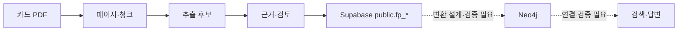
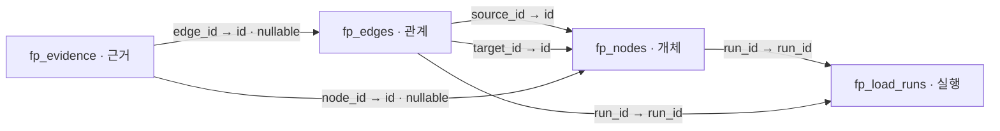
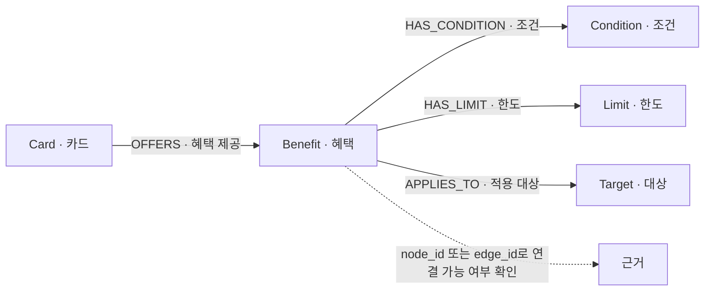
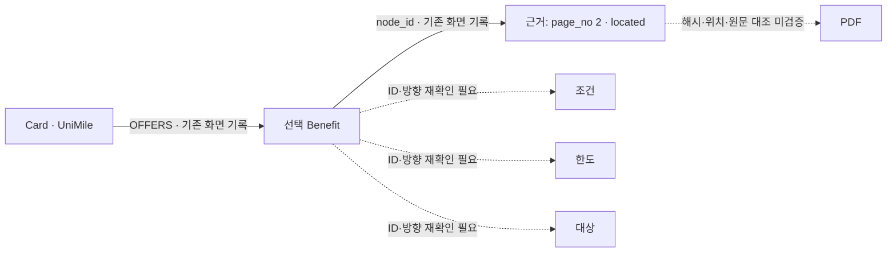

# 카드 혜택 프로젝트 Supabase 구조 설명 보완 초안

상태: **미완성 초안**. 2026-11-05 Supabase 화면을 직접 재확인하지 못했으며, 아래 화면 관련 내용은 사용자가 제공한 기존 점검 문서의 기록이다. 실제 컬럼 전체 목록·자료형·NULL 제약 및 링크는 후속 확인이 필요하다. 기존 문서 원본의 위치가 확인되면 그 내용을 유지하며 합친다.

## 1. 핵심 결과와 추천

사용자 담당 `public.fp_*`와 팀원 담당 `db_pipeline`을 별도 구조로 설명한다. 실제 영문 컬럼명을 유지하고 한글 데이터 사전과 관계도에 설명을 병기하는 것을 우선 제안한다. DB 변경은 수행하지 않았다.

## 2. 시각자료

### 전체 흐름

실선은 기존 문서가 설명하는 흐름이며 모든 단계의 실행 성공을 뜻하지 않는다. 점선 이후는 현재 연결 미검증이다.

### 테이블 관계

화살표는 FK를 가진 행에서 참조 대상 방향이다. FK는 **기존 문서의 화면 확인 기록**이며 이번 직접 재확인 전이다. `chunk_id`의 물리 FK는 미확인이다.

### 지식그래프 관계

관계명은 기존 문서 기록에 따른 일반 구조다. 특정 혜택에 각 관계가 연결되는지는 해당 `source_id`·`target_id` 대조가 필요하다.

### 대표 카드 1건 추적

실선은 기존 문서의 확인 기록이지 이번 재확인 결과가 아니다. 선택한 혜택의 실제 ID, 카드명·발급사와 각 조건·한도 관계는 재검증해야 한다.

## 3. fp_pipeline 한글 데이터 사전

아래는 기존 문서에서 언급된 컬럼만 정리한 부분 사전이다. 예시는 합성값 또는 식별자 종류이며 실제 행 값이 아니다. 자료형과 기타 제약은 확인하지 못하면 미확인으로 둔다.

| 테이블 | 실제 컬럼명 | 한글 표시명 제안 | 쉬운 설명 / 예시 | 키·NULL 및 근거 |
|---|---|---|---|---|
| fp_load_runs | run_id | 실행 ID | 적재 실행 식별자 | PK · 기존 화면 기록 |
| fp_load_runs | input_folder_name, model_name, started_at, node_count, edge_count | 입력 폴더, 모델, 시작 시각, 노드 수, 관계 수 | 실행 관련 정보 | 제약·자료형 미확인 · 기존 화면 기록 |
| fp_nodes | id | 노드 ID | 개체 식별자 | PK · 기존 화면 기록 |
| fp_nodes | node_type | 노드 종류 | 예: Benefit | 제약 미확인 · 기존 화면 기록 |
| fp_nodes | props | 노드 속성 | 노드 종류별 JSON 속성 | JSONB · 기존 화면 기록; 내부 계약 미확인 |
| fp_nodes | chunk_id | 청크 ID | 개체가 연결된 청크 식별값 | FK 선언 미확인 · 기존 화면 기록 |
| fp_nodes | run_id | 실행 ID | 해당 실행을 참조 | FK · 기존 화면 기록 |
| fp_edges | id | 관계 ID | 관계 행 식별자 | PK · 기존 화면 기록 |
| fp_edges | source_id, target_id | 시작·끝 노드 ID | 관계 방향의 양 끝 | 각각 노드 FK · 기존 화면 기록 |
| fp_edges | edge_type | 관계 종류 | 예: OFFERS | 제약 미확인 · 기존 화면 기록 |
| fp_edges | run_id | 실행 ID | 해당 실행을 참조 | FK · 기존 화면 기록 |
| fp_evidence | id | 근거 ID | 근거 행 식별자 | PK·identity · 기존 화면 기록 |
| fp_evidence | node_id, edge_id | 노드·관계 ID | 근거가 연결된 대상 | nullable FK · 기존 화면 기록 |
| fp_evidence | doc_sha256 | 문서 해시 | 문서 동일성 대조에 쓰는 값 | 제약·실제 파일 일치 미확인 |
| fp_evidence | page_no, start_pos, end_pos | 페이지·시작·끝 위치 | 근거 위치를 표현 | 인덱스 기준·끝 포함 여부 미확인 |
| fp_evidence | quote_status | 인용 위치 상태 | 예: located | 저장 상태이며 원문 일치 검증 결과가 아님 |

## 4. 노드·관계·props 용어

기존 문서에는 Card, Benefit, Condition, Limit, Target과 OFFERS, HAS_CONDITION, HAS_LIMIT, APPLIES_TO가 나온다. 종류별 `props`의 실제 키, 자료형과 필수 여부는 코드 또는 화면을 확인하기 전이므로 열거하지 않는다.

## 5. 대표 카드 원문 대조

기존 화면 기록: 선택 근거는 `page_no=2`, `start_pos=39`, `end_pos=52`, `quote_status=located`, `node_id` 연결이며 `edge_id`는 NULL. 이 기록은 원문 일치 증명이 아니다. Drive에서 `UniMile` 검색 결과 동일 PDF는 확인하지 못했다. 문서 SHA-256과 파일 SHA-256 일치, 청크·페이지 기준 및 위치 끝 포함 여부는 모두 미확인이다. [우리카드 중복 확인표](https://docs.google.com/spreadsheets/d/1IA5CM0YDTaLKWHe7miHNNqNrqlML9YbQ-Fynr_zC8H4/edit?usp=drivesdk)는 존재를 확인했으나 이 근거의 동일 파일임은 확인하지 않았다.

## 6. db_pipeline과의 역할 비교

| 구분 | 사용자 fp_pipeline | 팀원 db_pipeline |
|---|---|---|
| 기존 문서의 주요 대상 | public.fp_load_runs, fp_nodes, fp_edges, fp_evidence | card_doc, card_doc_page, card_doc_chunk, card_ai_call, card_extr_stg, card_product, card_product_item 등 |
| 관계 확인 | fp_* FK는 기존 화면 확인 기록 | 문서상 논리 연결; 전체 물리 FK 여부는 개별 확인 필요 |
| 주의 | 사용자 그래프 추출·근거 경로 | fp_*에 합치지 않고 별도 계약으로 설명 |

## 7. 컬럼명 보완 방법 비교

| 순위 | 방법 | 이해도 / 작업량 | 기존 코드·DB 영향 | 유지보수·권한 검토 |
|---|---|---|---|---|
| 1 | 영문 유지 + 한글 사전 | 높음 / 문서 작성 | DB 변경 없음 | 스키마와 사전 동기화 |
| 2 | 관계도 영문·한글 병기 | 높음 / 그림 관리 | DB 변경 없음 | 관계 변경 시 그림 갱신 |
| 3 | 앱에 한글 표시명 | 높음 / 앱 개발 | 앱 변경 | 표시명 갱신·화면 권한 검토 |
| 4 | Supabase 컬럼 설명 | DB 화면에서 유용 / DB 변경 | 메타데이터 변경 | 관리 권한·설명 동기화 검토 |
| 5 | 한글 별칭 조회 뷰 | 조회 편의 / DB 변경 | 새 조회 계약 | 읽기 권한·쓰기 가능성·RLS·호출자 권한 검토 |
| 6 | 기존 컬럼 직접 변경 | 단기 이해도 높음 / 작업량 큼 | 파이프라인·앱·적재 영향 가능 | 마이그레이션·호환성·권한 검토 |

## 8. 불일치·미확인

- 기존 문서의 대표 혜택에서 조건·한도·대상으로 가는 실제 ID와 방향은 재확인 필요.
- 카드명·발급사 및 동일 PDF 해시, 위치 기준, PDF 원문 일치 미검증.
- 전체 컬럼·자료형·NULL, `props` 필수 키, 팀원 테이블의 개별 FK 미확인.
- Neo4j 실제 적재와 챗봇 답변 재현 미검증.
- 기존 점검 문서 원본의 파일 경로 미확인. Supabase 대시보드는 이번 세션에서 직접 확인하지 못함.

## 9. 다음 작업과 승인 대상

1. 원본 Markdown 위치를 확인하고 기존 내용을 보존해 통합한다.
2. Supabase 화면의 컬럼·FK와 대표 혜택의 양 끝 ID를 다시 확인한다.
3. 동일 해시 PDF와 청크 및 위치 기준을 확인한 후 일치 여부만 기록한다.
4. DB 컬럼 설명 변경, 뷰 생성, 컬럼 변경, 적재·삭제는 별도 변경 계획과 승인 후 진행한다. 이번 작업에서는 SQL을 실행하지 않는다.
