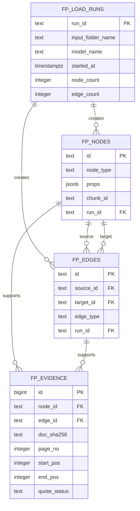

# 카드 혜택 지식그래프 저장·운영

상태: **현재 구현과 운영 상태를 설명한다.** 챗봇 시험용 그래프 저장소는 사용자 관리 Supabase `public.fp_*`와 읽기 뷰 `fp_chat`이다. 2026-11-06 사용자 지시에 따라 현재 진행 방향은 이를 챗봇용 별도 읽기 그래프로 유지하는 것이다. 승인된 사실의 기준은 팀 장부에 두고, 필드 매핑과 팀 합의 전에는 두 저장소를 통합하지 않는다. 이는 이 대화에서 정한 진행 방향이며 팀 전체 합의로 기록된 것은 아니다. 아래 적재 현황은 프로젝트 지도와 작업이력에서 확인한 기록이며, 이 문서 갱신 과정에서 DB에 직접 접속해 재확인하지 않았다.

같은 이름 엔티티는 노드를 지우거나 `fp_edges`에 관계를 추가하지 않고, 별도 `public.fp_entity_links` 초안에 링크로 기록한다. `graph/entity_links.sql`은 DRAFT ONLY이고, `graph/entity_links_loader.py`는 기본적으로 CSV 검증만 한다. 챗봇 중복 제거는 `FP_ENTITY_DEDUPE`를 켜고 연결 파일을 지정해야 동작한다. 현재 기본값은 꺼짐이다.

## 실행 상태

2026-11-06 작업이력에는 Supabase `public.fp_*`의 전체 그래프가 노드 12,144개·엣지 15,697개로 적재됐다고 기록돼 있다. 로컬 Neo4j `graphrag-neo4j`에도 같은 도메인 노드·관계 수를 확인했고, 근거 노드는 23,970개로 기록됐다. Neo4j 내보내기 원본 CSV 근거 24,066행과의 차이 96개는 원인을 확인하지 못했다. 이 수치와 사용자 실행 이력은 [H1·적재 이력](../../../../../docs/작업이력/06-챗봇연결-골든셋/2026-11-06-H1기준선-새run적재-거절판정수정-laptop.md) 및 [Neo4j 적재 이력](../../../../../docs/작업이력/06-챗봇연결-골든셋/2026-11-06-PPT요구사항대조-Neo4j적재-README3개-laptop.md)에 근거한다.

Neo4j는 로컬 시각화용이며 팀 Aura를 대상으로 하지 않는다. Supabase 적재 대상은 `public.fp_*`로 제한된다. 팀 운영 장부와 사실 데이터의 소유·승인 경로는 별도 합의 전까지 통합하지 않는다.

## 논리 모델



`fp_nodes`는 Issuer, Card, Benefit, Condition, Limit, Target를 나타낸다. `props`에는 각 유형의 속성을 JSON으로 보관한다. 카드 및 발급사 마스터의 소유 위치는 아직 미정이다. `fp_edges`는 유형 간 관계다. 기존 추출 계약의 다섯 관계를 그대로 허용하며, `OFFERS`는 인덱스의 카드 상품 연결을 나타내는 Card→Benefit 링크로 추가했다. 끝점 유형 조합은 트리거가 검사한다.

## 근거 위치 규칙

- 근거는 노드 또는 엣지 하나에만 연결한다(둘 중 정확히 하나).
- `doc_sha256`, `page_no`, `start_pos`, `end_pos`로 원문 위치를 식별한다. 위치는 쪽별 원문 기준 1부터 시작하고 끝 글자를 포함한다.
- `quote_status`는 `located`, `ambiguous`, `missing` 중 하나다. 인용문 문자열이나 쪽/청크 원문은 저장하지 않는다.
- 근거가 여러 개면 각각 별도 행으로 저장한다. `chunk_id`는 추적 보조값이며 위치 비교의 키가 아니다.

## 이름과 보안 규칙

모든 새 DB 객체 이름에는 `fp_` 접두사를 쓴다. 모든 테이블은 `public`에 두고 RLS를 켜며 정책은 만들지 않는다. Supabase는 `public`을 API로 노출할 수 있으므로, 정책이 없는 기본 거부 상태로 공개 API 접근을 막는다. 정책과 적재 계정은 별도 팀 결정 후 다룬다.

## CSV 및 후속 적재기

CSV는 UTF-8 헤더 포함 파일로 정의한다. 빈 선택값은 빈 칸으로 두고, `props`는 JSON 객체 문자열로 쓴다. CSV를 SQL로 직접 실행하지 않는다.

- `fp_nodes.csv`: `id,node_type,props,chunk_id,run_id`
- `fp_edges.csv`: `id,source_id,target_id,edge_type,run_id`
- `fp_evidence.csv`: `node_id,edge_id,doc_sha256,page_no,start_pos,end_pos,quote_status` (대상 쪽 하나만 채움)

적재기는 기본 드라이런으로 CSV 검증과 테이블별 건수만 출력한다. 먼저 드라이런 결과를 확인한 뒤 사용자 환경에 `FP_DATABASE_URL`을 설정하고 `--execute`를 명시해야 실제 적재한다. 적재는 `fp_load_runs → fp_nodes → fp_edges → fp_evidence` 순으로 테이블당 최대 1,000행을 묶어 한 트랜잭션에서 처리한다. 중복 `run_id`는 거부한다.

```bash
UV_CACHE_DIR=/tmp/uv-cache PYTHONPATH=src:src/card_benefit uv run --locked --no-sync python -m payment_card.file_pipeline.graph.load --csv-dir <CSV_DIR>
UV_CACHE_DIR=/tmp/uv-cache PYTHONPATH=src:src/card_benefit uv run --locked --no-sync python -m payment_card.file_pipeline.graph.load --csv-dir <CSV_DIR> --execute
```

실행할 때 `--delete-run <run_id>`를 지정하면 삭제 대상 건수만 드라이런으로 확인한다. 건수를 검토한 뒤 `--execute`를 추가해야 실제 삭제한다. 근거, 엣지, 노드, 적재 기록 순으로 `fp_` 테이블만 삭제하며, CSV 경로는 필요하지 않다.

```bash
UV_CACHE_DIR=/tmp/uv-cache PYTHONPATH=src:src/card_benefit uv run --locked --no-sync python -m payment_card.file_pipeline.graph.load --delete-run <run_id>
UV_CACHE_DIR=/tmp/uv-cache PYTHONPATH=src:src/card_benefit uv run --locked --no-sync python -m payment_card.file_pipeline.graph.load --delete-run <run_id> --execute
```

접속 설정은 환경 변수 이름 `FP_DATABASE_URL`로만 다루며 값은 문서나 출력에 기록하지 않는다. 쓰기·삭제 대상은 코드에 고정된 `fp_` 테이블뿐이다. 한 번의 적재는 `run_id`로 묶고 재실행/정리 단위로 사용한다.

## 다음 단계

1. 팀 `file_pipeline` 장부와 현재 GraphRAG 저장소의 경계, 상품 ID·근거·승인 데이터 연결 계약을 합의한다.
2. 대표 질문과 사람 확인된 정답을 기준으로 조건별 한도 대응이 필요한지 평가한다. 필요성이 확인된 뒤 규칙·한도 구조 변경을 결정한다.
3. 외부 사용 전 `fp_chat` 뷰의 소유자 권한과 챗봇 연결 역할을 DB 관리자와 확인한다. SQL은 RLS를 켜고 정책을 만들지 않지만, PostgreSQL 뷰의 `security_invoker` 설정과 실제 연결 역할은 아직 확인되지 않았다.

## 질의 예시

`queries.sql`은 `fp_` 테이블만 읽는 조회 예시다. 각 쿼리 주석에 목적과 바인딩 매개변수가 적혀 있다.

- 카드 이름 일부로 카드의 혜택과 각 혜택의 조건·한도·대상 조회 (`:card_name`)
- 혜택 근거의 문서 해시·쪽·시작·끝 위치 조회 (`:benefit_id`)
- `MUTUALLY_EXCLUSIVE` 관계인 혜택 쌍 조회 (`:card_name`)
- `shared=true`인 한도와 연결 혜택 조회 (`:card_name`)
- 시작 노드에서 최대 N개 관계까지 재귀 탐색 (`:start_node_id`, `:max_hops`)

테스트는 내보내기 CSV와 같은 열 모양의 합성 데이터를 SQLite에서 사용해 실행한다. SQLite 실행은 로컬 문법·결과 검증이며 실제 PostgreSQL 문법은 검증하지 못했다. DB 접속이나 실제 데이터를 사용하지 않았다.

## 적재 규칙 보강 (Claude 검토 반영)
- **노드·간선 id는 전역 유일해야 한다.** 추출기가 내는 id(`benefit-1` 등)는 청크마다 겹치므로 적재기가 `"<chunk_id>:<추출 id>"` 형태로 바꿔 쓴다. 관계의 `source`/`target`도 같은 규칙으로 바꿔 연결이 끊기지 않게 한다. Issuer와 Card의 id는 인덱스의 발급사·상품 키로 정한다.
- `located`만 위치(쪽·시작·끝)를 저장한다. 위치를 못 찾은 `missing`과 같은 문구가 청크에 여러 번 나오는 `ambiguous`는 위치 열을 비워 저장한다(`fp_evidence_position_by_status`). 반복 인용문의 첫 위치를 임의로 근거로 삼지 않는다는 데스크탑 정책을 따른다. 8단계 비교에서 반복 인용문 대조 방법을 정해야 한다.
- 현재 관계 유형에는 Issuer와 Card를 잇는 것이 없다. `Issuer` 노드를 쓰려면 `ISSUES`(Issuer→Card) 같은 유형을 추가할지 결정해야 한다(결정 대기).

`graph.source_text`는 `--trace-dir <DIR>`를 지정하면 `<DIR>/<issuer>/<doc_id>.json`의 페이지 텍스트를 PDF 텍스트 범위가 유효하지 않거나 trace와 다른 경우 보조 근거로 사용한다.
