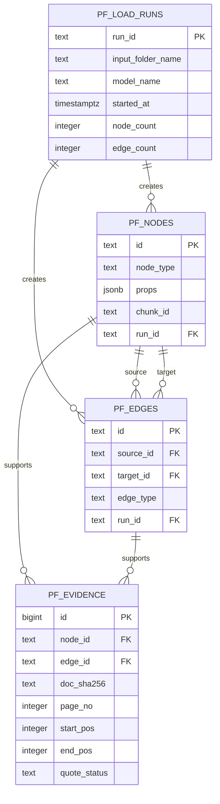

# 카드 혜택 지식그래프 저장 설계 초안

상태: **제안 초안**. 저장소 후보는 팀 합의 전이며, SQL은 검토용으로만 작성했다. 실행하지 않았다.

## 실행 상태

2026-11-03 Supabase SQL Editor에서 `schema.sql` 전체를 실행했고, `public`의 `pf_edges`, `pf_evidence`, `pf_load_runs`, `pf_nodes` 네 테이블과 모두 `rowsecurity=true`인 것을 확인했다. 기존 `nodes`·`edges` 테이블 보존 여부는 확인하지 않았으며, 데이터 적재(`load.py --execute`)는 아직 실행하지 않았다.

## 논리 모델

`pf_nodes`는 Issuer, Card, Benefit, Condition, Limit, Target를 나타낸다. `props`에는 각 유형의 속성을 JSON으로 보관한다. 카드 및 발급사 마스터의 소유 위치는 아직 미정이다. `pf_edges`는 유형 간 관계다. 기존 추출 계약의 다섯 관계를 그대로 허용하며, `OFFERS`는 인덱스의 카드 상품 연결을 나타내는 Card→Benefit 링크로 추가했다. 끝점 유형 조합은 트리거가 검사한다.

## 근거 위치 규칙

- 근거는 노드 또는 엣지 하나에만 연결한다(둘 중 정확히 하나).
- `doc_sha256`, `page_no`, `start_pos`, `end_pos`로 원문 위치를 식별한다. 위치는 쪽별 원문 기준 1부터 시작하고 끝 글자를 포함한다.
- `quote_status`는 `located`, `ambiguous`, `missing` 중 하나다. 인용문 문자열이나 쪽/청크 원문은 저장하지 않는다.
- 근거가 여러 개면 각각 별도 행으로 저장한다. `chunk_id`는 추적 보조값이며 위치 비교의 키가 아니다.

## 이름과 보안 규칙

모든 새 DB 객체 이름에는 `pf_` 접두사를 쓴다. 모든 테이블은 `public`에 두고 RLS를 켜며 정책은 만들지 않는다. Supabase는 `public`을 API로 노출할 수 있으므로, 정책이 없는 기본 거부 상태로 공개 API 접근을 막는다. 정책과 적재 계정은 별도 팀 결정 후 다룬다.

## CSV 및 후속 적재기

CSV는 UTF-8 헤더 포함 파일로 정의한다. 빈 선택값은 빈 칸으로 두고, `props`는 JSON 객체 문자열로 쓴다. CSV를 SQL로 직접 실행하지 않는다.

- `pf_nodes.csv`: `id,node_type,props,chunk_id,run_id`
- `pf_edges.csv`: `id,source_id,target_id,edge_type,run_id`
- `pf_evidence.csv`: `node_id,edge_id,doc_sha256,page_no,start_pos,end_pos,quote_status` (대상 쪽 하나만 채움)

나중에 구현할 적재 스크립트는 드라이런을 기본값으로 하고 `--execute`를 명시해야만 쓴다. 쓰기 대상 테이블 allowlist는 코드에 고정하고, 접속 설정은 환경 변수 이름 `PF_DATABASE_URL`만 문서와 인자로 다룬다(값 출력·기록 금지). 허용된 `pf_` 테이블 외에는 절대 쓰지 않는다. 한 번의 적재는 `run_id`로 묶고 재실행/정리 단위로 사용한다.

## 다음 단계

1. 팀에서 Supabase 및 `pf_` 접두사 충돌 여부, 카드 상품 마스터 위치, RLS 접근 주체를 합의한다.
2. 이 초안을 검토하고 추출 결과 CSV 매핑과 `OFFERS` 연결 입력을 확정한다.
3. 별도 적재기 구현과 실제 DB 적용은 합의 후 수행한다. 현재는 SQL 실행·DB 접속·적재를 하지 않았다.

## 질의 예시

`queries.sql`은 `pf_` 테이블만 읽는 조회 예시다. 각 쿼리 주석에 목적과 바인딩 매개변수가 적혀 있다.

- 카드 이름 일부로 카드의 혜택과 각 혜택의 조건·한도·대상 조회 (`:card_name`)
- 혜택 근거의 문서 해시·쪽·시작·끝 위치 조회 (`:benefit_id`)
- `MUTUALLY_EXCLUSIVE` 관계인 혜택 쌍 조회 (`:card_name`)
- `shared=true`인 한도와 연결 혜택 조회 (`:card_name`)
- 시작 노드에서 최대 N개 관계까지 재귀 탐색 (`:start_node_id`, `:max_hops`)

테스트는 내보내기 CSV와 같은 열 모양의 합성 데이터를 SQLite에서 사용해 실행한다. SQLite 실행은 로컬 문법·결과 검증이며 실제 PostgreSQL 문법은 검증하지 못했다. DB 접속이나 실제 데이터를 사용하지 않았다.

## 적재 규칙 보강 (Claude 검토 반영)
- **노드·간선 id는 전역 유일해야 한다.** 추출기가 내는 id(`benefit-1` 등)는 청크마다 겹치므로 적재기가 `"<chunk_id>:<추출 id>"` 형태로 바꿔 쓴다. 관계의 `source`/`target`도 같은 규칙으로 바꿔 연결이 끊기지 않게 한다. Issuer와 Card의 id는 인덱스의 발급사·상품 키로 정한다.
- `located`만 위치(쪽·시작·끝)를 저장한다. 위치를 못 찾은 `missing`과 같은 문구가 청크에 여러 번 나오는 `ambiguous`는 위치 열을 비워 저장한다(`pf_evidence_position_by_status`). 반복 인용문의 첫 위치를 임의로 근거로 삼지 않는다는 데스크탑 정책을 따른다. 8단계 비교에서 반복 인용문 대조 방법을 정해야 한다.
- 현재 관계 유형에는 Issuer와 Card를 잇는 것이 없다. `Issuer` 노드를 쓰려면 `ISSUES`(Issuer→Card) 같은 유형을 추가할지 결정해야 한다(결정 대기).
