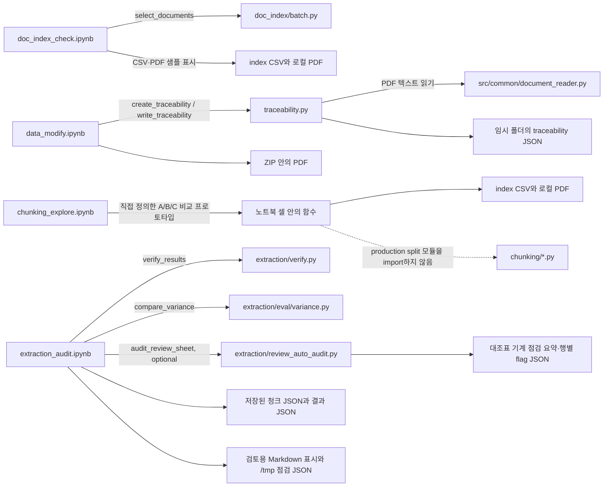

# file_pipeline 노트북 안내

이 폴더의 노트북은 데이터와 중간 결과를 눈으로 확인하는 보조 도구다. 일반 실행 로직은 `file_pipeline`의 `.py` 모듈에 둔다. 예외적으로 `chunking_explore.ipynb`는 청킹 기준을 탐색하던 시기의 알고리즘 프로토타입을 노트북 안에 포함한다. 이 프로토타입은 현재 청킹 모듈을 호출하지 않는다.

현재 이 폴더에는 보조 `.py` 파일이 없다. 노트북은 상위 `doc_index/`, `extraction/`, `traceability.py`의 코드를 일부 가져다 쓴다. 아래 사용 관계는 파일을 읽어 확인한 정적 호출 관계다. 노트북이 실제로 최근 실행됐는지와 실행 빈도는 저장소만으로 확인할 수 없다.

## Mermaid 의존성 다이어그램

## 노트북별 용도

| 노트북 | 용도와 입력 | 사용하거나 호출하는 코드 | 결과와 주의점 |
|---|---|---|---|
| `doc_index_check.ipynb` | 하나·우리 인덱스 CSV의 문서 역할, 대표 여부, 검토 사유, 배치 대상 분포와 PDF 표 샘플 확인 | `doc_index/batch.py`의 `select_documents`를 호출한다. CSV 통계와 PDF 표 확인은 노트북에서 pandas·PyMuPDF로 직접 한다. | 실행 결과는 표와 미리보기다. 판정·변환은 노트북이 아니라 `doc_index/*.py`에 있다. PDF 텍스트가 화면에 보일 수 있다. |
| `data_modify.ipynb` | ZIP에서 하나 PDF 한 건을 임시 폴더로 꺼내 추적성 JSON과 페이지별 텍스트를 확인 | `traceability.py`의 `create_traceability`, `write_traceability`; 간접적으로 `src/common/document_reader.py`를 거친다. PyMuPDF로 페이지 이미지를 그린다. | 시스템 임시 폴더의 `card-pilot/`에 PDF와 JSON을 만든다. ZIP·manifest·DB는 수정하지 않는다. 원문 출력이 있으므로 공유 전 노트북 출력을 지운다. ZIP 경로, PDF 이름, SHA-256, 페이지 수가 셀에 고정돼 있다. |
| `chunking_explore.ipynb` | 쪽 길이 분포와 제목 기준 분할을 비교해 A(쪽 단위), B(제목 단위), C(혼합) 청킹 규칙을 탐색 | pandas·PyMuPDF를 사용하고 `page_lines`, `body_size`, `split_by_heading`, `hybrid_chunks` 등을 노트북 셀에서 직접 정의한다. `chunking/split.py`, `headings.py`, `build.py`는 import하지 않는다. | 표본 통계와 청크 미리보기를 만든다. 셀 안의 분할 함수는 탐색 프로토타입이므로 현재 구현 규칙의 실행 증거로 쓰지 않는다. 원문 일부가 출력될 수 있다. |
| `extraction_audit.ipynb` | 이미 저장된 최대 5개 청크 결과를 골라 자동 신호와 원문을 나란히 검토하고, 선택적으로 검토 대조표의 기계 신호를 확인 | `extraction/verify.py`의 `verify_results`, `extraction/eval/variance.py`의 `compare_variance`, 선택 입력 시 `extraction/review_auto_audit.py`의 `audit_review_sheet`를 호출한다. 청크·결과 JSON을 노트북에서 읽고 비교용 Markdown을 조립한다. | LLM 호출은 하지 않는다. 점검 JSON은 `/tmp/pilot_followup_20261103_desktop/notebook_audit/`에 쓴다. 대조표 감사 입력은 `REVIEW_SHEET`와 `TRACE_DIR`을 명시해야 실행되며 결과는 `review_sheet_audit.json`으로 저장한다. 화면에는 청크 원문과 추출 인용문이 나올 수 있다. 입력 경로 기본값이 `/tmp/pilot_followup_20261103_desktop`으로 고정돼 있어 다른 실행 폴더에서는 먼저 경로 셀을 바꿔야 한다. |

## 생산 코드와 역할 구분

- `doc_index_check.ipynb`는 문서 선택 규칙을 복사해 구현하지 않고 `select_documents`를 호출한다. 인덱스 요약과 PDF 표 샘플링만 화면에서 직접 한다.
- `data_modify.ipynb`는 페이지 읽기·청킹 로직을 복사하지 않고 `traceability.py`를 호출한다. 입력 준비와 시각 확인은 노트북이 맡는다.
- `chunking_explore.ipynb`는 생산 코드를 호출하지 않는 탐색 노트북이다. 확정된 규칙은 `chunking/` 모듈을 기준으로 확인한다.
- `extraction_audit.ipynb`는 `verify.py`와 `variance.py`의 분석 결과를 보조 화면에 보여 주며, 대조표와 페이지 추적 자료를 지정하면 기존 `review_auto_audit.py`도 호출한다. 이 자동 신호는 인용·좌표·숫자·관계 끝점의 기계 점검일 뿐 추출 정답 판정이 아니다. 의미 대조는 사람이 한다.

## 실행 전 확인

노트북은 이 안내만으로 실행하지 않는다. 데이터 경로, 필요한 패키지, 출력 위치를 먼저 확인한다. 특히 `data_modify.ipynb`와 `extraction_audit.ipynb`의 경로는 특정 작업 폴더에 고정돼 있다. 대조표 자동 점검은 입력 `REVIEW_SHEET`, `TRACE_DIR`을 직접 지정해야 하며, 필요하면 `REVIEW_RESULT_DIR`로 관계 끝점 검사를 켠다. 결과 JSON은 저장소 밖에 둔다. 노트북 출력에는 PDF 원문이 포함될 수 있으므로 Git에 저장하거나 다른 사람에게 공유하기 전에 모든 출력 셀을 지운다. 이 문서 갱신 중에는 노트북이나 Python 코드를 실행하지 않았다.

## 코드 근거

- `doc_index_check.ipynb` 코드 셀 2에서 `doc_index.batch.select_documents`를 가져오고 셀 10에서 사용한다.
- `data_modify.ipynb` 코드 셀 3에서 `create_traceability`, `write_traceability`를 가져오며 셀 5·8에서 추적성과 위치 왕복 확인에 사용한다.
- `chunking_explore.ipynb` 코드 셀 2·4·8·10·13에서 분석 데이터와 탐색용 함수를 직접 만든다. 생산 청킹 모듈의 import는 없다.
- `extraction_audit.ipynb` 코드 셀 5에서 `verify_results`, `compare_variance`를 호출하고, 대조표 경로를 지정한 경우 `review_auto_audit.audit_review_sheet`를 호출한다. 셀 8에서 사람이 고른 청크의 원문·결과 미리보기를 만든다.

연결된 구현 파일: [`doc_index/batch.py`](../doc_index/batch.py#L24), [`traceability.py`](../traceability.py#L14), [`common/document_reader.py`](../../../../common/document_reader.py), [`extraction/verify.py`](../extraction/verify.py#L50), [`extraction/eval/variance.py`](../extraction/eval/variance.py#L36). 실제 청킹 규칙의 구현은 [`chunking/split.py`](../chunking/split.py), [`chunking/headings.py`](../chunking/headings.py), [`chunking/build.py`](../chunking/build.py)에 있다.
