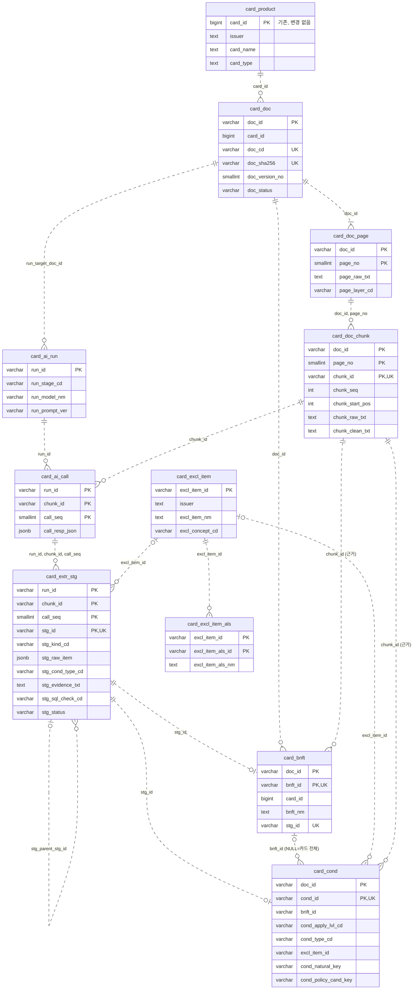

# 하나카드 상품설명서 PDF 정제·검증 DB 설계서 (db_pipeline, 초안)

- 작성일: 2026-10-29
- 상태: **설계 검토 초안. `db_pipeline` 스키마는 DB에 적용하지 않음.** 공유 Supabase에는 같은 10개 테이블이 이전 스키마 `card_benefit`에 있다(2026-10-30 백업 `src/data/backup/card_benefit-postgres-202610301243.sql`). 적용 전 공동 확인 필요([development_roles.md](../docs/development_roles.md) 5절)
- 관리용 DDL 기준본: [db_pipeline_schema.sql](db_pipeline_schema.sql) (2026-10-30). 이전 초안 [hana_card_schema_draft.sql](hana_card_schema_draft.sql)은 비교용으로 보존
- 표기: **[기존]** 현재 소스·문서에 근거한 사실 · **[제안]** 이 문서에서 새로 제안하는 설계 · **❓** 미확정
- 스키마: **`db_pipeline`** (2026-10-30 변경). 이 문서의 신규 테이블·시퀀스·함수·인덱스는 DB 기반 전용 스키마 `db_pipeline`에 두고, 카드 마스터 `card_product`(`schema.sql`)는 공통 스키마 `card_benefit`에 그대로 둔다. 이전 `payment_card` 스키마는 사용하지 않는다(DB에서 삭제됨, 다시 만들지 않음). Python 패키지 `payment_card/`와 mapper namespace `payment_card.*`는 DB 스키마가 아니라 파일·폴더 이름이므로 그대로다.

| 스키마 | 역할 |
|---|---|
| `card_benefit` | 기존 공통 카드 마스터(`card_product`) 및 등록·조회 CLI |
| `file_pipeline` | 파일 기반 파이프라인 전용 영역(담당 별도, 이 문서 범위 밖) |
| `db_pipeline` | DB 기반 PDF 추출·정제·검증 전용 영역(이 문서의 테이블 10개, 시퀀스 8개, `fn_get_biz_id`) |

---

## 1. 참고 덤프에서 파악한 DB 설계 스타일 [기존]

출처: `sample_dump-postgres-202610292124.sql` (`recipe` 스키마, 스키마만 덤프됨·데이터 행 없음). 테이블은 복사하지 않고 아래 패턴만 따른다.

| 항목 | recipe 덤프의 패턴 | 이번 설계 적용 |
|---|---|---|
| 스키마 | 프로젝트 단일 스키마(`recipe`) + 스키마 COMMENT | DB 기반 전용 스키마 `db_pipeline` + 스키마 COMMENT (`card_product`는 공통 스키마 `card_benefit`) |
| 테이블명 | 소문자 snake_case 약어: `rcp`, `ingr`, `ingr_als`, `rcp_raw`, `rcp_ingr_stg`, `rcp_cat_rel` | `card_doc`, `card_doc_chunk`, `card_extr_stg`, `card_excl_item_als`, `card_bnft`, `card_cond` |
| 컬럼명 | 테이블 약어 접두어 + 의미 접미어: `_id`, `_nm`, `_txt`, `_cd`, `_no`, `_seq`, `_status`, `_date`, `_note` | `doc_*`, `page_*`, `chunk_*`, `run_*`, `call_*`, `stg_*`, `bnft_*`, `cond_*` |
| 업무 ID | `VARCHAR(20) DEFAULT recipe.fn_get_biz_id('<테이블>')` → `YYYYMMDD_000001`, 테이블별 `seq_<테이블>` (MAXVALUE 999999, CYCLE) | `db_pipeline.fn_get_biz_id` + `db_pipeline.seq_<테이블>` 동일 구조 |
| PK | 단일 업무 ID 또는 부모 키를 포함한 복합 PK (`pk_rcp_raw (rcp_raw_id, rcp_raw_seq)`, `pk_ingr_als (ingr_id, ingr_als_id)`) | **부모 PK 승계 복합 PK** (`card_doc_page (doc_id, page_no)`, `card_doc_chunk (doc_id, page_no, chunk_id)` 등). 단독 ID로 참조되는 컬럼은 단독 UNIQUE 유지. 3-1절 |
| FK | **물리 FK 없음**. 부모 존재·중복은 적재기와 검증 SQL에서 확인 (`recipe_design_review.md` 등에 명시) | 동일하게 물리 FK 없음 + 8절 검증 SQL |
| 제약·인덱스 이름 | `pk_`, `uq_<테이블>_<컬럼>`, `ck_<테이블>_<컬럼>`, `ix_<테이블>_<키>_key` | **제약조건 이름을 쓰지 않음**(2026-10-30). PostgreSQL 자동 이름 `<테이블>_pkey`, `<테이블>_<컬럼>_key`, `<테이블>_<컬럼>_check`(여러 컬럼이면 `<테이블>_check`, `_check1`…). 인덱스 이름 `ix_<테이블>_<키>_key`·`uq_card_doc_active`는 유지 |
| 상태값 | `VARCHAR(20)` + 영문 대문자 코드 CHECK (`UNCHECKED`/`VALID`/…, `PENDING_REVIEW`/`AUTO_APPROVED`/`MANUAL_APPROVED`/`REJECTED`) | 동일. staging 상태값은 그대로 차용 |
| 승인 조건 CHECK | `ck_rcp_ingr_stg_approval`: 승인 상태면 매핑 ID 필수 | 승인 조건 CHECK(이름 없음, 이전 `ck_card_extr_stg_approval`): 승인 상태면 SQL 검증 OK·근거 위치·제외 항목 매핑 필수 |
| 원본·staging·정제 분리 | `rcp_raw`(원본) → `rcp_ingr_stg`(파싱·검토, `*_raw_txt`·`*_parsed_nm`·`*_parser_version`·`*_review_note`·`*_approved_*`) → `rcp`·`rcp_ingr`(정제) | `card_doc_page`·`card_doc_chunk`(원문) → `card_ai_call`·`card_extr_stg`(AI 원 출력·검토) → `card_bnft`·`card_cond`(확정) |
| 별칭 사전 | `ingr` + `ingr_als` (`uq (ingr_id, ingr_als_nm)`) | `card_excl_item` + `card_excl_item_als` |
| 공통 컬럼 | `create_date`·`update_date` `timestamptz DEFAULT now() NOT NULL`, `create_user_id`·`update_user_id` `VARCHAR(50) NOT NULL`(기본값 없음) | 모든 신규 테이블에 동일 |
| 타입 | 금액·수치 `numeric(p,s)`, 순번 `smallint`, 자유 텍스트 `text`, 코드 `varchar(20)` | 동일. AI 응답만 `jsonb` 추가 |
| COMMENT | 모든 테이블·컬럼·시퀀스·함수에 한글 COMMENT, 코드 컬럼은 허용값 설명 | 동일 |
| 공통코드 테이블 | `common_code_grp`/`common_cd` 존재 | **사용하지 않음** [제안]: 코드 수가 적어 CHECK로 관리(10절 위험 참고) |

---

## 2. 현재 프로젝트 DB 구조 분석 [기존]

| 구분 | 내용 |
|---|---|
| 구현됨 | `card_benefit.card_product` 한 테이블 + 카드 등록·조회 CLI (`main.py`, `repository.py`, `payment_card.sql`) |
| `card_product` 컬럼 | `card_id BIGINT GENERATED ALWAYS AS IDENTITY PK`, `issuer TEXT`, `card_name TEXT`, `card_type TEXT CHECK (CREDIT, DEBIT)`, `created_at TIMESTAMPTZ` |
| 스타일 차이 | IDENTITY 숫자 PK, `created_at` 단일 감사 컬럼 → recipe 스타일(업무 ID, 4개 감사 컬럼)과 다름 |
| 제약 공백 | `(issuer, card_name)` UNIQUE 없음 → CLI로 같은 카드 중복 등록 가능 |
| DB 접근 | `src/common` `PostgresDbSession`(aiosql Named SQL Mapper, `-- name:`), `DatabaseManager`(pool, 연결 시 pgvector 어댑터 등록) |
| Mapper 규칙 | `MAPPER_ROOT=payment_card/` 하위 `*.sql` 전부 등록, 파일명=namespace. DB 방식 전용 SQL은 `payment_card/db_pipeline/db_pipeline.sql` 예정 |
| DDL 위치 | `src/card_benefit/sql/` (수동 실행 전용) |
| 미구현 | PDF 파싱, 추출, 정제·검증, Neo4j. `db_pipeline/`·`file_pipeline/` 은 README만 존재 |
| 미확정 ❓ | DB에 넣을 텍스트 확보 방법, DB에서 AI 호출 방식, 공통 데이터 계약(문서 ID·위치 표기·JSON·판정 기준), 최종 확정 방식 |

문서에서 확인된 데이터 특성 [기존: `card_pdf_structuring_validation.md`, `card_scope_comparison*.md`]

- 하나카드 PDF는 텍스트 레이어가 있으나 **표 자동 구조화는 대부분 실패**(STYLE·PLAY 표 0개, BT 구간 행 병합, 에너지 더블 가맹점 열 None).
- 같은 `상품권` 항목이 카드마다 **실적 제외 / 혜택 제외 / 적립 제외**로 범위가 다르다. 실적 조건은 카드 전체가 아니라 **혜택 단위**(ONE PICK은 실적 무관, ONE MORE만 10만원).
- STYLE·PLAY는 ONE PICK·ONE MORE·실적 제외 목록이 문자 단위로 같아 **동일 정책 후보**. 다른 카드사와는 동일 정책 입증 0건.
- 원문 `상품/선불전자지급수단`(신한 건담)처럼 오기 의심 문구도 **자동 정규화 금지**.
- `제외`(확정)와 `제외될 수 있습니다`(가능)를 구분해야 한다.

---

## 3. 테이블 목록 — 재사용·신규 [제안]

| # | 테이블 | 구분 | 역할 | 처리 단계 |
|---|---|---|---|---|
| 0 | `card_benefit.card_product` | **기존 재사용(구조 변경 없음, 스키마만 `payment_card`→`card_benefit`)** | 카드 마스터. `card_id`로 논리 참조 | 사전 등록 (기존 CLI) |
| 1 | `card_doc` | 신규 | 원본 PDF 정보·문서 버전 | ① 원본 등록 |
| 2 | `card_doc_page` | 신규 | 페이지별 추출 원문(불변) | ② 텍스트·메타 적재 |
| 3 | `card_doc_chunk` | 신규 | 청크 원문 + SQL 정제 텍스트, 원문 위치 | ③ 청크 분리 ④ SQL 정제 |
| 4 | `card_ai_run` | 신규 | AI 실행 회차(모델·프롬프트·호출 방식) | ⑤ AI 추출 / 의미 검증 |
| 5 | `card_ai_call` | 신규 | 청크별 AI 원 응답·토큰·오류 | ⑤ |
| 6 | `card_extr_stg` | 신규 | 추출 항목 staging(원 JSON, 정제 값, 검증·승인 상태) | ⑥ 저장·검증 |
| 7 | `card_excl_item` | 신규 | 표준 제외 항목(카드사 범위 개념) | ④·⑥ 정규화 |
| 8 | `card_excl_item_als` | 신규 | 제외 항목 원문 표기 사전 | ④·⑥ 정규화 |
| 9 | `card_bnft` | 신규 | 확정 혜택(결과 B) | ⑦ 확정 |
| 10 | `card_cond` | 신규 | 확정 조건: 전월실적·실적 제외·혜택 제외·한도·구간·예외 | ⑦ 확정 → ⑧ Neo4j |

- 신규 10개. 공통코드·검증 로그·문서-카드 관계 테이블은 **만들지 않았다**(필요해지면 10절 참고).
- 모든 신규 테이블은 **db_pipeline 소유**. `file_pipeline`은 이 테이블을 읽거나 쓰지 않는다. 두 방식이 공유할 것은 `card_doc.doc_cd`(문서 코드)·페이지 번호·근거 원문 같은 **계약 값**뿐이다(9절).
- `card_bnft`·`card_cond`의 "확정"은 **db_pipeline 내부 검증 완료(결과 B)** 를 뜻한다. 결과 A·B를 비교한 공동 최종 확정은 별개이며 미정 ❓.

### 3-1. PK 승계 구조 (2026-10-30 확정)

원칙: 부모 테이블의 PK를 자식 PK 앞에 승계하고 자기 식별자를 붙인다. 물리 FK는 만들지 않는다. 다른 테이블이 단독 ID 하나로 참조하는 컬럼은 **단독 UNIQUE**로 남겨 그 참조를 유지한다. PK 구성 컬럼은 모두 NOT NULL이다(임시 로컬 DB 카탈로그로 확인).

| 테이블 | 부모 | PK | 단독 UNIQUE(참조용) | 변경 |
|---|---|---|---|---|
| `card_doc` | (최상위, `card_product`는 다른 스키마 논리 참조) | `(doc_id)` | — | 없음 |
| `card_doc_page` | `card_doc` | `(doc_id, page_no)` | — | 없음 |
| `card_doc_chunk` | `card_doc_page` | `(doc_id, page_no, chunk_id)` | `(chunk_id)` | **변경**(이전 `(chunk_id)`) |
| `card_ai_run` | (최상위. `run_target_doc_id`는 여러 문서 실행 시 NULL) | `(run_id)` | — | 없음 |
| `card_ai_call` | `card_ai_run` + `card_doc_chunk` | `(run_id, chunk_id, call_seq)` | — | 없음(**예외**, 아래) |
| `card_excl_item` | (최상위, 카드사별 사전) | `(excl_item_id)` | — | 없음 |
| `card_excl_item_als` | `card_excl_item` | `(excl_item_id, excl_item_als_id)` | — | 없음 |
| `card_extr_stg` | `card_ai_call` | `(run_id, chunk_id, call_seq, stg_id)` | `(stg_id)` | **변경**(이전 `(stg_id)`) |
| `card_bnft` | `card_doc` | `(doc_id, bnft_id)` | `(bnft_id)` | **변경**(이전 `(bnft_id)`) |
| `card_cond` | `card_doc` | `(doc_id, cond_id)` | `(cond_id)` | **변경**(이전 `(cond_id)`) |

- 단독 UNIQUE를 참조하는 곳: `chunk_id` ← `card_ai_call`·`card_extr_stg`·`card_bnft`·`card_cond` / `stg_id` ← `card_extr_stg.stg_parent_stg_id`·`card_bnft.stg_id`·`card_cond.stg_id` / `bnft_id` ← `card_cond.bnft_id`·`card_extr_stg.bnft_id`·Neo4j Benefit / `cond_id` ← `card_extr_stg.cond_id`·Neo4j Condition.
- `card_cond`의 부모 혜택(`bnft_id`)은 카드 전체 조건이면 NULL이라 PK에 넣지 않았다. `card_bnft`·`card_cond`의 `card_id`는 문서(`card_doc.card_id`)에서 정해지는 값이라 PK에 넣지 않았다.

**설계 예외 — `card_ai_call`은 청크의 상위 키를 승계하지 않는다.**
청크 PK가 `(doc_id, page_no, chunk_id)`가 되었지만 `card_ai_call`은 `chunk_id`만 가진다. 이유: 승계하려면 컬럼을 추가해야 하는데 기존 컬럼 구조를 바꾸지 않기로 했고, `chunk_id`가 단독 UNIQUE라 청크를 하나로 특정할 수 있다. 같은 이유로 자식인 `card_extr_stg`도 `doc_id`, `page_no`를 갖지 않는다. 근거 청크를 `chunk_id`로만 가리키는 `card_bnft`·`card_cond`의 `chunk_id`도 같은 방식이다.

**완전 승계 구조로 바꿀 경우(미승인, 참고용)** — 컬럼 추가가 필요하므로 별도 승인 대상이다.

| 테이블 | 추가할 컬럼 | 바뀌는 PK / UNIQUE | 관계 |
|---|---|---|---|
| `card_ai_call` | `doc_id varchar(20) NOT NULL`, `page_no smallint NOT NULL` | PK `(run_id, doc_id, page_no, chunk_id, call_seq)` | `card_doc_chunk (doc_id, page_no, chunk_id)` 복합 참조 + `card_ai_run (run_id)` |
| `card_extr_stg` | `doc_id`, `page_no` (같은 자료형, NOT NULL) | PK `(run_id, doc_id, page_no, chunk_id, call_seq, stg_id)`, UNIQUE `(run_id, doc_id, page_no, chunk_id, call_seq, stg_item_seq)` | `card_ai_call` 복합 참조 |
| `card_bnft`, `card_cond` | `page_no smallint NOT NULL`(근거 청크 위치) | PK는 그대로 `(doc_id, …)` | 근거 `card_doc_chunk (doc_id, page_no, chunk_id)` 복합 참조 |

- 추가 컬럼은 `chunk_id`로 결정되는 중복 값이므로 적재 시 청크 값과 일치하는지 8절 같은 검증 SQL이 필요하다. 인덱스(`ix_card_ai_call_chunk_key`, `ix_card_extr_stg_chunk_key`)와 8절 SQL·COMMENT도 함께 고쳐야 한다.
- 장점은 모든 하위 행에서 문서·페이지를 조인 없이 바로 알 수 있다는 것이고, 단점은 컬럼 중복과 값 불일치 위험이다.

---

## 4. 테이블별 설계 [제안]

공통: 모든 신규 테이블에 `create_date`, `create_user_id`, `update_date`, `update_user_id`가 있다(아래 표에서 생략). 물리 FK는 없으며 "논리 참조" 열은 8절 SQL로 검증한다. 전체 COMMENT는 DDL 파일에 있다.

### 4-1. `card_doc` — 원본 문서(버전 단위)

| 컬럼 | 타입 | NULL | 설명 / 제약 |
|---|---|---|---|
| `doc_id` | varchar(20) | N | **PK**, `fn_get_biz_id('card_doc')` |
| `card_id` | bigint | N | → `card_product.card_id` (논리) |
| `doc_cd` | varchar(50) | N | **UQ**. 공통 문서 코드(예: `HANA_15650_20260429` = 리플릿 번호+일자). 결과 A·B 비교 키 후보 |
| `doc_type_cd` | varchar(20) | N | `PRODUCT_GUIDE`/`TERMS`/`ETC` |
| `doc_title`, `doc_file_nm` | text | N | 제목, 파일명 |
| `doc_source_url` | text | Y | 공식 URL |
| `doc_file_size` | bigint | Y | 바이트 |
| `doc_sha256` | varchar(64) | N | **UQ**, 소문자 hex CHECK. 같은 파일 중복 등록 방지 |
| `doc_page_cnt` | smallint | Y | > 0 |
| `doc_review_no`, `doc_review_date`, `doc_release_date` | text/date | Y | 준법심의 번호·심의일·출시일(버전 판별 근거) |
| `doc_collect_date` | timestamptz | N | 다운로드 일시 |
| `doc_version_no` | smallint | N | **UQ (card_id, doc_type_cd, doc_version_no)** |
| `doc_status` | varchar(20) | N | `ACTIVE`/`SUPERSEDED`/`EXCLUDED`. 부분 UNIQUE 인덱스 `uq_card_doc_active`로 카드·유형별 ACTIVE 1건 |
| `doc_note` | text | Y | 문서 범위 메모(MULTI Any처럼 블록 2개 등) |

PDF 바이너리는 저장하지 않는다(재배포 조건 미확인, 과제 매핑표 보완점 #11).

### 4-2. `card_doc_page` — 페이지 원문(정제 전, 불변)

| 컬럼 | 타입 | NULL | 설명 / 제약 |
|---|---|---|---|
| `doc_id`, `page_no` | varchar(20), smallint | N | **PK (doc_id, page_no)**, page_no ≥ 1 |
| `page_raw_txt` | text | N | 추출기 출력 그대로 |
| `page_char_cnt` | integer | N | ≥ 0. 추출 실패(0자) 탐지 |
| `page_txt_sha256` | varchar(64) | N | 재추출 시 원문 변경 감지 |
| `page_layer_cd` | varchar(20) | N | `TEXT`/`IMAGE`/`MIXED`/`UNKNOWN` (KB처럼 일부 표만 이미지인 경우 `MIXED`) |
| `page_extractor_nm`, `page_extractor_ver` | varchar(50) | N/Y | 예: PyMuPDF 1.28.2 |
| `page_note` | text | Y | 표 미탐지 등 한계 기록 |

규칙: 청크가 만들어진 뒤에는 `page_raw_txt`를 수정하지 않는다. 다른 추출기로 다시 뽑으려면 하위 데이터를 정리하고 다시 적재한다(10절).

### 4-3. `card_doc_chunk` — 청크(원문 위치 + 정제 전·후)

| 컬럼 | 타입 | NULL | 설명 / 제약 |
|---|---|---|---|
| `chunk_id` | varchar(20) | N | 업무 ID. **UQ (chunk_id)** — 다른 테이블의 `chunk_id` 참조용 |
| `doc_id`, `page_no` | | N | 논리 참조 → `card_doc_page`. **PK (doc_id, page_no, chunk_id)** — (doc_id, page_no) 조회도 PK 인덱스가 맡음 |
| `chunk_seq` | integer | N | **UQ (doc_id, chunk_seq)**, 문서 내 순번 |
| `chunk_section_nm` | text | Y | 원문 절 제목(`[실적 산정 기준]`, `서비스 제외 대상`) |
| `chunk_type_cd` | varchar(20) | N | `BODY`/`TABLE`/`NOTICE`/`HEADER_FOOTER`/`ETC` |
| `chunk_start_pos`, `chunk_end_pos` | integer | N | `page_raw_txt` 내 위치(1부터, `substr` 기준). start ≥ 1, end ≥ start |
| `chunk_raw_txt` | text | N | **정제 전** 원문(= `substr(page_raw_txt, start, end-start+1)`) |
| `chunk_clean_txt` | text | Y | **정제 후**(공백·줄바꿈·머리말 제거). AI 입력 |
| `chunk_status` | varchar(20) | N | `RAW`/`CLEANED`/`EXCLUDED`. `CLEANED`면 clean_txt·rule_ver 필수(CHECK) |
| `chunk_split_rule_ver`, `chunk_clean_rule_ver` | varchar(50) | N/Y | 규칙 버전(재현성) |

청크는 페이지를 넘지 않는다(넘는 절은 같은 `chunk_section_nm`으로 두 청크).

### 4-4. `card_ai_run` — AI 실행 회차

| 컬럼 | 타입 | NULL | 설명 / 제약 |
|---|---|---|---|
| `run_id` | varchar(20) | N | **PK** |
| `run_stage_cd` | varchar(20) | N | `EXTRACT`(추출) / `VERIFY`(의미 검증) |
| `run_call_mthd_cd` | varchar(20) | N | `PYTHON_RELAY`/`PGAI`/`EDGE_FUNCTION`/`ETC` — 호출 방식 미확정 ❓을 값으로 기록 |
| `run_model_nm`, `run_prompt_ver`, `run_prompt_txt` | | N | 모델·프롬프트 버전·템플릿 원문 |
| `run_param` | jsonb | Y | temperature, 출력 스키마 등 |
| `run_target_doc_id` | varchar(20) | Y | 대상 문서. **ix** |
| `run_status` | varchar(20) | N | `RUNNING`/`SUCCEEDED`/`PARTIAL`/`FAILED` |
| `run_start_date`, `run_end_date` | timestamptz | N/Y | end ≥ start |

### 4-5. `card_ai_call` — 청크별 원 응답(정제 전 AI 출력)

| 컬럼 | 타입 | NULL | 설명 / 제약 |
|---|---|---|---|
| `run_id`, `chunk_id`, `call_seq` | | N | **PK (run_id, chunk_id, call_seq)**. 재시도 시 call_seq 증가. **ix chunk_id** |
| `call_input_sha256` | varchar(64) | N | 프롬프트+청크 입력 해시(같은 입력 재호출 탐지) |
| `call_status` | varchar(20) | N | `SUCCEEDED`/`FAILED`/`PARSE_ERROR`. SUCCEEDED면 `call_resp_json` 필수 |
| `call_resp_raw` / `call_resp_json` | text / jsonb | Y | 원 응답 / 파싱 결과 |
| `call_error_msg`, 토큰 수, `call_latency_ms`, `call_req_date` | | | 비용·처리 시간 비교 기준(architecture.md 4절) |

### 4-6. `card_extr_stg` — 추출 항목 staging

recipe `rcp_ingr_stg`와 같은 구조: 원본 항목 + 파싱 값 + 검토 상태 + 승인 정보.

| 컬럼 그룹 | 컬럼 | 설명 |
|---|---|---|
| 키 | **PK (run_id, chunk_id, call_seq, stg_id)**; **UQ (stg_id)**; **UQ (run_id, chunk_id, call_seq, stg_item_seq)** | 부모 `card_ai_call` PK 승계. 응답의 몇 번째 항목인지 |
| 출처 | `run_id`, `chunk_id`, `call_seq`, `card_id` | 논리 참조. **ix chunk_id** |
| 종류 | `stg_kind_cd` (`BENEFIT`/`CONDITION`), `stg_parent_stg_id` | 조건이 걸린 혜택(staging 내 자기 참조), NULL = 카드 전체 |
| 정제 전 | `stg_raw_item jsonb NOT NULL` | AI 항목 원본 |
| 정제 후 — 혜택 | `stg_bnft_nm`, `stg_bnft_grp_nm`, `stg_bnft_type_cd` | BENEFIT이면 `stg_bnft_nm` 필수 |
| 정제 후 — 조건 | `stg_cond_type_cd`, `stg_apply_lvl_cd`, `stg_excl_raw_txt`, `excl_item_id`, `stg_basis_cd`, `stg_min_amt`, `stg_max_amt`, `stg_rate`, `stg_amt`, `stg_limit_amt`, `stg_limit_cnt`, `stg_period_cd`, `stg_modality_cd` | CONDITION이면 `stg_cond_type_cd` 필수. 코드값 CHECK, min ≤ max |
| 원문 표기 | `stg_value_txt`, `stg_target_txt` | 금액·비율·가맹점 원문 표기 보존(M3: 원문 표기 유지) |
| 근거 | `stg_evidence_txt NOT NULL`, `stg_evidence_start_pos`, `stg_evidence_end_pos` | 위치는 SQL이 `chunk_raw_txt`에서 찾았을 때만 채움 |
| 검증 | `stg_sql_check_cd` (NULL/`OK`/`EVIDENCE_NOT_FOUND`/`SCHEMA_VIOLATION`/`DUPLICATE`/`ORPHAN_REF`/`UNMAPPED_ITEM`/`VALUE_PARSE_ERROR`), `stg_ai_vrfy_cd` (`MATCH`/`MISMATCH`/`UNCERTAIN`), `stg_ai_vrfy_run_id` | SQL 정합성 검증과 AI 의미 검증을 **분리 기록**(architecture.md 5절) |
| 승인 | `stg_status` (`PENDING_REVIEW`/`AUTO_APPROVED`/`MANUAL_APPROVED`/`REJECTED`), `stg_review_note`, `stg_approved_date`, `stg_approved_user_id` | **승인 조건 CHECK**: 승인 상태면 SQL 검증 OK + 근거 위치 존재 + 제외 조건은 `excl_item_id` 필수 |
| 반영 | `bnft_id`, `cond_id` | 확정 테이블에 반영된 ID |

**ix (stg_status, stg_kind_cd)**, **ix excl_item_id**.

### 4-7. `card_excl_item` / `card_excl_item_als` — 제외 항목 사전

| 테이블 | 컬럼 | 설명 / 제약 |
|---|---|---|
| `card_excl_item` | `excl_item_id` **PK**, `issuer`, `excl_item_nm`, `excl_concept_cd`, `excl_item_desc` | **UQ (issuer, excl_item_nm)**. 병합은 **같은 카드사 안에서만**. `excl_concept_cd`(예: `GIFT_CERT_PURCHASE`)는 카드사 간 **분류용** 개념으로 정책 동일을 뜻하지 않음. **ix excl_concept_cd** |
| `card_excl_item_als` | **PK (excl_item_id, excl_item_als_id)**, `excl_item_als_nm` | **UQ (excl_item_id, excl_item_als_nm)**. 원문 표기 → 표준 항목. 의미가 불확실한 표기(`상품/`)는 등록하지 않음 |

이 사전은 **정책을 담지 않는다**. "상품권 구매"는 항목 1개이고, 실적 제외인지 혜택 제외인지는 `card_cond`가 가진다.

### 4-8. `card_bnft` — 확정 혜택

| 컬럼 | 타입 | NULL | 설명 / 제약 |
|---|---|---|---|
| `bnft_id` | varchar(20) | N | **UQ (bnft_id)** = Neo4j Benefit 키 |
| `card_id`, `doc_id` | | N | **PK (doc_id, bnft_id)**. 논리 참조. `card_id`는 `card_doc.card_id`와 같아야 함(8절). **ix (card_id, doc_id)** |
| `bnft_nm` | text | N | **UQ (doc_id, bnft_nm)** |
| `bnft_grp_nm`, `bnft_type_cd` | | Y/N | 서비스 영역(ONE PICK), 유형 CHECK |
| `bnft_target_txt`, `bnft_rate numeric(6,3)`, `bnft_amt numeric(12,0)`, `bnft_value_txt` | | Y | 대표값. 구간값은 `card_cond` TIER |
| `chunk_id`, `bnft_evidence_txt`, `bnft_evidence_start_pos`, `bnft_evidence_end_pos` | | N | 근거 필수 |
| `stg_id` | varchar(20) | N | **UQ** — staging 1건 → 확정 1건 |
| `bnft_status` | varchar(20) | N | `CONFIRMED`/`RETIRED`(문서 새 버전으로 대체) |

### 4-9. `card_cond` — 확정 조건(카드·혜택별 정책 인스턴스)

| 컬럼 | 타입 | NULL | 설명 / 제약 |
|---|---|---|---|
| `cond_id` | varchar(20) | N | **UQ (cond_id)** = Neo4j Condition 노드 / EXCLUDES 관계 키 |
| `card_id`, `doc_id`, `bnft_id` | | N/N/Y | **PK (doc_id, cond_id)**. `bnft_id` NULL = 카드 전체 |
| `cond_apply_lvl_cd` | varchar(20) | N | `CARD`/`BENEFIT`. **CHECK: CARD ⇔ bnft_id IS NULL** |
| `cond_type_cd` | varchar(20) | N | `SPEND_REQ` 전월실적 요건 · `SPEND_EXCL` 실적 산정 제외 · `BNFT_EXCL` 혜택 적용 제외 · `LIMIT` 한도 · `TIER` 구간별 률·금액 · `USAGE_REQ` 건당 이용 요건 · `GRACE` 유예 · `MERCHANT_RULE` 가맹점 분류 규칙 · `ETC` |
| `excl_item_id`, `cond_excl_raw_txt` | | Y | **CHECK: SPEND_EXCL·BNFT_EXCL이면 둘 다 필수** |
| `cond_basis_cd` | varchar(20) | N | `PREV_MONTH_SPEND`/`TXN_AMT`/`MONTH_USAGE`/`NONE` |
| `cond_min_amt`, `cond_max_amt` | numeric(12,0) | Y | 구간(이상·미만). min ≤ max |
| `cond_rate`, `cond_amt`, `cond_limit_amt`, `cond_limit_cnt`, `cond_period_cd` | | Y/N | 률·정액·한도 금액·횟수·기간(`TXN`/`DAY`/`MONTH`/`YEAR`/`NONE`) |
| `cond_modality_cd` | varchar(20) | N | `CONFIRMED`(제외) / `POSSIBLE`(제외될 수 있음) |
| `cond_value_txt`, `cond_target_txt` | text | Y | 원문 표기 |
| `cond_natural_key` | varchar(64) | N | **UQ (doc_id, cond_natural_key)**. 재적재 중복 방지 |
| `cond_policy_cand_key` | varchar(64) | Y | 동일 정책 **후보** 키. **ix**. 자동 병합 근거 아님 |
| `chunk_id`, `cond_evidence_*` | | N | 근거 필수 |
| `stg_id` | varchar(20) | N | **UQ** |
| `cond_status` | varchar(20) | N | `CONFIRMED`/`RETIRED` |

인덱스: **ix (card_id, cond_type_cd)**, **ix bnft_id**, **ix (excl_item_id, cond_type_cd)** — "제외 항목 X에 영향받는 카드·혜택" 조회용.

#### 조건 표현 예시 (문서 근거 사례를 행으로 옮긴 예, 값은 [기존] 문서 기준)

| 원문 사례 | cond_type_cd | 적용 수준 | basis | 값 |
|---|---|---|---|---|
| STYLE ONE PICK "실적과 관계없이" | `SPEND_REQ` | BENEFIT(ONE PICK) | PREV_MONTH_SPEND | min 0 (실적 무관을 **명시적으로** 기록) |
| STYLE ONE MORE 대중교통 지난달 10만원 | `SPEND_REQ` | BENEFIT(대중교통) | PREV_MONTH_SPEND | min 100000 |
| STYLE 실적 제외: 상품권·기프트카드 구매 | `SPEND_EXCL` | CARD | NONE | excl_item=상품권 구매 |
| STYLE 서비스 제외: 상품권·기프트카드 구매 | `BNFT_EXCL` | CARD | NONE | excl_item=상품권 구매 (**위와 별개 행**) |
| BT BIG TICKET 건당 100만~200만원 1.0% | `TIER` | BENEFIT(BIG TICKET) | TXN_AMT | min 1000000, max 2000000, rate 1.0 |
| ONE PICK 월 5천원, 일 1회/월 30회 | `LIMIT` ×2 | BENEFIT | NONE | limit_amt 5000 MONTH / limit_cnt 1 DAY, 30 MONTH |
| KB 첵첵 "할인대상에서 제외될 수 있습니다" | `MERCHANT_RULE` | CARD | NONE | modality POSSIBLE |

---

## 5. 관계와 데이터 처리 흐름 [제안]

### 5-1. 논리 관계 (물리 FK 없음)

| 자식 | 부모 | 키 | 카디널리티 |
|---|---|---|---|
| `card_doc` | `card_product` | card_id | N:1 (카드당 문서 버전 여러 개) |
| `card_doc_page` | `card_doc` | doc_id | N:1 |
| `card_doc_chunk` | `card_doc_page` | (doc_id, page_no) | N:1 |
| `card_ai_run` | `card_doc` | run_target_doc_id | N:0..1 |
| `card_ai_call` | `card_ai_run`, `card_doc_chunk` | run_id, chunk_id | N:1, N:1 |
| `card_extr_stg` | `card_ai_call` | (run_id, chunk_id, call_seq) | N:1 |
| `card_extr_stg` | `card_extr_stg` | stg_parent_stg_id | 조건 N : 혜택 0..1 |
| `card_extr_stg` / `card_cond` | `card_excl_item` | excl_item_id | N:0..1 |
| `card_excl_item_als` | `card_excl_item` | excl_item_id | N:1 |
| `card_bnft` | `card_doc`, `card_doc_chunk`, `card_extr_stg` | doc_id, chunk_id, stg_id | N:1, N:1, 1:1 |
| `card_cond` | `card_bnft` | bnft_id | N:0..1 (NULL = 카드 전체) |
| `card_cond` | `card_doc`, `card_doc_chunk`, `card_extr_stg` | doc_id, chunk_id, stg_id | N:1, N:1, 1:1 |

### 5-2. 처리 흐름 (요청의 8단계와 대응)

```text
① 원본 등록      Python: PDF 다운로드·SHA-256 계산 → INSERT card_doc (card_product 등록 선행, 기존 CLI)
② 텍스트 적재    Python: 페이지 텍스트 추출(PyMuPDF) → INSERT card_doc_page  ※ PostgreSQL은 PDF를 파싱하지 않음
③ 청크 분리      SQL: 절 제목·기호(regexp) 기준 분리 → INSERT card_doc_chunk (chunk_raw_txt, 위치, RAW)
④ SQL 정제       SQL: regexp_replace로 공백·줄바꿈·머리말 정리 → chunk_clean_txt, CLEANED / 불필요 청크 EXCLUDED
⑤ AI 추출        INSERT card_ai_run(EXTRACT) → 청크별 호출 → INSERT card_ai_call(원 응답·토큰·오류)
⑥ 저장·검증      SQL: jsonb_to_recordset(call_resp_json) → INSERT card_extr_stg
                 SQL 검증 → stg_sql_check_cd / 별칭 사전으로 excl_item_id 매핑
                 (선택) card_ai_run(VERIFY) → stg_ai_vrfy_cd
⑦ 확정           승인(AUTO/MANUAL_APPROVED) → INSERT card_bnft, card_cond
                 ON CONFLICT (doc_id, cond_natural_key) DO NOTHING → stg.bnft_id / cond_id 기록
⑧ Neo4j 적재     ACTIVE 문서 + CONFIRMED 행만 → MERGE (9절)
   결과 B 내보내기 card_bnft·card_cond → 공통 JSON (계약 확정 후)
```

정제 전·후 구분:

| 계층 | 정제 전 | 정제 후 |
|---|---|---|
| 텍스트 | `card_doc_page.page_raw_txt`, `card_doc_chunk.chunk_raw_txt` | `card_doc_chunk.chunk_clean_txt` |
| AI 출력 | `card_ai_call.call_resp_raw`, `card_extr_stg.stg_raw_item` | `card_extr_stg.stg_*` 컬럼 |
| 결과 | `card_extr_stg` (미승인 포함) | `card_bnft`, `card_cond` (승인만) |

근거 위치는 항상 **정제 전 원문**(`chunk_raw_txt`) 기준으로 기록한다. 정제 텍스트 기준 위치는 원문과 어긋나기 때문이다.

---

## 6. ERD 초안 [제안]

점선 관계는 모두 논리 참조(물리 FK 없음)이다.



---

## 7. DDL

| 파일 | 용도 | 비고 |
|---|---|---|
| [db_pipeline_schema.sql](db_pipeline_schema.sql) | **관리용 DDL 기준본.** 사람이 읽고 직접 수정한다 | recipe `rcp_cat` 형식: PK·UNIQUE·CHECK를 `CREATE TABLE` 안에 이름 없이 두고, 코드값 CHECK는 `IN (...)`, 자료형은 `varchar`·`timestamptz`. PK는 3-1절 승계 구조 |
| [hana_card_schema_draft.sql](hana_card_schema_draft.sql) | 이전 초안(pg_dump 표기). 비교용 보존 | 컬럼·CHECK·COMMENT는 기준본과 같고, PK 4개·단독 UNIQUE 4개·인덱스 1개·제약조건 이름이 다르다(아래). 앞으로 수정하지 않는다 |
| `src/data/backup/card_benefit-postgres-202610301243.sql` | 공유 DB pg_dump 백업 원본(`card_benefit` 스키마) | 수정 금지 |
| `src/data/backup/card_benefit-postgres-202610301243_db_pipeline.sql` | 위 백업의 스키마명만 `db_pipeline`으로 바꾼 사본 | `COPY`·`setval` 포함. 관리용 DDL과 섞지 않는다 |

- 구성: 스키마 1, 시퀀스 8, 함수 1(`fn_get_biz_id`), 테이블 10(PK 10·UNIQUE 15·CHECK 46), 일반 인덱스 11 + 조건부 UNIQUE 인덱스 1(`uq_card_doc_active`), 전체 COMMENT.
- 제약조건은 `CONSTRAINT 이름` 없이 선언한다. CHECK는 테이블마다 `-- CHECK: 업무 규칙·확정 코드값`과 `-- CHECK [검토 대상]: 미확정 코드값` 두 묶음으로 나눠 적는다. 검토 대상 10개(삭제하지 않음): `page_layer_cd`, `chunk_type_cd`, `run_stage_cd`, `run_call_mthd_cd`, `call_status`, `stg_bnft_type_cd`, `stg_cond_type_cd`, `stg_ai_vrfy_cd`, `bnft_type_cd`, `cond_type_cd`.

  2026-10-30 변경 내역(이전 기준본·초안 대비):

  | 항목 | 이전 | 현재 |
  |---|---|---|
  | `card_doc_chunk` PK | `pk_card_doc_chunk (chunk_id)` | `(doc_id, page_no, chunk_id)` + UNIQUE `(chunk_id)` |
  | `card_extr_stg` PK | `pk_card_extr_stg (stg_id)` | `(run_id, chunk_id, call_seq, stg_id)` + UNIQUE `(stg_id)` |
  | `card_bnft` PK | `pk_card_bnft (bnft_id)` | `(doc_id, bnft_id)` + UNIQUE `(bnft_id)` |
  | `card_cond` PK | `pk_card_cond (cond_id)` | `(doc_id, cond_id)` + UNIQUE `(cond_id)` |
  | `ix_card_doc_chunk_page_key (doc_id, page_no)` | 있음 | 삭제(PK 인덱스 앞부분과 중복) |
  | 제약조건 이름 | `pk_`·`uq_`·`ck_` 명시 | 없음(자동 이름) |

- 실행 순서: 스키마 → 시퀀스 → 업무 ID 함수 → 테이블 → 인덱스 → COMMENT. 컬럼 순서는 현재 DB와 같다.
- `CREATE ... IF NOT EXISTS`만 사용(함수만 `CREATE OR REPLACE`). DROP·ALTER·데이터 변경 없음. 두 번 실행해도 오류·데이터 손실이 없지만, 이미 있는 테이블의 컬럼·제약 차이는 고치지 않는다.
- `card_product`는 만들거나 바꾸지 않는다. 적용 순서: `schema.sql`(`card_benefit`) → `db_pipeline_schema.sql`(`db_pipeline`).
- 물리 FK는 없다. 6절 ERD의 관계선은 논리 참조이며 PostgreSQL FK 제약조건이 아니다.
- 검증(2026-10-30, 임시 로컬 PostgreSQL 16.2 — 공유 Supabase 아님): 기준본을 두 번 실행해 오류 없음. 백업 변환본과 카탈로그를 정의 기준으로 비교한 결과 테이블·컬럼(순서·자료형·기본값·NOT NULL)·시퀀스·함수·COMMENT·CHECK 46개·기존 UNIQUE 11개·나머지 인덱스가 같고, 차이는 위 변경 내역(PK 4개, UNIQUE 4개 추가, 인덱스 1개 삭제)뿐이다. 코드값 CHECK는 PostgreSQL 내부 배열 표기만 다르고 의미가 같다. 업무 ID 함수의 `Asia/Seoul` 변환은 임시 환경에 시간대 데이터가 없어 실행 확인하지 못했다(함수 본문은 백업과 동일).

---

## 8. 검증 SQL 설계 (정합성·중복·참조 무결성) [제안]

물리 FK가 없으므로 아래 SELECT를 단계마다 실행해 결과가 0건인지 확인한다. 실제 파일은 구현 단계에서 `payment_card/db_pipeline/db_pipeline.sql`(namespace `db_pipeline`)에 둔다.

```sql
-- 고아 참조: 문서의 카드가 card_product에 없음
SELECT d.doc_id FROM db_pipeline.card_doc d
LEFT JOIN card_benefit.card_product p ON p.card_id = d.card_id
WHERE p.card_id IS NULL;

-- 고아 참조: 청크의 페이지가 없음
SELECT c.chunk_id FROM db_pipeline.card_doc_chunk c
LEFT JOIN db_pipeline.card_doc_page g ON g.doc_id = c.doc_id AND g.page_no = c.page_no
WHERE g.doc_id IS NULL;

-- 원문 위치 정합성: 청크 원문이 페이지 원문의 해당 위치와 다름
SELECT c.chunk_id FROM db_pipeline.card_doc_chunk c
JOIN db_pipeline.card_doc_page g ON g.doc_id = c.doc_id AND g.page_no = c.page_no
WHERE substr(g.page_raw_txt, c.chunk_start_pos, c.chunk_end_pos - c.chunk_start_pos + 1) <> c.chunk_raw_txt;

-- 근거 대조: AI 근거가 청크 원문에 없음 → EVIDENCE_NOT_FOUND (공백 정규화 후 비교)
SELECT s.stg_id FROM db_pipeline.card_extr_stg s
JOIN db_pipeline.card_doc_chunk c ON c.chunk_id = s.chunk_id
WHERE strpos(regexp_replace(c.chunk_raw_txt, '\s+', '', 'g'),
             regexp_replace(s.stg_evidence_txt, '\s+', '', 'g')) = 0;

-- 카드 일치: 확정 조건의 card_id가 문서의 card_id와 다름
SELECT k.cond_id FROM db_pipeline.card_cond k
JOIN db_pipeline.card_doc d ON d.doc_id = k.doc_id
WHERE d.card_id <> k.card_id;

-- 혜택 귀속: BENEFIT 조건의 혜택이 다른 문서 소속
SELECT k.cond_id FROM db_pipeline.card_cond k
JOIN db_pipeline.card_bnft b ON b.bnft_id = k.bnft_id
WHERE b.doc_id <> k.doc_id;

-- 중복 후보: 같은 run에서 같은 조건이 두 번 추출됨
SELECT run_id, card_id, stg_cond_type_cd, excl_item_id, stg_min_amt, stg_max_amt, count(*)
FROM db_pipeline.card_extr_stg
WHERE stg_kind_cd = 'CONDITION'
GROUP BY run_id, card_id, stg_cond_type_cd, excl_item_id, stg_min_amt, stg_max_amt
HAVING count(*) > 1;

-- 별칭 모호성: 같은 카드사에서 한 별칭이 여러 표준 항목에 매핑됨
SELECT i.issuer, a.excl_item_als_nm, count(DISTINCT a.excl_item_id)
FROM db_pipeline.card_excl_item_als a
JOIN db_pipeline.card_excl_item i ON i.excl_item_id = a.excl_item_id
GROUP BY i.issuer, a.excl_item_als_nm
HAVING count(DISTINCT a.excl_item_id) > 1;

-- 기존 card_product 중복 감지(테이블은 변경하지 않음)
SELECT issuer, card_name, count(*) FROM card_benefit.card_product
GROUP BY issuer, card_name HAVING count(*) > 1;
```

`cond_natural_key` 계산 예(확정 INSERT 시 SQL에서 생성):

```sql
encode(sha256(convert_to(concat_ws('|',
    card_id, coalesce(bnft_id, '-'), cond_type_cd, coalesce(excl_item_id, '-'),
    cond_basis_cd, coalesce(cond_min_amt::text, '-'), coalesce(cond_max_amt::text, '-'),
    coalesce(cond_rate::text, '-'), coalesce(cond_amt::text, '-'),
    coalesce(cond_limit_amt::text, '-'), coalesce(cond_limit_cnt::text, '-'), cond_period_cd
), 'UTF8')), 'hex')
```

`cond_policy_cand_key`는 위에서 `card_id`·`bnft_id`를 빼고 `issuer`·`cond_apply_lvl_cd`·혜택 영역명(`bnft_grp_nm`)·`cond_modality_cd`를 넣는다. STYLE·PLAY의 같은 실적 제외 목록은 같은 키를 갖게 되며, **같은 키 = 동일 정책 후보**로만 쓴다.

---

## 9. Neo4j 변환 고려사항 [제안]

과제 매핑표 M2·M5·M6 [기존]의 노드·관계를 PostgreSQL 키로 대응시킨다.

| Neo4j | 출처 | MERGE 키 |
|---|---|---|
| `(:Card)` | `card_product` | `card_id` (아래 위험 참고) |
| `(:Document)` | `card_doc` (ACTIVE) | `doc_cd` |
| `(:Clause)` | `card_doc_chunk` | `chunk_id` (+ `doc_cd`, `page_no` 속성) |
| `(:Benefit)` | `card_bnft` (CONFIRMED) | `bnft_id` |
| `(:Condition)` | `card_cond` 중 SPEND_REQ·LIMIT·TIER·USAGE_REQ·GRACE·MERCHANT_RULE | `cond_id` |
| `(:ExclusionItem)` | `card_excl_item` | `excl_item_id` — 카드사 내 공유 노드 |
| `(:Concept)` | `card_excl_item.excl_concept_cd` | `excl_concept_cd` — 카드사 간 분류 |
| `HAS_BENEFIT` | Card → Benefit | (card_id, bnft_id) |
| `REQUIRES` / `LIMITED_BY` | Benefit 또는 Card → Condition | `cond_id` |
| `EXCLUDES` | Card 또는 Benefit → ExclusionItem, 속성 `scope`(=SPEND_EXCL/BNFT_EXCL), `modality`, `doc_cd`, `chunk_id`, `evidence` | **`cond_id`를 관계 키로** |
| `INSTANCE_OF` | ExclusionItem → Concept | (excl_item_id, excl_concept_cd) |
| `SOURCED_FROM` | Benefit·Condition → Clause | `chunk_id` |

- **핵심 시연**(공유 조건 변경 → 영향 카드): `ExclusionItem` 노드는 카드사 안에서 하나로 공유하고, 실적 제외·혜택 제외는 `EXCLUDES.scope`로 구분된 **별개 관계**로 남는다. "상품권 구매" 하나를 바꾸면 scope별로 영향받는 카드·혜택이 나뉘어 조회된다.
- 정책 인스턴스(`cond_id`)는 카드별로 분리 유지. `cond_policy_cand_key`가 같은 조건을 하나의 정책 노드로 합칠지는 사람이 확인한 뒤 결정 ❓.
- 업무 ID는 재사용되지 않으므로 `MERGE` 재적재가 멱등이다. 문서 새 버전은 새 ID를 받고, 이전 행은 `RETIRED`로 남는다 → Neo4j에서는 RETIRED 대상 노드·관계를 삭제하거나 `valid=false` 처리하는 규칙이 필요하다 ❓.
- 적재 입력은 테이블을 직접 읽기보다 조회 SQL(뷰 또는 mapper statement)로 고정하는 것을 권장. 그래프 전용 테이블은 만들지 않았다.

---

## 10. 위험 요소와 미확정 사항

### 10-1. 설계상 위험

| # | 위험 | 영향 | 현재 대응 / 대안 |
|---|---|---|---|
| R1 | 물리 FK 없음(recipe 관례를 따름) | 고아 행이 DB 차원에서 막히지 않음 | 8절 검증 SQL을 적재 단계마다 실행. 대안: 신규 테이블 사이에만 물리 FK 추가 — **결정 필요** ❓ |
| R2 | `card_product`에 `(issuer, card_name)` UNIQUE 없음, 감사 컬럼 다름 | 같은 카드 중복 등록 시 `card_id`가 갈라짐 | 테이블은 변경하지 않고 중복 감지 SQL만. UNIQUE 추가는 공동 합의 후 별도 변경 |
| R3 | `card_id`가 IDENTITY | DB(로컬/Supabase)마다 값이 달라 Neo4j·결과 비교 키로 불안정 | 파이프라인 간·환경 간 키는 `doc_cd` 사용. Card 노드 키도 `issuer+card_name` 또는 별도 카드 코드로 바꿀지 ❓ |
| R4 | 문서 1건 = 카드 1개 가정 | MULTI Any(블록 2개), NH(신용·체크 공용 문서) 같은 경우 표현 불가 | 하나카드 MVP 범위에서는 영향 적음. 필요 시 `card_doc_card_rel` 추가 |
| R5 | 청크가 페이지를 넘지 않음, 표 구조 소실 | 절이 페이지를 넘거나 병합 셀 표는 문맥이 끊김 | `chunk_section_nm`으로 연결. 표 청크는 `TABLE`로 표시하고 확정 전 사람 검토 |
| R6 | 근거 위치 대조 | AI가 근거를 바꿔 쓰거나 줄바꿈이 달라 `strpos` 실패 | 공백 제거 비교 → 실패 시 `EVIDENCE_NOT_FOUND`로 승인 차단(CHECK) |
| R7 | 조건을 한 테이블(`card_cond`)에 일반화 | 한도 귀속이 모호한 표(BT '300만원'·'한도 없음')는 잘못 붙을 수 있음 | `cond_value_txt` 원문 보존 + MANUAL_APPROVED 대상으로 분류 |
| R8 | 코드값을 CHECK로 관리 | 유형 추가 시 ALTER 필요 | 코드 수가 적어 단순성을 택함. 늘어나면 recipe의 `common_code_grp`/`common_cd` 방식으로 전환 |
| R9 | 시퀀스 CYCLE(일 999,999건) | 하루 한도를 넘으면 PK 충돌(실패로 드러남) | 현재 규모에서는 문제 없음 |
| R10 | 페이지 원문을 DB에 저장 | 약관 재배포 조건 미확인(보완점 #11), Supabase 공유 DB 노출 | PDF 바이너리는 저장 안 함. 텍스트 저장 범위는 이용 조건 확인 후 확정 ❓ |
| R11 | 오기 의심 문구 자동 정규화 | `상품/선불전자지급수단`을 상품권으로 바꾸면 사실 왜곡 | 별칭 사전에 넣지 않음 → `UNMAPPED_ITEM`으로 사람 검토 |
| R12 | 페이지 원문 재추출 | 원문이 바뀌면 청크 위치·근거 위치가 무효 | 청크 생성 후 원문 수정 금지. 재추출은 하위 데이터 정리 후 재적재(정리 절차 ❓) |

### 10-2. 미확정 사항 (결정 필요)

1. **물리 FK 사용 여부** (R1) — recipe 관례 유지 vs 신규 테이블 간 FK.
2. **공통 데이터 계약** — `doc_cd` 형식, 원문 위치 표기(페이지 + 근거 원문 권장; `chunk_id`는 파이프라인마다 달라 비교 키로 부적합), 공통 JSON, 판정 기준.
3. **db_pipeline 원문 확보 방법** — 자체 파싱(PyMuPDF) vs file_pipeline 파싱 결과 공유. 설계는 `page_extractor_nm`으로 둘 다 기록 가능.
4. **DB에서 AI 호출 방식** — `run_call_mthd_cd`로 기록만 하고 방식은 기술 검증 후 확정.
5. **승인 기준** — 어떤 조건이면 AUTO_APPROVED인지(예: SQL OK + AI MATCH + 표 청크 아님), 사람 검토 대상 범위.
6. **동일 정책 병합** — `cond_policy_cand_key` 일치 시 Neo4j에서 정책 노드를 공유할지.
7. **문서 새 버전 처리** — RETIRED 행의 Neo4j 반영 규칙.
8. **결과 A·B 비교 위치와 공동 최종 확정 방식** — 이 설계의 확정 테이블은 결과 B까지만 담당.
9. **`card_product` 보완**(UNIQUE, 카드 코드) — 공동 소유 파일이므로 합의 후 별도 변경.
