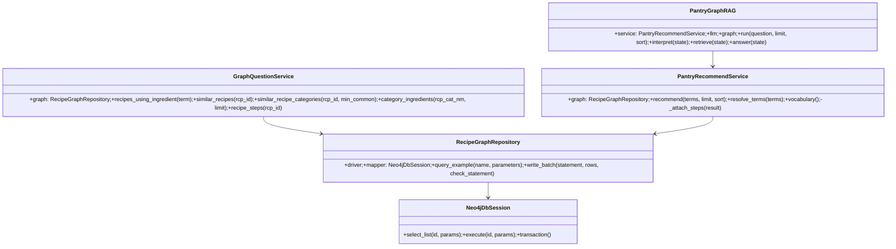
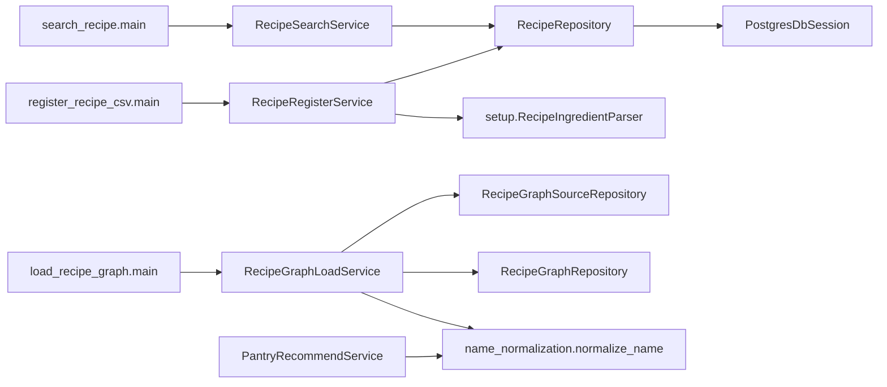

# 03. 클래스·모듈 구조

[메인](README.md) · [실행 흐름](04_execution_flow.md) · [데이터 흐름](05_data_flow.md)

`streamlit_app.get_pipeline()`이 위 세 업무 객체를 만들고 `st.cache_resource`가 반환한 `PantryGraphRAG`를 재사용한다. `PantryGraphRAG.__init__`는 `_build()`로 컴파일된 그래프를 `self.graph`에 둔다. `create_llm()`은 키가 없으면 `None`을 반환한다. 모드 B의 `get_graph_question_service()`는 같은 `RecipeGraphRepository`(`rag.service.graph`)를 주입해 `GraphQuestionService`를 만들며 LangGraph·LLM을 거치지 않는다. 화면의 `session_state.outcome`은 **결과 dict** 저장소이고 그래프 객체 저장소가 아니다.

| Java 관점 | 실제 Python 객체와 생성 위치 | 차이 |
| --- | --- | --- |
| Controller 유사 | [Streamlit 모듈](../../streamlit_app.py)의 최상위 화면 코드와 `run_pipeline` | HTTP Controller 클래스가 없다. Streamlit이 스크립트를 재실행한다. |
| Service | `PantryRecommendService`(웹 모드 A), `GraphQuestionService`(웹 모드 B), `RecipeRegisterService`(등록), `RecipeSearchService`(조회), `RecipeGraphLoadService`(ETL) | 각 CLI/웹이 명시적으로 `Service(...)`를 생성한다. 컨테이너 자동 주입이 아니다. |
| Repository/DAO | `RecipeRepository`, `RecipeGraphRepository`, `RecipeGraphSourceRepository` | 소스 Repository는 SQL mapper를 거치지 않고 psycopg SELECT를 직접 실행한다. |
| DB 세션 | `PostgresDbSession`, `Neo4jDbSession` | 둘 다 `QuerySession` 계약을 구현하지만 반환·트랜잭션의 세부 의미는 다르다. |
| DTO/상태 | `RecipeLoadPlan`, `RecipeLoadResult`, `GraphSourceSnapshot`, `PreparedGraph`, `PantryResult`, `Recommendation`, `RecipeStep`, `GraphQuestion`, `GraphAnswer`는 dataclass; `PantryState`는 `TypedDict` | `TypedDict`는 런타임 인스턴스 클래스가 아니라 dict의 타입 표기다. |
| 구조화 LLM 출력 | `IngredientTerms`, `RecipeReason`, `PantryAnswer`는 Pydantic `BaseModel` | 외부 응답의 필드를 파싱하는 스키마이며 DB entity가 아니다. |

등록 CLI·Parser·등록 Service와 그래프 적재 CLI·스냅샷 Repository·적재 Service는 `recipe_recommender.setup`에 있다. 두 업무 경로가 공유하는 `RecipeRepository`, `RecipeGraphRepository`, DB 연결, mapper 파일은 `recipe_recommender` 최상위에 있다. 추천 Service와 LangGraph는 [공용 이름 정규화](../../recipe_recommender/name_normalization.py)를 직접 import하며 `setup`에 의존하지 않는다.

생성자 위치: 등록·조회 CLI는 `create_recipe_sql_session()` 후 각각 Service를 생성하고, Service 생성자가 `RecipeRepository(sql_session)`를 만든다. 적재 CLI는 `RecipeGraphRepository()`와 `RecipeGraphSourceRepository()`를 만들고 `RecipeGraphLoadService(source, graph)`에 주입한다. Graph Repository 생성자는 `Neo4jDbSession`과 필요하면 드라이버를 만든다.

모듈 수준 함수는 객체 없이 `split_terms(text)`, `normalize_name(value)`, `validate_answer(raw, result, vocabulary)`처럼 호출한다. 클래스 메서드는 `self`로 생성자에서 받은 의존성과 캐시를 사용한다. `@staticmethod`인 CSV 읽기·검증 함수는 클래스 아래에 배치됐지만 `self`를 사용하지 않는다. `@dataclass`는 필드 기반 생성자 등을 제공하고, `@property`는 `result.owned_ingredients`처럼 괄호 없는 계산 속성을 만든다.

`common.QuerySession`은 Java 인터페이스/추상 클래스에 가깝지만, 업무 Service가 이 타입으로 완전히 추상화된 것은 아니다. 예를 들어 적재 서비스는 `RecipeGraphRepository`의 구체 메서드에 의존하고, 추천 Service도 `graph.mapper`에 직접 접근한다. 자세한 호출은 [실행 흐름](04_execution_flow.md)을 따른다.
