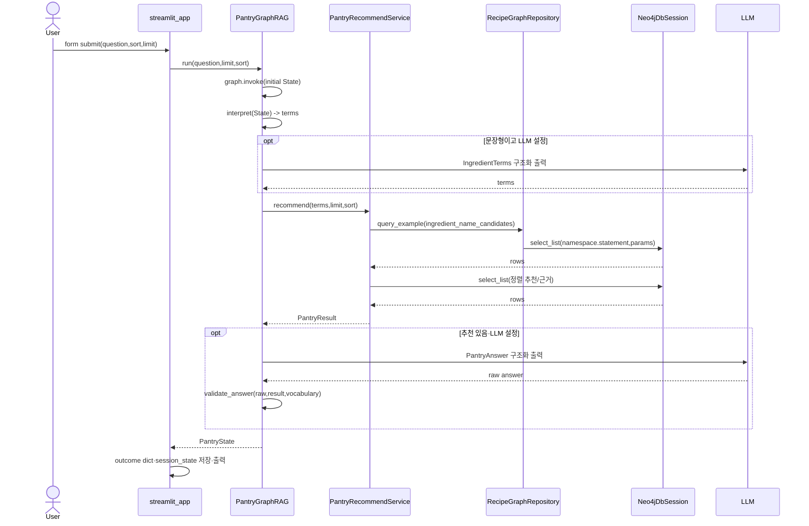
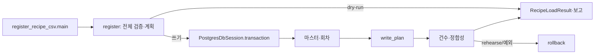
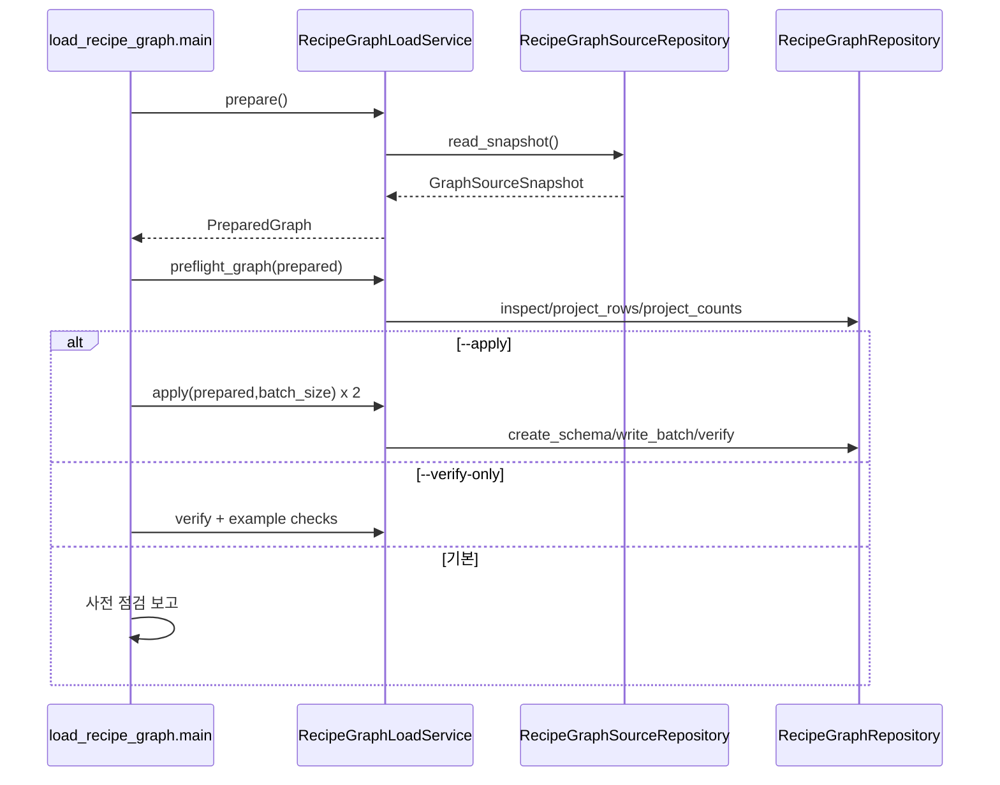

# 04. 실행 및 호출 구조

[메인](README.md) · [데이터 흐름](05_data_flow.md) · [파일 인덱스](02_file_structure.md)

화살표는 직접 호출, `→ mapper → DB`는 세션을 거친 실행을 뜻한다. Streamlit/LangGraph가 함수를 호출하는 지점은 프레임워크 콜백이다. 명령은 설명용이며 이 문서 작성 과정에서는 실행하지 않았다.

## A. 웹 시작, 객체 생성, 질문과 결과

1. Streamlit이 [streamlit_app.py](../../streamlit_app.py)를 실행한다. 모듈 최상위에서 `TASK_DIR`를 `sys.path`에 넣고, `st.secrets`의 **존재하는** 키를 `os.environ.setdefault`로 옮긴 뒤 `load_project_environment()`가 Git 루트 `.env`를 `override=False`로 읽는다. 환경변수 기존 값이 우선한다.
2. 화면·폼을 선언하고 `get_pipeline()`을 호출한다. `@st.cache_resource` 때문에 반환한 객체를 앱 프로세스에서 재사용한다. 이 함수는 `RecipeGraphRepository()` → `create_neo4j_driver()`/`Neo4jDbSession(...)` → `driver.verify_connectivity()` → `PantryRecommendService(graph)` → `create_llm()` → `PantryGraphRAG(...)` 순으로 만든다. `PantryGraphRAG.__init__`가 `_build()`에서 `StateGraph(PantryState)`를 `compile()`한다.
3. 제출 시 공백만 있는 질문은 중단한다. `run_pipeline(rag, question, limit, sort)`가 `rag.run(...)`을 호출한다. 예외는 화면의 제출 `try/except`에서 표시하고 `outcome`을 지운다. 연결 예외는 별도 `try/except` 후 `st.stop()`이다.
4. `run()`은 `graph.invoke({"question", "limit", "sort", "warnings": []})`를 수행한다. 프레임워크가 등록된 bound method `interpret`, `retrieve`, `answer`를 차례로 호출한다. 조건 Edge는 없다. 각 Node는 바뀐 필드만 dict로 돌려주고 State에 병합된다.
5. `interpret`: `split_terms()`로 구분자 분리. 짧은 목록이면 `rule`. 문장이면 선택적으로 `llm.with_structured_output(IngredientTerms).invoke(...)`와 `terms_in_question()`을 사용한다. LLM 미설정·실패·빈 추출이면 `_interpret_without_llm()`이 `service.vocabulary()`의 이름·별칭을 문장에 대조하고, 없으면 규칙 결과를 쓴다.
6. `retrieve`: `service.recommend(terms, limit, sort)`. `resolve_terms()`가 각 입력어마다 `ingredient_name_candidates`를 조회하고, 유효어가 있으면 정렬별 추천 쿼리와 추천별 `graphrag_context`를 조회한다. 이어서 `_attach_steps()`가 `recipe_steps`를 한 번 조회해 조리 과정을 붙인다. `PantryResult`를 반환한다. 추천 경로의 DB 예외는 Node가 삼키지 않지만, 조리 과정 조회 예외만은 `step_error`로 남기고 추천을 계속한다.
7. `answer`: `grounded_summary/reason` 대체 답을 먼저 만든다. 추천이 없거나 LLM이 없으면 그대로 반환한다. 그 외 `build_context()`의 DB 근거를 JSON으로 프롬프트에 넣고 `llm.with_structured_output(PantryAnswer).invoke(...)`를 호출한다. 호출 오류는 `failed` 대체 답, 성공은 `validate_answer()`로 ID·DB 어휘를 검사해 `ok` 또는 `partial`을 반환한다.
8. `run_pipeline`은 `PantryResult.to_dict()`와 `answer`, `terms`, `warnings`를 화면용 dict로 바꿔 `st.session_state.outcome`에 저장한다. 화면은 입력 해석 표, 추천 카드(대표 이미지·조리 과정 펼침 포함), 출처 배지, 근거 JSON을 출력한다. 상세는 [Streamlit](details/01_streamlit.md), [LangGraph](details/02_langgraph.md), [추천 Service](details/03_recommend_service.md).

**직접 호출 주의:** `PantryRecommendService._query()`는 `recipe_graph_queries.*`를 `graph.query_example()`로 보내지만 `pantry_graphrag.*`는 `graph.mapper.select_list()`를 **직접** 호출한다. 도식의 두 경로를 하나의 Repository 메서드로 오해하지 않는다.

### A-2. 모드 B: 그래프 관계 탐색

1. 화면 상단 `사용 모드`가 `graph`이면 `show_graph_explorer()`를 호출하고 `st.stop()`한다. 모드 A의 폼·추천 코드는 실행되지 않는다.
2. `get_graph_question_service()`(`@st.cache_resource`)가 `get_pipeline().service.graph`를 주입해 `GraphQuestionService`를 만든다. 선택지는 `recipe_options()`·`category_options()`로 한 번만 조회한다.
3. 질문 라디오와 폼(`graph_inputs`)에서 대상을 고르고 제출하면 `run_graph_question()`이 `recipes_using_ingredient`/`similar_recipes`/`similar_recipe_categories`/`category_ingredients`/`recipe_steps` 중 하나를 호출한다.
4. Service `_query()`가 `ALLOWED_STATEMENTS`를 확인하고 `recipe_graph_queries.*`는 `graph.query_example`, `graph_questions.*`는 `graph.mapper.select_list`로 실행한다(읽기 전용). Q1은 먼저 `ingredient_name_candidates`로 입력어를 해석하고 없으면 레시피 쿼리를 실행하지 않는다.
5. `GraphAnswer`를 `st.session_state.graph_answer`에 저장하고 `show_graph_answer()`가 hop·관계 경로·표를 표시한다(실행 Cypher는 `RECIPE_QUERY_LOG=1`일 때 터미널 로그로만 확인). DB 예외는 `show_graph_explorer()`의 `try/except`가 `st.error`로 표시한다. 상세는 [그래프 관계 탐색](details/06_graph_questions.md).

## B. PostgreSQL CSV 등록 CLI

[register_recipe_csv.main](../../recipe_recommender/setup/register_recipe_csv.py) → `parse_args` → `load_project_environment` → `create_recipe_sql_session` → `RecipeRegisterService(sql_session)` → `register(csv_path, limit, dry_run, rehearse)` → `RecipeRepository` → `PostgresDbSession` → [recipe.sql](../../recipe_recommender/recipe.sql) → PostgreSQL. 결과는 `RecipeLoadResult`이며 `print_report` 후 종료 코드 `0`/검증 오류 `1`/DB 오류 `2`/정합성 위반 `3`이다.

`register()` 내부 순서는 `check_target_model` → `read_csv` → **전체 CSV** `validate_rows` → seed·조리 코드 확인 → `build_plan` → dry-run이면 반환이다. 쓰기라면 `with sql_session.transaction():` 안에서 `register_reference_masters` → `register_ingredient_master` → `resolve_batch` → 실제 ID로 `build_plan` 재작성 → `write_plan` → 회차 건수·테이블 건수·정합성 집계다. `write_plan`은 원본 → 레시피 → 분류 관계 → 조리 단계 → 재료 staging → 정확 일치 자동 승인 → 최종 사용 관계 순서다. 예외는 PG 세션이 rollback한다. `--rehearse`는 내부 `RehearsalRollback`으로 rollback한 보고서를 돌려준다. 기본 옵션(범위 미지정)은 dry-run이며 `--limit`/`--full`은 실제 쓰기 경로다. [상세](details/05_data_pipeline.md).

## C. PostgreSQL 조회 CLI

[search_recipe.main](../../recipe_recommender/search_recipe.py) → `create_recipe_sql_session` → `RecipeSearchService(sql_session)` → 조건 분기. 상세(`--rcp-seq`/`--rcp-id`)는 `get_recipe_detail` → Repository `find_recipe_detail` → 찾으면 `list_recipe_steps`, `list_recipe_ingredients`, `list_recipe_unmatched_stagings`. 식재료(`--ingredient`)는 `search_recipes_by_ingredient` → `find_ingredient` → 이름/별칭 정확 일치와 별칭 목록 → 사용 레시피 count/list. 그 밖 이름·분류·방법은 `search_recipes` → count/list. 모든 Repository 조회는 `recipe.<name>` SQL로 간다. `RecipeSearchError`는 CLI가 코드 `1`로 처리하고, 없는 상세/식재료는 `3`; `finally`가 DB pool을 닫는다. 일반 DB 예외를 잡는 별도 `except`는 없다.

## D. PostgreSQL → Neo4j 적재 CLI

[load_recipe_graph.main](../../recipe_recommender/setup/load_recipe_graph.py) → `RecipeGraphRepository()`/`RecipeGraphSourceRepository()` → `RecipeGraphLoadService(source, graph)` → `prepare()` → `source.read_snapshot()`(PG `REPEATABLE READ READ ONLY` 트랜잭션) → 키·참조·별칭 검증 및 `PreparedGraph` → `preflight_graph()`(기존 그래프·스키마 대조). 기본은 여기서 JSON 보고 후 종료한다. `--verify-only`면 `verify`/대표 예제·쿼리·검색 시나리오를 추가 조회한다. `--apply`면 `apply()`를 **같은 준비된 스냅샷으로 두 번** 호출해 멱등성을 비교하고 대표 사례를 검증한다.

`apply`는 재사전점검 → 적재 Cypher `EXPLAIN` → 제약·인덱스 생성 → 노드 세 종류 → 관계 두 종류 순으로 `write_batch`한다. 부모 검사와 `MERGE`는 각 배치의 Neo4j 트랜잭션이다. **배치별로 commit되므로** 중간 실패 시 앞선 배치는 남을 수 있다. `finally`가 소유 드라이버를 닫고 `except`는 `safe_error`를 표시하며 종료 코드 `1`을 반환한다. [상세](details/05_data_pipeline.md).

