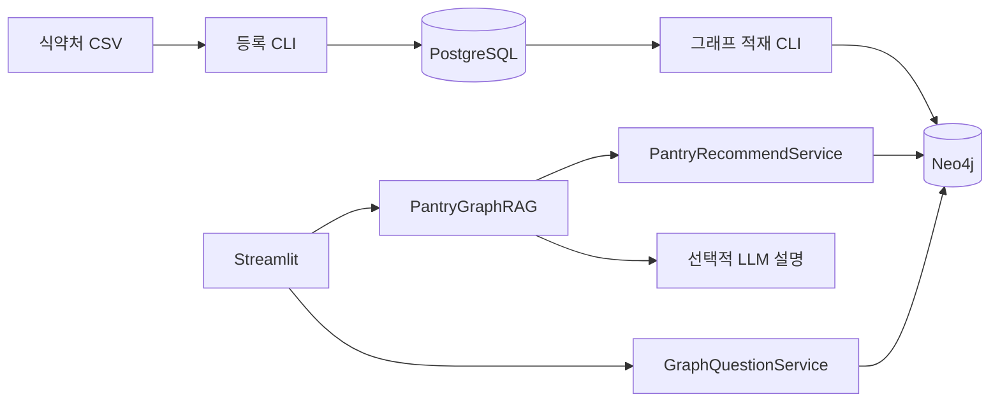

# 레시피 GraphRAG 개발자 가이드

이 문서는 **이 폴더를 프로젝트 루트**로 삼는다. 기준은 현재 Python·SQL·Cypher 소스다. [기존 학습 문서](../study/recipe_source_guide_ko.md)와 [인수인계 기록](../handoff/graphrag_mvp_handoff_20261023.md)은 배경 자료이며, 당시의 미완성 목록은 현재 구현 여부를 판단하는 근거가 아니다.

## 한눈에 보기

식약처 CSV를 PostgreSQL `recipe` 스키마에 등록하고, 그 결과를 Neo4j의 `rcp`·`ingr`·`rcp_cat`·`rcp_step` 노드와 세 관계로 적재한다. Streamlit 화면은 두 모드다. 모드 A는 사용자의 보유 재료를 받아 Neo4j 조회 결과로 추천하고, 로컬 쿼리 로그가 켜진 경우에만 첫 추천 레시피를 PostgreSQL에서 추가로 읽어 SQL 로그를 확인한다(화면 결과에는 사용하지 않음). 모드 B는 과제 질문 Q1~Q5(1·2·3-hop)를 고정 Named Cypher로 조회한다(LLM 미사용). LangGraph가 입력 해석, 검색, 설명 생성을 순서대로 실행한다. LLM은 추천 이유와 요약 문장에만 관여하며, 레시피와 사용·부족 재료, 대표 이미지·조리 과정·단계 이미지(식약처 원본)는 DB 조회 결과다.

| 기술 | 현재 코드에서 하는 일 |
| --- | --- |
| Python | CLI, Service·Repository, 데이터 변환 |
| Streamlit | 입력 폼, 결과·근거 표시, 프로세스 내 파이프라인 캐시 |
| PostgreSQL / psycopg / aiosql | CSV 원본·정제 모델 저장, 명명 SQL 실행 |
| Neo4j / Cypher | 레시피 관계 저장, 별칭·추천·근거 조회 |
| LangGraph | `interpret → retrieve → answer` 상태 전달 |
| LangChain OpenAI / Pydantic | 구조화된 식재료·설명 출력; 키가 없으면 규칙 기반 처리 |

## 처음 읽는 순서

1. [폴더 구조](01_directory_structure.md)에서 경계 확인
2. [실행 및 호출 구조](04_execution_flow.md)에서 자신이 수정할 경로 추적
3. [데이터 흐름](05_data_flow.md)에서 객체와 키 확인
4. [패키지·모듈 인덱스](02_file_structure.md)와 [API Reference](api/README.md)에서 클래스·메서드 및 실제 소스로 이동
5. [클래스·모듈 구조](03_component_structure.md)와 아래 상세 가이드로 메서드 확인

## 모든 가이드

| 문서 | 찾을 내용 |
| --- | --- |
| [01 폴더 구조](01_directory_structure.md) | 코드·설정·데이터·문서 구분 |
| [02 패키지·모듈 인덱스](02_file_structure.md) | 패키지별 모듈과 원본 소스 링크 |
| [API Reference](api/README.md) | 패키지·클래스·메서드 상세와 전체 색인 |
| [03 컴포넌트 구조](03_component_structure.md) | 객체 생성·의존 관계, Java와 비교 |
| [04 실행 흐름](04_execution_flow.md) | 웹·등록·조회·적재 실제 호출 순서 |
| [05 데이터 흐름](05_data_flow.md) | State, DTO, 조회 행, 화면 dict |
| [Streamlit 상세](details/01_streamlit.md) | 화면·캐시·오류·세션 상태 |
| [LangGraph 상세](details/02_langgraph.md) | Node, Edge, LLM 검증·대체 |
| [추천 Service 상세](details/03_recommend_service.md) | 입력어 해석·추천 결과 |
| [Neo4j Repository 상세](details/04_neo4j_repository.md) | 드라이버·mapper·Cypher |
| [데이터 파이프라인 상세](details/05_data_pipeline.md) | CSV→PostgreSQL→Neo4j, 조회 CLI |
| [그래프 관계 탐색 상세](details/06_graph_questions.md) | 모드 B, 과제 질문 Q1~Q5, hop 판정 |
| [쿼리 로그 검증 보고서](details/07_query_log_verification.md) | PostgreSQL·Neo4j 로그 복사 재실행, 타입별 렌더링, 마스킹, 제한 사항 |
| [과제 제출물](../assignment/README.md) | 질문지·Cypher 결과·검증 보고·제출용 노트북 |

## 실행 진입점

아래는 **실행 안내**이며 문서 작업에서는 실행하지 않았다. 명령의 현재 디렉터리는 이 프로젝트 루트다.

| 경로 | 명령 / 기본 동작 |
| --- | --- |
| [streamlit_app.py](../../streamlit_app.py) | `python -m streamlit run streamlit_app.py` — 개발용 SQL/Cypher 터미널 로그: 로컬(.env 있음) 기본 켜짐, Cloud 기본 꺼짐, `RECIPE_QUERY_LOG=0/1`로 지정 |
| [register_recipe_csv.py](../../recipe_recommender/setup/register_recipe_csv.py) | `python -m recipe_recommender.setup.register_recipe_csv` — 범위 미지정 시 dry-run |
| [search_recipe.py](../../recipe_recommender/search_recipe.py) | `python -m recipe_recommender.search_recipe --rcp-seq 28` — 조회 |
| [load_recipe_graph.py](../../recipe_recommender/setup/load_recipe_graph.py) | `python -m recipe_recommender.setup.load_recipe_graph` — 기본 사전 점검, 쓰기는 `--apply` |
| [main.py](../../recipe_recommender/main.py) | scaffold 메시지만 출력; 통합 진입점 아님 |

실제 접속 값은 문서화하지 않는다. 필요한 환경변수 이름과 로드 순서는 [Streamlit 상세](details/01_streamlit.md)와 [데이터 파이프라인 상세](details/05_data_pipeline.md)에 있다.
